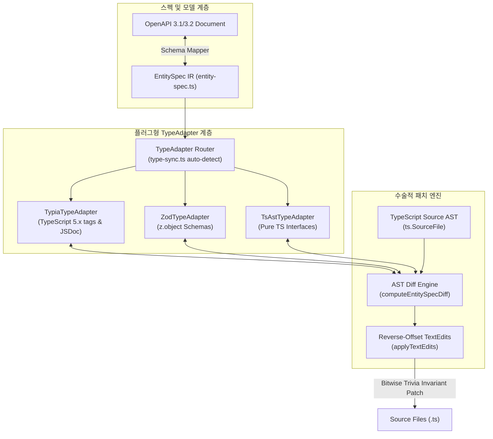
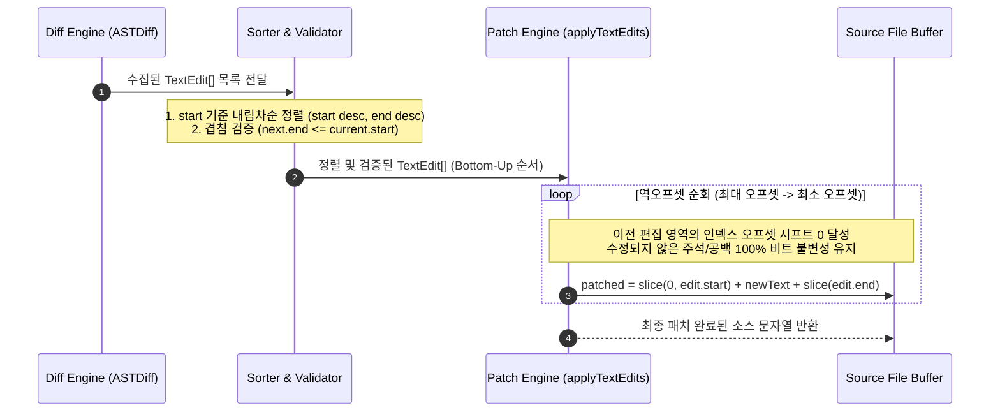
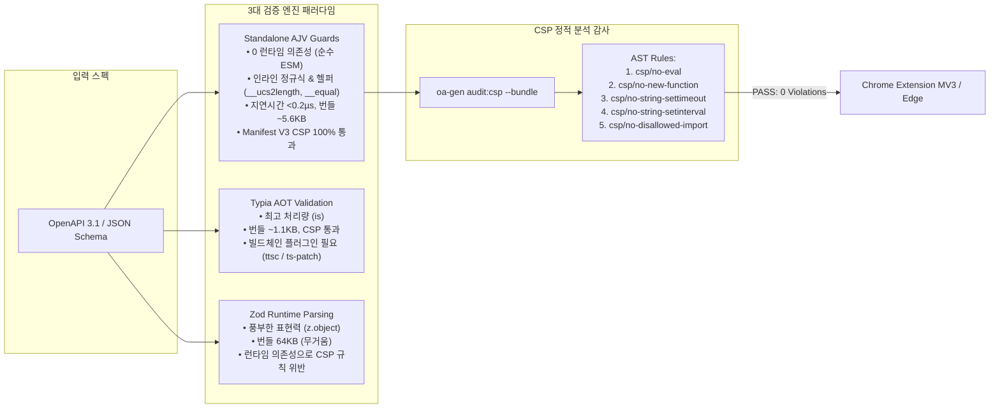

# TypeScript AST Codegen & Type Sync Engine (`@oa-sdk/codegen`)

`@oa-sdk/codegen`는 `oa-sdk` 모노레포의 핵심 코드 생성 및 양방향 AST 동기화 엔진입니다. OpenAPI 3.1/3.2 스펙과 TypeScript 소스 코드 간의 무손실 변환(Zero-Loss Transformation), 비트 단위 포맷팅 보존(Bitwise Trivia Invariance), 플러그형 타입 어댑터(Typia, Zod, TS AST), Manifest V3 CSP 준수 정적 분석(`oa-gen audit:csp`) 및 고성능 독립형 타입 가드(Standalone AJV Guards) 생성을 담당합니다.

---

## 🏛️ 아키텍처 토폴로지 (Architecture Topology)

### 1. AST 양방향 동기화 및 중간 표현(IR) 파이프라인



### 2. 역오프셋(Reverse-Offset) 패치 엔진 메커니즘



### 3. 검증 엔진 삼각 구도 및 Manifest V3 CSP 감사 파이프라인



---

## 🧩 1. EntitySpec IR 기반 AST 양방향 동기화

`packages/codegen/src/ast-sync/entity-spec.ts`에 정의된 `EntitySpec`은 TypeScript 소스 코드와 OpenAPI 스키마 간의 무손실 중간 표현(IR, Intermediate Representation)입니다.

### 1.1 핵심 데이터 구조

```typescript
export interface PropertyConstraint {
  min?: number | undefined;
  max?: number | undefined;
  minimum?: number | undefined;
  maximum?: number | undefined;
  exclusiveMinimum?: number | undefined;
  exclusiveMaximum?: number | undefined;
  minLength?: number | undefined;
  maxLength?: number | undefined;
  pattern?: string | undefined;
  format?: string | undefined;
  default?: unknown;
  email?: boolean | undefined;
  url?: boolean | undefined;
  uuid?: boolean | undefined;
  cuid?: boolean | undefined;
  datetime?: boolean | undefined;
  int?: boolean | undefined;
  positive?: boolean | undefined;
  nonnegative?: boolean | undefined;
  negative?: boolean | undefined;
  nonpositive?: boolean | undefined;
  multipleOf?: number | undefined;
  enum?: (string | number | boolean)[] | undefined;
  [key: string]: unknown;
}

export interface EntityPropertySpec {
  name: string;
  type: string;
  optional?: boolean | undefined;
  nullable?: boolean | undefined;
  docComment?: string | undefined;
  defaultValue?: unknown;
  constraints?: PropertyConstraint | undefined;
  metadata?: Record<string, unknown> | undefined;
  sourceSpan?: { start: number; end: number } | undefined;
}

export interface EntitySpec {
  id: string;
  name: string;
  kind: 'schema' | 'interface' | 'type-alias' | 'object-literal' | 'node';
  docComment?: string | undefined;
  properties: Record<string, EntityPropertySpec>;
  extends?: string[] | undefined;
  discriminator?: { propertyName: string; mapping?: Record<string, string> } | undefined;
  metadata?: Record<string, unknown> | undefined;
  sourceSpan?: { start: number; end: number } | undefined;
}
```

### 1.2 시맨틱 구조 차이 계산 (`computeEntitySpecDiff`)

`diff-engine.ts`는 기존 코드에서 파싱된 `EntitySpec`과 타겟 `EntitySpec`을 비교하여 국소적 차이점(`ASTDiff`)을 식별합니다:
- `add-property`: 새로 추가된 프로퍼티 (타입 및 제약조건 포함).
- `update-property`: 기존 프로퍼티의 타입, nullability, optionality 또는 제약조건 변경.
- `remove-property`: 제거 대상 프로퍼티.
- `rename-property`: 식별자 이름 변경.

---

## ✂️ 2. Trivia & 포맷팅 보존: 역오프셋 TextEdits 패치 엔진

코드 생성기가 기존 소스 코드를 패치할 때 가장 흔히 발생하는 문제는 **주석 손실, 들여쓰기 훼손, trailing comma 파괴, 문자 인덱스 시프트**입니다. `@oa-sdk/codegen`은 `packages/codegen/src/ast-sync/text-edit.ts`의 `applyTextEdits`를 통해 이를 수학적으로 완벽하게 방지합니다.

### 2.1 불변성 보장 알고리즘 (Invariants)

1. **내림차순 정렬 (Descending Offset Sort)**:
   모든 `TextEdit`를 시작 오프셋 내림차순(`b.start - a.start`), 동일 오프셋인 경우 끝 오프셋 내림차순(`b.end - a.end`)으로 정렬합니다.
   ```typescript
   const sortedEdits = [...edits].sort((a, b) => {
     if (b.start !== a.start) return b.start - a.start;
     return b.end - a.end;
   });
   ```
2. **0 오프셋 시프트 (Zero Offset Shift)**:
   가장 높은 문자 오프셋(파일의 끝부분)부터 가장 낮은 오프셋(파일의 앞부분) 방향으로 거꾸로 패치를 적용(Bottom-Up)하므로, 앞선 오프셋들의 절대 위치가 전혀 변경되지 않습니다. 인덱스 재계산 루프가 필요 없습니다.
3. **비중첩 범위 엄격 검증 (Non-Overlapping Range Validation)**:
   연속된 편집 영역에 대해 `next.end <= current.start` 불변식을 검증합니다. 만약 `next.end > current.start`이면 즉시 예외를 던져 코드 오염을 사전에 방지합니다:
   ```typescript
   if (next.end > current.start) {
     throw new Error(`Overlapping text edit ranges: [${next.start}, ${next.end}] overlaps with [${current.start}, ${current.end}]`);
   }
   ```
4. **비트 단위 트 trivia 보존 (Bitwise Trivia Invariance)**:
   수정 대상 범위 외의 모든 문자열(선행/후행 공백, 주석, 줄바꿈, JSDoc)은 단 1바이트의 변화도 없이 원본 그대로 유지됩니다.
5. **수술적 프로퍼티 시그니처 갱신 (Surgical Property Patch)**:
   `TypiaTypeAdapter.patch`에서 프로퍼티의 JSDoc이 변경되지 않은 경우(`!jsdocChanged`), JSDoc 블록을 건드리지 않고 프로퍼티 시그니처 범위(`propNode.getStart(sourceFile)` ~ `propNode.getEnd()`)만 교체합니다.

---

## 🔌 3. 플러그형 TypeAdapter 아키텍처

`packages/codegen/src/ast-sync/adapter-interface.ts`는 모든 타입 어댑터가 구현해야 하는 표준 규격을 정의합니다:

```typescript
export interface TypeAdapter<TSource = string, TTarget = string> {
  readonly name: string;
  readonly supportedDialects: string[];
  read(source: TSource): EntitySpec;
  parse(source: TSource): EntitySpec;
  write(spec: EntitySpec, originalSource?: TSource): TTarget;
  emit(spec: EntitySpec, originalSource?: TSource): TTarget;
  diff?(a: EntitySpec, b: EntitySpec): ASTDiff[];
  patch?(originalSource: string, targetSpec: EntitySpec, diffs?: ASTDiff[]): string | TextEdit[];
}
```

### 3.1 어댑터 자동 감지 규칙 (`packages/codegen/src/ast-sync/type-sync.ts`)

`syncEntitySpecWithCode(existingCode, targetSpec, options)` 호출 시 `options.adapter`가 지정되지 않으면 코드를 정적 분석하여 어댑터를 자동 선택합니다:

| 어댑터 | 정규식 패턴 및 감지 조건 | 대상 코드 예시 |
|---|---|---|
| `ZodTypeAdapter` | `z\.object` 또는 `/from\s+['"]zod['"]/` | `export const UserSchema = z.object({ ... });` |
| `TypiaTypeAdapter` | `@minimum`, `@maximum`, `@format`, `@default`, `/\b(?:tags\.|typia\.tags\.)/i`, 또는 `/from\s+['"]typia(?:\/.*)?['"]/` | `interface User { age: number & tags.Minimum<0>; }` |
| `TsAstTypeAdapter` | 기본 폴백 (Fallback) | 순수 TypeScript 인터페이스/타입 선언 |

---

## 🏷️ 4. Typia AOT 타입 레벨 태그 AST 파싱 및 역방향 생성

`TypiaTypeAdapter`(`packages/codegen/src/ast-sync/adapters/typia.ts`)는 TypeScript 5.x의 타입 레벨 교차 태그(`ts.IntersectionTypeNode`)를 파싱하여 정규화된 제약조건(`PropertyConstraint`)으로 추출하고, 역방향으로 완벽한 TS 인터페이스로 복원합니다.

### 4.1 파싱 지원 태그 목록

| Typia 5.x 태그 | 추출되는 `PropertyConstraint` 필드 | 비고 |
|---|---|---|
| `tags.Type<'int32'>` | `{ type: 'int32', int: true }` | 정수형 타입 제약 |
| `tags.Minimum<N>` | `{ minimum: N, min: N }` | 음수 bounds 지원 (`tags.Minimum<-50>`) |
| `tags.Maximum<N>` | `{ maximum: N, max: N }` | 상한 bounds |
| `tags.ExclusiveMinimum<N>` | `{ exclusiveMinimum: N }` | 초과 bounds |
| `tags.ExclusiveMaximum<N>` | `{ exclusiveMaximum: N }` | 미만 bounds |
| `tags.Format<'uuid'>` | `{ format: 'uuid', uuid: true }` | email, uri, date-time 등 매핑 |
| `tags.Pattern<'^[a-z]+$'>` | `{ pattern: '^[a-z]+$' }` | 정규식 패턴 (역슬래시 이스케이프 지원) |
| `tags.MinLength<N>` | `{ minLength: N }` | 문자열 최소 길이 |
| `tags.MaxLength<N>` | `{ maxLength: N }` | 문자열 최대 길이 |
| `tags.MultipleOf<N>` | `{ multipleOf: N }` | 배수 제약 |
| `tags.Default<V>` | `{ default: V }` | 기본값 |

### 4.2 음수 수치 파싱 메커니즘 (`parseTagArgument`)

TypeScript AST에서 음수 리터럴은 `ts.NumericLiteral`이 아니라 `ts.PrefixUnaryExpression`(`MinusToken`)으로 표현됩니다. 이를 처리하지 않으면 음수 경계(`tags.Minimum<-50>`)가 `NaN` 또는 양수로 잘못 파싱됩니다:

```typescript
if (ts.isPrefixUnaryExpression(lit)) {
  if (lit.operator === ts.SyntaxKind.MinusToken && ts.isNumericLiteral(lit.operand)) {
    return -Number(lit.operand.text); // 올바른 음수 값 반환
  }
  if (lit.operator === ts.SyntaxKind.PlusToken && ts.isNumericLiteral(lit.operand)) {
    return Number(lit.operand.text);
  }
}
```

### 4.3 괄호로 감싸진 Nullable 유니온 처리

`(string & tags.Format<'uuid'>) | null`과 같은 타입은 `ts.isUnionTypeNode` 내부에 `ts.isParenthesizedTypeNode`가 감싸진 구조입니다.
- `elem.kind === ts.SyntaxKind.NullKeyword`를 감지하여 `nullable = true`를 세팅합니다.
- `ts.isParenthesizedTypeNode`를 언래핑하여 내부의 `ts.IntersectionTypeNode`를 추출합니다.

### 4.4 역방향 방출 규격 (`formatTypeLevelTags`)

1. **배열 스칼라 제약조건 보호**:
   배열 타입(`T[]`, `Array<T>`)에는 스칼라 문자열/숫자 태그(`minLength`, `minimum`)가 인터페이스 레벨에 붙지 않도록 차단합니다:
   ```typescript
   const isArray = baseType.endsWith('[]') || baseType.startsWith('Array<');
   if (isArray) return baseType;
   ```
2. **유니온 기본 타입 괄호 감싸기**:
   기본 타입이 유니온인 경우(`User | Admin`), 연산자 우선순위 문제를 방지하기 위해 반드시 괄호로 감싼 후 인터섹션을 추가합니다:
   ```typescript
   // 결과: (User | Admin) & tags.Format<'uuid'>
   const wrappedBase = isUnion && !isAlreadyWrapped ? `(${baseType})` : baseType;
   return `${wrappedBase} & ${tagParts.join(' & ')}`;
   ```
3. **정규식 문자열 역슬래시 이스케이프**:
   `Pattern<'...'>` 출력 시 역슬래시가 증발하지 않도록 `replace(/\\/g, '\\\\')` 처리를 수행합니다.

---

## 🛡️ 5. Zero-Eval CSP 강제 및 독립형 AJV 가드

브라우저 확장 프로그램(Chrome Extension Manifest V3)이나 고보안 샌드박스 환경에서는 `eval()` 및 `new Function()` 실행이 엄격히 금지됩니다.

### 5.1 CSP 감사 AST 규칙 (`oa-gen audit:csp`)

`packages/codegen/src/cli/commands/audit-csp.ts`는 정적 AST 분석기를 통해 번들 코드를 5가지 규칙으로 엄격하게 검사합니다:

1. `csp/no-eval`:
   - `eval(...)` 직접 호출 탐지.
   - `window.eval`, `globalThis.eval`, `self.eval`, `global.eval` 속성 접근 호출 탐지.
2. `csp/no-new-function`:
   - `new Function(...)` 및 `Function(...)` 동적 코드 생성 호출 탐지.
3. `csp/no-string-settimeout`:
   - `setTimeout("stringCode", delay)` 문자열 실행 패턴 탐지.
4. `csp/no-string-setinterval`:
   - `setInterval("stringCode", delay)` 문자열 실행 패턴 탐지.
5. `csp/no-disallowed-import`:
   - 런타임 번들에 포함되어서는 안 되는 무거운 검증/파서 패키지 임포트 차단:
     `DISALLOWED_IMPORT_PATTERN = /^(ajv(-[a-z0-9_]+)?(\/.*)?|zod(\/.*)?|@oa-sdk(\/.*)?)$/`
   - 검사 대상: ESM `import`, ESM `export * from`, TS `import = require()`, CommonJS `require()`, 동적 `import()`.

### 5.2 사전 컴파일 독립형 타입 가드 (`standalone-guards/generator.ts`)

`Ajv2020`과 `ajv/dist/standalone`을 사용하여 빌드 타임에 완전한 정적 ESM 함수로 검증 코드를 사전 컴파일합니다.

#### 인라인 헬퍼 및 런타임 의존성 박멸 (`postProcessGeneratedJs`):
- `__ucs2length`: UTF-16 surrogate pair 길이를 정확히 계산하는 헬퍼 함수 인라인화.
- `__equal`: 딥 이퀄 비교 헬퍼 인라인화.
- `STANDALONE_FORMATS`: `uuid`, `email`, `uri`, `date-time`, `ipv4`, `ipv6` 등 12종의 정규식을 JS 파일 내에 상수 리터럴로 직접 인라인화.
- 모든 외부 `require()` 호출 제거 및 순수 함수 선언으로 변환:
  ```javascript
  // 생성된 결과물 (순수 ESM, 0 의존성, 0 eval)
  export function isUserProfile(data, ...args) {
    return validate10(data, ...args);
  }
  ```

### 5.3 3대 검증 엔진 비교 매트릭스

| 지표 / 기준 | Standalone AJV Guards | Typia AOT (`typia.is<T>`) | Zod Runtime Parsing |
|---|---|---|---|
| **CSP 적합성 (`audit:csp`)** | 🟢 **100% 통과 (0 violations)** | 🟢 **100% 통과 (0 violations)** | ❌ **실패 (disallowed-import)** |
| **외부 런타임 의존성** | **0개 (순수 ESM 자립)** | **0개 (바이트 인라인)** | `zod` 패키지 필요 |
| **번들 크기 (Gzip)** | **~5.6 KB** | **~1.1 KB** | **~64.0 KB** |
| **실행 지연시간 (p99)** | **< 0.2 µs** | **< 0.05 µs** | **~ 2.5 µs** |
| **빌드 체인 복잡도** | 🟢 **일반 tsc/Vite/Rollup 빌드** | ⚠️ **`ttsc` 또는 `ts-patch` 필수** | 🟢 **일반 빌드** |
| **권장 사용처** | 브라우저 익스텐션, UI 엣지 | 대규모 서버 수신, LLM 디스패치 | 동적 스키마 빌더, 폼 밸리데이션 |

---

## 💻 6. 운영 레시피 및 실무 코드 스니펫

### 6.1 TypeScript 소스 코드와 `EntitySpec` 양방향 동기화

```typescript
import { syncEntitySpecWithCode } from '@oa-sdk/codegen';
import type { EntitySpec } from '@oa-sdk/codegen';

const existingSourceCode = `
export interface UserProfile {
  id: string & tags.Format<'uuid'>;
  // 유저의 나이 (0세 이상)
  age: number & tags.Minimum<0>;
}
`;

const updatedSpec: EntitySpec = {
  id: 'UserProfile',
  name: 'UserProfile',
  kind: 'interface',
  properties: {
    id: { name: 'id', type: 'string', constraints: { format: 'uuid', uuid: true } },
    age: { name: 'age', type: 'number', constraints: { minimum: 18, min: 18 } },
    email: { name: 'email', type: 'string', optional: true, constraints: { format: 'email', email: true } },
  },
};

// 동기화 실행 (Typia 어댑터 자동 감지, reverse-offset 수술적 패치 적용)
const patchedSource = syncEntitySpecWithCode(existingSourceCode, updatedSpec);
console.log(patchedSource);
```

### 6.2 CLI 워크플로 레시피

```bash
# 1. 독립형 무런타임 타입 가드 분할 생성 (Manifest V3 배포용)
oa-gen generate --target standalone-guards --input packages/schemas/src/.merged.yaml --out-dir dist/guards --split

# 2. 생성된 번들의 Manifest V3 CSP 호환성 정적 감사 (eval / new Function / ajv 금지 검사)
oa-gen audit:csp --bundle dist/guards

# 3. OpenAPI 3.2 스펙으로부터 TypeScript 타입 정의 생성
oa-gen typegen --spec packages/schemas/src/.merged.yaml --output packages/models/src

# 4. 스펙 차이점 및 파괴적 변경사항 비교
oa-gen diff --base spec-v1.yaml --head spec-v2.yaml --fail-on-breaking
```

---

## 🔍 7. 문제 해결 매트릭스 (Troubleshooting)

| 증상 (Symptom) | 근본 원인 (Root Cause) | 해결 방법 (Remediation) |
|---|---|---|
| `Overlapping text edit ranges: [X, Y] overlaps with [A, B]` | 복수의 프로퍼티 수정 시 `TextEdit`의 범위가 겹침 | 편집 대상 범위를 상호 배타적으로 분리하거나 선행 JSDoc과 시그니처 범위를 독립 계산하여 정렬 순서 준수 확인 |
| `[csp/no-disallowed-import] Disallowed runtime import: ajv` | Standalone 가드 파일에 `require("ajv/...")`가 잔존함 | `postProcessGeneratedJs`에서 포맷 정규식 인라인화 및 `__ucs2length`/`__equal` 헬퍼 주입 여부 확인 |
| `tags.Minimum<-50>` 파싱 시 값이 `NaN` 또는 양수로 반환됨 | 음수 리터럴이 `ts.PrefixUnaryExpression`으로 래핑됨 | `parseTagArgument`에서 `MinusToken` 연산자 확인 후 `-Number(operand.text)` 반환 로직 적용 |
| 배열 프로퍼티에 `tags.MinLength` 등 스칼라 제약이 출력됨 | `formatTypeLevelTags`에서 기본 타입이 배열임을 검사하지 않음 | `baseType.endsWith('[]')` 또는 `Array<T>`인 경우 스칼라 인터섹션 태그 부착을 건너뛰도록 처리 |
| `User \| Admin & tags.Format<'uuid'>` 연산자 결합 오류 | 유니온 기본 타입에 괄호 래핑이 누락됨 | 유니온 타입 탐지 시 `(User \| Admin) & tags.Format<'uuid'>` 형태로 괄호를 강제 감싸도록 보정 |

---

## 🧪 8. 검증 및 테스트 명령어

```bash
# 1. Typia 어댑터 및 타입 레벨 태그 파싱 단위 테스트
pnpm --filter @oa-sdk/codegen test test/ast-sync/typia-adapter.test.ts

# 2. Standalone 타입 가드 E2E 및 정적 컴파일 테스트
pnpm --filter @oa-sdk/codegen test test/standalone-guards/

# 3. Manifest V3 CSP 감사 엔진 15종 단위 테스트
pnpm --filter @oa-sdk/codegen test test/audit-csp/audit-csp.test.ts

# 4. Codegen 패키지 전체 타입 체크
pnpm --filter @oa-sdk/codegen typecheck
```
