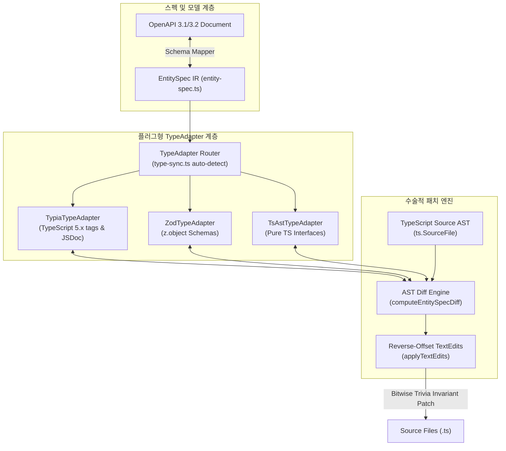
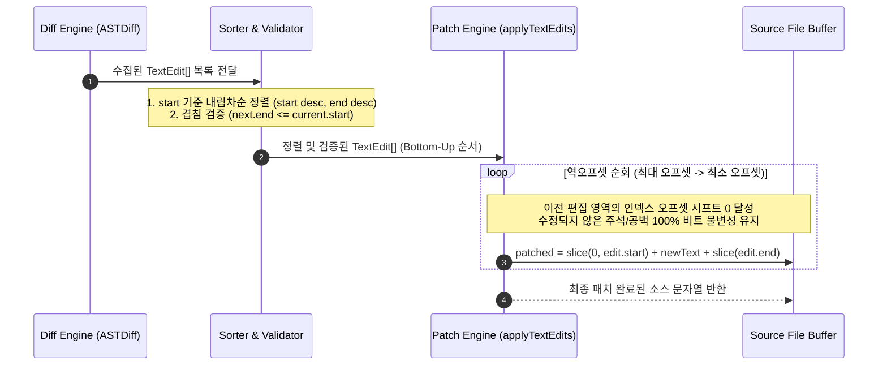
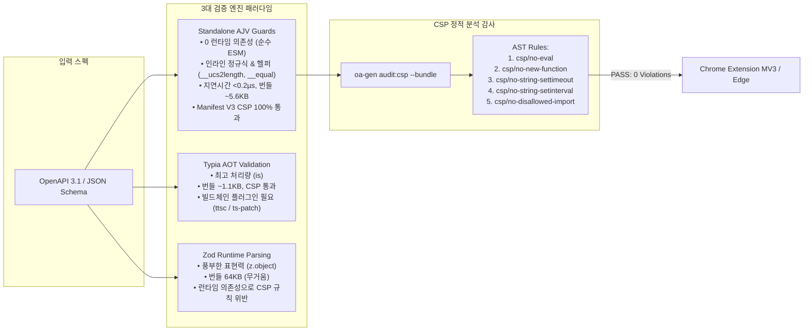

# TypeScript AST Codegen & Onboarding Engine (`@oa-sdk/codegen`)

`@oa-sdk/codegen`는 `oa-sdk` 모노레포의 핵심 코드 생성, 양방향 AST 동기화, 마찰 제로 온보딩 및 실시간 스펙 관측 엔진입니다. OpenAPI 3.1/3.2 스펙과 TypeScript 소스 코드 간의 무손실 변환(Zero-Loss Transformation), 비트 단위 포맷팅 보존(Bitwise Trivia Invariance), 플러그형 타입 어댑터(Typia, Zod, TS AST), 타깃 분리형 대화형 온보딩 엔진(`oa-gen init`), 엄격한 런타임 격리(Strict Runtime Isolation), 실시간 무중단 핫 리로드 목 서버(`oa-gen mock --watch`), Manifest V3 CSP 준수 정적 분석(`oa-gen audit:csp`) 및 고성능 독립형 타입 가드(Standalone AJV Guards) 생성을 담당합니다.

---

## 🏛️ 아키텍처 토폴로지 (Architecture Topology)

### 1. AST 양방향 동기화 및 중간 표현(IR) 파이프라인



### 2. 역오프셋(Reverse-Offset) 패치 엔진 메커니즘



### 3. 검증 엔진 삼각 구도 및 Manifest V3 CSP 감사 파이프라인



### 4. 타깃 분리형 온보딩 엔진 및 실시간 스펙 관측 파이프라인

```mermaid
graph TD
    subgraph Onboarding [타깃 분리형 온보딩 엔진 (oa-gen init)]
        InitCLI["oa-gen init\n(--target, --spec, --yes, --force, --dry-run)"]
        TargetRouter["Target Profile Router\n(getTargetProfile / detectTargetProfile)"]
        SchemaDet["Recursive Schema Detector\n(common/schema-detector.ts)"]
        PkgPatcher["Non-Destructive Package Patcher\n(common/package-patcher.ts)"]
    end

    subgraph TargetProfiles [6대 프레임워크 타깃 전략 (Strategy Pattern)]
        direction TB
        P_Fastify["FastifyProfile (Node ESM / tsx watch / JIT schema)"]
        P_Elysia["ElysiaProfile (Bun Native / bun --watch / zero Node tools)"]
        P_Hono["HonoProfile (Bun or Node lockfile detection)"]
        P_Express["ExpressProfile (Node ESM / tsx watch / @types/express)"]
        P_NestJS["NestJsProfile (Nest CLI / generic contract target)"]
        P_Generic["GenericProfile (Standalone contract fallback)"]
    end

    subgraph LiveWatch [실시간 무중단 핫 리로드 파이프라인 (oa-gen mock --watch)]
        SpecWatch["Spec Watcher (spec-watcher.ts)\n• .yaml, .json, .tsp, @oaOperation .ts\n• 100ms Debouncing & Error Shielding"]
        AtomicSwap["Atomic Route Swapping\nserver.updateSpec(newDoc)\n• 0 Socket Disconnects & 0 Process Restarts"]
    end

    InitCLI --> TargetRouter
    InitCLI --> SchemaDet
    TargetRouter --> P_Fastify
    TargetRouter --> P_Elysia
    TargetRouter --> P_Hono
    TargetRouter --> P_Express
    TargetRouter --> P_NestJS
    TargetRouter --> P_Generic

    TargetProfiles --> PkgPatcher
    PkgPatcher -->|Formatting/CRLF Invariant| OutputPkg["package.json & oa.config.ts"]

    SpecWatch --> AtomicSwap
```

---

## 🧩 1. EntitySpec IR 기반 AST 양방향 동기화

`packages/codegen/src/ast-sync/entity-spec.ts`에 정의된 `EntitySpec`은 TypeScript 소스 코드와 OpenAPI 스키마 간의 무손실 중간 표현(IR, Intermediate Representation)입니다.

### 1.1 핵심 데이터 구조

```typescript
export interface PropertyConstraint {
  min?: number | undefined;
  max?: number | undefined;
  minimum?: number | undefined;
  maximum?: number | undefined;
  exclusiveMinimum?: number | undefined;
  exclusiveMaximum?: number | undefined;
  minLength?: number | undefined;
  maxLength?: number | undefined;
  pattern?: string | undefined;
  format?: string | undefined;
  default?: unknown;
  email?: boolean | undefined;
  url?: boolean | undefined;
  uuid?: boolean | undefined;
  cuid?: boolean | undefined;
  datetime?: boolean | undefined;
  int?: boolean | undefined;
  positive?: boolean | undefined;
  nonnegative?: boolean | undefined;
  negative?: boolean | undefined;
  nonpositive?: boolean | undefined;
  multipleOf?: number | undefined;
  enum?: (string | number | boolean)[] | undefined;
  [key: string]: unknown;
}

export interface EntityPropertySpec {
  name: string;
  type: string;
  optional?: boolean | undefined;
  nullable?: boolean | undefined;
  docComment?: string | undefined;
  defaultValue?: unknown;
  constraints?: PropertyConstraint | undefined;
  metadata?: Record<string, unknown> | undefined;
  sourceSpan?: { start: number; end: number } | undefined;
}

export interface EntitySpec {
  id: string;
  name: string;
  kind: 'schema' | 'interface' | 'type-alias' | 'object-literal' | 'node';
  docComment?: string | undefined;
  properties: Record<string, EntityPropertySpec>;
  extends?: string[] | undefined;
  discriminator?: { propertyName: string; mapping?: Record<string, string> } | undefined;
  metadata?: Record<string, unknown> | undefined;
  sourceSpan?: { start: number; end: number } | undefined;
}
```

### 1.2 시맨틱 구조 차이 계산 (`computeEntitySpecDiff`)

`diff-engine.ts`는 기존 코드에서 파싱된 `EntitySpec`과 타겟 `EntitySpec`을 비교하여 국소적 차이점(`ASTDiff`)을 식별합니다:
- `add-property`: 새로 추가된 프로퍼티 (타입 및 제약조건 포함).
- `update-property`: 기존 프로퍼티의 타입, nullability, optionality 또는 제약조건 변경.
- `remove-property`: 제거 대상 프로퍼티.
- `rename-property`: 식별자 이름 변경.

---

## ✂️ 2. Trivia & 포맷팅 보존: 역오프셋 TextEdits 패치 엔진

코드 생성기가 기존 소스 코드를 패치할 때 가장 흔히 발생하는 문제는 **주석 손실, 들여쓰기 훼손, trailing comma 파괴, 문자 인덱스 시프트**입니다. `@oa-sdk/codegen`은 `packages/codegen/src/ast-sync/text-edit.ts`의 `applyTextEdits`를 통해 이를 수학적으로 완벽하게 방지합니다.

### 2.1 불변성 보장 알고리즘 (Invariants)

1. **내림차순 정렬 (Descending Offset Sort)**:
   모든 `TextEdit`를 시작 오프셋 내림차순(`b.start - a.start`), 동일 오프셋인 경우 끝 오프셋 내림차순(`b.end - a.end`)으로 정렬합니다.
   ```typescript
   const sortedEdits = [...edits].sort((a, b) => {
     if (b.start !== a.start) return b.start - a.start;
     return b.end - a.end;
   });
   ```
2. **0 오프셋 시프트 (Zero Offset Shift)**:
   가장 높은 문자 오프셋(파일의 끝부분)부터 가장 낮은 오프셋(파일의 앞부분) 방향으로 거꾸로 패치를 적용(Bottom-Up)하므로, 앞선 오프셋들의 절대 위치가 전혀 변경되지 않습니다. 인덱스 재계산 루프가 필요 없습니다.
3. **비중첩 범위 엄격 검증 (Non-Overlapping Range Validation)**:
   연속된 편집 영역에 대해 `next.end <= current.start` 불변식을 검증합니다. 만약 `next.end > current.start`이면 즉시 예외를 던져 코드 오염을 사전에 방지합니다:
   ```typescript
   if (next.end > current.start) {
     throw new Error(`Overlapping text edit ranges: [${next.start}, ${next.end}] overlaps with [${current.start}, ${current.end}]`);
   }
   ```
4. **비트 단위 트 trivia 보존 (Bitwise Trivia Invariance)**:
   수정 대상 범위 외의 모든 문자열(선행/후행 공백, 주석, 줄바꿈, JSDoc)은 단 1바이트의 변화도 없이 원본 그대로 유지됩니다.
5. **수술적 프로퍼티 시그니처 갱신 (Surgical Property Patch)**:
   `TypiaTypeAdapter.patch`에서 프로퍼티의 JSDoc이 변경되지 않은 경우(`!jsdocChanged`), JSDoc 블록을 건드리지 않고 프로퍼티 시그니처 범위(`propNode.getStart(sourceFile)` ~ `propNode.getEnd()`)만 교체합니다.

---

## 🔌 3. 플러그형 TypeAdapter 아키텍처

`packages/codegen/src/ast-sync/adapter-interface.ts`는 모든 타입 어댑터가 구현해야 하는 표준 규격을 정의합니다:

```typescript
export interface TypeAdapter<TSource = string, TTarget = string> {
  readonly name: string;
  readonly supportedDialects: string[];
  read(source: TSource): EntitySpec;
  parse(source: TSource): EntitySpec;
  write(spec: EntitySpec, originalSource?: TSource): TTarget;
  emit(spec: EntitySpec, originalSource?: TSource): TTarget;
  diff?(a: EntitySpec, b: EntitySpec): ASTDiff[];
  patch?(originalSource: string, targetSpec: EntitySpec, diffs?: ASTDiff[]): string | TextEdit[];
}
```

### 3.1 어댑터 자동 감지 규칙 (`packages/codegen/src/ast-sync/type-sync.ts`)

`syncEntitySpecWithCode(existingCode, targetSpec, options)` 호출 시 `options.adapter`가 지정되지 않으면 코드를 정적 분석하여 어댑터를 자동 선택합니다:

| 어댑터 | 정규식 패턴 및 감지 조건 | 대상 코드 예시 |
|---|---|---|
| `ZodTypeAdapter` | `z\.object` 또는 `/from\s+['"]zod['"]/` | `export const UserSchema = z.object({ ... });` |
| `TypiaTypeAdapter` | `@minimum`, `@maximum`, `@format`, `@default`, `/\b(?:tags\.|typia\.tags\.)/i`, 또는 `/from\s+['"]typia(?:\/.*)?['"]/` | `interface User { age: number & tags.Minimum<0>; }` |
| `TsAstTypeAdapter` | 기본 폴백 (Fallback) | 순수 TypeScript 인터페이스/타입 선언 |

---

## 🏷️ 4. Typia AOT 타입 레벨 태그 AST 파싱 및 역방향 생성

`TypiaTypeAdapter`(`packages/codegen/src/ast-sync/adapters/typia.ts`)는 TypeScript 5.x의 타입 레벨 교차 태그(`ts.IntersectionTypeNode`)를 파싱하여 정규화된 제약조건(`PropertyConstraint`)으로 추출하고, 역방향으로 완벽한 TS 인터페이스로 복원합니다.

### 4.1 파싱 지원 태그 목록

| Typia 5.x 태그 | 추출되는 `PropertyConstraint` 필드 | 비고 |
|---|---|---|
| `tags.Type<'int32'>` | `{ type: 'int32', int: true }` | 정수형 타입 제약 |
| `tags.Minimum<N>` | `{ minimum: N, min: N }` | 음수 bounds 지원 (`tags.Minimum<-50>`) |
| `tags.Maximum<N>` | `{ maximum: N, max: N }` | 상한 bounds |
| `tags.ExclusiveMinimum<N>` | `{ exclusiveMinimum: N }` | 초과 bounds |
| `tags.ExclusiveMaximum<N>` | `{ exclusiveMaximum: N }` | 미만 bounds |
| `tags.Format<'uuid'>` | `{ format: 'uuid', uuid: true }` | email, uri, date-time 등 매핑 |
| `tags.Pattern<'^[a-z]+$'>` | `{ pattern: '^[a-z]+$' }` | 정규식 패턴 (역슬래시 이스케이프 지원) |
| `tags.MinLength<N>` | `{ minLength: N }` | 문자열 최소 길이 |
| `tags.MaxLength<N>` | `{ maxLength: N }` | 문자열 최대 길이 |
| `tags.MultipleOf<N>` | `{ multipleOf: N }` | 배수 제약 |
| `tags.Default<V>` | `{ default: V }` | 기본값 |

### 4.2 음수 수치 파싱 메커니즘 (`parseTagArgument`)

TypeScript AST에서 음수 리터럴은 `ts.NumericLiteral`이 아니라 `ts.PrefixUnaryExpression`(`MinusToken`)으로 표현됩니다. 이를 처리하지 않으면 음수 경계(`tags.Minimum<-50>`)가 `NaN` 또는 양수로 잘못 파싱됩니다:

```typescript
if (ts.isPrefixUnaryExpression(lit)) {
  if (lit.operator === ts.SyntaxKind.MinusToken && ts.isNumericLiteral(lit.operand)) {
    return -Number(lit.operand.text); // 올바른 음수 값 반환
  }
  if (lit.operator === ts.SyntaxKind.PlusToken && ts.isNumericLiteral(lit.operand)) {
    return Number(lit.operand.text);
  }
}
```

### 4.3 괄호로 감싸진 Nullable 유니온 처리

`(string & tags.Format<'uuid'>) | null`과 같은 타입은 `ts.isUnionTypeNode` 내부에 `ts.isParenthesizedTypeNode`가 감싸진 구조입니다.
- `elem.kind === ts.SyntaxKind.NullKeyword`를 감지하여 `nullable = true`를 세팅합니다.
- `ts.isParenthesizedTypeNode`를 언래핑하여 내부의 `ts.IntersectionTypeNode`를 추출합니다.

### 4.4 역방향 방출 규격 (`formatTypeLevelTags`)

1. **배열 스칼라 제약조건 보호**:
   배열 타입(`T[]`, `Array<T>`)에는 스칼라 문자열/숫자 태그(`minLength`, `minimum`)가 인터페이스 레벨에 붙지 않도록 차단합니다:
   ```typescript
   const isArray = baseType.endsWith('[]') || baseType.startsWith('Array<');
   if (isArray) return baseType;
   ```
2. **유니온 기본 타입 괄호 감싸기**:
   기본 타입이 유니온인 경우(`User | Admin`), 연산자 우선순위 문제를 방지하기 위해 반드시 괄호로 감싼 후 인터섹션을 추가합니다:
   ```typescript
   // 결과: (User | Admin) & tags.Format<'uuid'>
   const wrappedBase = isUnion && !isAlreadyWrapped ? `(${baseType})` : baseType;
   return `${wrappedBase} & ${tagParts.join(' & ')}`;
   ```
3. **정규식 문자열 역슬래시 이스케이프**:
   `Pattern<'...'>` 출력 시 역슬래시가 증발하지 않도록 `replace(/\\/g, '\\\\')` 처리를 수행합니다.

---

## 🛡️ 5. Zero-Eval CSP 강제 및 독립형 AJV 가드

브라우저 확장 프로그램(Chrome Extension Manifest V3)이나 고보안 샌드박스 환경에서는 `eval()` 및 `new Function()` 실행이 엄격히 금지됩니다.

### 5.1 CSP 감사 AST 규칙 (`oa-gen audit:csp`)

`packages/codegen/src/cli/commands/audit-csp.ts`는 정적 AST 분석기를 통해 번들 코드를 5가지 규칙으로 엄격하게 검사합니다:

1. `csp/no-eval`:
   - `eval(...)` 직접 호출 탐지.
   - `window.eval`, `globalThis.eval`, `self.eval`, `global.eval` 속성 접근 호출 탐지.
2. `csp/no-new-function`:
   - `new Function(...)` 및 `Function(...)` 동적 코드 생성 호출 탐지.
3. `csp/no-string-settimeout`:
   - `setTimeout("stringCode", delay)` 문자열 실행 패턴 탐지.
4. `csp/no-string-setinterval`:
   - `setInterval("stringCode", delay)` 문자열 실행 패턴 탐지.
5. `csp/no-disallowed-import`:
   - 런타임 번들에 포함되어서는 안 되는 무거운 검증/파서 패키지 임포트 차단:
     `DISALLOWED_IMPORT_PATTERN = /^(ajv(-[a-z0-9_]+)?(\/.*)?|zod(\/.*)?|@oa-sdk(\/.*)?)$/`
   - 검사 대상: ESM `import`, ESM `export * from`, TS `import = require()`, CommonJS `require()`, 동적 `import()`.

### 5.2 사전 컴파일 독립형 타입 가드 (`standalone-guards/generator.ts`)

`Ajv2020`과 `ajv/dist/standalone`을 사용하여 빌드 타임에 완전한 정적 ESM 함수로 검증 코드를 사전 컴파일합니다.

#### 인라인 헬퍼 및 런타임 의존성 박멸 (`postProcessGeneratedJs`):
- `__ucs2length`: UTF-16 surrogate pair 길이를 정확히 계산하는 헬퍼 함수 인라인화.
- `__equal`: 딥 이퀄 비교 헬퍼 인라인화.
- `STANDALONE_FORMATS`: `uuid`, `email`, `uri`, `date-time`, `ipv4`, `ipv6` 등 12종의 정규식을 JS 파일 내에 상수 리터럴로 직접 인라인화.
- 모든 외부 `require()` 호출 제거 및 순수 함수 선언으로 변환:
  ```javascript
  // 생성된 결과물 (순수 ESM, 0 의존성, 0 eval)
  export function isUserProfile(data, ...args) {
    return validate10(data, ...args);
  }
  ```

### 5.3 3대 검증 엔진 비교 매트릭스

| 지표 / 기준 | Standalone AJV Guards | Typia AOT (`typia.is<T>`) | Zod Runtime Parsing |
|---|---|---|---|
| **CSP 적합성 (`audit:csp`)** | 🟢 **100% 통과 (0 violations)** | 🟢 **100% 통과 (0 violations)** | ❌ **실패 (disallowed-import)** |
| **외부 런타임 의존성** | **0개 (순수 ESM 자립)** | **0개 (바이트 인라인)** | `zod` 패키지 필요 |
| **번들 크기 (Gzip)** | **~5.6 KB** | **~1.1 KB** | **~64.0 KB** |
| **실행 지연시간 (p99)** | **< 0.2 µs** | **< 0.05 µs** | **~ 2.5 µs** |
| **빌드 체인 복잡도** | 🟢 **일반 tsc/Vite/Rollup 빌드** | ⚠️ **`ttsc` 또는 `ts-patch` 필수** | 🟢 **일반 빌드** |
| **권장 사용처** | 브라우저 익스텐션, UI 엣지 | 대규모 서버 수신, LLM 디스패치 | 동적 스키마 빌더, 폼 밸리데이션 |

---

## 💻 6. 운영 레시피 및 실무 코드 스니펫

### 6.1 TypeScript 소스 코드와 `EntitySpec` 양방향 동기화

```typescript
import { syncEntitySpecWithCode } from '@oa-sdk/codegen';
import type { EntitySpec } from '@oa-sdk/codegen';

const existingSourceCode = `
export interface UserProfile {
  id: string & tags.Format<'uuid'>;
  // 유저의 나이 (0세 이상)
  age: number & tags.Minimum<0>;
}
`;

const updatedSpec: EntitySpec = {
  id: 'UserProfile',
  name: 'UserProfile',
  kind: 'interface',
  properties: {
    id: { name: 'id', type: 'string', constraints: { format: 'uuid', uuid: true } },
    age: { name: 'age', type: 'number', constraints: { minimum: 18, min: 18 } },
    email: { name: 'email', type: 'string', optional: true, constraints: { format: 'email', email: true } },
  },
};

// 동기화 실행 (Typia 어댑터 자동 감지, reverse-offset 수술적 패치 적용)
const patchedSource = syncEntitySpecWithCode(existingSourceCode, updatedSpec);
console.log(patchedSource);
```

### 6.2 CLI 워크플로 레시피

```bash
# 1. 30초 마찰 제로 대화형/비대화형 프로젝트 온보딩 (프레임워크 및 스키마 자동 감지)
oa-gen init --yes

# 2. 특정 프레임워크 타깃을 명시한 비대화형 온보딩 (Fastify 예시)
oa-gen init --target fastify --yes

# 3. 실시간 무중단 핫 리로드 Mock 서버 구동 (OpenAPI 스펙 관측)
oa-gen mock --spec packages/schemas/dist/openapi.yaml --watch

# 4. 실시간 무중단 핫 리로드 Mock 서버 구동 (TypeSpec 관측)
oa-gen mock --tsp packages/schemas/typespec/main.tsp --watch

# 5. OpenAPI 3.2 스펙으로부터 Zod 4 스키마 및 TypeScript 타입 코드 생성
oa-gen generate:zod --spec packages/schemas/dist/openapi.yaml --output ./generated/zod

# 6. 독립형 무런타임 타입 가드 분할 생성 (Manifest V3 배포용)
oa-gen generate --target standalone-guards --input packages/schemas/src/.merged.yaml --out-dir dist/guards --split

# 7. 생성된 번들의 Manifest V3 CSP 호환성 정적 감사 (eval / new Function / ajv 금지 검사)
oa-gen audit:csp --bundle dist/guards

# 8. OpenAPI 3.2 스펙으로부터 TypeScript 타입 정의 생성
oa-gen typegen --spec packages/schemas/src/.merged.yaml --output packages/models/src

# 9. 스펙 차이점 및 파괴적 변경사항 비교
oa-gen diff --base spec-v1.yaml --head spec-v2.yaml --fail-on-breaking
```

---

## 🚀 7. OpenAPI 3.2 → Zod 4 코드 생성 엔진 (`@oa-sdk/codegen/zodgen`)

`@oa-sdk/codegen/zodgen`은 OpenAPI 3.2 Schema Object (JSON Schema Draft 2020-12 방언)를 관용적인 Zod 4 소스 코드 및 런타임 유효성 검증기로 변환합니다.

### 7.1 핵심 매핑 규칙
* **수치형 경계**: Draft 2020-12 엄격 수치형 `exclusiveMinimum` / `exclusiveMaximum` ➔ `.gt(n)` / `.lt(n)`.
* **튜플 & 레스트**: `prefixItems` ➔ `z.tuple([...])` 및 `items` 선언 시 `.rest(z.array(...))`.
* **식별 유니온 (Discriminator)**: OAS 3.2 `propertyName`, `mapping`, `defaultMapping` ➔ `z.discriminatedUnion(prop, [...])`.
* **객체 봉인**: `unevaluatedProperties: false` / `additionalProperties: false` ➔ `.strict()`.
* **순환 참조 격리**: DFS 참조 사이클 탐색(`findCircularSchemas`)을 통해 순환 모델에만 선별적으로 `: z.ZodTypeAny` 주석과 `z.lazy(() => Schema)`를 적용하여 `TS7022` 컴파일 에러를 원천 차단하고 비순환 모델의 정적 타입 추론(`z.infer`) 100% 보존.

### 7.2 프로그래밍 방식 사용법

```typescript
import { generateZodFromSpec, createRuntimeZodValidators } from '@oa-sdk/codegen/zodgen';

// 정적 코드 생성 (.ts 문자열 방출)
const { source, schemaNames } = generateZodFromSpec(openApiDoc, {
  exportTypes: true,
  style: 'both',
});

// 인메모리 동적 런타임 유효성 검증 어댑터 (Native Zod 4 z.fromJSONSchema)
const validators = createRuntimeZodValidators(openApiDoc);
const parseResult = validators.UserProfile.safeParse(incomingJson);
```

---

## 🛠️ 8. 타깃 분리형 대화형 온보딩 엔진 (`oa-gen init`) & 라이프사이클 아키타입

`packages/codegen/src/cli/commands/init.ts`와 `packages/codegen/src/cli/lib/init/`에 구현된 `oa-gen init`은 30초 만에 기존 및 신규 프로젝트를 `oa-sdk` 생태계로 마찰 없이 온보딩하는 엔진입니다. 6대 프레임워크 타깃, 3대 라이프사이클 아키타입(`mvp`, `microservice`, `enterprise`), 4대 산출물 라우팅 프리셋(`default`, `fsd`, `monorepo`, `by-kind`), 그리고 엄격한 Bun vs. Node 런타임 격리를 제공합니다.

### 8.1 CLI 옵션 및 실행 모드
```typescript
export interface InitCommandOptions {
  target?: string // 'fastify' | 'elysia' | 'hono' | 'express' | 'nestjs' | 'generic' (-t)
  archetype?: string // 'mvp' | 'microservice' | 'enterprise' (-a)
  routing?: string // 'default' | 'fsd' | 'monorepo' | 'by-kind' (-r)
  cwd?: string // 대상 프로젝트 디렉토리 (기본: process.cwd())
  spec?: string // OpenAPI 또는 TypeSpec 스키마 진입점 경로 (-s)
  yes?: boolean // 비대화형 모드 (기본값 자동 수락) (-y)
  force?: boolean // 기존 oa.config.ts 및 충돌 스크립트 강제 덮어쓰기 (-f)
  dryRun?: boolean // 디스크 수정 없이 계획된 변경사항 사전 미리보기
}
```

### 8.2 라이프사이클 아키타입 엔진 (`archetypes/`)
프로젝트의 운영 성숙도에 따라 거버넌스 정책과 기본 설정을 결정론적으로 주입합니다:

| 아키타입 (`--archetype`) | 타깃 단계 | 거버넌스 정책 및 기본 설정 | 권장 시나리오 |
|---|---|---|---|
| **`mvp`** | 프로토타입, 해커톤, 신규 프로젝트 (Day 1) | `driftCheck: false`, `failOnBreaking: false`, `preflightLint: 'warn'`, `wireFormatSafety: false`, `jitSchema: false`, `zeroCopy: false` | 빠른 반복 주기, 라이브 목 중심 개발 |
| **`microservice`** | 고성능 내부 서비스, 백엔드 API (Day 60+) | `driftCheck: true`, `failOnBreaking: false`, `preflightLint: 'error'`, `wireFormatSafety: true`, `resolveSymbolCycles: true`, `jitSchema: true`, `zeroCopy: true` | 고처리량 런타임(Fastify JIT/Elysia Zero-Copy), 엄격한 계약 테스트 |
| **`enterprise`** | 다중 팀 공개 플랫폼, 규제 준수 환경 (Day 180+) | `driftCheck: true`, `failOnBreaking: true`, `baseRef: 'origin/main'`, `preflightLint: 'error'`, `personas.enforceCoverage: true`, `minCoverageRatio: 0.8` | CI 무관용 파괴적 변경 차단, 페르소나 마스킹 강제 |

### 8.3 4대 산출물 라우팅 프리셋 (`--routing`)
`oa-gen init --routing <preset>`을 통해 프로젝트 폴더 구조에 맞는 `outputRouting` 블록을 즉시 생성합니다:
1. **`default`**: `pattern: 'src/api/{tag}/{tag}.{kind}.ts'`
2. **`fsd`**: Feature-Sliced Design (`src/features/{tag}/api/{tag}.{kind}.ts`, shared/common 라우팅 규칙)
3. **`monorepo`**: 패키지 경계 분산 (`packages/contracts/`, `packages/client-sdk/`, `apps/web/`)
4. **`by-kind`**: 종류별 전용 폴더 (`src/contracts/`, `src/client/`, `src/queries/`, `src/keys/`)

### 8.4 Strategy Pattern 기반 6대 타깃 프로필 (`TargetProfile`)
모든 프레임워크 어댑터는 `TargetProfile` 인터페이스를 구현하며, 프레임워크 감지(`detect`), 설정 생성(`generateConfig`), 권장 스크립트(`getRecommendedScripts`), 권장 의존성(`getRecommendedDependencies`)을 캡슐화합니다:

| 타깃 프로필 | 감지 기준 (Markers) | 호스트 런타임 | 주입 스크립트 | 주입 의존성 |
|---|---|---|---|---|
| **`fastify`** | `dependencies['fastify']` 또는 `fastify.config.{ts,js}` | Node ESM | `'dev': 'tsx watch src/server.ts'`<br/>`'generate:router': 'oa-gen generate --target fastify'` | `@oa-sdk/codegen`, `@oa-sdk/router`, `tsx`, `typescript`, `@types/node` |
| **`elysia`** | `dependencies['elysia']` 또는 `bun.lockb` / `bun.lock` | Bun Native | `'dev': 'bun --watch src/index.ts'`<br/>`'generate:router': 'bun x oa-gen generate --target elysia'`<br/>`'mock': 'bun x oa-gen mock --watch'` | `@oa-sdk/codegen`, `@oa-sdk/router`, `@types/bun: 'latest'` (Node 도구 0개) |
| **`hono`** | `dependencies['hono']` | Bun 또는 Node (락파일 감지) | Bun: `bun --watch` / `bun x`<br/>Node: `tsx watch` | `@oa-sdk/codegen`, `@oa-sdk/router`, 호스트 런타임 도구 |
| **`express`** | `dependencies['express']` | Node ESM | `'dev': 'tsx watch src/app.ts'`<br/>`'generate:router': 'oa-gen generate --target express'` | `@types/express`, `tsx`, `@types/node`, `@oa-sdk/codegen`, `@oa-sdk/router` |
| **`nestjs`** | `@nestjs/core` 또는 `nest-cli.json` | Node.js | `'start:dev': 'nest start --watch'`<br/>`'generate:contract': 'oa-gen generate --target generic'` | `@oa-sdk/codegen` |
| **`generic`** | 상위 프로필 신뢰도 < 0.5일 때 폴백 (신뢰도 0.1) | Node.js | `'generate': 'oa-gen generate'`<br/>`'mock': 'oa-gen mock --watch'` | `@oa-sdk/codegen` |

### 8.5 엄격한 런타임 격리 (Strict Runtime Isolation)
- **Bun/Elysia 완전 격리 원칙**: Bun 런타임 프로젝트에는 `tsx`, `nodemon`, `@types/node` 등 Node 도구를 일절 주입하지 않으며, 네이티브 Bun 명령(`bun --watch`, `bun x`)과 `@types/bun`만을 주입합니다.
- **Node/Fastify/Express 격리 원칙**: Node 기반 프로젝트에는 네이티브 Node ESM(`tsx watch`) 기반 스크립트를 주입하여 런타임 혼선을 방지합니다.

### 8.6 재귀적 스키마 감지기 (`common/schema-detector.ts`)
`detectSchemas(cwd, { maxDepth: 5 })`는 디렉토리 트리를 순회하여(최대 깊이 5, `node_modules`, `dist`, `.git` 등 자동 제외) 다음 우선순위 점수로 스키마를 자동 감지합니다:
1. `main.tsp` (신뢰도 1.0, score 100) / 기타 `*.tsp` (신뢰도 0.8, score 80)
2. 루트 `openapi.yaml`, `openapi.yml`, `spec.yaml` (신뢰도 0.95, score 95)
3. 루트 `openapi.json`, `swagger.json` (신뢰도 0.9, score 90)
4. 소스 코드 내 `/** @oaOperation <METHOD> <PATH> */` JSDoc 태그 (신뢰도 0.75, score 75)

### 8.7 비파괴적 패키지 패처 (`common/package-patcher.ts`)
`patchPackageJson(rawJson, options)`는 기존 `package.json`의 원본 서식을 100% 보존하면서 새로운 스크립트와 의존성을 안전하게 병합합니다:
- **들여쓰기 감지**: 탭(`\t`), 2-스페이스, 4-스페이스를 자동 감지하여 일치시킵니다.
- **개행 보존**: Windows CRLF(`\r\n`) 및 POSIX LF(`\n`)를 보존하고 파일 끝 trailing newline을 유지합니다.
- **충돌 방어 (Collision Defense)**: 기존 `package.json`에 이미 정의된 스크립트가 있을 경우, 기본적으로 `action: 'skipped'` 처리하여 덮어쓰지 않으며, `--force` 플래그가 지정된 경우에만 안전하게 업데이트합니다.

---

## ⚡ 9. 실시간 스펙 및 소스 핫 리로드 엔진 (`oa-gen mock --watch`)

`packages/codegen/src/cli/lib/spec-watcher.ts`와 `packages/codegen/src/cli/commands/mock.ts`는 로컬 개발 피드백 루프를 극대화하는 실시간 무중단 핫 리로드 엔진을 제공합니다.

### 9.1 다중 포맷 관측 파이프라인
- **TypeSpec (`--tsp <path>`)**: `watchTypeSpec`이 `.tsp` 소스 변경을 감지하여 `@typespec/compiler`의 `oldProgram` 캐시를 활용한 증분 컴파일 수행 (지연시간 < 200ms).
- **OpenAPI & TypeScript (`--spec <path>`)**: `watchSpec`이 `.yaml`, `.json`, 및 `@oaOperation` JSDoc이 선언된 `.ts` 소스 파일을 실시간 감시.
- **크로스 플랫폼 및 Linux 지원**: Linux 환경에서 `fs.watch({ recursive: true })` 지원 제약을 극복하기 위해 디렉터리 트리를 재귀 순회하여 각 서브디렉터리에 독립 워처를 부착하는 폴백 전략(`forceLinuxFallback`)을 내장하여 Docker/CI 컨테이너에서도 완벽히 동작.

### 9.2 원자적 라우트 스왑 (`server.updateSpec`)
파일 저장이 감지되면 100ms 디바운스(`debounceMs: 100`) 후 다음 단계가 수행됩니다:
1. 최신 스펙 문서를 인메모리에서 파싱 및 정규화.
2. `@oa-sdk/mock-server`의 `server.updateSpec(newDoc)` 호출.
3. 기존 HTTP 서버의 포트(기본 4010), 활성 TCP 소켓 연결, 클라이언트 대기 요청을 전혀 끊지 않고(0 Socket Disconnects) 내부 라우팅 색인 라딕스 트리를 원자적으로 교체.

### 9.3 에러 쉴딩 (Error Shielding)
개발자가 스펙 파일을 수정하는 도중 YAML 들여쓰기 오류나 TypeScript 문법 에러가 발생하더라도, 감시 프로세스가 종료되지 않고 `onError` 콜백을 통해 stderr에 `❌ [oa-gen mock:watch] Compilation error, keeping previous routes active` 진단을 출력하며 이전의 정상 라우트 상태를 그대로 유지합니다.

## 🗂️ 10. 산출물 경로 라우팅 커스터마이징 엔진 (Output Path Routing Engine)

`packages/codegen/src/routing/` 및 `packages/codegen/src/config.ts`에 구현된 Output Path Routing 엔진은 고정된 출력 폴더 제약(`src/api/generated/`)을 철폐하고, 개발자가 Feature-Sliced Design (FSD), Domain-Driven Design (DDD), Clean Architecture, 또는 모노레포 다중 패키지 구조로 생성 산출물을 유연하게 분산 배치할 수 있도록 지원합니다.

### 10.1 `OutputRoutingConfig` 설정 스키마 및 인터페이스

`oa.config.ts`의 `product.outputRouting` 또는 최상위 `outputRouting`에 구성됩니다:

```typescript
export type ArtifactKind = 'contract' | 'client' | 'queries' | 'keys' | 'guards' | 'schemas';

export interface OutputRoutingRule {
  /** Tag matcher: exact string or array of tags */
  tag?: string | string[];
  /** URL path prefix matcher: e.g. '/admin/' */
  pathPrefix?: string;
  /** HTTP method matcher: e.g. 'get' | ['post', 'put'] */
  method?: string | string[];
  /** Artifact kind matcher: 'contract' | 'client' | 'queries' | 'keys' | 'guards' | 'schemas' */
  kind?: ArtifactKind | ArtifactKind[];
  /** Target profile identifier matcher */
  profile?: string;
  /** Target file template path (supports token substitution) */
  target: string;
}

export interface ByKindRoutingConfig {
  contract?: string;
  client?: string;
  queries?: string;
  keys?: string;
  guards?: string;
  schemas?: string;
  [customKind: string]: string | undefined;
}

export interface OutputRoutingConfig {
  /** Global default template pattern (e.g. 'src/features/{tag}/api/{tag}.{kind}.ts') */
  pattern?: string;
  /** Ordered conditional rule matchers (Precedence Tier 1) */
  rules?: OutputRoutingRule[];
  /** Explicit routing templates per artifact kind (Precedence Tier 2) */
  byKind?: ByKindRoutingConfig;
  /** Base directory relative to rootDir (defaults to ".") */
  baseDir?: string;
  /** Import specifier style: "relative" (default) or "alias" */
  importStyle?: 'relative' | 'alias';
  /** Path to tsconfig.json for resolving compilerOptions.paths */
  tsconfigPath?: string;
  /** Manifest file path for tracking generated files (default: ".oa-manifest.json") */
  manifestPath?: string;
  /** Whether to safely prune orphan generated files when the spec changes (default: true) */
  pruneOrphans?: boolean;
  /** Casing strategy: "kebab" (default), "camel", "pascal", or "preserve" */
  casing?: 'kebab' | 'camel' | 'pascal' | 'preserve';
}
```

### 10.2 결정론적 5대 토큰 치환 엔진 (`routing/token-resolver.ts`)
- **지원 토큰 5종**:
  1. `{tag}`: 기본 OpenAPI 태그. 폴백: `context.tag` $\rightarrow$ `context.group` $\rightarrow$ URL 첫 번째 세그먼트 $\rightarrow$ `"default"`.
  2. `{kind}`: 산출물 종류 (`contract`, `client`, `queries`, `keys`, `guards`, `schemas`).
  3. `{operationId}`: 오퍼레이션 ID. 폴백: `context.operationId` $\rightarrow$ `${method}_${group}` $\rightarrow$ `"operation"`.
  4. `{method}`: 소문자 HTTP 메서드 (`get`, `post`, `put`, `delete`, `patch`, `query`, `head`).
  5. `{group}`: URL 첫 번째 세그먼트에서 추출한 도메인 그룹(중괄호 제거). 폴백: `group` $\rightarrow$ URL 세그먼트 $\rightarrow$ `tag` $\rightarrow$ `"common"`.
- **4대 토큰 케이싱 변환 (`casing`)**:
  - `kebab` (기본값): 단어를 하이픈으로 연결 (`user-profile`).
  - `camel`: 첫 단어 소문자 카멜케이스 (`userProfile`).
  - `pascal`: 첫 글자 대문자 파스칼케이스 (`UserProfile`).
  - `preserve`: 원본 대소문자 유지하되 파일시스템 예약 문자(`: * ? " < > | \0`)만 하이픈으로 치환.
- **결정론적 폴백 보장**: 누락된 메타데이터가 있어도 절대 `undefined`나 빈 폴더 경로를 생성하지 않습니다.

### 10.3 동적 상대 경로(Relative Import) & 모노레포 패키지 바운더리 리졸버 (`routing/import-resolver.ts`)
- **동적 상대 경로 연산**: `resolveImportSpecifier({ fromFile, toFile, tsconfig })`가 임의의 폴더로 분산 배치된 파일 간의 상대 경로를 `path.relative`로 계산.
- **POSIX 슬래시 정규화**: Windows 역슬래시(`\`)를 항상 POSIX 슬래시(`/`)로 변환.
- **ESM NodeNext 확장자**: 모든 상대 경로에 `./` 접두사와 `.js` 확장자를 자동 부여하여 최신 Node.js ESM 및 번들러 호환성 보장.
- **`tsconfig.json` Paths 별칭 연동**: tsconfig의 `@features/*`, `@shared/*` 등의 별칭을 자동 매칭하여 모듈 import 생성.
- **모노레포 패키지 바운더리 인식**: 모노레포 워크스페이스 패키지 간 임포트(예: `apps/web`에서 `packages/contracts` 참조) 시 깨지기 쉬운 깊은 상대 경로(`../../../../packages/contracts/...`) 대신 가장 가까운 `package.json`의 패키지 이름(예: `@oa-sdk/client`, `@myorg/contracts`)으로 자동 변환.
- **Self-Import 원천 차단**: 출발 파일과 대상 파일이 동일한 경우 자기 자신을 import하지 못하도록 에러를 던져 방어.

### 10.4 `.oa-manifest.json` 기반 3-Gate 안전 고아 파일 정리 (`routing/manifest-manager.ts`)
OpenAPI 스펙에서 태그나 엔드포인트가 삭제/이름 변경되었을 때, `OaManifestManager`는 3단계 안전 게이트를 통과한 파일만 선별 삭제합니다:
1. **Gate 1 (Provenance Check)**: `.oa-manifest.json`에 공식 생성물로 기록된 파일만 삭제 후보로 고려 (수작업 파일 100% 보존).
2. **Gate 2 (Hash Integrity Check)**: 디스크 파일의 현재 SHA-256 해시가 매니페스트에 기록된 `contentHash`(`sha256:<hex>`)와 불일치하면 개발자가 수정한 파일로 판단하여 삭제 즉시 중단 (`prune-skipped: content-modified`).
3. **Gate 3 (Banner Guard Check)**: 파일 상위 10행에 `@generated`, `@oa-sdk/codegen` 등 공식 생성 배너가 없으면 삭제 중단 (`prune-skipped: banner-missing`).
- **원자적 매니페스트 커밋**: 임시 파일(`.oa-manifest.json.tmp`) 작성 후 원자적 이름 변경(`rename`)으로 쓰기 크래시 방어.
- **빈 디렉터리 재귀 정리**: 파일 삭제 후 비어있는 부모 디렉터리를 `baseDir`까지 거슬러 올라가며 안전하게 삭제.

### 10.5 중앙 라우팅 디스패처 4단계 우선순위 (`routing/path-dispatcher.ts`)
`PathDispatcher`는 다음의 확고한 4단계 우선순위로 산출물의 최종 절대 경로를 결정합니다:
`rules` (조건부 규칙 매칭) $\rightarrow$ `byKind` (종류별 매핑) $\rightarrow$ `pattern` (전역 템플릿) $\rightarrow$ 기본 규칙 (`src/api/{tag}/{tag}.{kind}.ts`).

---

## ⚛️ 11. TanStack Query (React Query) v5 3계층 코드 생성 아키텍처

`packages/client/src/tanstack/`에 구현된 TanStack Query v5 생성기는 1:1 훅 덤핑을 지양하고, 서버 컴포넌트와 다양한 UI 프레임워크에서 재사용 가능한 3계층 아키텍처를 채택합니다.

### 11.1 3계층 생성기 토폴로지
1. **Tier 1: 계층형 쿼리 키 팩토리 (`key-factory-generator.ts`)**:
   - 순수 TypeScript 튜플 (`as const`)로 구성되며 외부 런타임 의존성이 0개입니다.
   - 각 엔티티 태그별로 `all`, `lists()`, `list(filters)`, `details()`, `detail(id)`, `subresource(id, sub, query)`, `mutation(operationId)`을 생성.
   - 단수/복수 비충돌 별칭 자동 생성 (예: `export const userKeys = usersKeys`).
   - 직관적인 캐시 무효화 계층 보장: `queryClient.invalidateQueries({ queryKey: userKeys.lists() })`는 목록만 무효화하고 개별 상세 캐시는 보존.
2. **Tier 2: 순수 옵션 팩토리 & 무한 쿼리 (`options-factory-generator.ts`)**:
   - `queryOptions()` 및 `mutationOptions()` 순수 함수 생성.
   - UI 프레임워크 락인 0: React뿐만 아니라 `@tanstack/vue-query`, `@tanstack/svelte-query`, Next.js App Router Server Component(`prefetchQuery`)에서 100% 재사용 가능.
   - **와이어 타입 안전성**: `JsonPrimitive<TResponse>` (직렬화 불가 프로토타입/함수 박멸) 및 `Resolved<TBody>`.
   - **자동 페이지네이션 감지 & `infiniteQueryOptions`**:
     - GET 쿼리 파라미터에서 페이지네이션 파라미터(`cursor`, `page`, `offset`, `limit`, `starting_after`) 자동 감지.
     - `<operation>InfiniteQueryOptions<TData, TPageParam>(client, params, options)` 함수 방출.
     - `initialPageParam` 자동 설정 (커서형은 `null`, 오프셋형은 `0`, 페이지형은 `1`).
     - `getNextPageParam` 내장: `lastPage.next_page`, `lastPage.nextPage`, `totalPages`, `hasMore`, `items.length` 등을 지능적으로 분석하여 다음 페이지 파라미터 반환(마지막 페이지는 `undefined` 반환).
   - **요청 취소 시그널 포워딩**: `queryFn: async ({ signal }) => client.<op>(..., { signal })`를 인라인하여 컴포넌트 언마운트나 쿼리 무효화 시 HTTP 요청이 즉시 wire 레벨에서 중단.
3. **Tier 3: 리액트 컴포지션 훅 래퍼 (`hook-factory-generator.ts`)**:
   - `'use client'` 래퍼 (`use*Query`, `use*InfiniteQuery`, `use*Mutation`).
   - 오픈 제네릭(`TData`, `TError`) 및 옵션 오버라이드(`select`, `enabled`, `staleTime`, `retry`) 노출.
   - `createApiHooks(useClient)` 컨텍스트 바인딩 헬퍼: React Context 훅과 바인딩하여 클라이언트 인스턴스를 매번 전달하지 않고 `api.useGetUser(params)` 형태로 간편 호출.

### 11.2 제로 런타임 의존성 누수 불변식 (Zero Runtime Leaks)
- `@oa-sdk/client`와 `@oa-sdk/codegen`은 `package.json`의 `dependencies`에 `@tanstack/react-query`를 절대 포함하지 않습니다.
- 순수 AST 코드 방출기로 동작하며, 생성된 코드가 소비자의 프로젝트에 설치된 `@tanstack/react-query` (또는 `--framework`에 지정된 `@tanstack/vue-query` 등)를 import합니다.

### 11.3 CLI 명령어 지원: `oa-gen generate:tanstack`
전용 CLI 명령어를 통해 산출물을 자유롭게 제어할 수 있습니다:
```bash
# 기본 전체 생성 (keys, options, hooks 통합)
oa-gen generate:tanstack --spec ./openapi.yaml --output ./src/api/generated

# 특정 계층만 선별 생성 (keys, options, hooks)
oa-gen generate:tanstack --spec ./openapi.yaml --output ./src/api/generated --tier options

# 모듈별 분할 파일 생성 (keys.ts, queries.ts, hooks.ts)
oa-gen generate:tanstack --spec ./openapi.yaml --output ./src/api/generated --split

# 타깃 UI 프레임워크 지정 (react, vue, svelte)
oa-gen generate:tanstack --spec ./openapi.yaml --framework vue --output ./src/api/generated

# 범용 파이프라인 연동
oa-gen generate --tanstack --spec ./openapi.yaml --output ./src/api/generated
```

---

## 🔍 12. 문제 해결 매트릭스 (Troubleshooting)

| 증상 (Symptom) | 근본 원인 (Root Cause) | 해결 방법 (Remediation) |
|---|---|---|
| `oa-gen init` 실행 시 프레임워크가 잘못 인식됨 | `package.json`의 의존성 식별자 누락 또는 특이 구성 | `--target <framework>` 명시적 플래그를 지정하여 감지 단계를 강제 지정 |
| Bun 프로젝트에서 `tsx` 또는 `nodemon` 설치 시도 발생 | Strict Runtime Isolation 위반 | `elysia` 프로필을 사용하거나 `--target elysia`를 통해 Bun 전용 격리 프로필 활성화 |
| `oa-gen init`이 기존 커스텀 `dev` 스크립트를 덮어쓰지 않음 | Non-destructive Collision Defense 동작 | 의도적인 덮어쓰기를 원하는 경우 `--force` 플래그를 추가하여 강제 병합 |
| `oa-gen mock --watch` 실행 중 스펙 오타 시 서버 종료됨 | Error Shielding이 적용되지 않은 구버전 | 최신 `spec-watcher.ts` 기반 `oa-gen mock --watch` 사용 시 파싱 에러가 쉴딩되어 이전 라우트 유지 |
| `Output routing generated broken relative imports` | 서로 다른 디렉터리로 분산된 파일 간 상대 경로 계산 누락 | `import-resolver.ts`의 `resolveImportSpecifier`를 통해 POSIX 슬래시와 `.js` ESM 확장자가 포함된 상대 경로를 자동 계산 |
| 모노레포 패키지 간 임포트 시 깨지기 쉬운 상대 경로 발생 | `packageBoundary: true` 인식 누락 | `import-resolver.ts`가 대상 디렉터리의 `package.json`을 검사하여 정규 패키지 이름(`@oa-sdk/client` 등)으로 변환하도록 보장 |
| `.oa-manifest.json` orphan pruning이 수작업 파일을 삭제하지 않음 | 3-Gate Safety Invariants 보호 메커니즘의 정상 동작 | Gate 1 (Provenance)과 Gate 2 (Hash Integrity)가 수작업 코드와 수정된 파일을 완벽히 보호하고 있습니다. 정상 동작입니다. |
| `TS7022: 'X' implicitly has type 'any'` | 순환 참조 스키마에 타입 주석 누락 | `findCircularSchemas`로 사이클 참여 여부를 감지하고 `: z.ZodTypeAny` 명시적 타입 주석을 부여하여 비순환 스키마의 타입 추론을 해치지 않고 해결 |
| Zod 4 `discriminatedUnion`에서 프로퍼티 누락 시 crash 발생 | 식별자(discriminant) 프로퍼티가 optional로 취급됨 | `prepareSchemaForZod`에서 discriminator 프로퍼티를 `required` 목록에 자동 강제 주입 |
| `Overlapping text edit ranges: [X, Y] overlaps with [A, B]` | 복수의 프로퍼티 수정 시 `TextEdit`의 범위가 겹침 | 편집 대상 범위를 상호 배타적으로 분리하거나 선행 JSDoc과 시그니처 범위를 독립 계산하여 정렬 순서 준수 확인 |
| `[csp/no-disallowed-import] Disallowed runtime import: ajv` | Standalone 가드 파일에 `require("ajv/...")`가 잔존함 | `postProcessGeneratedJs`에서 포맷 정규식 인라인화 및 `__ucs2length`/`__equal` 헬퍼 주입 여부 확인 |
| TanStack Query 무한 쿼리에서 마지막 페이지 이후 무한 루프 | `getNextPageParam`이 빈 배열에 대해 `undefined`를 반환하지 않음 | `items.length === 0` 또는 `totalPages` 도달 시 `undefined`를 반환하도록 파라미터 감지 휴리스틱 검증 |
| `TypeError: Cannot read properties of null (reading 'signal')` | 클라이언트 호출 시 `signal: null` 전달 시 크래시 | `__combineSignals`에서 `null`을 `undefined`로 안전 정규화하여 처리 |

---

## 🧪 13. 검증 및 테스트 명령어

```bash
# 1. Output Path Routing 및 토큰 치환/임포트/매니페스트 단위 테스트 (38종)
pnpm --filter @oa-sdk/codegen test src/__tests__/output-routing.test.ts src/__tests__/e2e-routing.test.ts

# 2. TanStack Query v5 3계층 생성기 단위 및 통합 테스트 (16종)
pnpm --filter @oa-sdk/client test src/__tests__/tanstack-query.test.ts src/__tests__/tanstack-infinite-adversarial.test.ts

# 3. CLI generate:tanstack 명령어 및 거버넌스 스펙 검증
pnpm check:cli-spec

# 4. Onboarding 엔진 (oa-gen init) 및 타깃 프로필/아키타입 테스트
pnpm --filter @oa-sdk/codegen test src/__tests__/cli/init.test.ts src/__tests__/init/

# 5. Spec Watcher 및 실시간 핫 리로드 단위 테스트
pnpm --filter @oa-sdk/codegen test src/__tests__/spec-watcher.test.ts

# 6. Zod 4 코드 생성 엔진 및 E2E 테스트 (184종)
pnpm --filter @oa-sdk/codegen test src/zodgen/ test/e2e/zod4-generator.e2e.test.ts test/zodgen/adversarial-challenger-1.test.ts

# 7. Standalone 타입 가드 E2E 및 정적 컴파일 테스트
pnpm --filter @oa-sdk/codegen test test/standalone-guards/

# 8. Manifest V3 CSP 감사 엔진 15종 단위 테스트
pnpm --filter @oa-sdk/codegen test test/audit-csp/audit-csp.test.ts

# 9. Codegen 패키지 전체 타입 체크
pnpm --filter @oa-sdk/codegen typecheck

# 10. 모노레포 거버넌스 게이트 검증
pnpm check:docs
pnpm check:release-policy
```

