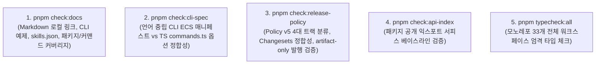

# Monorepo Governance, Persona Capabilities & Verification Gates (`oa-governance`)

The `oa-governance` skill governs Tier 4 (`TypeSpec & Governance`), API persona contracts, release policy integrity, and static verification gates in the `oa-sdk` monorepo. It establishes the policy, capability taxonomy, contract emission, and static verification gates that enforce platform integrity across all 19 packages and 5 applications:

1. `@oa-sdk/personas`: Capability traits taxonomy defined in `packages/personas/src/traits/skill.yaml` (21 traits across 6 categories), orthogonal 3-bucket modeling (`identity`, `reference`, `outcome`), profile bundling, and coverage matrix reporting (`personas:check`).
2. `@oa-sdk/typespec-*`: TypeSpec decorators, emitters, and tooling including:
   - `@oa-sdk/typespec-decorators`: `$oaUseResponseComponent` (emitting `x-oa-sdk-operation-component-refs`), `$personaCapability` (emitting `x-oa-sdk-persona-traits` validated against `skill.yaml`), and `$pseudonymize` (emitting `x-oa-sdk-dpm-projection`).
   - `@oa-sdk/typespec-erd` & `@oa-sdk/logical-erd-contract`: logical ERD decorators (`$dataset`, `$entity`, `$field`, `$primaryKey`, `$unique`, `$foreignKey`, `$relationship`), and the `$onEmit` compiler producing `logical-erd.json`.
   - `@oa-sdk/typespec-tooling`: TypeSpec IDE templates, VS Code settings presets, snippets, and custom linter diagnostics.
3. `@oa-sdk/dpm`: Dynamic Package Manager subpath architecture (9 decoupled subpaths), immutable `DpmNeutralDataBindingArtifact`, and the fail-closed in-memory execution engine (`executeDpmRows`).
4. Closed-by-Default Agent Skill Governance: Hermetic registration in `.agents/skills.json` and `.agents/plugins.json`, strict prohibition of universal cross-domain wildcards (`.*`, `*`), and filesystem path existence verification.
5. 5 Monorepo Governance Gates: Network-free static gates enforced repository-wide:
   - `pnpm check:docs` (powered by `@spec-platform/document-gates`)
   - `pnpm check:cli-spec` (language-neutral CLI ECS manifest synchronization)
   - `pnpm check:release-policy` (Policy Version 5 across 4 workspace tracks)
   - `pnpm check:api-index` (public API export surface verification)
   - `pnpm typecheck:all` (strict TypeScript validation across all 33 workspaces)

---

## 🏛️ Architectural Topology & Governance Boundaries

```mermaid
graph TD
    subgraph Modeling [TypeSpec Modeling Layer]
        TSP["TypeSpec Spec (.tsp)"]
        Decors["@oa-sdk/typespec-decorators ($oaUseResponseComponent, $personaCapability, $pseudonymize)"]
        ERDDecors["@oa-sdk/typespec-erd ($dataset, $entity, $field, $primaryKey)"]
        Tooling["@oa-sdk/typespec-tooling (LSP Presets & Snippets)"]
        Emitter["$onEmit Emitter -> logical-erd.json"]
        CliTooling["oa-gen tsp CLI (diff, mock, scaffold)"]
    end

    subgraph PersonasLayer [Persona Capability & Profile Contracts (@oa-sdk/personas)]
        SkillYaml["packages/personas/src/traits/skill.yaml (21 Traits, 6 Categories)"]
        ThreeBuckets["3-Bucket Model (Identity, Reference, Outcome)"]
        Profiles["Profile Query Bundles (*.profile.yaml)"]
        Coverage["Coverage Tracker & Markdown Report (personas:check)"]
    end

    subgraph DpmLayer [Dynamic Package Manager (@oa-sdk/dpm)]
        Subpaths["9 Decoupled Subpaths (@oa-sdk/dpm/*)"]
        Binding["DpmNeutralDataBindingArtifact"]
        ExecBoundary["Fail-Closed Row Execution (executeDpmRows)"]
    end

    subgraph ClosedGov [Closed-by-Default Agent Governance]
        SkillsJson[".agents/skills.json (Local + Scoped Globals)"]
        PluginsJson[".agents/plugins.json (Local + Scoped Globals)"]
        WildcardRule["Forbidden Wildcards Policy (DEFAULT_FORBIDDEN_AGENT_WILDCARDS)"]
    end

    subgraph MonorepoGates [5 Monorepo Governance Gates]
        CheckDocs["1. pnpm check:docs (5 Document Gates)"]
        CheckCliSpec["2. pnpm check:cli-spec (CLI ECS Manifest Sync)"]
        CheckRelease["3. pnpm check:release-policy (Policy v5: 4 Tracks)"]
        CheckApi["4. pnpm check:api-index (Export Surface)"]
        TypecheckAll["5. pnpm typecheck:all (33 Workspaces)"]
    end

    TSP --> Decors
    TSP --> ERDDecors
    TSP --> Tooling
    TSP --> CliTooling
    ERDDecors --> Emitter

    SkillYaml --> ThreeBuckets
    ThreeBuckets --> Profiles
    Profiles --> Coverage

    Subpaths --> Binding
    Binding --> ExecBoundary

    SkillsJson --> CheckDocs
    PluginsJson --> CheckDocs
    WildcardRule --> CheckDocs

    CliTooling --> CheckCliSpec
```

---

## 1. API Persona Capability Traits (`@oa-sdk/personas`)

API personas represent formal consumer archetypes and testing profiles. Rather than relying on unstructured tags, personas define precise behavioral capabilities and orthogonal constraints.

### 1.1 The 21 Capability Traits across 6 Categories (`packages/personas/src/traits/skill.yaml`)

Personas declare capabilities via `Persona.skills: string[]`. These traits describe what an API endpoint or consumer supports:

| Category | Trait ID | Semantic Meaning & Architectural Guarantee |
|---|---|---|
| **`request-shape`** | `pagination` | Endpoint supports `page`/`limit` or opaque `cursor` pagination parameters. |
| | `filter-by-role` | Endpoint accepts a `role` query parameter to scope resource results. |
| | `filter-by-status` | Endpoint accepts a `status` query parameter for lifecycle filtering. |
| | `full-text-search` | Endpoint accepts text queries via `q` or `search`. |
| | `batch` | Endpoint processes multi-item arrays in a single roundtrip. |
| **`response-shape`** | `sse-stream` | Endpoint streams chunks using `text/event-stream` (Server-Sent Events). |
| | `etag-supported` | Endpoint emits `ETag` and evaluates `If-None-Match` returning `304 Not Modified`. |
| | `partial-response` | Endpoint accepts `fields=` projection queries to return sparse payloads. |
| **`lifecycle`** | `idempotent` | Calling the operation repeatedly yields identical server state (naturally or via `Idempotency-Key`). |
| | `retryable` | Client retry on `5xx` errors is explicitly guaranteed to be side-effect safe. |
| | `cacheable` | Emits `Cache-Control` allowing intermediate proxies or CDN caching. |
| **`observability`** | `audit-emission` | Emits structured compliance audit events (`X-Audit-Id` or audit queue). |
| | `metrics-emission` | Exports Prometheus or Datadog latency and count metrics. |
| | `trace-context` | Propagates W3C `traceparent` or `X-Request-Id` headers. |
| **`security`** | `pii-visible-admin` | Admin scopes receive unmasked plaintext Personally Identifiable Information. |
| | `pii-masked-default` | Default scopes receive masked PII (`j***@example.com`); only privileged callers unmask. |
| | `pseudonymized` | Direct personal identifiers are irreversibly stripped or tokenized. |
| | `signed-response` | Responses include cryptographic signatures (JWS/JWT) for integrity assurance. |
| | `mtls` | Requires mutual TLS authentication with client certificate verification. |
| **`integration`** | `webhook-source` | Invoking this operation triggers outbound webhook delivery to registered listeners. |
| | `webhook-target` | Endpoint serves as an inbound webhook receiver. |
| | `oauth-scope-aware` | Endpoint enforces granular OAuth scopes (`read`, `write`, `admin`). |
| | `rate-limit-honored` | Emits `429 Too Many Requests` with RFC `Retry-After` header when throttled. |
| | `idempotency-key-required` | Partner SDK callers must provide a unique `Idempotency-Key` header. |

### 1.2 The Orthogonal 3-Bucket Model

Every persona is classified across three independent dimensions:


### 1.3 Persona Links & Relationships

Personas express graph relationships via `links`:
- `depends_on`: Declares prerequisite steps in a multi-step workflow.
- `refines`: Variant of a base persona with narrower constraints or added security skills.
- `supersedes`: Migration or deprecation target replacing a legacy persona.

### 1.4 Persona Profiles & Coverage Verification

Profiles (`*.profile.yaml`) package test query bundles:
```yaml
id: admin-audit-compliance
description: Verification bundle for SOC2 and GDPR administrative audit operations
query:
  identity.actor: admin
  reference.regulation: GDPR
  skills:
    - audit-emission
    - pii-visible-admin
```

Running `pnpm personas:check` verifies:
1. All skills declared in personas exist in `skill.yaml`.
2. All `maps_to` identifiers correspond to valid OpenAPI `operationId` symbols.
3. Coverage matrices are rendered to Markdown documentation.

---

## 2. TypeSpec Emitters, Decorators & DX Tooling (`@oa-sdk/typespec-*`)

TypeSpec enables schema authoring with strong static typing. `@oa-sdk` provides custom emitters, native decorators, IDE LSP tooling, and AST verification utilities to maintain contract integrity across the monorepo.

### 2.1 `@oa-sdk/typespec-decorators`: Response Component References, Personas & DPM

The package `packages/typespec-decorators` provides native TypeSpec decorators for contract enrichment and compliance:

#### 1. Response Component References (`@oaUseResponseComponent`)
Attaches shared response component references to TypeSpec operations:

```typespec
import "@oa-sdk/typespec-decorators";
using OaSdkTypeSpec;

namespace PetStore;

op getUser(@path id: string): User {
  @oaUseResponseComponent("404", "NotFoundResponse")
  @oaUseResponseComponent("500", "InternalServerError")
}
```

- **Target Extension**: Emits the OpenAPI extension `x-oa-sdk-operation-component-refs`.
- **Syntax Validation**:
  - `statusCode`: Enforces regex `/^(?:[1-5][0-9]{2}|default)$/`.
  - `componentName`: Enforces identifier regex `/^[A-Za-z][A-Za-z0-9._-]*$/`.
- **Deduplication Invariant**: Rejects duplicate status codes on the same operation.

#### 2. Persona Capabilities (`@personaCapability`)
Attaches persona capability traits directly to TypeSpec operations, enforcing validation against `packages/personas/src/traits/skill.yaml`:

```typespec
import "@oa-sdk/typespec-decorators";
using OaSdkTypeSpec;

@personaCapability("pagination", "audit-emission", "pii-masked-default")
op listUsers(): User[];
```

- **Target Extension**: Emits `x-oa-sdk-persona-traits`.
- **Validation**: Rejects undeclared or invalid skill identifiers with diagnostic errors during compilation.

#### 3. DPM Field Pseudonymization (`@pseudonymize`)
Declares relationship-first pseudonymization policies on model properties:

```typespec
import "@oa-sdk/typespec-decorators";
using OaSdkTypeSpec;

model UserProfile {
  id: string;
  @pseudonymize(UserProfile.email, "hmac-sha256")
  email: string;
}
```

- **Target Extension**: Emits `x-oa-sdk-dpm-projection`.

### 2.2 `@oa-sdk/typespec-erd` & `@oa-sdk/logical-erd-contract`

Provides data modeling decorators and a compiler emitter that extracts relational schemas into `logical-erd.json`.

#### Decorator Vocabulary
```typespec
import "@oa-sdk/typespec-erd";
using OaSdkErd;

@dataset("ecommerce")
namespace Store {
  @entity("users")
  model User {
    @primaryKey("pk_user", 1)
    @field("usr_id")
    id: string;

    @unique
    @field("usr_email")
    email: string;
  }

  @entity("orders")
  model Order {
    @primaryKey("pk_order", 1)
    @field("ord_id")
    id: string;

    @foreignKey(User.id)
    @field("ord_user_id")
    userId: string;
  }

  @relationship("rel_user_orders", User.id, Order.userId, "one-to-many")
  namespace Relations {}
}
```

#### Compiler Invariants
1. **Composite Primary Keys (`$primaryKey`)**: Requires a non-empty `groupId` and positive integer `order` (`order >= 1`).
2. **Cardinality Verification (`$relationship`)**: Cardinality must be one of `one-to-one`, `one-to-many`, or `many-to-one`.
3. **Emitter Output (`$onEmit`)**: Generates `logical-erd.json`.

### 2.3 `@oa-sdk/typespec-tooling`: IDE LSP Presets & Snippets

`@oa-sdk/typespec-tooling` bundles IDE enhancements and templates for developer ergonomics:
- **VS Code Configuration Presets**: `.vscode/settings.json` and `.vscode/extensions.json` templates preconfigured for `typespec.tsp-vscode` language server.
- **Code Snippets (`snippets/typespec.json`)**: Pre-authored shortcuts for CRUD operations, DTO models, and persona decorators.

### 2.4 TypeSpec CLI Governance & Quality Tooling

- **TypeSpec AST Semantic Diff (`oa-gen tsp diff`)**: Compares TypeSpec AST structures between two git refs with `--fail-on-breaking`.
- **Zero-Build Instant Mock Server (`oa-gen mock --tsp`)**: In-memory compilation serving mock routes directly on port 4010 with `--watch`.
- **TypeSpec Endpoint Scaffolding (`oa-gen tsp-scaffold`)**: Scaffolds valid TypeSpec operations from CLI arguments.

---

## 3. Dynamic Package Manager Patterns (`@oa-sdk/dpm`)

`@oa-sdk/dpm` provides relationship-first data pseudonymization contracts, profiling adapters, and in-memory row execution.

### 3.1 Subpath Packaging Architecture

`@oa-sdk/dpm` enforces strict decoupling through 9 dedicated subpath exports (`packages/dpm/package.json`):
`@oa-sdk/dpm/package`, `@oa-sdk/dpm/catalog`, `@oa-sdk/dpm/data`, `@oa-sdk/dpm/profile`, `@oa-sdk/dpm/relationship`, `@oa-sdk/dpm/gateway`, `@oa-sdk/dpm/storage`, `@oa-sdk/dpm/publishing`, `@oa-sdk/dpm/execution`.

### 3.2 Neutral Data Binding (`DpmNeutralDataBindingArtifact`)

Decouples logical API pointers from physical storage columns without leaking physical database identifiers into public OpenAPI specs.

### 3.3 Fail-Closed Row Execution Boundary (`executeDpmRows`)

The execution engine operates exclusively on caller-owned in-memory rows:
1. **Zero Database Coupling**: Never connects to external databases or vaults.
2. **Fail-Closed on Stale Plans**: Halts immediately with `EXE_PLAN_STALE` if `input.plan.stale === true`.
3. **Unapproved Transform Rejection**: Rejects unauthorized tables or unrecognized rules.
4. **Token Preservation**: Preserves relationship tokens across foreign key boundaries.

---

## 4. Closed-by-Default Agent Skill Governance

The monorepo enforces a strict **Closed-by-Default** security boundary for all AI agent tools and skills.

### 4.1 Configuration Schemas (`skills.json` and `plugins.json`)

Located at `.agents/skills.json` and `.agents/plugins.json`:

```json
{
  "$schema": "https://antigravity.google/schemas/skills.json",
  "entries": [
    {
      "path": ".agents/skills"
    },
    {
      "path": "~/.gemini/config/skills",
      "include_only": [
        "oa-.*",
        "openapi-.*"
      ]
    }
  ]
}
```

### 4.2 Governance Rules & Gate Invariants

Enforced by `createAgentConfigGate` in `@spec-platform/document-gates`:
1. **Strict Wildcard Prohibition (`DEFAULT_FORBIDDEN_AGENT_WILDCARDS`)**: Universal wildcards (`*`, `**`, `.*`, `.+`, `^.*$`) are strictly rejected. Global skill paths MUST define scoped `include_only` regex arrays (e.g. `["oa-.*", "openapi-.*"]`).
2. **Hermetic Path Discipline**: Workspace paths must be relative (`.agents/skills`). Global external paths must use portable home notation (`~/...`). Absolute system paths (`/Users/...`, `C:\...`) are rejected.
3. **Filesystem Existence**: Configured directories must exist on disk.

---

## 5. 모노레포 정적 거버넌스 및 검증 게이트 (Monorepo Static Governance & Verification Gates)

`oa-sdk` 모노레포는 코드베이스, 문서, CLI 명세, 릴리스 정책 간의 드리프트를 원천 방지하기 위해 5개의 엄격한 정적 거버넌스 게이트를 운영합니다.

### 5.1 5대 거버넌스 게이트 명세 (The 5 Governance Gates)



1. **`pnpm check:docs` (`scripts/check-docs.ts`)**:
   - `@spec-platform/document-gates` 라이브러리를 통해 236개 이상의 마크다운 문서를 검증합니다:
     - `createAgentConfigGate`: `.agents/skills.json` 및 `plugins.json` 밀폐형 거버넌스 검증.
     - `createMarkdownLocalLinkGate`: 모든 로컬 상대 링크의 대상 파일 존재 여부 AST 검증.
     - `createCliExampleGate`: 코드 블록 내 `oa-gen` 명령어 및 플래그 유효성 검증.
     - `createCliReferenceGate`: `cli-command-reference.md`의 29개 전체 명령어 100% 커버리지 검증.
     - `createPackageEntrypointGate`: `library-entrypoints.md`의 19개 패키지 100% 커버리지 검증.
2. **`pnpm check:cli-spec` (`scripts/check-cli-spec.ts`)**:
   - 언어 중립 CLI ECS 매니페스트(`docs/cli-spec/oa-gen.governance.json`, `oa-contract.governance.json`)와 TypeScript 구현체(`packages/codegen/src/cli/commands.ts`) 간의 1:1 정합성을 검증합니다.
   - 명령어 이름, 옵션 타입, 필수 여부(`required`), 복수 플래그(`multiple`), 단축 플래그(`short`), 설명(`description`), 전역 옵션(`--root`, `--project-root`) 일치를 강제합니다.
   - 아티팩트 호환성 정책(`docs/cli-spec/oa-sdk-artifact-compatibility-policy.v1.json`)과 코드 상수(`OA_SDK_ARTIFACT_COMPATIBILITY_POLICY_V1`)의 무결성을 검증합니다.
3. **`pnpm check:release-policy` (`scripts/check-release-policy.ts`)**:
   - 릴리스 정책 매니페스트(`docs/internal/release-policy.json`, Policy Version 5)를 모든 워크스페이스의 `package.json` 및 Changesets 설정(`.changeset/config.json`)과 대조 검증합니다.
4. **`pnpm check:api-index` (`scripts/check-api-index.ts`)**:
   - 공개 API 익스포트 목록이 베이스라인과 일치하는지 확인하여 예기치 않은 브레이킹 체인지를 차단합니다.
5. **`pnpm typecheck:all`**:
   - Turborepo를 통해 모노레포 내 33개 전체 워크스페이스의 `tsc --noEmit`을 일괄 실행하여 0개 에러를 보장합니다.

### 5.2 릴리스 정책 버전 5 및 4대 워크스페이스 트랙 (Policy Version 5: 4-Track Topology)

모노레포의 모든 워크스페이스는 역할과 책임에 따라 4개 트랙으로 엄격히 분류됩니다:

| 트랙 명칭 (Track) | 정책 (Policy) | 릴리스 추적 (Release) | 소속 워크스페이스 (Workspaces) |
|---|---|---|---|
| **`corePlatform`** | `active` | `release-tracked` | `@oa-sdk/core`, `@oa-sdk/openapi-projection-contract`, `@oa-sdk/spec-lens-contract`, `@oa-sdk/typespec-decorators`, `@oa-sdk/schemas`, `@oa-sdk/parser`, `@oa-sdk/surface-ir`, `@oa-sdk/codegen`, `@oa-sdk/spec-lens`, `@oa-sdk/ast-sync`, `@oa-sdk/tools` (총 11개) |
| **`downstream`** | `compatibility` | `release-tracked` | `@oa-sdk/router`, `@oa-sdk/client`, `@oa-sdk/mock-server`, `@oa-sdk/chunk-stream`, `@oa-sdk/chunk-stream-crdt`, `@oa-sdk/chunk-stream-ui`, `@oa-sdk/chunk-stream-timeseries`, `@oa-sdk/chunk-stream-react`, `@oa-sdk/peer-transport`, `@oa-sdk/peer-server`, `@oa-sdk/collab-workspace`, `@oa-sdk/mcp-mesh` (총 12개) |
| **`maintenance`** | `maintenance-only` | `ignored` | `@oa-sdk/dpm`, `@oa-sdk/personas`, `@oa-sdk/typia-mock`, `@oa-sdk/logical-erd-contract`, `@oa-sdk/typespec-erd`, `@oa-sdk/typespec-tooling`, `@oa-sdk/ttsc-compile-fixture` (총 7개) |
| **`applications`** | `support-only` | `ignored` | `@oa-sdk/nestjs-ref`, `@oa-sdk/playground`, `@oa-sdk/preview`, `@oa-sdk/spec-lens-ui` (총 4개) |

- **트랙 요약**: 23개 워크스페이스는 릴리스 추적(`release-tracked`) 대상이며, 11개 워크스페이스는 릴리스 무시(`ignored`) 대상입니다.
- **배포 후보 및 모드**: `distributionCandidates`에 Core 8개(`core`, `openapi-projection-contract`, `typespec-decorators`, `parser`, `codegen`, `ast-sync`, `tools`, `surface-ir`) 및 Downstream 12개(`router`, `client`, `mock-server`, `chunk-stream*`, `peer-*`) 총 20개 패키지가 승인 등록되어 있으며, `publish.mode`는 `"artifact-only"`로 운영됩니다.
- **의존성 경계 불변식**: `corePlatform` 워크스페이스는 런타임에 `downstream` 워크스페이스를 직접 의존할 수 없으며 오직 `devDependencies`를 통해서만 참조 가능합니다.

### 5.3 온보딩 라이프사이클 아키타입 거버넌스 정책 (Onboarding Lifecycle Archetypes)

`oa-gen init --archetype <mvp|microservice|enterprise>` 명령은 프로젝트의 수명 주기에 따라 서로 다른 거버넌스 규칙을 생성합니다:

| 아키타입 (Archetype) | 타깃 대상 | 거버넌스 정책 프리셋 (`oa.config.ts`) | CI/CD 게이트 불변식 |
|---|---|---|---|
| **`mvp`** | 초기 프로토타이핑 | `driftCheck: false`, `failOnBreaking: false`, `preflightLint: 'warn'`, `wireFormatSafety: false`, `jitSchema: false`, `zeroCopy: false` | 개발 속도 극대화, 경고만 출력하고 CI 통과 |
| **`microservice`** | 프로덕션 단일 서비스 | `driftCheck: true`, `failOnBreaking: false`, `preflightLint: 'error'`, `wireFormatSafety: true`, `resolveSymbolCycles: true`, `jitSchema: true`, `zeroCopy: true` | 스키마 린트 에러 시 빌드 차단, 런타임 최적화 강제 |
| **`enterprise`** | 멀티 팀 분산 거버넌스 | `driftCheck: true`, `failOnBreaking: true`, `baseRef: 'origin/main'`, `preflightLint: 'error'`, `personas.enforceCoverage: true`, `minCoverageRatio: 0.8` | 브레이킹 체인지 감지 시 PR 머지 즉시 차단, 페르소나 커버리지 80% 미만 시 실패 |

위 프리셋 값을 읽어 동작을 바꾸는 `oa-gen` 명령은 아직 없습니다. 게이트는 `init`이 추가하는 스크립트로 걸리며, 스크립트는 모두 스캐폴드에서 그대로 실행됩니다. `enterprise`는 `init`이 스펙에서 만드는 계약 기준선 `openapi.baseline.yaml`과 비교하는 `diff`(`oa-gen diff --fail-on-breaking`), OpenAPI 3.2 검증·린트·diff를 묶은 `ci:gate`, 기준선을 옮기는 `baseline:update`(`oa-gen normalize`), `lint:spec`을 추가합니다. persona 커버리지 검사 스크립트는 없습니다(oa-sdk 저장소 루트의 `pnpm personas:check`는 `@oa-sdk/personas` 패키지의 `check`를 실행하는 저장소 스크립트입니다).

### 5.4 출력 매니페스트 및 3단계 고아 프루닝 거버넌스 (.oa-manifest.json 3-Gate Invariants)

코드 생성 시 자동 방출된 파일이 프로젝트를 오염시키지 않도록 `.oa-manifest.json` 기반의 3단계 안전성 검증을 거쳐서만 고아 파일이 제거됩니다:
1. **Gate 1 (Provenance Gate)**: `.oa-manifest.json`에 기록되어 있고 이번 `oa-gen generate` 실행이 소유한 파일(같은 설정 파일로 `producer: "generate"`가 기록, `--spec` 실행은 같은 스펙 파일 `specFile`로 기록)만 삭제 후보로 등록. `oa-gen generate:tanstack` 등 다른 명령의 기록은 제외하고, `outputRouting.pruneOrphans: false`면 정리하지 않음.
2. **Gate 2 (Hash Integrity Gate)**: 디스크 파일의 SHA-256 해시가 생성 당시 해시와 정확히 일치해야 함 (`'content-modified'` 보호).
3. **Gate 3 (Banner Guard)**: `@generated` 또는 `DO NOT EDIT` 배너 주석이 존재해야 함 (`'banner-missing'` 보호).

---

## 🛠️ CLI Recipes & Workflows

### 5대 모노레포 거버넌스 게이트 일괄 검증
```bash
pnpm check:docs
pnpm check:cli-spec
pnpm check:release-policy
pnpm check:api-index
pnpm typecheck:all
```

### 릴리스 정책 및 프리플라이트 단위 테스트
```bash
pnpm test:release-policy
pnpm test:release-preflight
```

### 페르소나 능력 및 오퍼레이션 매핑 검증
```bash
pnpm personas:check
pnpm personas:coverage
```

### TypeSpec AST 시맨틱 차이 및 브레이킹 체인지 검사
```bash
# --head에 파일 경로를 주면 커밋 전 작업 트리까지 비교한다. git ref는 커밋된 내용만 읽는다.
oa-gen tsp diff --base origin/main:packages/schemas/typespec/main.tsp --head packages/schemas/typespec/main.tsp --fail-on-breaking
# 두 커밋 비교: 경로 없는 ref는 상대편과 같은 진입점을 자기 커밋에서 읽는다(정할 수 없으면 <ref>:<path>를 요구하는 오류).
oa-gen tsp diff --base origin/main --head HEAD --fail-on-breaking
```

### TypeSpec 인메모리 핫 리로드 목 서버 구동
```bash
oa-gen mock --tsp packages/schemas/typespec/main.tsp --watch
```

### DPM 서브패스 및 실행 표면 무결성 감사
```bash
pnpm check:dpm-surface
```

---

## 🚨 Troubleshooting Matrix

| Symptom | Root Cause | Remediation |
|---|---|---|
| `ERR_AGENT_CONFIG_FORBIDDEN_WILDCARD` in `pnpm check:docs` | An unrestricted wildcard (`.*` or `*`) was placed in `include_only` in `.agents/skills.json` | Replace wildcard with scoped domain prefix patterns (e.g. `oa-.*`) |
| `ERR_AGENT_CONFIG_NON_HERMETIC` in `pnpm check:docs` | An absolute path (`/Users/...`) was used instead of workspace-relative or home-relative path | Change path to `.agents/skills` or `~/.gemini/config/skills` |
| `missing local link target: ./missing.md` | A Markdown document contains a broken relative link | Fix the link target or remove stale reference |
| `oa-gen:<cmd>: option <opt> description drift` in `check:cli-spec` | CLI option description in TS `commands.ts` does not match `docs/cli-spec/oa-gen.governance.json` | Update the governance JSON manifest or run manifest sync tooling |
| `workspace <pkg> is not tracked in release policy` in `check:release-policy` | A newly created workspace package was not assigned to one of the 4 tracks | Add package to `docs/internal/release-policy.json` under appropriate track |
| `orphan pruning skipped: content-modified` | Generated file was manually edited by developer; SHA-256 mismatch | Revert manual edits if file should be deleted, or move manual code outside generated directory |
| `orphan pruning skipped: banner-missing` | Generated file is missing `@generated` or `DO NOT EDIT` banner comment | Ensure generator templates emit proper banner headers |
| `ERR_TSP_BREAKING_CHANGE` in CI | `oa-gen tsp diff --fail-on-breaking` detected backward-incompatible TypeSpec change | Review diff report; preserve existing fields or bump major API version |
| `EXE_PLAN_STALE` error during `executeDpmRows` | Attempted execution of a compiled plan whose source catalog has changed | Recompile the DPM plan before executing row pseudonymization |
