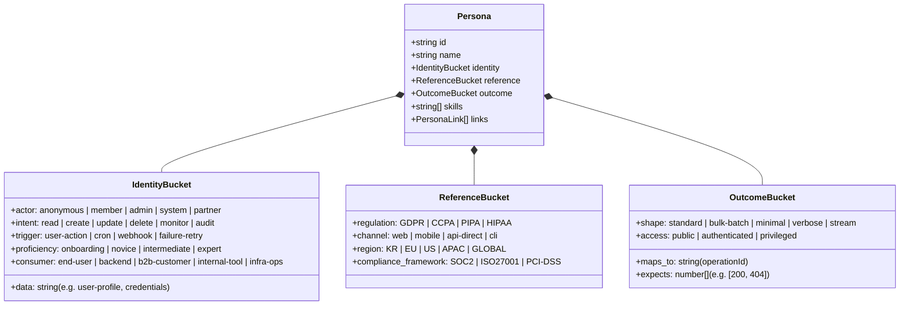
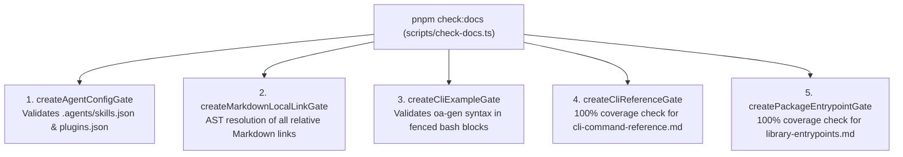

# Monorepo Governance, Persona Capabilities & Document Gates (`oa-governance`)

The `oa-governance` skill governs Tier 4 (`TypeSpec & Governance`) and monorepo documentation verification in the `oa-sdk` monorepo. It establishes the policy, capability taxonomy, contract emission, and static verification gates that enforce platform integrity across all 19 packages and 5 applications:

1. `@oa-sdk/personas`: Capability traits taxonomy defined in `packages/personas/src/traits/skill.yaml` (21 traits across 6 categories), orthogonal 3-bucket modeling (`identity`, `reference`, `outcome`), profile bundling, and coverage matrix reporting.
2. `@oa-sdk/typespec-*`: TypeSpec decorators, emitters, and tooling including:
   - `@oa-sdk/typespec-decorators`: `$oaUseResponseComponent` (emitting `x-oa-sdk-operation-component-refs`), `$personaCapability` (emitting `x-oa-sdk-persona-traits` validated against `skill.yaml`), and `$pseudonymize` (emitting `x-oa-sdk-dpm-projection`).
   - `@oa-sdk/typespec-erd` & `@oa-sdk/logical-erd-contract`: logical ERD decorators (`$dataset`, `$entity`, `$field`, `$primaryKey`, `$unique`, `$foreignKey`, `$relationship`), and the `$onEmit` compiler producing `logical-erd.json`.
   - `@oa-sdk/typespec-tooling`: TypeSpec IDE templates, VS Code settings presets, snippets, and custom linter diagnostics.
3. `@oa-sdk/dpm`: Dynamic Package Manager subpath architecture, immutable `DpmNeutralDataBindingArtifact`, and the fail-closed in-memory execution engine (`executeDpmRows`).
4. Closed-by-Default Agent Skill Governance: Hermetic registration in `.agents/skills.json` and `.agents/plugins.json`, strict prohibition of universal cross-domain wildcards (`.*`), and filesystem path existence verification.
5. 4-Tier Verification & Document Gates: Network-free static gates powered by `@spec-platform/document-gates` (`createAgentConfigGate`, `createMarkdownLocalLinkGate`, `createCliExampleGate`, `createCliReferenceGate`, `createPackageEntrypointGate`) enforced repository-wide via `pnpm check:docs`.

---

## 🏛️ Architectural Topology & Governance Boundaries

```mermaid
graph TD
    subgraph Modeling [TypeSpec Modeling Layer]
        TSP["TypeSpec Spec (.tsp)"]
        Decors["@oa-sdk/typespec-decorators ($oaUseResponseComponent, $personaCapability, $pseudonymize)"]
        ERDDecors["@oa-sdk/typespec-erd ($dataset, $entity, $field, $primaryKey)"]
        Tooling["@oa-sdk/typespec-tooling (LSP Presets & Snippets)"]
        Emitter["$onEmit Emitter -> logical-erd.json"]
        CliTooling["oa-gen tsp CLI (diff, mock, scaffold)"]
    end

    subgraph PersonasLayer [Persona Capability & Profile Contracts (@oa-sdk/personas)]
        SkillYaml["packages/personas/src/traits/skill.yaml (21 Traits, 6 Categories)"]
        ThreeBuckets["3-Bucket Model (Identity, Reference, Outcome)"]
        Profiles["Profile Query Bundles (*.profile.yaml)"]
        Coverage["Coverage Tracker & Markdown Report (personas:check)"]
    end

    subgraph DpmLayer [Dynamic Package Manager (@oa-sdk/dpm)]
        Subpaths["9 Decoupled Subpaths (@oa-sdk/dpm/*)"]
        Binding["DpmNeutralDataBindingArtifact"]
        ExecBoundary["Fail-Closed Row Execution (executeDpmRows)"]
    end

    subgraph ClosedGov [Closed-by-Default Agent Governance]
        SkillsJson[".agents/skills.json (Local + Scoped Globals)"]
        PluginsJson[".agents/plugins.json (Local + Scoped Globals)"]
        WildcardRule["Forbidden Wildcards Policy (DEFAULT_FORBIDDEN_AGENT_WILDCARDS)"]
    end

    subgraph DocumentGates [Static Verification Gates (@spec-platform/document-gates)]
        AgentGate["createAgentConfigGate"]
        LinkGate["createMarkdownLocalLinkGate (AST Link Resolver)"]
        CliGate["createCliExampleGate (oa-gen Shell Validator)"]
        RefGate["createCliReferenceGate (29 Commands Coverage)"]
        EntryGate["createPackageEntrypointGate (19 Packages Coverage)"]
        CheckDocs["pnpm check:docs (scripts/check-docs.ts)"]
    end

    TSP --> Decors
    TSP --> ERDDecors
    TSP --> Tooling
    TSP --> CliTooling
    ERDDecors --> Emitter

    SkillYaml --> ThreeBuckets
    ThreeBuckets --> Profiles
    Profiles --> Coverage

    Subpaths --> Binding
    Binding --> ExecBoundary

    SkillsJson --> AgentGate
    PluginsJson --> AgentGate
    WildcardRule --> AgentGate

    AgentGate --> CheckDocs
    LinkGate --> CheckDocs
    CliGate --> CheckDocs
    RefGate --> CheckDocs
    EntryGate --> CheckDocs
```

---

## 1. API Persona Capability Traits (`@oa-sdk/personas`)

API personas represent formal consumer archetypes and testing profiles. Rather than relying on unstructured tags, personas define precise behavioral capabilities and orthogonal constraints.

### 1.1 The 21 Capability Traits across 6 Categories (`packages/personas/src/traits/skill.yaml`)

Personas declare capabilities via `Persona.skills: string[]`. These traits describe what an API endpoint or consumer supports:

| Category | Trait ID | Semantic Meaning & Architectural Guarantee |
|---|---|---|
| **`request-shape`** | `pagination` | Endpoint supports `page`/`limit` or opaque `cursor` pagination parameters. |
| | `filter-by-role` | Endpoint accepts a `role` query parameter to scope resource results. |
| | `filter-by-status` | Endpoint accepts a `status` query parameter for lifecycle filtering. |
| | `full-text-search` | Endpoint accepts text queries via `q` or `search`. |
| | `batch` | Endpoint processes multi-item arrays in a single roundtrip. |
| **`response-shape`** | `sse-stream` | Endpoint streams chunks using `text/event-stream` (Server-Sent Events). |
| | `etag-supported` | Endpoint emits `ETag` and evaluates `If-None-Match` returning `304 Not Modified`. |
| | `partial-response` | Endpoint accepts `fields=` projection queries to return sparse payloads. |
| **`lifecycle`** | `idempotent` | Calling the operation repeatedly yields identical server state (naturally or via `Idempotency-Key`). |
| | `retryable` | Client retry on `5xx` errors is explicitly guaranteed to be side-effect safe. |
| | `cacheable` | Emits `Cache-Control` allowing intermediate proxies or CDN caching. |
| **`observability`** | `audit-emission` | Emits structured compliance audit events (`X-Audit-Id` or audit queue). |
| | `metrics-emission` | Exports Prometheus or Datadog latency and count metrics. |
| | `trace-context` | Propagates W3C `traceparent` or `X-Request-Id` headers. |
| **`security`** | `pii-visible-admin` | Admin scopes receive unmasked plaintext Personally Identifiable Information. |
| | `pii-masked-default` | Default scopes receive masked PII (`j***@example.com`); only privileged callers unmask. |
| | `pseudonymized` | Direct personal identifiers are irreversibly stripped or tokenized. |
| | `signed-response` | Responses include cryptographic signatures (JWS/JWT) for integrity assurance. |
| | `mtls` | Requires mutual TLS authentication with client certificate verification. |
| **`integration`** | `webhook-source` | Invoking this operation triggers outbound webhook delivery to registered listeners. |
| | `webhook-target` | Endpoint serves as an inbound webhook receiver. |
| | `oauth-scope-aware` | Endpoint enforces granular OAuth scopes (`read`, `write`, `admin`). |
| | `rate-limit-honored` | Emits `429 Too Many Requests` with RFC `Retry-After` header when throttled. |
| | `idempotency-key-required` | Partner SDK callers must provide a unique `Idempotency-Key` header. |

### 1.2 The Orthogonal 3-Bucket Model

Every persona is classified across three independent dimensions:



### 1.3 Persona Links & Relationships

Personas express graph relationships via `links`:
- `depends_on`: Declares prerequisite steps in a multi-step workflow.
- `refines`: Variant of a base persona with narrower constraints or added security skills.
- `supersedes`: Migration or deprecation target replacing a legacy persona.

### 1.4 Persona Profiles & Coverage Verification

Profiles (`*.profile.yaml`) package test query bundles:
```yaml
id: admin-audit-compliance
description: Verification bundle for SOC2 and GDPR administrative audit operations
query:
  identity.actor: admin
  reference.regulation: GDPR
  skills:
    - audit-emission
    - pii-visible-admin
```

Running `pnpm personas:check` verifies:
1. All skills declared in personas exist in `skill.yaml`.
2. All `maps_to` identifiers correspond to valid OpenAPI `operationId` symbols.
3. Coverage matrices are rendered to Markdown documentation.

---

## 2. TypeSpec Emitters, Decorators & DX Tooling (`@oa-sdk/typespec-*`)

TypeSpec enables schema authoring with strong static typing. `@oa-sdk` provides custom emitters, native decorators, IDE LSP tooling, and AST verification utilities to maintain contract integrity across the monorepo.

### 2.1 `@oa-sdk/typespec-decorators`: Response Component References, Personas & DPM

The package `packages/typespec-decorators` provides native TypeSpec decorators for contract enrichment and compliance:

#### 1. Response Component References (`@oaUseResponseComponent`)
Attaches shared response component references to TypeSpec operations:

```typespec
import "@oa-sdk/typespec-decorators";
using OaSdkTypeSpec;

namespace PetStore;

op getUser(@path id: string): User {
  @oaUseResponseComponent("404", "NotFoundResponse")
  @oaUseResponseComponent("500", "InternalServerError")
}
```

- **Target Extension**: Emits the OpenAPI extension `x-oa-sdk-operation-component-refs`.
- **Syntax Validation**:
  - `statusCode`: Enforces regex `/^(?:[1-5][0-9]{2}|default)$/`.
  - `componentName`: Enforces identifier regex `/^[A-Za-z][A-Za-z0-9._-]*$/`.
- **Deduplication Invariant**: Rejects duplicate status codes on the same operation. Emits:
  ```json
  {
    "x-oa-sdk-operation-component-refs": {
      "responses": [
        { "statusCode": "404", "ref": "#/components/responses/NotFoundResponse" },
        { "statusCode": "500", "ref": "#/components/responses/InternalServerError" }
      ]
    }
  }
  ```

#### 2. Persona Capabilities (`@personaCapability`)
Attaches persona capability traits directly to TypeSpec operations, enforcing validation against `packages/personas/src/traits/skill.yaml`:

```typespec
import "@oa-sdk/typespec-decorators";
using OaSdkTypeSpec;

@personaCapability("pagination", "audit-emission", "pii-masked-default")
op listUsers(): User[];
```

- **Target Extension**: Emits `x-oa-sdk-persona-traits`.
- **Validation**: Rejects undeclared or invalid skill identifiers with diagnostic errors during compilation.

#### 3. DPM Field Pseudonymization (`@pseudonymize`)
Declares relationship-first pseudonymization policies on model properties:

```typespec
import "@oa-sdk/typespec-decorators";
using OaSdkTypeSpec;

model UserProfile {
  id: string;
  @pseudonymize(UserProfile.email, "hmac-sha256")
  email: string;
}
```

- **Target Extension**: Emits `x-oa-sdk-dpm-projection`.
- **Pipeline Integration**: Consumed directly by `@oa-sdk/dpm` execution engine for zero-database-coupling data masking.

### 2.2 `@oa-sdk/typespec-erd` & `@oa-sdk/logical-erd-contract`

Provides data modeling decorators and a compiler emitter that extracts relational schemas into `logical-erd.json`.

#### Decorator Vocabulary
```typespec
import "@oa-sdk/typespec-erd";
using OaSdkErd;

@dataset("ecommerce")
namespace Store {
  @entity("users")
  model User {
    @primaryKey("pk_user", 1)
    @field("usr_id")
    id: string;

    @unique
    @field("usr_email")
    email: string;
  }

  @entity("orders")
  model Order {
    @primaryKey("pk_order", 1)
    @field("ord_id")
    id: string;

    @foreignKey(User.id)
    @field("ord_user_id")
    userId: string;
  }

  @relationship("rel_user_orders", User.id, Order.userId, "one-to-many")
  namespace Relations {}
}
```

#### Compiler Invariants
1. **Composite Primary Keys (`$primaryKey`)**: Requires a non-empty `groupId` and positive integer `order` (`order >= 1`). If two parts of a composite primary key in the same model declare the same order, the compiler reports a diagnostic error: `Composite primary-key group <id> repeats component order <order>`.
2. **Cardinality Verification (`$relationship`)**: Cardinality must be one of `one-to-one`, `one-to-many`, or `many-to-one`.
3. **Emitter Output (`$onEmit`)**: Generates `logical-erd.json` containing datasets, entities, fields, keys, and validated relationship topologies.

### 2.3 `@oa-sdk/typespec-tooling`: IDE LSP Presets & Snippets

`@oa-sdk/typespec-tooling` bundles IDE enhancements and templates for developer ergonomics:
- **VS Code Configuration Presets**: `.vscode/settings.json` and `.vscode/extensions.json` templates preconfigured for `typespec.tsp-vscode` language server, auto-formatting on save, and custom lint severity.
- **Code Snippets (`snippets/typespec.json`)**: Pre-authored shortcuts for standard CRUD operations, DTO models, logical entities, and persona capability decorators.
- **Custom Linter Rules**: Detects non-idiomatic schemas and enforces naming conventions prior to compilation.

### 2.4 TypeSpec CLI Governance & Quality Tooling

The `oa-gen` CLI provides specialized TypeSpec developer tooling:

#### 1. TypeSpec AST Semantic Diff (`oa-gen tsp diff`)
Parses and compares TypeSpec AST structures between two git refs or file paths in < 0.5s without intermediate builds. Detects:
- Removed operations or altered HTTP methods/paths
- Removed or renamed models
- Removed properties or newly required properties
- Changed status codes or modified `@operationId`

Supports `--fail-on-breaking` to exit with status code 1 for automated CI PR gating, and `--format <markdown|json>` for PR comment reporting.

#### 2. Zero-Build Instant Mock Server (`oa-gen mock --tsp`)
Spins up an HTTP Mock server on port 4010 using `@typespec/compiler` in-memory compilation. Bypasses disk YAML generation entirely and mounts routes directly to `@oa-sdk/mock-server`. With `--watch`, it monitors `.tsp` file modifications and performs hot route updates on the fly.

#### 3. TypeSpec Endpoint Scaffolding (`oa-gen tsp-scaffold`)
Generates standardized, syntactically valid TypeSpec operations and DTO models from CLI arguments, injecting them into target `.tsp` modules.

---

## 3. Dynamic Package Manager Patterns (`@oa-sdk/dpm`)

`@oa-sdk/dpm` provides relationship-first data pseudonymization contracts, profiling adapters, and in-memory row execution.

### 3.1 Subpath Packaging Architecture

`@oa-sdk/dpm` enforces strict decoupling through dedicated subpath exports (`packages/dpm/package.json`):

| Subpath | Purpose & Export Surface |
|---|---|
| `@oa-sdk/dpm/package` | Package metadata, manifest versioning (`DPM_VERSION`), contract schemas. |
| `@oa-sdk/dpm/catalog` | Database catalog profiling adapters (PostgreSQL, Cloudflare D1 provenance). |
| `@oa-sdk/dpm/data` | `createDpmIdentityDataDefinitions`, logical entity definitions. |
| `@oa-sdk/dpm/profile` | Kafka topic and streaming data profiler. |
| `@oa-sdk/dpm/relationship` | Relationship graph discovery and registry snapshots. |
| `@oa-sdk/dpm/gateway` | OpenAPI projection contract helpers and runtime validators. |
| `@oa-sdk/dpm/storage` | Job, report, registry snapshot repositories. |
| `@oa-sdk/dpm/publishing` | AI schema context and physical foreign key recommendations. |
| `@oa-sdk/dpm/execution` | In-memory row execution engine (`executeDpmRows`). |

### 3.2 Neutral Data Binding (`DpmNeutralDataBindingArtifact`)

Decouples logical API pointers from physical storage columns:
- Upstream OpenAPI schemas reference business entity fields (e.g. `user.ssn`).
- Downstream database catalogs reference physical table columns (e.g. `tbl_customer.cust_national_id`).
- `DpmNeutralDataBindingArtifact` bridges these worlds without forcing physical database identifiers into public OpenAPI specs.

### 3.3 Fail-Closed Row Execution Boundary (`executeDpmRows`)

The execution engine (`packages/dpm/src/execution/in-memory-executor.ts`) acts as an adapter boundary operating exclusively on caller-owned in-memory rows:

```typescript
import { executeDpmRows, type DpmExecutionInput } from '@oa-sdk/dpm/execution'

const result = executeDpmRows({
  plan: compiledPlan,
  rows: rawRows,
  keys: { hmacKey: process.env.HMAC_SECRET! },
})
```

#### Security Invariants
1. **Zero Database Coupling**: Never connects to a database, resolves external vaults, or persists rows. Key material is passed by the caller and omitted from reports.
2. **Fail-Closed on Stale Plans**: If `input.plan.stale === true`, execution halts immediately with diagnostic code `EXE_PLAN_STALE`. Stale pseudonymization plans are never executed.
3. **Unapproved Transform Rejection**: Any transform step referencing an unapproved table or unrecognized rule aborts without modifying row data.
4. **Token Preservation**: Maintains relationship tokens across foreign key boundaries so anonymized datasets retain relational referential integrity.

---

## 4. Closed-by-Default Agent Skill Governance

The monorepo enforces a strict **Closed-by-Default** security boundary for all AI agent tools and skills.

### 4.1 Configuration Schemas (`skills.json` and `plugins.json`)

Located at `.agents/skills.json` and `.agents/plugins.json`:

```json
{
  "$schema": "https://antigravity.google/schemas/skills.json",
  "entries": [
    {
      "path": ".agents/skills"
    },
    {
      "path": "~/.gemini/config/skills",
      "include_only": [
        "oa-.*",
        "openapi-.*"
      ]
    }
  ]
}
```

### 4.2 Governance Rules & Gate Invariants

Enforced by `createAgentConfigGate` in `@spec-platform/document-gates`:

1. **Strict Wildcard Prohibition (`DEFAULT_FORBIDDEN_AGENT_WILDCARDS`)**:
   - Universal or cross-domain wildcards are strictly rejected: `*`, `**`, `.*`, `.+`, `^.*$`, `(.*)`, `(?.*)`.
   - Global skill paths MUST define a scoped, explicit `include_only` regex array (e.g. `["oa-.*", "openapi-.*"]`).
2. **Hermetic Path Discipline**:
   - Workspace paths must be relative and resolve strictly inside the monorepo root (`.agents/skills`).
   - Global external paths must use portable home-relative notation (`~/...`). Absolute system paths (`/Users/...`, `C:\...`) are rejected.
3. **Filesystem Existence**:
   - Configured directories must exist on disk. Pointing to non-existent skill or plugin folders causes gate failure.

---

## 5. 4-Tier Verification & Document Gates

The repository employs five static validation gates from `@spec-platform/document-gates` executed via `pnpm check:docs`.

### 5.1 Gate Catalog



1. **`createAgentConfigGate`**: Validates JSON syntax, schema validity, hermeticity, and closed-by-default rules on agent configuration files.
2. **`createMarkdownLocalLinkGate`**: Parses Markdown AST using `@spec-platform/document-parser`. Resolves all local relative link targets (e.g. `[guide](./guide.md)`). Fails if any referenced document does not exist.
3. **`createCliExampleGate`**: Scans all fenced shell code blocks (` ```bash ... ``` `). Matches every invocation of `oa-gen` against the live command definitions in `packages/codegen/src/cli/commands.ts`. Fails on unrecognized subcommands or unregistered option flags.
4. **`createCliReferenceGate`**: Ensures all 29 `oa-gen` commands are listed in `docs/guides/cli-command-reference.md` without duplicates or omissions.
5. **`createPackageEntrypointGate`**: Ensures all 19 packages in `packages/*` are listed in `docs/guides/library-entrypoints.md`.

---

## 🛠️ CLI Recipes & Workflows

### Validating All Monorepo Documentation Gates
```bash
pnpm check:docs
```

### Running Validation Gate Unit Tests
```bash
pnpm test:docs-gates
```

### Verifying Persona Capabilities and Operation Coverage
```bash
pnpm personas:check
```

### Comparing TypeSpec AST Changes & Breaking Change Gate
```bash
oa-gen tsp diff --base origin/main --head HEAD --fail-on-breaking
```

### Running Zero-Build Instant TypeSpec Mock Server with Watch Mode
```bash
oa-gen mock --tsp packages/schemas/typespec/main.tsp --watch
```

### Scaffolding New TypeSpec Endpoint & DTO Models
```bash
oa-gen tsp-scaffold --route /users/{id}/audit --method get
```

### Auditing DPM Surface and Subpath Integrity
```bash
pnpm check:dpm-surface
```

### Validating Schemas with Strict OpenAPI 3.2 Enforcement
```bash
oa-gen validate --spec packages/schemas/src/.merged.yaml --require-32
```

### Auditing Bundles for CSP & Zero-Eval Safety
```bash
oa-gen audit:csp --bundle dist/client
```

---

## 🚨 Troubleshooting Matrix

| Symptom | Root Cause | Remediation |
|---|---|---|
| `ERR_AGENT_CONFIG_FORBIDDEN_WILDCARD` in `pnpm check:docs` | An unrestricted wildcard (`.*` or `*`) was placed in `include_only` in `.agents/skills.json` | Replace wildcard with scoped domain prefix patterns (e.g. `oa-.*`) |
| `ERR_AGENT_CONFIG_NON_HERMETIC` in `pnpm check:docs` | An absolute path (`/Users/...`) was used instead of workspace-relative or home-relative path | Change path to `.agents/skills` or `~/.gemini/config/skills` |
| `missing local link target: ./missing.md` | A Markdown document contains a broken relative link | Fix the link target or remove stale reference |
| `unknown oa-gen option: --invalid-flag` | A fenced bash example in documentation used an unlisted CLI flag | Verify flag against `packages/codegen/src/cli/commands.ts` and correct the example |
| `ERR_TSP_BREAKING_CHANGE` in CI | `oa-gen tsp diff --fail-on-breaking` detected backward-incompatible TypeSpec change | Review diff report; preserve existing fields or bump major API version |
| `ERR_PERSONA_TRAIT_UNKNOWN` in TypeSpec | `@personaCapability` referenced skill not defined in `packages/personas/src/traits/skill.yaml` | Add trait to `skill.yaml` or fix typo in `@personaCapability` decorator |
| `ERR_TSP_MOCK_COMPILE` in `oa-gen mock --tsp` | TypeSpec syntax error or unresolvable import during in-memory compilation | Fix `.tsp` syntax; verify imports resolve to valid packages |
| `Composite primary-key group repeats component order` | Two `@primaryKey` decorators in the same model used identical order numbers | Assign unique sequential positive integers (`1`, `2`, `3`) to each part of the composite primary key |
| `invalid-cardinality` diagnostic in TypeSpec compilation | `@relationship` cardinality was not one of `one-to-one`, `one-to-many`, or `many-to-one` | Use valid cardinality literal string in decorator declaration |
| `EXE_PLAN_STALE` error during `executeDpmRows` | Attempted execution of a compiled plan whose source catalog has changed | Recompile the DPM plan before executing row pseudonymization |

