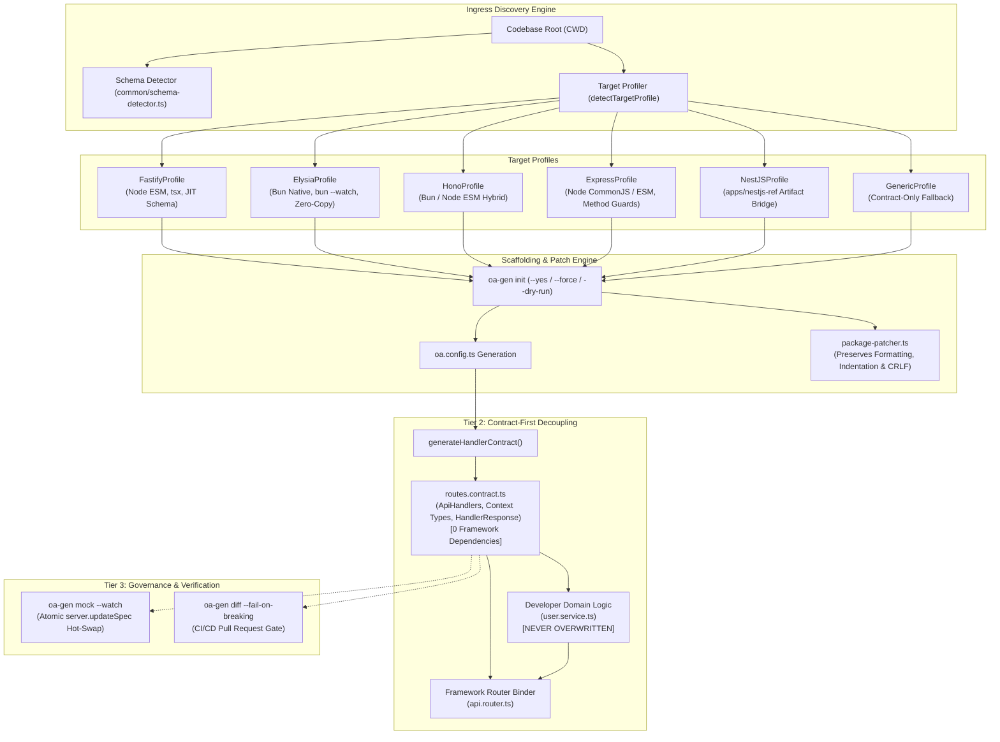

# Project Onboarding & Progressive Adoption Architecture (`oa-onboarding`)

The `oa-onboarding` skill provides an authoritative, operational manual and diagnostic framework for autonomous agents and engineers introducing the `oa-sdk` ecosystem into external Greenfield and Brownfield codebases.

It establishes standard procedures for:
1. **Target-Separated Onboarding (`oa-gen init`)**: 30-second headless/interactive setup auto-detecting host runtimes (Bun vs. Node), framework targets (Fastify, Elysia, Hono, Express, NestJS, Generic), schema sources (.tsp, openapi.yaml, openapi.json, `@oaOperation` JSDoc), lifecycle archetype presets (`mvp`, `microservice`, `enterprise`), and output routing presets (`default`, `fsd`, `monorepo`, `by-kind`) with zero architectural disruption.
2. **Dual-Layer Architectural Decoupling**: Enforcing strict isolation between the immutable Shared Platform Core (`core`) and the evolvable Product-Specific Domain Layer (`product`).
3. **Contract-First Decoupling & Generic Context (`generateHandlerContract`)**: Generating pure TypeScript handler interfaces (`*.contract.ts`) completely isolated from framework plumbing with generic context injection (`${baseName}Context<TContext>`, `ApiHandlers<TContext>`), discriminated multi-status error unions (`HandlerResponse<TSuccess, TErrorMap, THeaders>`), and 3-part response envelope collision defense, eradicating the "Overwrite Dilemma", wire schema pollution, and framework lock-in.
4. **High-Performance Multi-Framework Binders**: Fastify (with inlined JIT schemas for `fast-json-stringify`), Bun Elysia (fluent chaining with selective zero-copy context destructuring), Hono (multi-runtime), and Express (with OAS 3.2 method guards), all accepting generic `getContext` / `context` options.
5. **Live In-Memory Mock Hot-Reloading (`oa-gen mock --watch`)**: Dual TypeSpec and OpenAPI/JSDoc watching with 100ms debouncing, atomic `server.updateSpec` route swapping, and zero socket drop.
6. **Frontend Query & Client Integration**: TanStack Query v5 3-tier generation (Keys, pure Options, UI Hooks) with automated infinite pagination detection (`cursor`, `page`, `offset`) and `AbortSignal | null` request cancellation pass-through.
7. **Continuous Contract Governance**: CI/CD breaking change detection via `oa-gen diff --fail-on-breaking` and 3-gate safe orphan pruning via `.oa-manifest.json`.

---

## 1. Executive Scope & 5 Zero-Value Management Points

Traditional API tooling forces development teams to maintain repetitive, fragile glue code across client, server, and documentation layers. `oa-onboarding` targets and eliminates the **5 Zero-Value Management Points**:

| # | Management Point | Legacy Problem State | `oa-sdk` Elimination Mechanism | Quantified Impact |
|---|---|---|---|---|
| **1** | **Sync Overhead** | Manual client/server synchronization meetings; documentation drifts from implementation code. | Single-source-of-truth OAS 3.2 / TypeSpec contracts feed automated type, router, and client emitters. | Eliminates **4–6 hrs/week** of API coordination meetings. |
| **2** | **Overwrite Dilemma** | Re-running code generation clobbers handwritten business logic in route controllers, causing "regeneration anxiety". | Architectural separation between pure data contracts (`*.contract.ts`) and framework binders (`*.router.ts`). Business logic resides in user service files. | **0 code collisions** and 100% safe continuous regeneration. |
| **3** | **Mock Bottlenecks** | Frontend and QA teams are blocked waiting for backend API endpoints to be implemented. | Zero-build live mock server (`oa-gen mock --watch`) generates realistic responses from schema definitions with in-memory hot reload. | Frontend lead time reduced from **days $\rightarrow$ 0 seconds**. |
| **4** | **Framework Lock-In** | Business logic tightly coupled to framework Request/Response objects (`FastifyRequest`, `express.Response`), making migration prohibitive. | Pure Context data objects (`{ params, query, body }`). `@oa-sdk/router` has 0 framework runtime dependencies; switching frameworks only swaps the binder file. | Framework migration effort reduced from **weeks $\rightarrow$ minutes**. |
| **5** | **Silent Breaking Drift**| Breaking changes (dropped properties, altered types, added required fields) deployed to production silently breaking clients. | CI gate `oa-gen diff --fail-on-breaking` analyzes AST semantics and fails builds on non-backward-compatible changes. | Unplanned production API hotfixes reduced to **0 (Zero Drift)**. |

---

## 2. Architectural Topology & Adoption Flow



### 2.1 Shared Platform Core vs. Product-Specific Domain Taxonomy

The `oa-sdk` ecosystem enforces a strict architectural boundary dividing every system into two isolated, orthogonal layers:

```
┌─────────────────────────────────────────────────────────────────────────────┐
│  SHARED PLATFORM CORE (불변 공유 코어) — Single Source of Truth              │
│  - Universal Wire Specs: OpenAPI 3.2, TypeSpec AST, JSON Schema 2020-12     │
│  - Decoupled Pure Handler Contracts: generateHandlerContract() -> *.contract.ts│
│  - Wire-Safe Primitive Typing: JsonPrimitive<T>, wireFormatSafety: true     │
│  - Automated Breaking Change Defense: oa-gen diff --fail-on-breaking        │
│  - Zero Framework Leaks: @oa-sdk/router has 0 runtime framework dependencies │
└──────────────────────────────────────┬──────────────────────────────────────┘
                                       │ Pure Contracts & Wire Types
                                       ▼
┌─────────────────────────────────────────────────────────────────────────────┐
│  PRODUCT-SPECIFIC DOMAIN LAYER (제품 특화 확장 레이어) — Lifecycle & Bindings│
│  - Day 1 Lifecycle Archetypes: mvp | microservice | enterprise              │
│  - Framework Route Binders: Fastify JIT, Elysia Zero-Copy, Hono, Express    │
│  - Generic Context Injection: options.getContext / context (auth, tenancy)  │
│  - Domain Projections & Security: ProfileTargetConfig, personas, audit log │
└─────────────────────────────────────────────────────────────────────────────┘
```

1. **Shared Platform Core (`core`)**:
   - **Universal Wire Specifications**: Authored in OpenAPI 3.2 or TypeSpec (`.tsp`). Represents the invariant public protocol.
   - **Decoupled Handler Contracts**: Standalone interfaces (`*.contract.ts`) declaring wire payloads (`params`, `query`, `headers`, `body`) and generic context slots (`TContext`).
   - **Wire-Safe Primitive Typing**: Sanitizes TypeScript types via `JsonPrimitive<T>`, converting `Date` to `string` and stripping runtime functions.
   - **Zero-Breakage Guarantee**: Core contracts remain **completely invariant** as the product transitions from MVP to Microservice to Enterprise.

2. **Product-Specific Domain Layer (`product`)**:
   - **Day 1 Lifecycle Archetypes**: Configured via `--archetype <mvp|microservice|enterprise>` in `oa-gen init` and resolved via `resolveConfigWithDefaults`.
   - **Framework Runtime Binders**: Mounts pure handlers to specific framework engines without coupling business logic to framework request objects.
   - **Generic Product Context Injection**: Supplies application-level context (`tenantId`, `user`, `traceId`, `db`) through `options.getContext` or `options.context` without polluting OpenAPI schemas.
   - **Persona Capability Traits**: `@personaCapability` and `@pseudonymize` tags enabling fine-grained capability masks for `@oa-sdk/personas`.

---

## 3. Diagnostic Decision Matrices

When an autonomous agent inspects an arbitrary target repository, it must evaluate the following five decision matrices before executing any modification.

### Matrix 0: Day 1 Lifecycle Archetype Decision Matrix

Every codebase must be classified into one of three Lifecycle Archetypes based on operational maturity:

| Feature / Dimension | MVP Archetype (`mvp`) | Microservice Archetype (`microservice`) | Enterprise Archetype (`enterprise`) |
|---|---|---|---|
| **Target Stage** | Greenfield prototypes, POCs, early-stage startups (Day 1) | Production microservices, high-traffic internal APIs (Day 60+) | Multi-team regulated platforms, public APIs, enterprise SOA (Day 180+) |
| **Throughput & Serialization** | Standard JSON serialization, zero tuning overhead | Fastify JIT inlined schema (`fast-json-stringify`) or Bun Elysia zero-copy destructuring | Multi-target projection bundles, cached schema evaluation, sub-millisecond serialization |
| **Wire Typing Safety** | Relaxed primitive typing | Strict wire-safe typing (`wireFormatSafety: true`, `JsonPrimitive<T>`) | Strict wire-safe typing + circular reference lazy resolution + schema sealing |
| **Contract Testing** | Manual validation, live mock unblocking | Automated unit contract tests (`vitest` / native `bun test` testing `ApiHandlers`) | Comprehensive contract integration suite + mock mesh simulation |
| **Breaking Change Gates** | Advisory / non-blocking diff warnings | Automated PR gate (`oa-gen diff --fail-on-breaking`) | Zero-tolerance CI gate + TypeSpec semantic diff + persona coverage audit |
| **Context Injection** | Static dependency container or omitted | Per-request tenancy (`tenantId`) and tracing (`traceId`) via `getContext` | Full IAM actor context (`user`, `roles`, `permissions`, `auditSpan`) |
| **Persona Governance** | Disabled (`personas: undefined`) | Optional capability traits on sensitive endpoints | Mandatory `@personaCapability` checks, `@pseudonymize` data masking |
| **CLI Initialization** | `oa-gen init -t <target> -a mvp --routing default` | `oa-gen init -t <target> -a microservice --routing fsd` | `oa-gen init -t <target> -a enterprise --routing monorepo` |

### Matrix 1: Host Runtime Engine (Bun vs. Node.js)

| Host Runtime | Primary Indicators | Scripts Emitted | Tooling DevDependencies Injected | Prohibited Tooling |
|---|---|---|---|---|
| **Bun** | `bun.lockb`, `bun.lock`, or `process.versions.bun` | `bun --watch src/index.ts`<br>`bun x oa-gen generate`<br>`bun x oa-gen mock --watch` | `@types/bun: 'latest'` | **STRICTLY PROHIBITED**:<br>`tsx`, `nodemon`, `@types/node` |
| **Node.js** | `pnpm-lock.yaml`, `package-lock.json`, `yarn.lock`, or no Bun markers | `tsx watch src/server.ts`<br>`oa-gen generate`<br>`oa-gen mock --watch` | `tsx: '^4.7.0'`,<br>`typescript: '^5.4.0'`,<br>`@types/node: '^20.0.0'` | `bun` commands |

### Matrix 2: Framework Target Profile

| Target ID | Detection Markers | Confidence | Generated Target in `oa.config.ts` | Router Architecture Features |
|---|---|---|---|---|
| **`fastify`** | `dependencies['fastify']` or `fastify.config.{ts,js}` | 0.95 | `target: 'fastify'` | `FastifyPluginAsync`, inlined JIT schemas for `fast-json-stringify` acceleration. |
| **`elysia`** | `dependencies['elysia']` or `bun.lockb` | 0.95 | `target: 'elysia'` | Fluent `new Elysia()` chaining, selective zero-copy destructuring (`{ params, query, body, set }`). |
| **`hono`** | `dependencies['hono']` | 0.90 | `target: 'hono'` | Multi-runtime routing (`app.get()`, `app.on()` for OAS 3.2 verbs). |
| **`express`** | `dependencies['express']` | 0.85 | `target: 'express'` | Express router with inline method guard (`if (req.method !== 'QUERY') return next()`). |
| **`nestjs`** | `@nestjs/core`, `@nestjs/common`, or `nest-cli.json` | 0.95 | `target: 'generic'` | Swagger metadata extraction via `SwaggerModule.createDocument`; retains `nest start --watch`. |
| **`generic`** | None of the above (fallback) | 0.10 | `target: 'generic'` | Framework-agnostic pure contract emission (`api.contract.ts`). |

### Matrix 3: Schema Ingress State

| Schema Format | File Patterns | Detection Confidence | Ingress Action |
|---|---|---|---|
| **TypeSpec** | `packages/schemas/typespec/main.tsp`, `main.tsp`, `*.tsp` | 1.00 (score 100) | Set as `schemaEntry`; wire `oa-gen mock --tsp <path> --watch` and `oa-gen tsp diff`. |
| **OpenAPI YAML** | `openapi.yaml`, `openapi.yml`, `spec.yaml` | 0.95 (score 95) | Set as `schemaEntry`; wire `oa-gen mock --spec <path> --watch` and `oa-gen diff`. |
| **OpenAPI JSON** | `openapi.json`, `swagger.json` | 0.90 (score 90) | Set as `schemaEntry`; wire `oa-gen mock --spec <path> --watch`. |
| **JSDoc Annotations** | `src/**/*.ts` with `@oaOperation <METHOD> <PATH>` | 0.75 (score 75) | Set directory as `schemaEntry`; watcher monitors `.ts` source files. |
| **Greenfield None** | No schema files detected | 0.50 (fallback) | Default `schemaEntry` to `openapi.yaml`; prompt or scaffold base contract. |

### Matrix 4: 3-Tier Value Adoption Ladder

| Adoption Tier | Required Changes | Deliverables | Verification Gate |
|---|---|---|---|
| **Tier 1: Instant Discovery & Zero-Friction Scan** | 0 code modifications; run `oa-gen init --yes` | `oa.config.ts`, patched `package.json` scripts | File existence, `pnpm check:docs` |
| **Tier 2: Contract-First Decoupling** | Implement `ApiHandlers` in service class; mount router | `api.contract.ts`, `api.router.ts`, `service.ts` | `tsc --noEmit` passes with 0 type errors |
| **Tier 3: Automated Governance & Drift Defense** | Add CI GitHub Actions workflow; launch mock server | `ci.yml` with `oa-gen diff --fail-on-breaking` | PR branch breaking change simulation blocked |

### Matrix 5: Output Path Routing & Project Layout Strategies

| Layout Strategy | Configuration Pattern (`outputRouting`) | Target Directory Topology | Primary Benefits |
|---|---|---|---|
| **Flat Convention (Default)** | Default / omitted `outputRouting` | `src/api/generated/{contracts,client,queries,keys}.ts` | Minimal setup, standard single-service Node/Bun architecture. |
| **Feature-Sliced Design (FSD)** | `pattern: 'src/features/{tag}/api/{tag}.{kind}.ts'`<br>`rules: [{ tag: ['common', 'shared'], target: 'src/shared/api/{tag}.{kind}.ts' }]`<br>`byKind: { client: 'src/shared/api/client.ts' }` | Slices: `src/features/{feature}/api/` & `src/shared/api/` | Perfect slice encapsulation; relative imports between feature queries and shared clients are auto-recalculated. |
| **Full-Stack Monorepo** | `byKind: { contract: 'packages/contracts/src/api.contract.ts', client: 'packages/client-sdk/src/index.ts', queries: 'apps/web/src/api/queries.ts', keys: 'apps/web/src/api/keys.ts' }` | Cross-package: `packages/contracts/`, `packages/client-sdk/`, `apps/web/` | Single OpenAPI SSOT projects contracts to backend and TanStack queries to frontend across monorepo workspace boundaries. |
| **Clean Architecture / DDD** | `pattern: 'src/domain/{tag}/api/{tag}.{kind}.ts'` | Domain slices: `src/domain/{domain}/` | Preserves clean boundaries; handler contracts act as port interfaces for domain services. |

### Matrix 6: Frontend Data Fetching & Query Generator Strategies

| Strategy | Command / Engine | Output Deliverables | Execution Context |
|---|---|---|---|
| **Raw Typed Fetch SDK** | `oa-gen generate` (via `core.client`) / `generateClient()` | `client.ts` (`ApiClient` with `withResponse` helpers) | Framework-agnostic fetch calls, Node.js scripts, background workers. |
| **TanStack Query Tier 1 (Keys)** | `oa-gen generate:tanstack --tier keys` | `keys.ts` (`*Keys` hierarchical query key trees) | Pure TypeScript tuples (`as const`), 0 runtime dependencies, precise cache invalidation. |
| **TanStack Query Tier 2 (Options)** | `oa-gen generate:tanstack --tier options` | `queries.ts` (`*QueryOptions`, `*MutationOptions`) | Pure functional options layer; 0 UI lock-in; directly usable in Next.js Server Components (`prefetchQuery`), React, Vue, Svelte. |
| **TanStack Query Tier 3 (Hooks)** | `oa-gen generate:tanstack --tier hooks` | `hooks.ts` (`use*Query`, `use*Mutation`, `createApiHooks`) | React component tree integration with open generics (`select`, `enabled`, `staleTime`). |

---

## 4. Step-by-Step Agent Execution Procedures

When an agent is dispatched to onboard a codebase, it MUST follow these 10 discrete, verifiable steps:

### Step 1: Pre-Scan & Dry-Run Inspection
Execute non-destructive inspection to discover framework, host runtime, and schema candidates without writing files:
```bash
npx oa-gen init --dry-run
```
Verify the returned target ID, detected runtime (`bun` or `node`), and candidate schema path in stdout.

### Step 2: Archetype & Target Execution
Run the onboarding initialization specifying both the target framework, the lifecycle archetype preset (`mvp`, `microservice`, `enterprise`), and the output routing preset (`default`, `fsd`, `monorepo`, `by-kind`):
```bash
# For Fastify Microservice with FSD routing (Node ESM, JIT schema, contract tests)
npx oa-gen init --target fastify --archetype microservice --routing fsd --yes

# For Bun Elysia MVP with default routing (Bun native, zero-copy, live mock)
bun x oa-gen init --target elysia --archetype mvp --routing default --yes

# For Enterprise Platform Service with Monorepo routing (breaking change gates, personas)
npx oa-gen init --target fastify --archetype enterprise --routing monorepo --yes

# For Express or Hono
npx oa-gen init --target express --archetype microservice --routing by-kind --yes
npx oa-gen init --target hono --archetype mvp --routing default --yes
```

### Step 3: Validate Dual-Layer Configuration & Package Patch
Verify that `oa.config.ts` was generated with clean isolation between Shared Platform Core (`core`) and Product Domain Layer (`product`):
```typescript
import { defineConfig } from '@oa-sdk/codegen';

export default defineConfig({
  rootDir: '.',
  archetype: 'microservice',
  core: {
    dialect: { oasVersion: '3.2.0', jsonSchemaDialect: 'draft-2020-12', canonicalProjection: true },
    contracts: { pureHandlers: true, contractName: 'ApiHandlers', banner: true },
    client: { enabled: true, wireFormatSafety: true },
    typegen: { resolveSymbolCycles: false, discriminatedUnions: true },
    gates: { driftCheck: true, failOnBreaking: true, preflightLint: 'strict' },
  },
  product: {
    archetype: 'microservice',
    framework: 'fastify',
    runtime: 'node',
    jitSchema: true,
    zeroCopy: false,
    specs: [
      {
        id: 'api-service',
        profile: 'full-api-document',
        schemaEntry: './openapi.yaml',
        outDir: './src/generated',
      },
    ],
  },
});
```
Inspect `package.json`: confirm indentation (2/4 spaces or tabs), line endings (LF/CRLF), and trailing newlines are strictly preserved, with recommended scripts added without clobbering existing custom commands.

### Step 4: Configure Output Path Routing (FSD / Monorepo Layouts)
For non-trivial projects adopting Feature-Sliced Design (FSD) or multi-package monorepos, configure `outputRouting` in `oa.config.ts` (or initialize with `oa-gen init --routing <preset>`). Four standard presets are available:
- `default`: Flat output `src/api/generated/{contracts,client,queries,keys}.ts`
- `fsd`: Feature-Sliced Design pattern `src/features/{tag}/api/{tag}.{kind}.ts` with shared client and shared tags
- `monorepo`: Cross-package byKind mapping (`packages/contracts`, `packages/client-sdk`, `apps/web`)
- `by-kind`: Grouping by artifact kind `src/api/{kind}s/{kind}.ts`

```typescript
import { defineConfig } from '@oa-sdk/codegen';

export default defineConfig({
  rootDir: '.',
  outputRouting: {
    // 1. Template Pattern: Dynamic token substitution ({tag}, {kind}, {operationId}, {method}, {group})
    pattern: 'src/features/{tag}/api/{tag}.{kind}.ts',

    // 2. Rule Matchers: Route specific tags or kinds to custom targets
    rules: [
      {
        tag: ['common', 'shared', 'auth', 'system'],
        target: 'src/shared/api/{tag}.{kind}.ts',
      },
      {
        kind: 'schemas',
        target: 'src/shared/api/schemas.ts',
      },
    ],

    // 3. By-Kind Routing: Explicit destination per artifact kind
    byKind: {
      contract: 'packages/contracts/src/api.contract.ts',
      client: 'packages/client-sdk/src/index.ts',
      queries: 'apps/web/src/api/queries.ts',
      keys: 'apps/web/src/api/keys.ts',
    },
  },
});
```
- The Path Dispatcher supports 5 template tokens with casing modifiers (`{tag:kebab}`, `{kind:camel}`, `{operationId:pascal}`, `{method:lower}`, `{group}`) and automatically recalculates relative TypeScript imports (`path.relative`) across directory boundaries, appending NodeNext `.js` extensions.

### Step 5: Pure Handler Contract Generation with Generic Context
Generate the decoupled handler contracts:
```bash
npx oa-gen generate
```
Or via programmatic API (`generateHandlerContract` in `@oa-sdk/router`), outputting `src/generated/api.contract.ts`.

Contracts support **generic product context injection (`TContext = unknown`)** and **typed multi-status error unions** without polluting public OpenAPI wire schemas:
```typescript
// Auto-generated handler contracts from OpenAPI spec. Do not edit.
// @oa-sdk/router
export type HandlerResponse<TSuccess = unknown, TErrorMap = Record<number, unknown>, THeaders = Record<string, string>> =
  | TSuccess
  | { status: 200; body: TSuccess; headers?: THeaders }
  | { [K in keyof TErrorMap]: { status: K; body: TErrorMap[K]; headers?: Record<string, string> } }[keyof TErrorMap];

export interface GetUserContext<TContext = unknown> {
  params: GetUserPathParams;
  query?: GetUserQueryParams;
  headers: Record<string, string | undefined>;
  context?: TContext;
}

export type GetUserHandler<TContext = unknown> = (
  ctx: GetUserContext<TContext>,
) => HandlerResponse<GetUserResponse, GetUserErrors> | Promise<HandlerResponse<GetUserResponse, GetUserErrors>>;

export interface ApiHandlers<TContext = unknown> {
  getUser: GetUserHandler<TContext>;
}
```
If a shared context type is desired across all contracts, supply `contextImport: './context'` and `contextTypeName: 'AppContext'` in `HandlerContractOptions`.

#### Strict 3-Part Response Envelope Collision Defense Heuristic
All framework router binders apply the strict 3-part collision defense predicate:
```typescript
if (
  result !== undefined &&
  result !== null &&
  typeof result === 'object' &&
  'body' in result &&
  ((result as any).status === undefined || typeof (result as any).status === 'number') &&
  ((result as any).headers === undefined || typeof (result as any).headers === 'object')
) {
  // Treated as an HTTP response envelope -> set status and headers, return body
  const resp = result as { status?: number; headers?: Record<string, string>; body?: unknown };
  if (resp.headers) { /* set headers */ }
  if (resp.status) { /* set status */ }
  if (resp.status === 204) { /* send 204 No Content */ }
  return resp.body;
}
// Raw business entity -> serialized as HTTP 200 JSON
```
This ensures business entities with `status: 'ACTIVE'` (string) or `body: string` are NEVER mistakenly parsed as HTTP envelopes, and HTTP 204 No Content returns an empty body across all 4 frameworks.

### Step 6: Framework Router Binding & Custom Context Forwarding
1. Author business handlers implementing `ApiHandlers<AppContext>` in a user file (e.g. `src/services/user.service.ts`).
2. Register the router binder in the application entrypoint, forwarding custom context via `getContext` or static `context`:
   - **Fastify**:
     ```typescript
     import { apiRouter } from './generated/api.router.js';
     import { userService } from './services/user.service.js';

     await server.register(apiRouter, {
       prefix: '/api',
       handlers: userService,
       getContext: async (request) => ({
         tenantId: request.headers['x-tenant-id'] as string,
         user: (request as any).user,
       }),
     });
     ```
   - **Bun Elysia**:
     ```typescript
     import { createRouter } from './generated/api.router.js';
     import { userService } from './services/user.service.js';

     const app = new Elysia().use(
       createRouter(userService, {
         getContext: async ({ request, set }) => ({
           tenantId: request.headers.get('x-tenant-id') ?? 'default',
         }),
       }),
     );
     ```
   - **Hono**:
     ```typescript
     import { createRouter } from './generated/api.router.js';
     import { userService } from './services/user.service.js';

     const app = new Hono();
     app.route('/api', createRouter(userService, {
       getContext: (c) => ({
         user: c.get('jwtPayload'),
       }),
     }));
     ```
   - **Express**:
     ```typescript
     import { createRouter } from './generated/api.router.js';
     import { userService } from './services/user.service.js';

     app.use('/api', createRouter(userService, {
       getContext: (req, res) => ({
         tenantId: req.headers['x-tenant-id'],
         user: req.user,
       }),
     }));
     ```

### Step 7: TanStack Query v5 3-Tier Code Generation
Generate frontend TanStack Query artifacts using the dedicated CLI command or `--tanstack` flag:
```bash
# Generate unified TanStack Query v5 keys, options, and hooks
npx oa-gen generate:tanstack --spec ./openapi.yaml --output ./src/api/generated

# Generate split modular files (keys.ts, queries.ts, hooks.ts)
npx oa-gen generate:tanstack --spec ./openapi.yaml --output ./src/api/generated --split

# Generate via oa-gen generate
npx oa-gen generate --tanstack --spec ./openapi.yaml --output ./src/api/generated
```

#### Infinite Query Heuristics & `AbortSignal` Pass-Through
For paginated endpoints, the generator auto-detects cursor, page, or offset parameters and emits `*InfiniteQueryOptions`:
- Emits `getNextPageParam` logic extracting next page coordinates from response envelopes (`nextCursor`, `nextPage`, `pagination.next`).
- Passes `signal` from `queryFn: ({ pageParam, signal }) => client.listItems({ cursor: pageParam }, { signal })` directly into the isomorphic `@oa-sdk/client` fetch call.

Frontend consumption in Next.js 15 App Router Server Component with SSR prefetching:
```tsx
import { QueryClient, dehydrate, HydrationBoundary } from '@tanstack/react-query';
import { createClient } from '@/shared/api/client';
import { getUserByIdQueryOptions } from '@/features/users/api/users.queries';

export default async function Page({ params }: { params: Promise<{ id: string }> }) {
  const { id } = await params;
  const queryClient = new QueryClient();
  const client = createClient();

  // Tier 2 pure options passed directly to server-side prefetch:
  await queryClient.prefetchQuery(getUserByIdQueryOptions(client, { id }));

  return (
    <HydrationBoundary state={dehydrate(queryClient)}>
      <ClientDetailView id={id} />
    </HydrationBoundary>
  );
}
```

### Step 8: Safe Orphan Pruning via `.oa-manifest.json` (3-Gate Safety)
When endpoints are removed or renamed in the OpenAPI specification, invoke the orphan pruning engine to delete only obsolete generated artifacts while 100% protecting developer code:
- **Gate 1 (Provenance Check)**: Verifies the file path was originally registered in `.oa-manifest.json`. Unregistered files are strictly untouched.
- **Gate 2 (Hash Integrity Check)**: Compares the SHA-256 hash of the disk file with the recorded `contentHash`. If a developer modified the file, pruning is safely aborted.
- **Gate 3 (Banner Guard)**: Inspects the first 10 lines of the file for `@generated` / `@oa-sdk/codegen` banner markers. If absent, pruning is aborted.

### Step 9: Live Instant Mock Server Execution
Start the zero-build live mock server with hot reloading enabled:
```bash
# For OpenAPI schema
npx oa-gen mock --spec ./openapi.yaml --watch --port 4010

# For TypeSpec schema
npx oa-gen mock --tsp ./main.tsp --watch --port 4010
```
Verify that modifying the schema triggers debounced (100ms) recompilation and `server.updateSpec` route swap without disconnecting TCP clients.

### Step 10: Continuous Governance & Zero-Breakage Lifecycle Evolution
Incorporate breaking change defense and evolve projects across maturity stages without breaking contracts:

```bash
# CI/CD pull request gate for OpenAPI
npx oa-gen diff --base origin/main --head ./openapi.yaml --fail-on-breaking

# CI/CD pull request gate for TypeSpec
npx oa-gen tsp diff --base origin/main --head ./main.tsp --fail-on-breaking
```

#### Zero-Breakage Evolution Runbook
1. **Day 1 MVP $\rightarrow$ Day 60 Microservice**:
   - Update `oa.config.ts`: change `archetype: 'mvp'` to `archetype: 'microservice'`.
   - Run `npx oa-gen init --target fastify --archetype microservice --force` (updates scripts to include contract tests).
   - In router binder, provide `getContext` to extract `tenantId` and `traceId`.
   - **Result**: `api.contract.ts` and `src/services/user.service.ts` remain **100% untouched** (0 code modifications).
2. **Day 60 Microservice $\rightarrow$ Day 180 Enterprise**:
   - Update `oa.config.ts`: change `archetype: 'microservice'` to `archetype: 'enterprise'`.
   - Add `oa-gen diff --fail-on-breaking` to GitHub Actions workflow.
   - Annotate TypeSpec/OpenAPI schemas with `@personaCapability` and `@pseudonymize`.
   - Expand `getContext` to return full enterprise IAM context (`user`, `roles`, `auditLog`).
   - **Result**: Core wire contracts and business handlers remain invariant while enterprise governance is activated.

---

## 5. 9 Strict Invariants & Guardrails

Every agent adopting `oa-sdk` MUST maintain these 9 invariants without exception:

### Invariant 1: Strict Runtime Isolation (Bun vs. Node)
- **Bun projects** (`bun.lockb`, `bun.lock`, Elysia target) MUST strictly use Bun-native commands (`bun --watch`, `bun x oa-gen`) and devDependency `@types/bun`.
- An agent must **NEVER** inject `tsx`, `nodemon`, `@types/node`, or `node` CLI commands into a Bun project.
- **Node projects** (Fastify, Express, NestJS) MUST use Node ESM tooling (`tsx watch`, `@types/node`) and never invoke `bun`.

### Invariant 2: Handler Contract Purity & Generic Context Decoupling
- Generated `*.contract.ts` files MUST have **ZERO framework imports**. No `import { FastifyRequest }`, no `import { Context } from 'elysia'`, no `import { Request } from 'express'`.
- Handler contexts must strictly consist of pure JSON-serializable primitives and data bags (`params`, `query`, `querystring`, `headers`, `body`).
- Product runtime context (`tenantId`, `user`, `db`) MUST be injected via generic `context?: TContext` and provided via router binder `getContext` / `context`.
- **Zero Wire Pollution**: Internal server context properties must NEVER be declared as OpenAPI parameters or schemas.

### Invariant 3: Non-Destructive Package Patching
- `package.json` modifications MUST preserve existing indentation (detected tabs, 2 spaces, or 4 spaces), line endings (`\r\n` or `\n`), and trailing newlines.
- Existing custom scripts and dependencies MUST NOT be clobbered unless `--force` is explicitly provided.

### Invariant 4: Zero-Eval CSP Compliance
- All generated code (routers, contracts, standalone type guards) must operate without `eval()` or `new Function()`.
- Generated code must pass `oa-gen audit:csp`.

### Invariant 5: Hermetic Closed Skill Governance
- Skills must be registered in `.agents/skills.json` and must not contain universal cross-domain wildcards (`.*`).
- All relative markdown links and CLI examples must pass `pnpm check:docs`.

### Invariant 6: Dual-Layer Architectural Preservation
- `oa.config.ts` must maintain strict separation between Shared Platform Core (`core`) and Product Domain Layer (`product`).
- Upgrading lifecycle archetypes (`mvp` $\rightarrow$ `microservice` $\rightarrow$ `enterprise`) or switching framework targets MUST NOT mutate core contracts or require rewriting business handlers.

### Invariant 7: Output Path Sovereignty & Relative Import Integrity
- Output directory paths are never hardcoded. Path routing must respect `outputRouting` configuration (`pattern`, `rules`, `byKind`).
- Relative TypeScript imports (`path.relative`) across directory boundaries must be dynamically computed with POSIX forward slashes and modern NodeNext `.js` extensions.

### Invariant 8: 3-Gate Safe Orphan Pruning
- Automatic file deletion during spec updates is strictly gated by `.oa-manifest.json`:
  1. **Provenance Gate**: Unrecorded files are never touched.
  2. **Hash Integrity Gate**: Modified files with mismatching SHA-256 hashes abort deletion.
  3. **Banner Gate**: Files missing `@generated` banner markers abort deletion.
- Hand-written developer files must **NEVER** be deleted or overwritten.

### Invariant 9: Zero Runtime Dependency Leaks on Query Libraries
- `@oa-sdk/client` and `@oa-sdk/codegen` must **NEVER** declare `@tanstack/react-query` as a runtime dependency.
- All emitted TanStack Query options and hooks import from consumer-configured packages without polluting SDK library footprints.

---

## 6. Anti-Patterns & Negative Constraints

| Anti-Pattern | Why It Breaks the Architecture | Correct Remediation |
|---|---|---|
| **Injecting `FastifyRequest` into Business Handlers** | Binds domain logic to Fastify's internal prototype, preventing reuse in tests, serverless, or other frameworks. | Depend exclusively on `GetUserContext` from `api.contract.ts`. |
| **Polluting OpenAPI Schemas with Private Server State** | Exposes internal database keys, auth tokens, or tenancy IDs in client-facing wire documentation. | Use generic `TContext` in handler contracts and inject via router binder `getContext`. |
| **Injecting `tsx` into Bun/Elysia Projects** | Pollutes `package.json` with redundant Node dependencies, doubles install times, and risks runtime mismatches. | Use native `bun --watch src/index.ts`. |
| **Editing Generated `*.router.ts` or `*.contract.ts` Manually** | Handcrafted modifications will be obliterated on the next schema regeneration. | Put all business logic in user service files implementing `ApiHandlers`. |
| **Rewriting Business Handlers during Lifecycle Evolution** | Violates the core promise of decoupled architecture and causes regression bugs. | Keep handler implementations invariant; configure new capabilities in `oa.config.ts`. |
| **Using Unregistered CLI Flags in Shell Scripts** | Fails documentation gates (`[cli-examples] unknown oa-gen option`) and breaks automated CI. | Use only registered options verified in `packages/codegen/src/cli/commands.ts`. |
| **Bypassing Breaking Change Gates with `--no-fail`** | Allows silent API drift into production, causing runtime crashes for mobile and web clients. | Keep `--fail-on-breaking` enabled; version contracts or introduce non-breaking deprecations. |

---

## 7. Troubleshooting & Diagnostic Matrix

| Symptom / Error | Root Cause | Remediation Procedure |
|---|---|---|
| `TS6133: 'params' is declared but its value is never read` (in Elysia router) | Router generator destructured unused variables on parameter-less routes under `noUnusedLocals: true`. | Ensure `@oa-sdk/router` is up to date; the Elysia binder uses dynamic `destructureFields` to emit only `{ set }` when parameters are absent. |
| `Unknown target framework: <target>` | Invalid target identifier passed to `oa-gen init --target`. | Supported targets: `fastify`, `elysia`, `hono`, `express`, `nestjs`, `generic`. |
| `Invalid package.json syntax` | Target repository has malformed JSON or trailing commas in `package.json`. | Fix syntax errors in `package.json` before running `oa-gen init`. |
| `Compilation error, keeping previous routes active` | Schema file saved with syntax error during `oa-gen mock --watch`. | Normal error shielding behavior: the mock server continues serving traffic on the previous valid route table. Correct the syntax in your YAML/TSP file to trigger automatic reload. |
| `422 Unprocessable Entity on mock request` | Request payload fails schema validation against OpenAPI/TypeSpec rules. | Inspect the 422 JSON response; `@oa-sdk/mock-server` outputs structured validation errors indicating the exact path coordinate that failed. |
| Business entity with `status: 'ACTIVE'` treated as HTTP envelope | Router heuristics mistakenly triggered by simple property existence | Handlers use strict 3-part collision defense: `'body' in result && (status === undefined || typeof status === 'number') && (headers === undefined || typeof headers === 'object')` |
| `TypeError: Cannot read properties of null (reading 'aborted')` on request cancellation | Client caller passed `signal: null` instead of `undefined` | Generated client SDK normalizes `signal?: AbortSignal | null` via `__combineSignals` safely |
| Broken relative import between feature queries and shared client | Output routing placed client in different directory | The Path Dispatcher automatically recalculates `path.relative` across directory boundaries with NodeNext `.js` extensions |

---

## 8. Standard Verification Commands

After completing any onboarding or contract integration task, run the following verification suite:

```bash
# 1. Monorepo documentation integrity and CLI example checks
pnpm check:docs

# 2. CLI specification parity and argument schema validation
pnpm check:cli-spec

# 3. Full workspace TypeScript compilation check
pnpm typecheck:all

# 4. Router unit and integration test suite
pnpm --filter @oa-sdk/router test

# 5. Codegen onboarding engine and init test suite
pnpm --filter @oa-sdk/codegen test
```
