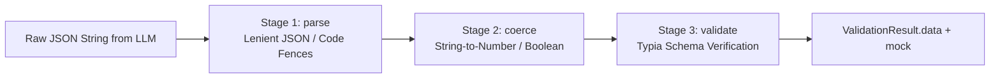

# Downstream Runtime & Execution Architecture (`oa-runtime`)

The `oa-runtime` skill provides architecture standards, operational implementation guides, and verification procedures for Tier 3 (`Runtime & Downstream`) of the `oa-sdk` monorepo. It governs four foundational downstream packages:

1. `@oa-sdk/router`: Code rendering engine for typed Hono, Express, Fastify (`FastifyPluginAsync` + inline JIT schema acceleration), and Bun Elysia (`createRouter` + fluent chaining + selective context destructuring) routers, framework-independent pure Handler Contract separation (`generateHandlerContract`), OpenAPI `{param}` to `:param` path mapping, OAS 3.2 non-standard verb handling (`HEAD`, `TRACE`, `QUERY`), raw query string extraction, and webhook stubs (0 framework runtime dependencies).
2. `@oa-sdk/client`: Zero-dependency, isomorphic TypeScript fetch client SDK featuring multi-realm structural duck typing (`isClientError`), exponential backoff retry with `Retry-After` header parsing and response stream cancellation (`await res.body?.cancel()`), and streaming primitives (`streamSse`, `streamNdjson`).
3. `@oa-sdk/mock-server`: Dual MSW and Node HTTP mock server adapters with literal-first regex route specificity matching (`compareRouteSpecificity`), stateful overrides (`server.override`), schema folding synthesis, fail-closed 422 sensitive value redaction (`MockReceivedValueSummary`), and atomic live route hot-swapping (`server.updateSpec`).
4. `@oa-sdk/typia-mock`: Maintenance-only quarantine boundary isolating Samchon Typia's AST compiler transformer complexity (`ttsc`/`ts-patch`) while serving `ILlmApplication` consumers via a 3-stage validation pipeline (`parse` -> `coerce` -> `validate`) and minimal mock algebra (`typiaGenerateAlgebra`).

---

## 🏛️ Architectural Topology & Component Boundaries

```mermaid
graph TD
    subgraph Upstream [Tier 1 & Tier 2 Sources]
        OasDoc["OAS 3.1 / 3.2 Document (OasDocument / ParsedDocument)"]
        Parser["@oa-sdk/parser (RouteIndex & foldSchema)"]
    end

    subgraph RouterEngine [Downstream Router (@oa-sdk/router)]
        RouterGen["generateRouter(spec, options)"]
        HandlerContract["Handler Contracts (generateHandlerContract -> *.contract.ts)"]
        ToColon["toColonPath: {param} -> :param"]
        RawQuery["__readOaRawQuerystring (OAS 3.2)"]
        HonoTarget["Hono Router (app.on for HEAD/TRACE/QUERY)"]
        ExpressTarget["Express Router (router.all + method guard)"]
        FastifyTarget["Fastify Router (FastifyPluginAsync + JIT Schema)"]
        ElysiaTarget["Bun Elysia Router (Fluent Chaining + Context Destructure)"]
        Webhooks["Webhook Stubs (doc.webhooks)"]
    end

    subgraph ClientEngine [Typed Client SDK (@oa-sdk/client)]
        ClientGen["generateClient(spec, options)"]
        FetchTransport["Zero-Dependency Fetch Transport (Web APIs)"]
        DuckType["isClientError (Structural Duck-Typing)"]
        RetryLoop["Exponential Backoff & res.body?.cancel()"]
        Streams["Streaming Primitives (streamSse & streamNdjson)"]
        AuthMid["Auth Middleware (Bearer / Basic / ApiKey)"]
    end

    subgraph MockEngine [In-Memory Mock Server (@oa-sdk/mock-server)]
        NodeHttp["Node HTTP Adapter (createNodeMockServer, port: 0)"]
        MswAdapter["MSW Adapter (createMswHandlers)"]
        RouteMatch["matchRoute & WeakMap Regex Cache"]
        Specificity["compareRouteSpecificity (Literal-first Sort)"]
        Overrides["Stateful Overrides (server.override)"]
        Redaction["422 Value Redaction (MockReceivedValueSummary)"]
        Callbacks["Outbound Webhook / Callback Simulation"]
        LiveHotSwap["Atomic Route Swapping (server.updateSpec)"]
    end

    subgraph TypiaQuarantine [Compiler Transform Boundary (@oa-sdk/typia-mock)]
        Isolation["Maintenance-Only Quarantine (docs/internal/platform-scope.md)"]
        LlmApp["Samchon ILlmApplication Consumers"]
        ValidationPipe["3-Stage Pipeline (parse -> coerce -> validate)"]
        TypiaAlgebra["typiaGenerateAlgebra (allOf Merge & enum[0])"]
    end

    OasDoc --> RouterGen
    OasDoc --> HandlerContract
    OasDoc --> ClientGen
    OasDoc --> MockEngine
    Parser --> MockEngine

    RouterGen --> ToColon
    RouterGen --> RawQuery
    RouterGen --> HonoTarget
    RouterGen --> ExpressTarget
    RouterGen --> FastifyTarget
    RouterGen --> ElysiaTarget
    RouterGen --> Webhooks

    ClientGen --> FetchTransport
    ClientGen --> DuckType
    ClientGen --> RetryLoop
    ClientGen --> Streams
    ClientGen --> AuthMid

    MockEngine --> RouteMatch
    RouteMatch --> Specificity
    MockEngine --> Overrides
    MockEngine --> Redaction
    MockEngine --> Callbacks
    MockEngine --> LiveHotSwap

    Isolation --> LlmApp
    LlmApp --> ValidationPipe
    ValidationPipe --> TypiaAlgebra
```

---

## 1. Downstream Runtime Routing (`@oa-sdk/router`)

`@oa-sdk/router` translates normalized OpenAPI 3.1 and 3.2 operations into typed route handlers and decoupled handler contracts for **Hono**, **Express**, **Fastify**, and **Bun Elysia** applications.

### 1.1 Entrypoints & Generation API

`@oa-sdk/router` operates in two complementary paradigms:
1. **Framework Router Binding (`generateRouter`, `generateRouterSync`)**: Renders framework-specific router definitions (Hono, Express, Fastify plugin, Bun Elysia instance) bound to typed handlers.
2. **Pure Handler Contract Generation (`generateHandlerContract`, `generateHandlerContractFromParsed`)**: Emits framework-independent pure TypeScript handler signatures (`*.contract.ts`), completely decoupling business logic from routing plumbing.

```typescript
import {
  generateRouter,
  generateRouterSync,
  generateHandlerContract,
  type RouterOptions,
  type RouterTarget,
  type RouterMode,
  type HandlerContractOptions,
} from '@oa-sdk/router'
import type { OasDocument, ParsedDocument } from '@oa-sdk/core'

export interface RouterOptions {
  /** Target routing framework: 'hono' | 'express' | 'fastify' | 'elysia' (default: 'hono') */
  target?: 'hono' | 'express' | 'fastify' | 'elysia'
  /** Mode: 'stub' (standalone with TODOs) or 'contract' (bound to handler contract) */
  mode?: 'stub' | 'contract'
  /** Path to import generated API types from (e.g. './types') */
  typesImport?: string
  /** Path to import handler contract from (e.g. './api.contract'). Automatically activates mode: 'contract' */
  contractImport?: string
  /** Name of the handlers aggregate interface (default: 'ApiHandlers') */
  contractName?: string
  /** Include header comment banner */
  banner?: boolean
  /** Base path for resolving relative external $refs */
  basePath?: string
}

export interface HandlerContractOptions {
  /** Path to import generated API types from (e.g. './types') */
  typesImport?: string
  /** Aggregate handlers interface name (default: 'ApiHandlers') */
  contractName?: string
  /** Include header comment banner */
  banner?: boolean
  /** Base path for resolving relative external $refs */
  basePath?: string
}

// 1. Generate decoupled pure TypeScript handler contracts
const contractSource: string = generateHandlerContract(spec, { typesImport: './types.js' })

// 2. Generate Fastify plugin router bound to handler contract
const fastifySource: string = generateRouter(spec, {
  target: 'fastify',
  typesImport: './types.js',
  contractImport: './api.contract.js',
})

// 3. Generate Bun Elysia router bound to handler contract
const elysiaSource: string = generateRouter(spec, {
  target: 'elysia',
  typesImport: './types.js',
  contractImport: './api.contract.js',
})
```

### 1.2 Path Parameter Mapping via `toColonPath`

OpenAPI defines template parameters using curly braces (e.g. `/organizations/{orgId}/users/{userId}`). Hono (`RegExpRouter`, `TrieRouter`), Express (`path-to-regexp`), Fastify (`find-my-way`), and Elysia require colon-prefixed parameters (`:orgId`, `:userId`).

`@oa-sdk/router` uses `toColonPath` from `@oa-sdk/core`:

```typescript
// packages/core/src/strings.ts:82
export function toColonPath(openApiPath: string): string {
  return openApiPath.replace(/\{([^}]+)\}/g, ':$1')
}
```

Generated handlers extract path parameters via typed casts:
- **Hono**: `const params = c.req.param() as unknown as OperationPathParams`
- **Express**: `const params = req.params as unknown as OperationPathParams`
- **Fastify**: `const params = request.params as OperationPathParams` (or via Fastify route generics)
- **Elysia**: Selective zero-copy context destructuring: `async ({ params }) => { ... }`

### 1.3 OAS 3.2 Non-Standard HTTP Verbs (`HEAD`, `TRACE`, `QUERY`)

OpenAPI 3.2 introduces first-class support for `HEAD`, `TRACE`, and `QUERY` methods. Because modern router frameworks differ in how they expose method-specific registration functions, `@oa-sdk/router` applies strict framework-specific branching:

#### Hono Target
Hono exposes convenience methods only for `get`, `post`, `put`, `delete`, `patch`, and `options`. For other HTTP verbs, it generates `app.on(...)`:

```typescript
// For GET, POST, PUT, DELETE, PATCH, OPTIONS:
app.get('/users/:id', async (c) => { ... })

// For OAS 3.2 HEAD, TRACE, and QUERY:
app.on('QUERY', '/users/search', async (c) => {
  try {
    const body = await c.req.json() as SearchUsersBody
    return c.json(result, 200)
  } catch (err) {
    return c.json({ error: String(err) }, 500)
  }
})
```

#### Express Target
Express provides methods for standard verbs plus `router.head(...)`, but lacks methods for `TRACE` and `QUERY`. Express stubs emit `router.all(...)` paired with a fail-pass method guard:

```typescript
// For OAS 3.2 QUERY or TRACE:
router.all('/users/search', async (req, res, next) => {
  if (req.method !== 'QUERY') return next()
  try {
    const body = req.body as SearchUsersBody
    res.status(200).json(result)
  } catch (err) {
    res.status(500).json({ error: String(err) })
  }
})
```

### 1.4 Fastify Target Router (`renderFastifyRouter`)

The Fastify target (`packages/router/src/targets/fastify.ts`) generates idiomatic `FastifyPluginAsync` modules optimized for Node.js high-throughput environments:

1. **`FastifyPluginAsync` Encapsulation**: Emits a typed plugin function receiving `(fastify, options)` where options provide `{ handlers: ApiHandlers }`.
2. **Inline JIT Schema Compilation (`fast-json-stringify`)**: Inlines OpenAPI 3.2 Schema Objects directly into Fastify's route configuration:
   ```typescript
   fastify.get('/users/:id', {
     schema: {
       params: { type: 'object', required: ['id'], properties: { id: { type: 'string' } } },
       response: { 200: { type: 'object', properties: { id: { type: 'string' }, name: { type: 'string' } } } },
     },
   }, async (request, reply) => { ... })
   ```
   Fastify's internal compiler compiles this schema into optimized JavaScript string concatenation code via `fast-json-stringify`, yielding 2-3x serialization speedups over `JSON.stringify()`.
3. **HTTP Verb Dispatching**:
   - Convenience verbs: `fastify.get`, `fastify.post`, `fastify.put`, `fastify.delete`, `fastify.patch`, `fastify.head`, `fastify.options`.
   - OAS 3.2 non-convenience verbs (`QUERY`, `TRACE`): Dispatched via `fastify.route({ method: 'QUERY', url, schema, handler })`.
4. **TypeScript Strictness**:
   - Unused request parameter is emitted as `_request` when the route takes no parameters, querystring, headers, or body, eliminating TS6133 warnings.
   - For empty paths (`paths: {}`), emits `void fastify; void handlers;`.
5. **Dual Mode**: Supports `mode: 'stub'` (inline placeholder logic) and `mode: 'contract'` (dispatching directly to injected `ApiHandlers`).

### 1.5 Bun Elysia Target Router (`renderElysiaRouter`)

The Bun Elysia target (`packages/router/src/targets/elysia.ts`) targets the Bun native JavaScript runtime:

1. **Fluent Builder Chaining**: Emits `new Elysia({ prefix })` with chained `.get()`, `.post()`, `.put()`, `.delete()`, `.patch()`.
2. **Selective Zero-Copy Context Destructuring**: Bun provides zero-copy C++ memory structures for incoming HTTP requests. The Elysia generator dynamically inspects each operation's parameter requirements and destructures **only the fields actually accessed**:
   - Route with only query: `async ({ query, set }) => { ... }`
   - Route with body: `async ({ body, set }) => { ... }`
   - Route with no inputs: `async ({ set }) => { ... }`
   This completely eliminates `TS6133: 'params' is declared but its value is never read` compiler errors under strict `noUnusedLocals` and `noUnusedParameters`.
3. **OAS 3.2 Verb Support**: Non-convenience verbs (`OPTIONS`, `QUERY`, `TRACE`) route via `.route('QUERY', path, ...)`.
4. **Dual Mode**: Emits standalone app instance (`export const app = new Elysia()...`) or router factory (`export function createRouter(handlers: ApiHandlers)`).

### 1.6 Framework-Independent Handler Contract Separation (`generateHandlerContract`)

`generateHandlerContract` (`packages/router/src/contracts/handler-contract.ts`) resolves the **Overwrite Dilemma** that plagues traditional API code generators.

#### The Problem
When codegen tools emit monolithic router files combining routing plumbing with handler logic, regenerating the code after an OpenAPI schema change clobbers hand-written business logic or requires tedious three-way git merges.

#### The Decoupled Contract Solution
`generateHandlerContract` emits a pure TypeScript definition file (`routes.contract.ts`):
1. **Pure Data Contexts**: Each operation receives a `<BaseName>Context` containing only typed data (`params`, `query`, `querystring`, `headers`, `body`). Zero HTTP framework objects (`Request`, `Response`, `Context`) leak into the contract.
2. **Polymorphic Handler Response (`HandlerResponse`)**:
   ```typescript
   export type HandlerResponse<TBody = unknown, THeaders = Record<string, string>> =
     | TBody
     | { status?: number; body: TBody; headers?: THeaders }
   ```
   Handlers can return raw data bodies or explicit status/header envelopes.
3. **Aggregate `ApiHandlers` Interface**: Maps every operation ID to its corresponding handler signature:
   ```typescript
   export interface ApiHandlers {
     listUsers(ctx: ListUsersContext): Promise<HandlerResponse<ListUsersResponse>> | HandlerResponse<ListUsersResponse>
     getUser(ctx: GetUserContext): Promise<HandlerResponse<GetUserResponse>> | HandlerResponse<GetUserResponse>
   }
   ```
4. **Zero Framework Dependencies**: `@oa-sdk/router` has **zero runtime dependencies** (`dependencies: {}` in `package.json`). All emitted router binders and handler contracts are pure TypeScript without framework lock-in. Developers implement `ApiHandlers` in their own service classes, safely isolated from codegen file re-emissions.

### 1.7 OAS 3.2 Raw Querystring Extraction (`in: 'querystring'`)

OpenAPI 3.2 allows operations to declare `in: 'querystring'` parameters where an unparsed query payload is submitted directly. When detected in an operation, `@oa-sdk/router` injects the helper `__readOaRawQuerystring`:

```typescript
function __readOaRawQuerystring(url: string): string | undefined {
  const question = url.indexOf('?')
  if (question === -1) return undefined
  const hash = url.indexOf('#', question + 1)
  return url.slice(question + 1, hash === -1 ? undefined : hash)
}
```

Extraction in router stubs:
- **Hono**: `const querystring = __readOaRawQuerystring(c.req.raw.url)`
- **Express**: `const querystring = __readOaRawQuerystring(req.originalUrl ?? req.url)`
- **Fastify**: `const querystring = __readOaRawQuerystring(request.raw.url ?? request.url)`
- **Elysia**: `const querystring = __readOaRawQuerystring(request.url)`

> **Invariant**: An OpenAPI operation MUST NOT declare more than one parameter with `in: 'querystring'`. The router generator throws a compile-time error if multiple querystring parameters are present.

### 1.8 Header Serialization & JSDoc Sanitization

1. **Header Serialization (`__setOaResponseHeaders`)**: Response headers declared as arrays are joined with `, ` in compliance with HTTP/1.1 and HTTP/2 semantics before emitting header setting calls.
2. **JSDoc Sanitization (`packages/router/src/jsdoc.ts`)**: Comment termination sequences (`*/`) in descriptions or summaries are sanitized to `*\/` to prevent breaking TypeScript parser tokenization.

---

## 2. Typed Client Generation (`@oa-sdk/client`)

`@oa-sdk/client` generates a zero-dependency, isomorphic TypeScript API client SDK relying strictly on modern Web Standards (`fetch`, `Headers`, `RequestInit`, `Response`, `URL`, `AbortController`).

### 2.1 Multi-Realm Structural Duck-Typing (`isClientError`)

In modern micro-frontends, iframes, Web Workers, or multi-bundle environments, errors created in one JavaScript realm or bundle chunk fail `instanceof` checks when caught in another.

`@oa-sdk/client` guarantees cross-realm error recognition through structural duck typing:

```typescript
// packages/client/src/error-contract.ts:9
export class ClientError<TBody = unknown, TStatus extends number = number> extends Error {
  public override readonly name = 'ClientError'
  constructor(
    public readonly status: TStatus,
    public readonly body: TBody,
    public readonly response: Response,
    public readonly operationId?: string,
  ) {
    super(`HTTP ${status} for operation ${operationId ?? 'unknown'}`)
  }
}

export function isClientError(error: unknown): error is ClientError {
  if (error instanceof ClientError) return true
  if (typeof error !== 'object' || error === null) return false
  const candidate = error as { name?: unknown; status?: unknown; body?: unknown; response?: unknown }
  return (
    candidate.name === 'ClientError' &&
    typeof candidate.status === 'number' &&
    'body' in candidate &&
    'response' in candidate
  )
}
```

Generated SDKs also generate operation-specific error type guards:
```typescript
// Type guard for specific operation errors
if (isGetUserClientError(error, 404)) {
  console.error('User not found:', error.body.message)
}
```

### 2.2 Exponential Backoff, `Retry-After`, and Body Cancellation

The client retry engine provides safe HTTP resilience:

1. **Retryable Predicate**:
   - Only idempotent methods (`GET`, `HEAD`, `OPTIONS`, `DELETE`) or operations explicitly tagged with `x-oa-sdk-retryable: true` are eligible for retry.
   - Non-retryable methods (`POST`, `PATCH`) that fail with `500 Internal Server Error` throw `ClientError` immediately without retrying.
2. **Response Body Cancellation**:
   - Before attempting a retry on an HTTP `>= 500` response, the client explicitly cancels the unconsumed response body:
     ```typescript
     await res.body?.cancel()
     ```
   - This releases active sockets and underlying stream buffers, preventing connection pool exhaustion and memory leaks.
3. **`Retry-After` Header Parsing**:
   - Parses integer seconds (`Retry-After: 120`) or HTTP-date strings (`Retry-After: Fri, 31 Dec 2026 23:59:59 GMT`).
   - Falls back to exponential backoff: `delay = baseDelay * 2 ** attempt`.

### 2.3 Streaming Primitives (`streamSse` and `streamNdjson`)

Generated clients support real-time data ingestion without external event-source dependencies:

1. **Server-Sent Events (`streamSse<T>`)**:
   - Consumes `text/event-stream` using `response.body.getReader()`.
   - Splits incoming chunks into CRLF/LF delimited lines, filters `data:` frames, discards heartbeats and comments (`: heartbeat`), and yields parsed JSON objects or raw text.
   - **Termination Invariant**: Terminates naturally when the readable stream ends (`done === true`). It does NOT synthesize artificial `data: [DONE]` tokens or rely on proprietary stream delimiters.
2. **Newline-Delimited JSON (`streamNdjson<T>`)**:
   - Consumes `application/x-ndjson` or `application/jsonl`.
   - Maintains an in-memory string buffer across network chunk boundaries, yielding parsed JSON objects per line.

```typescript
const client = createClient({ baseUrl: 'https://api.example.com' })

// SSE Stream Consumption
for await (const event of client.streamChatCompletions({ prompt: 'Hello' })) {
  process.stdout.write(event.delta)
}

// NDJSON Stream Consumption
for await (const record of client.streamLogRecords({ level: 'error' })) {
  console.log('Log entry:', record.timestamp, record.message)
}
```

### 2.4 Authentication Middleware Factories

Generated clients provide out-of-the-box authentication factories:
- `bearerAuth(token: string)`: Injects `Authorization: Bearer <token>`
- `basicAuth(user: string, pass: string)`: Injects `Authorization: Basic <base64>`
- `apiKeyAuth(key: string, location: 'header' | 'query' | 'cookie', name: string)`: Injects API key into designated request slot

---

## 3. In-Memory Mock Server Architecture (`@oa-sdk/mock-server`)

`@oa-sdk/mock-server` provides deterministic, zero-network mock environments for testing, UI preview, and E2E simulation.

### 3.1 Dual Adapter Architecture

1. **Node HTTP Adapter (`createNodeMockServer`)**:
   - Spins up a real Node.js `http.Server`.
   - Supports OS ephemeral port allocation via `port: 0`:
     ```typescript
     import { createNodeMockServer } from '@oa-sdk/mock-server'
     
     const server = createNodeMockServer(spec, { port: 0 })
     await server.start()
     console.log(`Mock server running at: ${server.url}`)
     // ... run tests ...
     await server.stop()
     ```
2. **MSW Adapter (`createMswHandlers`)**:
   - Emits an array of Mock Service Worker (MSW) `RequestHandler` instances using `http.get`, `http.post`, etc.
   - Ideal for Vitest browser mode, Playwright network interception, or Storybook previews.

### 3.2 Route Matching & Literal-First Specificity Algorithm

Route matching is delegated to `@oa-sdk/parser/src/route-match.ts`.

#### Regex Compilation & WeakMap Cache
Route patterns like `/organizations/{orgId}/teams/{teamId}` are compiled to regex `^\/organizations\/([^/]+)\/teams\/([^/]+)$` and cached in a `WeakMap<RouteIndex, Map<string, CompiledRoute>>`.

#### Specificity Comparison (`compareRouteSpecificity`)
When an incoming URL matches multiple routes (e.g. `/users/me` vs `/users/{id}`), the matcher executes a 3-tier specificity sort:

```typescript
// packages/parser/src/route-match.ts:100
function compareRouteSpecificity(left: CompiledRoute, right: CompiledRoute): number {
  // Tier 1: Segment kinds left-to-right (literal = 1, template = 0)
  const length = Math.max(left.segmentKinds.length, right.segmentKinds.length)
  for (let index = 0; index < length; index += 1) {
    const difference = (left.segmentKinds[index] ?? 0) - (right.segmentKinds[index] ?? 0)
    if (difference !== 0) return difference
  }
  // Tier 2: Fewer template parameters wins
  if (left.templateCount !== right.templateCount) {
    return right.templateCount - left.templateCount
  }
  // Tier 3: Longer literal character count wins
  if (left.literalCharacterCount !== right.literalCharacterCount) {
    return left.literalCharacterCount - right.literalCharacterCount
  }
  return 0
}
```

- **Example**: Path `/users/me` (`segmentKinds: [1, 1]`) matches against `/users/{id}` (`segmentKinds: [1, 0]`). At index 1, `1 - 0 = 1 > 0`. The candidate `/users/me` wins.

#### Prototype Pollution Defense
Path parameters extracted from regular expressions are stored in an `Object.create(null)` record via `createSafeRecord<string>()`, preventing prototype pollution attacks (`__proto__`, `constructor`, `toString`).

### 3.3 Stateful Mocking API (`server.override`)

The mock server allows runtime response overriding per `operationId`:

```typescript
// Dynamically override a specific operation
server.override('getUserProfile', {
  status: 403,
  body: { code: 'ACCOUNT_SUSPENDED', message: 'Account suspended by admin' },
  headers: { 'X-Account-Status': 'suspended' },
})

// Matching requests return the override immediately
// Unrelated operations continue schema-based generation

// Reset override for a single operation
server.clearOverride('getUserProfile')

// Reset all overrides back to schema generation
server.clearOverrides()
```

### 3.4 Response Synthesis & Precedence

When no override is registered, the mock server synthesizes response data using `foldSchema`:
1. **Status Code Selection**: Exact requested status -> lowest `2xx` status -> `default`.
2. **Example Precedence**:
   - `examples[name].dataValue` (OAS 3.2 structured literal)
   - `examples[name].value` (OAS 3.1)
   - `schema.example`
   - Schema algebra recursive synthesis (`GenerateFolder`)
3. **Format Synthesis**: Respects RFC formats: `date-time` (ISO string), `date` (YYYY-MM-DD), `time` (HH:mm:ss), `uuid` (v4 formatted string), `email`, `ipv4`, `ipv6`.

### 3.5 422 Sensitive Value Redaction Guarantee

When an incoming request fails parameter, header, or body validation, the mock server responds with HTTP `422 Unprocessable Content`.

To prevent secret and credential leaks in test logs and CI outputs, violated inputs are redacted via `MockReceivedValueSummary` (`packages/mock-server/src/errors/redaction.ts`):

```typescript
// Input with secret password failing minLength: 8
// Raw submitted input: { password: "secret_admin_token" }

// 422 Error Response Output:
{
  "error": "Validation failed",
  "details": [
    {
      "path": "/body/password",
      "message": "String must contain at least 8 characters",
      "received": {
        "type": "string",
        "length": 18
      }
    }
  ]
}
```

The raw string, array elements, or object properties are **never exposed** in the error detail.

### 3.6 Zero-Build Instant Mock Server & Hot-Reload (`oa-gen mock`)

For fast local developer feedback loops, `oa-gen mock` provides instant HTTP mocking directly from TypeSpec or OpenAPI specifications with zero build overhead:
1. **In-Memory TypeSpec Compilation (`--tsp <path>`)**: Invokes `@typespec/compiler` in-memory to compile `.tsp` specifications without emitting disk YAML. Incremental compilation reuses the compiler's `oldProgram` cache for sub-200ms hot-swaps.
2. **OpenAPI & JSDoc Multi-Format Parsing (`--spec <path>`)**: Ingests OpenAPI YAML (`.yaml`), JSON (`.json`), or TypeScript files declaring `/** @oaOperation <METHOD> <PATH> */` annotations in-memory.
3. **Atomic Route Swapping (`--watch`)**:
   - Monitored by `spec-watcher.ts` with 100ms debouncing.
   - On file change, re-parses the document and invokes `@oa-sdk/mock-server`'s atomic `server.updateSpec(newDoc)` method.
   - The internal routing radix trie is hot-swapped atomically without dropping active client connections, TCP sockets, or restarting the Node HTTP process.
4. **Error Shielding**: If a developer saves a file with invalid YAML indentation or syntax errors, the watcher catches the error, logs a diagnostic to stderr, and keeps existing valid routes active on port 4010.

---

## 4. Typia Compiler Transform Isolation Boundary (`@oa-sdk/typia-mock`)

### 4.1 Architectural Positioning & Scope Boundary

Per monorepo governance in `docs/internal/platform-scope.md`, `@oa-sdk/typia-mock` is classified as a **Maintenance-only quarantine boundary**:

| Architectural Dimension | Policy & Decision Rationale |
|---|---|
| **Problem Solved** | Provides standard mock HTTP endpoints for Samchon Typia `ILlmApplication` pipelines (`typia.llm.application<App>()`), MCP tools, and LLM agent function calls. |
| **Quarantine Rationale** | Typia requires AST compiler transformer monkey-patching (`ttsc`, `ts-patch`). If introduced to Core Platform (`core`, `schemas`, `parser`, `codegen`), it would force compiler patching onto the entire monorepo and its consumers. Isolating `@oa-sdk/typia-mock` protects the Core Platform's zero-transform standard `tsc` / `tsup` build integrity. |
| **Lifecycle & Scripts** | Excluded from standard root build/test scripts (`pnpm build`, `pnpm test`, `pnpm release`). Validated exclusively via maintenance scripts: `pnpm build:maintenance`, `pnpm test:maintenance`, `pnpm typecheck:maintenance`. |
| **Boundary Invariant** | Core Platform packages must have **zero runtime dependencies** on `@oa-sdk/typia-mock`. No feature expansion is permitted. |
| **Exit Condition** | Scheduled for full extraction to an external `typia-tools` or `samchon-adapter` repository once external ownership is established. |

### 4.2 3-Stage Validation Pipeline

When testing LLM tool calls and function invocations, `@oa-sdk/typia-mock` executes a specialized 3-stage pipeline (`packages/typia-mock/src/core/validator.ts`):



1. **Stage 1 (Parse)**: `fn.parse(rawJson)` uses typia's lenient JSON parser to gracefully handle LLM formatting quirks (trailing commas, unquoted keys, markdown code blocks).
2. **Stage 2 (Coerce)**: `fn.coerce(data)` coerces incoming types (e.g. string `"42"` coerced to number `42`).
3. **Stage 3 (Validate)**: `fn.validate(coerced)` enforces strict typia schemas, returning `TypiaErrorDetail[]` on failure.

### 4.3 Minimal Mock Algebra Synthesis (`typiaGenerateAlgebra`)

`typiaGenerateAlgebra` (`packages/typia-mock/src/core/generate.ts`) differs from `@oa-sdk/mock-server` in two critical ways:
- **`allOf` Merging**: Unlike `mock-server` (which selects the first branch), `typiaGenerateAlgebra` merges all branches of `allOf` into a single object to accurately reflect TypeScript intersection types (`TypeA & TypeB`).
- **Leaf Enum Prioritization**: Always returns `enum[0]` for leaf values when an enumeration is present.

---

## 🛠️ CLI Recipes & Workflows

### Generating Client SDK
```bash
oa-gen generate --input packages/schemas/src/.merged.yaml --target standalone-guards --out-dir dist/guards
```

### Auditing Zero-Eval & Manifest V3 CSP Compliance
```bash
oa-gen audit:csp --bundle dist/guards
```

### Validating Spec Compliance for OAS 3.2
```bash
oa-gen validate --spec packages/schemas/src/.merged.yaml --require-32
```

### Running Zero-Build Instant OpenAPI Mock Server with Watch Mode
```bash
oa-gen mock --spec packages/schemas/dist/openapi.yaml --watch
```

### Running Zero-Build Instant TypeSpec Mock Server with Watch Mode
```bash
oa-gen mock --tsp packages/schemas/typespec/main.tsp --watch
```

### Running Tier 3 Downstream Tests
```bash
pnpm test:downstream
```

### Running Isolated Typia Mock Maintenance Checks
```bash
pnpm build:maintenance
pnpm test:maintenance
pnpm typecheck:maintenance
```

---

## 🚨 Troubleshooting Matrix

| Symptom | Root Cause | Remediation |
|---|---|---|
| Hono route fails to trigger on `QUERY` or `TRACE` | Operation registered with convenience method (e.g. `app.query`) which does not exist in Hono | Use `generateRouter` which correctly emits `app.on('QUERY', path, ...)` |
| Express route for `QUERY` intercepts `GET` or `POST` | `router.all(...)` emitted without method guard | Ensure Express registration includes `if (req.method !== 'QUERY') return next()` |
| Elysia TypeScript build fails with `TS6133: 'params' is declared but never read` | Route handler destructures unused variables | Use `renderElysiaRouter` with selective zero-copy destructuring that unpacks only used fields |
| Fastify response serialization latency higher than expected | Route missing inlined JSON Schema options | Ensure router is generated with Fastify target which inlines OAS 3.2 schemas into `schema: { response }` for `fast-json-stringify` JIT acceleration |
| Regenerating router code overwrites developer business logic | Handlers written directly inside generated router file | Separate concerns using `generateHandlerContract` to emit `api.contract.ts`; implement handlers in independent service classes |
| Syntax error in spec during `oa-gen mock --watch` crashes server | Spec modification introduces broken syntax | The watcher catches parse errors, logs them to stderr, and keeps previous routes active without terminating the server |
| Multiple `in: 'querystring'` parameters throw error | OAS 3.2 permits only one raw querystring parameter per operation | Consolidate querystring definitions into a single parameter schema |
| `isClientError` returns `false` across iframes or worker threads | Using `instanceof ClientError` across distinct execution realms | Use `isClientError(error)` structural duck-typing guard |
| Non-retryable `POST` request retried on 500 error | Endpoint missing explicit retryability configuration | Retries only trigger on idempotent verbs (`GET`, `HEAD`, `OPTIONS`, `DELETE`) or with explicit `x-oa-sdk-retryable: true` |
| Route `/users/me` incorrectly handled by `/users/:id` | Literal segment not prioritized over parameter segment | Verify route matching uses `compareRouteSpecificity` where literal segment (`1`) beats template segment (`0`) |
| Passwords or API tokens exposed in 422 test logs | Unredacted error response returning raw input payload | Verify error serializer invokes `summarizeValidationValue`, returning `{ type: 'string', length: N }` |
| Build failure: `Cannot find module '@oa-sdk/typia-mock'` | Core platform package attempting to import quarantined typia package | Remove runtime dependency; `@oa-sdk/typia-mock` is strictly isolated for maintenance only |
