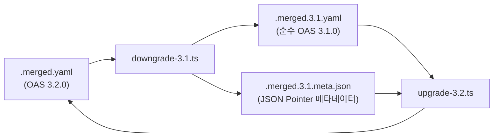

# Modular OpenAPI 3.1/3.2 Schema Architecture (`@oa-sdk/schemas`)

`@oa-sdk/schemas`는 `oa-sdk` 모노레포의 단일 진실 공급원(SSOT, Single Source of Truth) 역할을 수행하는 스키마 패키지입니다. **프로덕션 API 계약은 [ADR-009](./docs/internal/architecture/009-typespec-first-authoring.md)에 따라 TypeSpec-First (`packages/schemas/typespec/**/*.tsp`)로 작성·관리**되며, 엄격한 컴파일·승인 스냅샷 검증을 거쳐 OpenAPI 3.2 계약(`.merged.yaml`) 및 3.1 호환 번들(`dist/openapi.*`)을 방출합니다. 레거시 Definition Builder 프래그먼트(`packages/schemas/src/domains/`, `fragments/`)는 롤백 및 참조 경로로 격리 유지됩니다.

> ⚠️ **절대 불변 원칙**: 프로덕션 API 스펙을 변경할 때는 반드시 `packages/schemas/typespec/**/*.tsp` 원본 파일을 수정합니다. 파생 산출물(`.merged*.yaml`, `dist/openapi.*`)이나 승인 스냅샷(`approved.openapi.yaml`)을 수기로 직접 수정하는 것은 엄격히 금지됩니다.

---

## 🏛️ 아키텍처 토폴로지 (Architecture Topology)

### 1. 스키마 정본 및 번들링 파이프라인

```mermaid
graph TD
    subgraph TypeSpecSSOT [TypeSpec 프로덕션 정본 SSOT (packages/schemas/typespec/)]
        MainTSP["main.tsp\n(Composition Root)"]
        DomainTSP["auth.tsp, users.tsp, me.tsp,\nhealth.tsp, common.tsp, metadata/"]
        BundleJSON["oa-sdk.typespec-bundle.json\n(Manifest v1)"]
        Approved["approved.openapi.yaml\n(Approved Snapshot Baseline)"]
    end

    subgraph RollbackStorage [롤백/참조 프래그먼트 (packages/schemas/src/) - ADR-009]
        Domains["domains/<domain>/spec.yaml\n(auth, common, health, me, users)"]
        Fragments["fragments/<kind>/<scope>/...\n(parameter, path, response, schema)"]
        TargetYAML["targets/*.yaml\n(scopes, domains, includePaths)"]
    end

    subgraph Compiler [컴파일 & 승인 파이프라인]
        TspCompile["TypeSpec In-Memory Compile\n(packages/schemas/typespec/main.tsp)"]
        ApproveCheck["schema:approve-typespec-reference\n(Approved Snapshot Diff)"]
        Alloc["allocateDefinitionOutputNames\n(결정론적 이름 충돌 해소)"]
        Rewrite["rewriteDefinitionOutputRefs\n(oa:// URI -> #/components/...)"]
        Deref["DerefFolder (deref.ts)\n(Cycle Stack & DerefCycleStrategy)"]
    end

    subgraph Emission [산출물 방출]
        Merged32[".merged.yaml (OpenAPI 3.2.0 Canonical)"]
        Sidecar[".merged.3.1.meta.json (JSON Pointer Sidecar)"]
        Merged31[".merged.3.1.yaml (OpenAPI 3.1.0)"]
    end

    subgraph Routing [출력 경로 라우팅 (@oa-sdk/codegen)]
        Dispatcher["PathDispatcher (outputRouting)"]
        SchemaFiles["src/schemas/{tag}.schema.json"]
        GuardFiles["src/guards/{tag}.guard.ts"]
        Manifest[".oa-manifest.json (3-Gate Pruning)"]
    end

    MainTSP --> TspCompile
    DomainTSP --> TspCompile
    BundleJSON --> TspCompile
    TspCompile --> ApproveCheck
    ApproveCheck --> Merged32

    Domains -.->|build-spec rollback| Alloc
    Fragments -.->|build-spec rollback| Alloc
    TargetYAML -.->|build-spec rollback| Alloc
    Alloc -.-> Rewrite
    Rewrite -.-> Deref
    Deref -.-> Merged32

    Merged32 -->|downgrade-3.1.ts| Merged31
    Merged32 -->|downgrade-3.1.ts| Sidecar
    Merged31 -.->|upgrade-3.2.ts + Sidecar| Merged32

    Merged32 --> Dispatcher
    Dispatcher --> SchemaFiles
    Dispatcher --> GuardFiles
    Dispatcher --> Manifest
```

### 2. 결정론적 컴포넌트 이름 충돌 해소 흐름 (Name Collision Resolution)

```mermaid
flowchart TD
    Start([컴포넌트 노드 처리 시작]) --> CheckAlias{explicitAlias 존재 여부\nnamingPolicy.aliases}
    
    CheckAlias -- Yes --> UseAlias[이유: explicit-alias\n지정된 별칭 적용]
    CheckAlias -- No --> CheckGroup{동일 localName이\n선택된 노드군에 2개 이상 존재하는가?}
    
    CheckGroup -- Yes --> UsePrefix[이유: domain-prefix\nPascalCase(domain) + localName 결합\n예: BookNote, NotebookNote]
    CheckGroup -- No --> Preserve[이유: preserve-if-unique\n고유한 localName 그대로 유지\n예: User, AuthSession]

    UseAlias --> CollideCheck{최종 outputName 간\n중복이 남아있는가?}
    UsePrefix --> CollideCheck
    Preserve --> CollideCheck

    CollideCheck -- No --> OutputMap[outputNames Map 등록 및 $ref 재작성]
    CollideCheck -- Yes --> ErrorReport[오류 방출: definition-output-name/collision\n빌드 중단 및 충돌 리포트 생성]
```

---

## 📂 1. 스키마 디렉토리 구조 및 정본 소유권

`packages/schemas/`는 TypeSpec 프로덕션 정본 디렉토리와 ADR-009 롤백/참조 디렉토리로 명확히 분리되어 있습니다:

```
packages/schemas/
├── typespec/                     # [SSOT] TypeSpec 프로덕션 정본 계약
│   ├── main.tsp                  # 전체 도메인 임포트 및 번들 컴포지션 루트
│   ├── metadata/                 # 공통 컴포넌트, 서비스, 보안 스키마 메타데이터
│   ├── version.tsp               # ContractVersion API 시맨틱 버전 선언
│   ├── common.tsp                # 공통 에러 엔벨로프 및 기본 모델
│   ├── auth.tsp                  # 인증/인가 오퍼레이션 및 DTO
│   ├── health.tsp                # 헬스체크 및 네이티브 SSE 스트리밍
│   ├── me.tsp                    # 내 계정 관리
│   ├── users.tsp                 # 사용자 관리 및 페이징
│   ├── world-model.tsp           # 월드 모델 런타임 프로젝션 계약
│   ├── oa-sdk.typespec-bundle.json # v1 번들 매니페스트
│   └── approved.openapi.yaml     # 승인된 베이스라인 스냅샷 (직접 편집 금지)
│
└── src/                          # [ADR-009 롤백/참조] Definition Builder 아티팩트
    ├── .merged.yaml              # TypeSpec 컴파일 결과 정본 OpenAPI 3.2 아티팩트 (직접 편집 금지)
    ├── .merged.3.1.yaml          # 3.1 하위 호환 아티팩트 (직접 편집 금지)
    ├── domains/                  # 레거시 도메인 정의 (롤백 참조용)
    ├── fragments/                # 레거시 원자적 조각 (롤백 참조용)
    └── targets/                  # 멀티 타겟 빌드 프로파일 설정 (롤백 참조용)
```

---

## 🆔 2. 정규 정의 식별자 (Canonical Definition ID) 및 `oa://` 프로토콜

모든 프래그먼트는 글로벌 고유 식별자 규격을 통해 정의되고 서로를 참조합니다.

### 2.1 정규 ID 패턴 (`packages/parser/src/definition-id.ts`)

형식: **`${kind}:${scope}/${domain}/${name}`**

- **`kind`**: 정의 객체 종류 (`schema`, `response`, `parameter`, `requestBody`, `header`, `link`, `callback`, `path`, `operation`, `server`, `tag`, `securityScheme`).
- **`scope`**: 가시성 범위 (`shared`, `public`, `admin`, `internal`).
- **`domain`**: 소속 도메인 (`common`, `auth`, `health`, `me`, `users` 등 소문자 케밥케이스).
- **`name`**: 식별자 (컴포넌트형 kind는 반드시 PascalCase, 예: `AuthSession`, `User`, `Limit`).

### 2.2 내부 프래그먼트 `$ref` 참조 프로토콜 (`oa://`)

프래그먼트 파일 내에서 다른 스키마나 파라미터를 참조할 때 상대 파일 경로 대신 언어 중립적인 가상 URI 스킴을 사용합니다:

`$ref: oa://<kind>/<scope>/<domain>/<Name>`

#### 프래그먼트 작성 예시 (`src/fragments/schema/public/auth/AuthSession.yaml`):

```yaml
id: schema:public/auth/AuthSession
content:
  type: object
  description: 사용자 + 토큰 페어 — 가입/로그인 응답 단위
  required:
    - user
    - tokens
  properties:
    user:
      $ref: oa://schema/public/users/User
    tokens:
      $ref: oa://schema/public/auth/TokenPair
  example:
    user:
      id: 00000000-0000-0000-0000-000000000001
      email: alice@example.com
      name: Alice
      role: user
      createdAt: 2024-01-01T00:00:00.000Z
    tokens:
      accessToken: eyJhbGciOi...example
      refreshToken: rt_example_0001
      tokenType: Bearer
      expiresIn: 3600
```

---

## ⚙️ 3. 번들링 및 결정론적 컴포넌트 충돌 해소 (`@oa-sdk/parser`)

타겟 빌드 시 `@oa-sdk/parser`는 여러 도메인에 흩어져 있는 동일한 이름의 컴포넌트 간 충돌을 자동으로 감지하고 결정론적으로 해결합니다.

### 3.1 타겟 설정 명세 (`src/targets/*.yaml`)

```yaml
name: public-api
scopes:
  - shared
  - public
domains:
  - common
  - book
  - notebook
servers:
  - url: https://api.example.test
includePaths:
  - /books/{bookId}/notes
namingPolicy:
  aliases:
    securityScheme:shared/common/BearerAuth: bearerAuth
```

### 3.2 이름 할당 3단계 우선순위 (`allocateDefinitionOutputNames`)

`packages/parser/src/definition-output-names.ts`는 다음 우선순위에 따라 출력 컴포넌트 이름을 할당합니다:

1. **`explicit-alias` (최우선)**:
   - `namingPolicy.aliases[node.id]`에 매핑이 정의되어 있으면 해당 별칭을 강제 적용합니다.
2. **`domain-prefix` (자동 충돌 회피)**:
   - 명시적 별칭이 없고, 동일한 `localName`을 가진 컴포넌트가 선택된 노드 집합 내에 둘 이상 존재하는 경우(예: `book` 도메인의 `Note`와 `notebook` 도메인의 `Note`), 도메인의 파스칼케이스 접두사를 자동으로 결합합니다:
     - `schema:public/book/Note` ➔ `BookNote`
     - `schema:public/notebook/Note` ➔ `NotebookNote`
3. **`preserve-if-unique` (기본값)**:
   - 중복이 없는 경우 프래그먼트의 본래 `localName`을 그대로 보존합니다 (예: `User`, `AuthSession`).

### 3.3 `$ref` 포인터 정규화 (`rewriteDefinitionOutputRefs`)

할당된 이름을 바탕으로 모든 `oa://` 가상 참조를 표준 OpenAPI JSON Pointer로 재작성합니다:
- `schema` ➔ `#/components/schemas/<AllocatedName>`
- `response` ➔ `#/components/responses/<AllocatedName>`
- `parameter` ➔ `#/components/parameters/<AllocatedName>`
- `securityScheme` ➔ `#/components/securitySchemes/<AllocatedName>`

---

## 🔄 4. 순환 참조 탐지 및 역참조 (`DerefFolder`)

계층적 데이터 구조(예: 대댓글, 트리 구조, 조직도 등)에서 발생하는 순환 참조(`$ref`)는 코드 생성기나 직렬화기를 무한 루프에 빠뜨릴 수 있습니다.

### 4.1 스택 기반 순환 탐지 (`packages/parser/src/deref.ts`)

`DerefFolder`는 참조 해소 중인 노드의 캐시 키를 `stack: string[]`에 추적합니다:
```typescript
if (this.stack.includes(resolution.cacheKey)) {
  // ref-cycle 진단 코드 방출
  return this.resolveCycle(ref, node);
}
this.stack.push(resolution.cacheKey);
try {
  // 재귀적 폴딩 수행
} finally {
  this.stack.pop();
}
```

### 4.2 순환 해결 전략 (`DerefCycleStrategy`)

`resolveCycle(ref, node)`는 설정된 전략에 따라 노드를 안전하게 치환합니다:
- `'empty-schema'` (기본값):
  - 순환 지점 노드를 빈 스키마 `{}`로 대체하고 형제(sibling) 필드만 병합하여 무한 확장을 원천 차단합니다.
- `'preserve-ref'`:
  - `{ $ref: ref }` 형태를 그대로 유지하면서 형제 필드를 병합합니다.

### 4.3 OpenAPI 3.1+ Sibling 필드 보존

OpenAPI 3.1 이상에서는 `$ref` 옆에 작성된 형제 키(`description`, `summary`, `title` 등)가 유효합니다. `DerefFolder`는 `mergeRefSiblings`를 통해 참조 대상 스키마와 원본 노드의 형제 필드를 손실 없이 병합합니다.

---

## 🎛️ 5. CLI 명령어 및 버전 거버넌스 게이트

### 5.1 `oa-gen validate --require-32`

`packages/codegen/src/cli/commands/validate.ts`와 `packages/parser/src/validate.ts`는 관리 대상 계약(Managed Contract)의 OpenAPI 3.2 준수 여부를 검증합니다:

```bash
# 관리 대상 OpenAPI 3.2 계약 엄격 검증
oa-gen validate --spec packages/schemas/src/.merged.yaml --require-32
```

- **버전 게이트 불변식**:
  - `OPENAPI_32_VERSION = /^3\.2\.\d+/` 정규식으로 검증합니다.
  - `--require-32` 옵션이 활성화된 경우, 3.0.x 또는 3.1.x 스펙 문서는 치명적 오류(`parse/version-32`)를 발생시키며 CI 파이프라인을 즉시 차단합니다.
  - 미지정 시에는 정보(INFO) 진단만 출력됩니다.

### 5.2 타겟 빌드 (`oa-gen build-spec`)

```bash
# 프래그먼트로부터 public-api 타겟 스펙 빌드 및 리포트 출력
oa-gen build-spec --target packages/schemas/src/targets/public-api.yaml --output dist/public-api.yaml --collision-report dist/collisions.json
```

### 5.3 무손실 3.2 ↔ 3.1 다운그레이드 / 업그레이드 파이프라인

기존 서드파티 툴링(Swagger UI, Redoc 등)이 아직 OpenAPI 3.2를 지원하지 못하는 환경을 위해, `x-*` 확장 필드 오염 없이 완벽한 양방향 왕복(Roundtrip)을 지원합니다.



- **다운그레이드 (`packages/schemas/scripts/downgrade-3.1.ts`)**:
  - `openapi: "3.2.0"` ➔ `"3.1.0"`으로 변환.
  - `dataValue` ➔ `value`로 매핑.
  - 3.2 전용 필드(`serializedValue`, `itemSchema`, `prefixEncoding`, `itemEncoding`, `deviceAuthorization`, `deviceAuthorizationUrl`, `oauth2MetadataUrl`, `defaultMapping`, `additionalOperations`, `nodeType`, `$self`)를 추출하여 `.merged.3.1.meta.json`에 JSON Pointer 키로 기록한 뒤 3.1 문서에서는 제거.
- **업그레이드 (`packages/schemas/scripts/upgrade-3.2.ts`)**:
  - 순수 3.1 YAML에 `.merged.3.1.meta.json`의 JSON Pointer 메타데이터를 역으로 주입하여 1바이트의 오차도 없는 순수 3.2 문서를 복원.

### 5.4 TypeSpec 프로덕션 정본 및 표준 공통 계약 (`contracts.tsp`)

`packages/schemas/typespec/`는 모노레포의 프로덕션 OpenAPI 3.2를 생성하는 인간 작성 정본(Human-Authored SSOT)입니다.

- **표준 계약 모듈 (`contracts.tsp`)**:
  - `@oa-sdk/typespec-decorators/lib/contracts.tsp`(namespace `OaSdkTypeSpec`, `import "@oa-sdk/typespec-decorators"; using OaSdkTypeSpec;`로 사용) 및 `packages/schemas/typespec/common.tsp`(namespace `OaSdkApi`)에 공통 정의. `OaSdkContracts`라는 namespace는 없다.
  - `Ok<T>`, `Created<T>`, `NoContent<T = void>`, `PageResult<T>`, `ErrorResponse<Status>`, `StandardError`, `StandardValidationError`, `StandardHttpErrors` 제공.
  - 비제네릭 `NoContent`로 인한 드리프트를 원천 차단하기 위해 기본 제네릭 파라미터(`NoContent<T = void>`)를 적용하여 uninstantiated schema emission을 방지.
- **TypeSpec 검증 및 드리프트 차단 게이트**:
  ```bash
  # TypeSpec 번들 무결성, 사이드카 복원, approved.openapi.yaml 0-drift 검증
  pnpm schema:typespec-check
  ```

---

## 🌐 6. 출력 경로 라우팅 엔진과의 정렬 (Alignment with Output Path Routing Engine)

`@oa-sdk/schemas`의 프래그먼트 및 번들 스펙은 코드 생성기(`@oa-sdk/codegen`)의 출력 경로 라우팅 엔진(`outputRouting`)과 유기적으로 결합되어 프로젝트 소스 트리에 매핑됩니다.

### 6.1 스키마 아티팩트 라우팅 (`byKind.schemas` 및 `byKind.guards`)

`oa.config.ts`의 `outputRouting` 블록에서 스키마 아티팩트 종류별로 경로 템플릿을 선언할 수 있습니다:

```typescript
import { defineConfig } from '@oa-sdk/core'

export default defineConfig({
  core: {
    spec: 'packages/schemas/src/.merged.yaml',
  },
  product: {
    outputRouting: {
      baseDir: '.',
      pattern: 'src/api/{tag}/{tag}.{kind}.ts',
      byKind: {
        schemas: 'src/schemas/{tag}.schema.json',
        guards: 'src/guards/{tag}.guard.ts',
        contract: 'src/features/{tag}/api/{tag}.contract.ts',
        client: 'src/features/{tag}/api/{tag}.client.ts',
      },
      rules: [
        // 공통 스키마는 전역 공용 폴더로 명시적 분기
        { tag: 'common', kind: 'schemas', target: 'packages/schemas/dist/common.schema.json' },
      ],
      manifestPath: '.oa-manifest.json',
      pruneOrphans: true,
      casing: 'kebab',
    },
  },
})
```

### 6.2 정규 정의 ID와 템플릿 토큰 매핑 규칙

정규 식별자 `${kind}:${scope}/${domain}/${name}`는 코드 생성 시 다음과 같이 템플릿 토큰으로 결정론적으로 변환됩니다:

- **`{tag}`**: 소속 `domain`(예: `users`, `auth`) 또는 OpenAPI 오퍼레이션 태그.
- **`{group}`**: URL 경로의 첫 번째 세그먼트(예: `/users/{id}` ➔ `users`) 또는 `domain`.
- **`{kind}`**: 아티팩트 종류 (`schemas`, `guards`, `contract`, `client`, `queries`, `keys`).
- **`{operationId}`**: 정규 ID의 `${name}` 또는 스네이크케이스 HTTP 메서드 결합(`get_users`).

### 6.3 스키마 산출물 매니페스트 및 3단계 고아 프루닝 안전성

`outputRouting`에 의해 방출된 JSON 스키마 및 가드 파일은 `.oa-manifest.json`에 SHA-256 해시와 함께 기록됩니다. 스키마 프래그먼트가 삭제되거나 도메인이 개편될 때:

1. **Gate 1 (출처 게이트)**: 매니페스트에 등록된 파일만 삭제 후보로 지정됩니다.
2. **Gate 2 (해시 무결성 게이트)**: 디스크 상의 SHA-256 해시가 빌드 당시 해시와 일치해야 합니다. 개발자가 수정한 파일은 `'content-modified'`로 보존됩니다.
3. **Gate 3 (배너 보호 게이트)**: `@generated` 또는 `DO NOT EDIT` 배너가 포함된 파일만 삭제됩니다. 수기로 작성된 스키마 프래그먼트(`src/fragments/**/*.yaml`)는 실수로 삭제되지 않습니다.

### 6.4 4단계 TypeSpec-First 파이프라인 및 다형성 파라미터 다양화 표준 (Video Transitions)

복합 다형성 파라미터(비디오 트랜지션, 캔버스 이펙트 등) 모델링 시 Zod union 대신 **TypeSpec (`.tsp`)을 Stage 1 SSOT**로 선언합니다:
- **다형성 상속 모델**: `@discriminator("type")` 및 `model Variant extends Base { type: "variant"; ... }`를 사용하여 선언적 유니언 작성.
- **수치 경계 제약**: `@minValue`, `@maxValue`, `@pattern` 데코레이터를 통해 Draft 2020-12 및 OAS 3.1의 `exclusiveMinimum: 0` 규격을 완전 자동 투영.
- **4단계 파이프라인 투영**:
  1. `Stage 1 (SSOT)`: TypeSpec (`.tsp`) 모델 선언 (`schemas/.../*.tsp`)
  2. `Stage 2`: JSON Schema Draft 2020-12 투영 (`$defs`, `oneOf`, `discriminator`)
  3. `Stage 3`: OpenAPI 3.1/3.2 오퍼레이션 계약 (`POST /api/.../preview`)
  4. `Stage 4`: Standalone Zero-Eval 타입 가드 (`isVideoTransition(v)`)
  5. `Stage 5 (Bridge)`: `@oa-sdk/tools`의 `createSchemaTool`로 AI Agent MCP 및 CLI 도구 즉시 바인딩
- **상세 규격**: [스키마 아키텍처 및 작성 규칙 (Section 6.1 비디오 트랜지션 파라미터 다양화 표준)](docs/guides/schema-architecture-and-conventions.md) 참조.

---

## 🔍 7. 문제 해결 매트릭스 (Troubleshooting)

| 증상 (Symptom) | 근본 원인 (Root Cause) | 해결 방법 (Remediation) |
|---|---|---|
| `[definition-id/malformed] Invalid canonical definition ID` | 프래그먼트의 `id:` 필드가 `${kind}:${scope}/${domain}/${name}` 형식을 따르지 않음 | kind, scope, domain을 소문자로 맞추고 컴포넌트 이름은 PascalCase로 수정 |
| `[definition-output-name/collision] Duplicate output name` | 복수의 도메인에서 동일한 이름의 스키마를 정의했으며 충돌 회피 실패 | `targets/*.yaml`의 `namingPolicy.aliases`에 명시적 별칭을 선언하거나 도메인 접두사 정책 확인 |
| `[parse/version-32] Document version 3.1.0 does not satisfy required 3.2.x gate` | `--require-32` 게이트가 켜진 상태에서 3.1 스펙이 전달됨 | `scripts/upgrade-3.2.ts`를 실행하여 3.2 계약으로 업그레이드하거나 관리 대상 스펙 버전 확인 |
| `[ref/cycle] Circular reference detected in schema` | 프래그먼트 간 상호 참조로 인한 재귀 루프 발생 | `derefSpec`의 `cycleStrategy`를 `'empty-schema'`로 지정하여 순환 지점을 빈 객체로 치환 |
| 다운그레이드 시 3.2 전용 필드(`itemSchema` 등) 손실 | 다운그레이드 스크립트 실행 시 메타데이터 사이드카가 생성되지 않음 | `downgrade-3.1.ts`를 정상 실행하여 `.merged.3.1.meta.json` 사이드카 파일이 함께 커밋되었는지 확인 |
| `outputRouting: Unknown kind 'schema'` | `byKind` 설정 키에 단수형 `schema` 사용 | 복수형 키 `schemas`로 수정 (`byKind: { schemas: '...' }`) |

---

## 🧪 8. 스키마 검증 및 테스트 명령어

```bash
# 1. 스키마 다운그레이드/업그레이드 왕복 무손실 검증 (62개 테스트)
pnpm --filter @oa-sdk/schemas test

# 2. 파서 정의 식별자 및 충돌 해소 단위 테스트
pnpm --filter @oa-sdk/parser test src/__tests__/definition-output-names.test.ts src/__tests__/definition-id.test.ts

# 3. OpenAPI 3.2 버전 강제 게이트 검증 테스트
pnpm --filter @oa-sdk/parser test src/__tests__/validate.test.ts

# 4. 스키마 통합 및 유효성 검증 (Codegen CLI 검증 포함)
pnpm schema:validate

# 5. 모노레포 문서 및 CLI 예제 게이트 통합 검증
pnpm check:docs

# 6. 언어 중립 CLI ECS 매니페스트 정합성 검증
pnpm check:cli-spec

# 7. 릴리스 정책 및 워크스페이스 트랙 검증 (Policy v5)
pnpm check:release-policy

# 8. 모노레포 33개 전체 워크스페이스 타입 체크
pnpm typecheck:all
```
