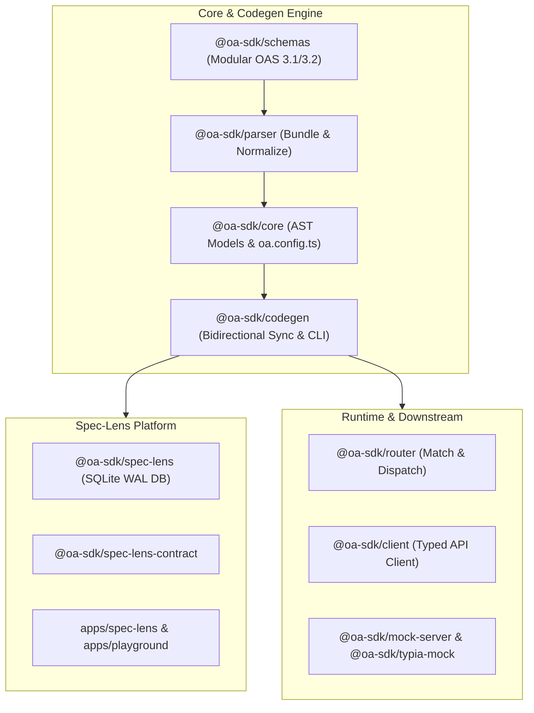

# OpenAPI SDK Monorepo Workflow (`oa-sdk`)

이 프로젝트 레벨 스킬은 `oa-sdk` 모노레포(19개 패키지, 5개 앱)의 아키텍처 원칙, TypeScript AST 양방향 동기화, 타입 어댑터 규격, `oa-gen` CLI 도구 체인 및 검증 절차를 안내합니다.

---

## 🏛️ 아키텍처 계층 및 모노레포 구조



### 패키지 그룹
1. **Core & Codegen**:
   - `@oa-sdk/schemas`: 모듈화된 OpenAPI 3.1/3.2 YAML 조각, 병합/번들 스펙 (`.merged.yaml`).
   - `@oa-sdk/parser`: 다중 버전 OpenAPI 스키마 파서 및 번들 정규화.
   - `@oa-sdk/core`: 핵심 AST 모델, `EntitySpec`, 프로젝트 루트 해석 및 `oa.config.ts` 로더.
   - `@oa-sdk/codegen`: 코드 생성 엔진, TypeScript AST 양방향 동기화, `oa-gen init` 타깃 분리형 온보딩, `oa-gen` CLI.
2. **Spec-Lens**:
   - `@oa-sdk/spec-lens`: SQLite WAL 기반 스펙 인덱싱/검색 엔진 (`.spec-lens.db`).
   - `@oa-sdk/spec-lens-contract`: 심볼 그래프, 프로젝션 계약 정의.
   - `apps/spec-lens`, `apps/playground`, `apps/preview`: 스펙 시각화 및 인터랙티브 테스트 도구.
3. **Runtime & Downstream**:
   - `@oa-sdk/router`: 고성능 라우팅 및 요청 디스패처 (Fastify JIT 스키마 가속, Bun Elysia Zero-copy 구조분해, Hono, Express, 순수 핸들러 계약 분리).
   - `@oa-sdk/client`: 런타임 독립적 타입 안전 API 클라이언트.
   - `@oa-sdk/mock-server`: 동적 OpenAPI 인메모리 목 서버.
   - `@oa-sdk/typia-mock`: Typia AOT 컴파일러 트랜스폼 목 통합용 격리 경계(Maintenance).
4. **TypeSpec & Governance**:
   - `@oa-sdk/typespec-decorators`, `@oa-sdk/typespec-erd`, `@oa-sdk/typespec-tooling`, `@oa-sdk/logical-erd-contract`.
   - `@oa-sdk/personas`: API 페르소나 능력(Skill) 특성 및 계약 (`packages/personas/src/traits/skill.yaml`).
   - `@oa-sdk/dpm`: 디자인 패턴 마이닝(DPM).

---

## 🔒 핵심 아키텍처 규칙 & 불변성 (Invariants)

1. **AST 무손실 양방향 동기화 (Zero-Loss Bidirectional Sync)**:
   - OpenAPI `EntitySpec`과 TypeScript 소스 코드 AST 간 동기화 시, 수정되지 않은 코드 영역의 공백, 주석, 포맷팅(Trivia)은 **비트 단위로 100% 보존(Bitwise Trivia Invariance)**되어야 합니다.
2. **Type Adapter 패턴 (Pluggable Type Adapters)**:
   - `TypiaTypeAdapter`: TypeScript 5.x intersection type tags 파싱 (`number & tags.Type<'int32'>`, `tags.Minimum<N>`, `tags.Format<'uuid'>` 등) 지원.
   - `ZodTypeAdapter`: Zod 런타임 스키마와 상호 변환.
   - `TsTypeAdapter`: 순수 TypeScript 인터페이스 생성 및 동기화.
3. **Manifest V3 CSP 준수 (Zero-eval Safety)**:
   - 사전 컴파일된 스탠드얼론 타입 가드 및 클라이언트 코드는 동적 코드 생성(`eval()`, `new Function()`)을 절대 사용하지 않으며, `oa-gen audit:csp` 검사를 통과해야 합니다.
4. **밀폐형 에이전트 거버넌스 (Closed-by-Default)**:
   - `.agents/skills.json` 및 `.agents/plugins.json`에 정의된 화이트리스트에 따라 외부 도메인의 스킬 유입을 엄격히 차단합니다.
5. **엄격한 런타임 격리 (Strict Runtime Isolation)**:
   - Bun/Elysia 프로젝트에는 순수 Bun 스크립트(`bun --watch`, `bun x`) 및 `@types/bun`만을 주입하여 Node 도구(`tsx`, `nodemon`, `@types/node`)의 오염을 원천 차단하고, Node 프로젝트에는 표준 Node ESM 도구(`tsx watch`)만을 주입합니다.
6. **핸들러 계약 분리 (Pure Handler Contract Decoupling)**:
   - `@oa-sdk/router`는 프레임워크 런타임 의존성이 0개이며(`dependencies: {}`), 비즈니스 로직과 라우팅 배선을 물리적으로 분리한 순수 TypeScript 인터페이스(`ApiHandlers`, `*.contract.ts`)를 방출하여 스펙 재생성 시 코드 덮어쓰기(Overwrite Dilemma)를 완전히 제거합니다.

---

## 🛠️ CLI 도구 체인 (`oa-gen`)

```bash
# 30초 마찰 제로 프로젝트 온보딩 (프레임워크/스키마 자동 감지 및 oa.config.ts 생성)
oa-gen init --yes

# 특정 프레임워크 타깃을 지정한 비대화형 온보딩 (Fastify 예시)
oa-gen init --target fastify --yes

# 스키마 유효성 및 OpenAPI 3.2 준수 검증
oa-gen validate --spec packages/schemas/src/.merged.yaml --require-32

# TypeSpec AST 시맨틱 차이 및 브레이킹 체인지 검사
oa-gen tsp diff --base origin/main --head HEAD --fail-on-breaking

# OpenAPI 스펙 기반 실시간 무중단 핫 리로드 Mock HTTP 서버 구동
oa-gen mock --spec packages/schemas/dist/openapi.yaml --watch

# TypeSpec 인메모리 컴파일 기반 실시간 무중단 핫 리로드 Mock HTTP 서버 구동
oa-gen mock --tsp packages/schemas/typespec/main.tsp --watch

# TypeSpec 신규 엔드포인트 및 DTO 스캐폴딩
oa-gen tsp-scaffold --route /users/{id}/audit --method get

# TypeScript 클라이언트 및 타입 가드 생성
oa-gen generate --target standalone-guards --input packages/schemas/src/.merged.yaml --out-dir dist/guards

# Manifest V3 CSP 호환성 감사 (eval / new Function 금지 검사)
oa-gen audit:csp --bundle dist/guards

# 스키마 간 차이점 및 브레이킹 체인지 비교
oa-gen diff --base spec-v1.yaml --head spec-v2.yaml
```

---

## 📚 모노레포 에이전트 스킬 카탈로그 (Monorepo Agent Skill Catalog)

`oa-sdk` 모노레포는 Antigravity / AGY 스펙을 준수하는 7대 도메인 특화 에이전트 스킬을 `.agents/skills/`에 유지·운영합니다:

1. **`oa-sdk`**: 모노레포 종합 아키텍처, 계층 구조, 6대 불변성 원칙, CLI 도구 체인 및 표준 검증 절차.
2. **`oa-codegen`**: TypeScript AST 코드 생성, 역오프셋 패치 엔진, 플러그형 TypeAdapter, `oa-gen init` 타깃 분리형 온보딩 엔진, 실시간 스펙 관측(`oa-gen mock --watch`), Standalone AJV 가드 및 Manifest V3 CSP 정적 감사.
3. **`oa-runtime`**: 다운스트림 라우팅(`@oa-sdk/router`의 Fastify, Bun Elysia, Hono, Express 바인더 및 순수 핸들러 계약), 타입 안전 클라이언트 SDK(`@oa-sdk/client`), 원자적 라우트 핫스왑 Mock 서버(`@oa-sdk/mock-server`), Typia 격리 경계(`@oa-sdk/typia-mock`).
4. **`oa-onboarding`**: Greenfield 및 Brownfield 프로젝트를 위한 3계층 점진적 가치 도입 플레이북, 프레임워크별 온보딩 레시피(Fastify, Bun Elysia, Express, NestJS), 5대 무가치 관리 포인트 제거 가이드.
5. **`oa-governance`**: API 페르소나 능력 특성(`@oa-sdk/personas`), TypeSpec 데코레이터 및 DPM 투영 계약, 4계층 문서 게이트 검증.
6. **`oa-schemas`**: 모듈화된 OpenAPI 3.1/3.2 스키마 분할/병합, 정규 정의 ID, 순환 참조 비순환화 및 타깃 번들링.
7. **`oa-spec-lens`**: SQLite WAL 캐시 라이프사이클, 스키마 v2 CQRS 저장소, TypeSpec AST 심볼 인덱싱, 역연대기 경로 추적 및 마크다운 프로젝션 엔벨로프.

---

## 🧪 표준 검증 절차 (Verification Suite)

모든 코드 및 문서 작업 후 아래의 검증 명령어를 단계별로 실행합니다:

```bash
# 1. 문서 무결성 및 에이전트 거버넌스 게이트 검증
pnpm check:docs

# 2. 핵심 계층 빌드 (Core, Parser, Codegen, Schemas, Spec-Lens)
pnpm build:core

# 3. 핵심 계층 단위 및 계약 테스트
pnpm test:core

# 4. 핵심 계층 타입 체크
pnpm typecheck:core

# 5. 스키마 통합 및 유효성 검증
pnpm schema:validate

# 6. (선택) 릴리스 프리플라이트 검증
pnpm release:preflight
```
