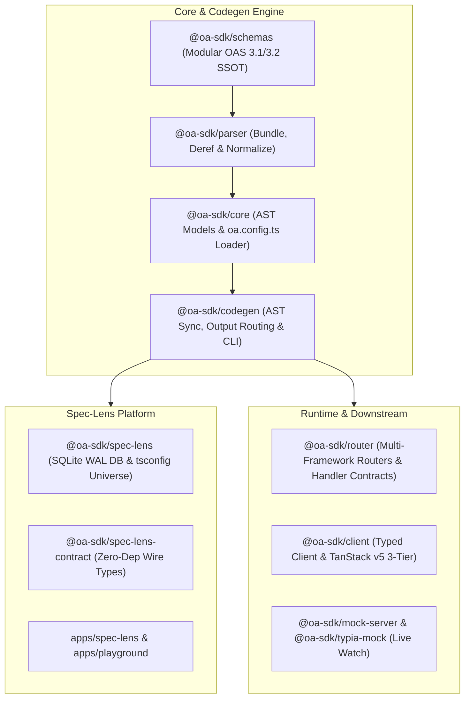

# OpenAPI SDK Monorepo Workflow (`oa-sdk`)

이 프로젝트 레벨 스킬은 `oa-sdk` 모노레포(19개 패키지, 5개 앱)의 아키텍처 원칙, 선언적 출력 경로 라우팅, TanStack Query v5 3계층 코드 생성, 멀티 프레임워크 라우터 및 순수 핸들러 계약, 타깃 분리형 온보딩, TypeScript AST 양방향 동기화, `oa-gen` CLI 도구 체인 및 모노레포 거버넌스 검증 절차를 안내합니다.

---

## 🏛️ 아키텍처 계층 및 모노레포 구조



### 패키지 그룹
1. **Core & Codegen**:
   - `@oa-sdk/schemas`: 모듈화된 OpenAPI 3.1/3.2 YAML 조각, 도메인 바운디드 컨텍스트, 멀티 타겟 번들 스펙 (`.merged.yaml`).
   - `@oa-sdk/parser`: 다중 버전 OpenAPI 스키마 파서, 결정론적 컴포넌트 이름 충돌 해소(`allocateDefinitionOutputNames`), 순환 참조 비순환화(`DerefFolder`).
   - `@oa-sdk/core`: 핵심 AST 모델, `EntitySpec`, 프로젝트 루트 해석 및 `oa.config.ts` 설정 로더.
   - `@oa-sdk/codegen`: 코드 생성 엔진, TypeScript AST 양방향 동기화, 선언적 출력 경로 라우팅(`outputRouting` 5대 토큰, 4대 케이싱, 상대 경로 임포트 해석, `.oa-manifest.json` 3-Gate 고아 프루닝), `oa-gen init` 타깃 분리형 온보딩(6대 타깃, 3대 라이프사이클 아키타입, 4대 라우팅 프리셋), 실시간 무중단 핫 리로드 Mock 관측(`oa-gen mock --watch`), Standalone 타입 가드 및 Manifest V3 CSP 정적 감사, `oa-gen` CLI.
2. **Spec-Lens**:
   - `@oa-sdk/spec-lens`: SQLite WAL 기반 스펙 인덱싱/검색 엔진 (`.spec-lens.db`), 전이적 `tsconfig.json` 컨피그 유니버스 해싱(`computeTsconfigUniverse`) 및 자동 캐시 무효화.
   - `@oa-sdk/spec-lens-contract`: 심볼 그래프, 프로젝션 계약, 9대 스키마 버전 핀(v2), 런타임 양방향 가드(`isSpecLensResponse`).
   - `apps/spec-lens`, `apps/playground`, `apps/preview`: 스펙 시각화, D3 심볼 디펜던시 그래프 및 인터랙티브 테스트 도구.
3. **Runtime & Downstream**:
   - `@oa-sdk/router`: 고성능 라우팅 및 요청 디스패처 (Fastify JIT 인라인 스키마 가속, Bun Elysia Zero-copy 컨텍스트 구조분해, Hono, Express, 순수 핸들러 계약 분리 `*.contract.ts`, 다중 상태 에러 유니온 `HandlerResponse<TSuccess, TErrorMap, THeaders>`, 3단계 응답 엔벨로프 충돌 방어, 204 No Content 처리).
   - `@oa-sdk/client`: 런타임 독립적 타입 안전 API 클라이언트 SDK, `AbortSignal | null` 전송 및 결합 엔진(`__combineSignals` 통한 네이티브 `AbortSignal.any` 및 `AbortController` 폴백), SSE/NDJSON 스트리밍 취소 파이프라인, TanStack Query v5 3계층 아키텍처(Tier 1 `*Keys` 계층적 쿼리 키 튜플 트리, Tier 2 순수 `queryOptions`/`mutationOptions`/`infiniteQueryOptions` 팩토리 및 `JsonPrimitive<T>` 와이어 안전성, Tier 3 `'use client'` React 훅 `use*Query` 및 컨텍스트 바인더 `createApiHooks`).
   - `@oa-sdk/mock-server`: 동적 OpenAPI 인메모리 목 서버 (원자적 라우트 테이블 핫스왑 `server.updateSpec`, 파싱 에러 쉴딩).
   - `@oa-sdk/typia-mock`: Typia AOT 컴파일러 트랜스폼 목 통합용 격리 경계(Maintenance).
4. **TypeSpec & Governance**:
   - `@oa-sdk/typespec-decorators`, `@oa-sdk/typespec-erd`, `@oa-sdk/typespec-tooling`, `@oa-sdk/logical-erd-contract`.
   - `@oa-sdk/personas`: API 페르소나 능력(Skill) 특성 및 계약 (`packages/personas/src/traits/skill.yaml`, 21개 특성, 6대 카테고리).
   - `@oa-sdk/dpm`: Dynamic Package Manager 서브패스 아키텍처, 중립 데이터 바인딩 및 인메모리 행 실행 엔진(`executeDpmRows`).

---

## 🔒 핵심 아키텍처 규칙 & 불변성 (Invariants)

1. **TypeSpec 계약 단일 진실 공급원 (TypeSpec-First SSOT Invariance)**:
   - `oa-sdk`의 모든 프로덕션 API 계약은 `packages/schemas/typespec/**/*.tsp` 원본 파일에서 정의·수정되어야 합니다.
   - 파생 산출물(`.merged*.yaml`, `dist/openapi.*`, `approved.openapi.yaml`)을 수기로 직접 수정하는 것은 엄격히 금지되며, 변경 후에는 반드시 `pnpm schema:validate` 및 `pnpm schema:approve-typespec-reference -- --write`를 통해 승인 스냅샷을 갱신해야 합니다.
2. **AST 무손실 양방향 동기화 (Zero-Loss Bidirectional Sync)**:
   - OpenAPI `EntitySpec`과 TypeScript 소스 코드 AST 간 동기화 시, 수정되지 않은 코드 영역의 공백, 주석, 포맷팅(Trivia)은 **비트 단위로 100% 보존(Bitwise Trivia Invariance)**되어야 합니다.
3. **Type Adapter 패턴 (Pluggable Type Adapters)**:
   - `TypiaTypeAdapter`: TypeScript 5.x intersection type tags 파싱 (`number & tags.Type<'int32'>`, `tags.Minimum<N>`, `tags.Format<'uuid'>` 등) 지원.
   - `ZodTypeAdapter`: Zod 런타임 스키마와 상호 변환.
   - `TsTypeAdapter`: 순수 TypeScript 인터페이스 생성 및 동기화.
4. **Manifest V3 CSP 준수 (Zero-eval Safety)**:
   - 사전 컴파일된 스탠드얼론 타입 가드 및 클라이언트 코드는 동적 코드 생성(`eval()`, `new Function()`)을 절대 사용하지 않으며, `oa-gen audit:csp` 검사를 통과해야 합니다.
5. **밀폐형 에이전트 거버넌스 (Closed-by-Default)**:
   - `.agents/skills.json` 및 `.agents/plugins.json`에 정의된 화이트리스트에 따라 외부 도메인의 스킬 유입을 엄격히 차단하며, 만능 와일드카드(`.*`, `*`) 사용을 원천 금지합니다.
6. **엄격한 런타임 격리 (Strict Runtime Isolation)**:
   - Bun/Elysia 프로젝트에는 순수 Bun 스크립트(`bun --watch`, `bun x`) 및 `@types/bun`만을 주입하여 Node 도구(`tsx`, `nodemon`, `@types/node`)의 오염을 원천 차단하고, Node 프로젝트에는 표준 Node ESM 도구(`tsx watch`)만을 주입합니다.
7. **순수 핸들러 계약 분리 (Pure Handler Contract Decoupling)**:
   - `@oa-sdk/router`는 프레임워크 런타임 의존성이 0개이며(`dependencies: {}`), 비즈니스 로직과 라우팅 배선을 물리적으로 분리한 순수 TypeScript 인터페이스(`ApiHandlers`, `*.contract.ts`)를 방출하여 스펙 재생성 시 코드 덮어쓰기(Overwrite Dilemma)를 완전히 제거합니다.
8. **선언적 출력 경로 라우팅 및 3단계 고아 프루닝 불변성 (Output Path Routing & 3-Gate Orphan Pruning)**:
   - 5대 토큰(`{tag}`, `{kind}`, `{operationId}`, `{method}`, `{group}`)과 4단계 우선순위(rules $\to$ byKind $\to$ pattern $\to$ default)를 적용하며, 생성된 아티팩트는 `.oa-manifest.json`에 SHA-256 해시로 등록됩니다. 고아 파일 삭제 시 3-Gate 검증(Gate 1 Manifest 출처 증명, Gate 2 SHA-256 해시 무결성 일치, Gate 3 `@generated`/`DO NOT EDIT` 배너 확인)을 통과한 파일만 안전하게 제거되며 수기 작성/수정된 코드는 100% 보존됩니다.
9. **응답 엔벨로프 충돌 방어 및 다중 상태 에러 유니온 (Response Envelope Collision Defense & Multi-Status Error Union)**:
   - 핸들러 응답이 비즈니스 도메인 객체(예: `body` 속성을 가진 블로그 포스트 등)인지 HTTP 응답 엔벨로프인지를 3개 조건 검증(`'body' in result && (status === undefined || typeof status === 'number') && (headers === undefined || typeof headers === 'object')`)으로 엄격히 판별하여 데이터 유실 및 잘못된 상태 코드 전송을 방지합니다. 또한 `HandlerResponse<TSuccess, TErrorMap, THeaders>` 유니온 타입을 통해 4xx/5xx 에러 응답을 타입 안전하게 반환합니다. 204 No Content 시 빈 응답 본문 처리를 완벽히 보장합니다.
10. **TanStack Query v5 3계층 아키텍처 및 와이어 안전성 (3-Tier Query Architecture & Wire Safety)**:
    - Tier 1(순수 튜플 쿼리 키 트리 `*Keys`), Tier 2(UI 프레임워크 비종속 순수 `queryOptions`/`mutationOptions`/`infiniteQueryOptions`), Tier 3(React 훅 `use*Query`, `createApiHooks`)으로 철저히 분리하며, `JsonPrimitive<T>`로 와이어 직렬화 안전성을 강제합니다. 자동 페이지네이션 파라미터(`cursor`, `page`, `offset`) 감지 및 `getNextPageParam` 휴리스틱을 내장합니다.
11. **요청 취소 완벽 전달 (End-to-End AbortSignal Pass-Through)**:
    - 모든 SDK 메서드와 TanStack Query 팩토리는 `signal?: AbortSignal | null`을 허용하며, `__combineSignals` 엔진을 통해 컴포넌트 언마운트 또는 쿼리 무효화 시 네트워크 전송 중인 HTTP 요청을 즉각 중단합니다.

---

## 🛠️ CLI 도구 체인 (`oa-gen`)

```bash
# 30초 마찰 제로 프로젝트 온보딩 (타깃, 아키타입, 라우팅 프리셋 지정)
oa-gen init --target elysia --archetype microservice --routing fsd --yes

# oa.config.ts 기반 순수 핸들러 계약 및 스펙 일괄 생성
oa-gen generate --config oa.config.ts

# TanStack Query v5 3계층 아티팩트 분할 방출 (keys, options, hooks)
oa-gen generate:tanstack --spec packages/schemas/src/.merged.yaml --output src/api/tanstack --tier all --split

# 스키마 유효성 및 OpenAPI 3.2 준수 검증
oa-gen validate --spec packages/schemas/src/.merged.yaml --require-32

# TypeSpec AST 시맨틱 차이 및 브레이킹 체인지 검사
oa-gen tsp diff --base origin/main --head HEAD --fail-on-breaking

# OpenAPI 스펙 기반 실시간 무중단 핫 리로드 Mock HTTP 서버 구동 (100ms 디바운스, 파싱 에러 쉴딩, 원자적 라우트 교체)
oa-gen mock --spec packages/schemas/dist/openapi.yaml --watch

# TypeSpec 인메모리 컴파일 기반 실시간 무중단 핫 리로드 Mock HTTP 서버 구동
oa-gen mock --tsp packages/schemas/typespec/main.tsp --watch

# TypeSpec 신규 엔드포인트 및 DTO 스캐폴딩
oa-gen tsp-scaffold --route /users/{id}/audit --method get

# Standalone 타입 가드 생성
oa-gen generate --target standalone-guards --input packages/schemas/src/.merged.yaml --out-dir dist/guards

# Manifest V3 CSP 호환성 감사 (eval / new Function 금지 검사)
oa-gen audit:csp --bundle dist/guards

# 스키마 간 차이점 및 브레이킹 체인지 비교
oa-gen diff --base spec-v1.yaml --head spec-v2.yaml
```

---

## 📚 모노레포 에이전트 스킬 카탈로그 (Monorepo Agent Skill Catalog)

`oa-sdk` 모노레포는 Antigravity / AGY 스펙을 준수하는 7대 도메인 특화 에이전트 스킬을 `.agents/skills/`에 유지·운영합니다:

1. **`oa-sdk`**: 모노레포 종합 아키텍처, 계층 구조, 10대 핵심 불변성 원칙, CLI 도구 체인 및 모노레포 정적 거버넌스 검증 절차.
2. **`oa-codegen`**: TypeScript AST 코드 생성, 역오프셋 패치 엔진, 플러그형 TypeAdapter, 선언적 출력 경로 라우팅(`outputRouting` 5대 토큰, 4대 케이싱, 상대 경로 해석, `.oa-manifest.json` 3-Gate 고아 프루닝), `oa-gen init` 타깃 분리형 온보딩 엔진, 실시간 스펙 관측(`oa-gen mock --watch`), Standalone AJV 가드 및 Manifest V3 CSP 정적 감사.
3. **`oa-runtime`**: 다운스트림 라우팅(`@oa-sdk/router`의 Fastify JIT 스키마 가속, Bun Elysia Zero-copy 구조분해, Hono, Express 바인더 및 순수 핸들러 계약 분리, 3단계 응답 엔벨로프 충돌 방어, 다중 상태 에러 유니온 `HandlerResponse`), 타입 안전 클라이언트 SDK(`@oa-sdk/client`의 `AbortSignal | null` 취소 전달 및 `__combineSignals`), TanStack Query v5 3계층 통합, 원자적 라우트 핫스왑 Mock 서버(`@oa-sdk/mock-server`), Typia 격리 경계(`@oa-sdk/typia-mock`).
4. **`oa-onboarding`**: Greenfield 및 Brownfield 프로젝트를 위한 3계층 점진적 가치 도입 플레이북, 6대 프레임워크 타깃별 온보딩 레시피(Fastify, Bun Elysia, Hono, Express, NestJS, Generic), 3대 라이프사이클 아키타입(`mvp`, `microservice`, `enterprise`), 4대 라우팅 프리셋(`default`, `fsd`, `monorepo`, `by-kind`), 5대 무가치 관리 포인트 제거 가이드.
5. **`oa-governance`**: API 페르소나 능력 특성(`@oa-sdk/personas`, 21개 특성), TypeSpec 데코레이터 및 DPM 투영 계약, 5대 모노레포 거버넌스 게이트(`check:docs`, `check:cli-spec`, `check:release-policy`, `check:api-index`, `typecheck:all`), Policy Version 5 워크스페이스 트랙 관리.
6. **`oa-schemas`**: 모듈화된 OpenAPI 3.1/3.2 스키마 분할/병합, 정규 정의 ID(`canonicalId`), 컴포넌트 이름 결정론적 충돌 해소, 순환 참조 비순환화, 출력 경로 라우팅 정렬 및 타깃 번들링.
7. **`oa-spec-lens`**: SQLite WAL 캐시 라이프사이클, 스키마 v2 CQRS 저장소, 전이적 `tsconfig.json` 컨피그 유니버스 해싱(`computeTsconfigUniverse`) 및 캐시 무효화, TypeSpec AST 심볼 인덱싱, 역연대기 경로 추적, 마크다운 프로젝션 엔벨로프, 와이어 계약 타입(`isSpecLensResponse`).

---

## 🧪 표준 검증 절차 (Verification Suite)

모든 코드 및 문서 작업 후 아래의 5대 모노레포 거버넌스 검증 및 계층별 테스트 명령어를 단계별로 실행합니다:

```bash
# 1. 문서 무결성 및 에이전트 거버넌스 게이트 검증 (링크, CLI 예제, skills.json, 패키지/커맨드 커버리지)
pnpm check:docs

# 2. 언어 중립 CLI ECS 매니페스트 및 TS 커맨드 정합성 검증 (29개 커맨드 동기화)
pnpm check:cli-spec

# 3. 릴리스 정책 및 워크스페이스 트랙 검증 (Policy Version 5, 4개 트랙 분류)
pnpm check:release-policy

# 4. API 익스포트 서피스 검증
pnpm check:api-index

# 5. 모노레포 33개 전체 워크스페이스 엄격 타입 체크
pnpm typecheck:all

# 6. 핵심 계층 빌드 및 테스트 (Core, Parser, Codegen, Schemas, Spec-Lens)
pnpm build:core
pnpm test:core

# 7. 다운스트림 계층 테스트 (Router, Client, Mock-Server)
pnpm test:downstream

# 8. 스키마 통합 및 OpenAPI 3.2 게이트 검증
pnpm schema:validate

# 9. 릴리스 프리플라이트 검증 (배포 전 전수 검사)
pnpm release:preflight
```
