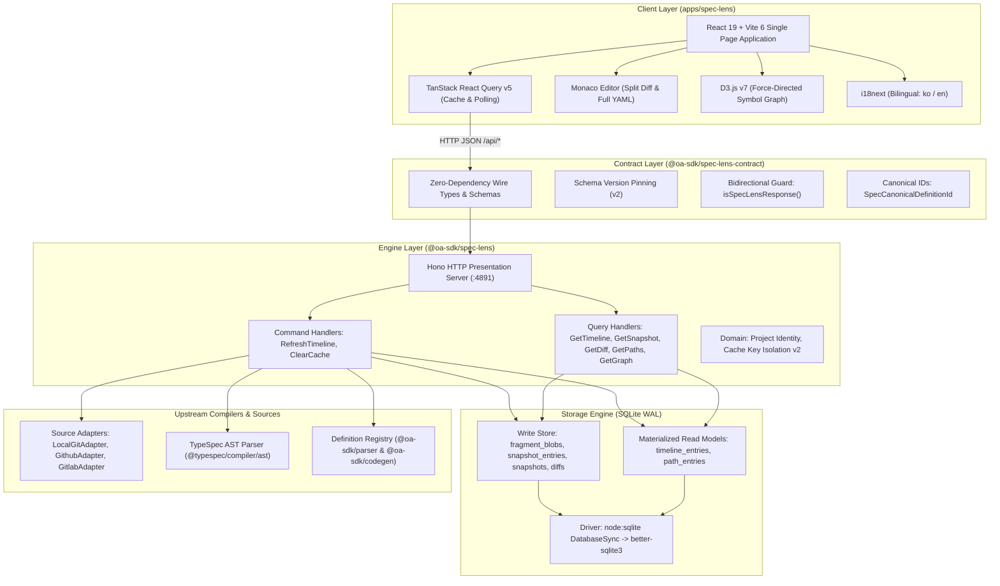
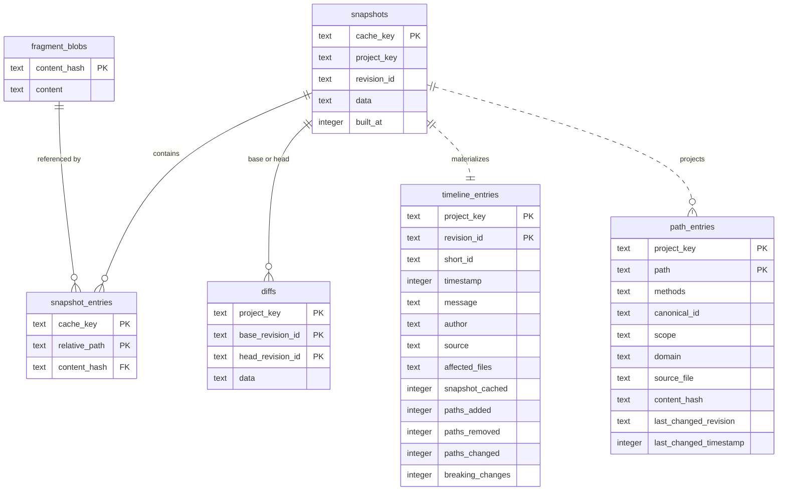
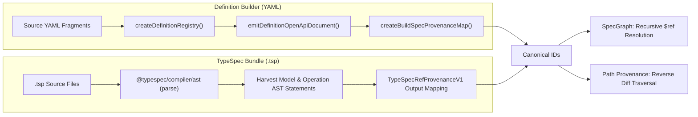

# Spec-Lens Platform Architecture & Operational Manual (`oa-spec-lens`)

Spec-Lens is the Tier 2 change management, observation, and visualization platform for OpenAPI 3.1/3.2 and TypeSpec projects in the `oa-sdk` monorepo. It tracks API evolution across historical git commits, isolates compiler toolchain environments, indexes schema symbols into a queryable graph, and serves an interactive web UI.

---

## 1. Platform Architecture & Topology

Spec-Lens operates on a **CQRS (Command Query Responsibility Segregation)** pattern backed by an embedded SQLite WAL database (`.spec-lens.db`), content-addressed blob storage, and a contract-first API boundary.

### 1.1 High-Level Platform Topology



---

## 2. SQLite WAL Lifecycle & Database Pragma Configuration

Spec-Lens stores its persistent cache in an embedded SQLite database (`.spec-lens.db`). The storage subsystem is implemented in `packages/spec-lens/src/infrastructure/cache/sqlite/sqlite-cache.ts`.

### 2.1 Database File Naming and Lifecycle

- **Default File Name**: `.spec-lens.db` located in the root of the repository or active project directory.
- **Resolution Precedence**:
  1. Configuration file property: `cfg.dbPath` in `spec-lens.config.yaml` / `.json`.
  2. Fallback default: `resolve(process.cwd(), cfg.dbPath ?? '.spec-lens.db')`.
- **Git Ignore Recommendations**:
  ```gitignore
  .spec-lens.db*
  .spec-lens-repos/
  ```
- **Process Signal Handling**: The CLI binds `SIGINT` and `SIGTERM` handlers to invoke `cache.close()`, flushing WAL buffers and releasing file locks cleanly.

### 2.2 Native Driver Fallback Hierarchy

Node.js environments vary across local development and CI containers. Spec-Lens implements an automated driver fallback mechanism:

```typescript
function loadSpecLensSqliteDriver(): SqliteDriver {
  const errors: string[] = []

  // 1. Preferred: Node.js 22+ built-in synchronous SQLite module
  try {
    const sqlite = require('node:sqlite') as NodeSqliteModule
    return {
      name: 'node:sqlite',
      open(path: string): SqliteDatabase {
        return new sqlite.DatabaseSync(path)
      },
    }
  } catch (error) {
    errors.push(`node:sqlite: ${errorMessage(error)}`)
  }

  // 2. Fallback: Native better-sqlite3 C++ addon
  try {
    const betterSqlite = require('better-sqlite3') as BetterSqliteModule
    return {
      name: 'better-sqlite3',
      open(path: string): SqliteDatabase {
        return betterSqlite(path)
      },
    }
  } catch (error) {
    errors.push(`better-sqlite3: ${errorMessage(error)}`)
  }

  throw new Error(`No supported SQLite driver found (${errors.join('; ')})`)
}
```

### 2.3 Mandatory Connection Pragmas

Upon opening the database connection, Spec-Lens executes four mandatory pragmas:

```sql
PRAGMA journal_mode = WAL;
PRAGMA busy_timeout = 5000;
PRAGMA foreign_keys = ON;
PRAGMA user_version = 2;
```

#### Operational Rationale for Pragmas
1. **`PRAGMA journal_mode = WAL`**: Write-Ahead Logging allows concurrent readers to query materialized views while the refresh worker writes new commits, preventing read/write contention.
2. **`PRAGMA busy_timeout = 5000`**: Sets a 5-second sleep-and-retry window on transient locks. Prevents immediate `SQLITE_BUSY` crashes during intensive write bursts.
3. **`PRAGMA foreign_keys = ON`**: Ensures relational integrity between `snapshot_entries` and `fragment_blobs`.
4. **`PRAGMA user_version = 2`**: Identifies schema generation v2 (incorporating project identity and compiler isolation).

### 2.4 Transaction Isolation with `BEGIN IMMEDIATE`

SQLite's default `BEGIN` (deferred) transaction starts in read mode and upgrades to write mode on the first DML statement, which causes deadlocks when multiple processes attempt concurrent writes. Spec-Lens enforces `BEGIN IMMEDIATE`:

```typescript
function runTransaction<T>(db: SqliteDatabase, callback: () => T): T {
  db.exec('BEGIN IMMEDIATE')
  try {
    const result = callback()
    db.exec('COMMIT')
    return result
  } catch (error) {
    try {
      db.exec('ROLLBACK')
    } catch {
      // Preserve original failure
    }
    throw error
  }
}
```

### 2.5 Reconciling Reachable Revisions via Temporary Table

When git history is rewritten (e.g., `git rebase` or `git commit --amend`), cached snapshots from abandoned branches become unreachable orphans. SQLite has a bound-variable parameter limit (`SQLITE_MAX_VARIABLE_NUMBER`, typically 999 or 32766). Passing thousands of revision IDs to a `WHERE revision_id IN (?, ?, ...)` query causes runtime panics.

Spec-Lens reconciles history using a temporary in-memory table with `WITHOUT ROWID`:

```sql
-- Step 1: Create lightweight in-memory temp table
CREATE TEMP TABLE IF NOT EXISTS spec_lens_reachable_revisions (
  revision_id TEXT PRIMARY KEY
) WITHOUT ROWID;

DELETE FROM spec_lens_reachable_revisions;

-- Step 2: Insert reachable commit hashes in batches
INSERT OR IGNORE INTO spec_lens_reachable_revisions (revision_id) VALUES (?);

-- Step 3: Delete orphaned snapshot entries
DELETE FROM snapshot_entries
WHERE cache_key IN (
  SELECT snapshots.cache_key FROM snapshots
  WHERE snapshots.project_key = ?
    AND NOT EXISTS (
      SELECT 1 FROM spec_lens_reachable_revisions reachable
      WHERE reachable.revision_id = snapshots.revision_id
    )
);

-- Step 4: Delete orphaned snapshots
DELETE FROM snapshots
WHERE project_key = ?
  AND NOT EXISTS (
    SELECT 1 FROM spec_lens_reachable_revisions reachable
    WHERE reachable.revision_id = snapshots.revision_id
  );

-- Step 5: Delete orphaned pairwise diffs
DELETE FROM diffs
WHERE project_key = ?
  AND (
    NOT EXISTS (
      SELECT 1 FROM spec_lens_reachable_revisions reachable
      WHERE reachable.revision_id = diffs.base_revision_id
    )
    OR NOT EXISTS (
      SELECT 1 FROM spec_lens_reachable_revisions reachable
      WHERE reachable.revision_id = diffs.head_revision_id
    )
  );

-- Step 6: Delete orphaned timeline entries
DELETE FROM timeline_entries
WHERE project_key = ?
  AND NOT EXISTS (
    SELECT 1 FROM spec_lens_reachable_revisions reachable
    WHERE reachable.revision_id = timeline_entries.revision_id
  );

-- Step 7: Reset path provenance projection before rebuild
DELETE FROM path_entries WHERE project_key = ?;

-- Step 8: Garbage collect unreferenced fragment blobs
DELETE FROM fragment_blobs
WHERE content_hash NOT IN (SELECT DISTINCT content_hash FROM snapshot_entries);
```

---

## 3. Schema v2 Storage Architecture

The relational schema is divided into **normalized write-side tables** (content-addressable raw storage) and **denormalized read-side tables** (materialized query views).



### 3.1 Write-Side Normalized Tables

1. **`fragment_blobs`**:
   - Content-addressed store for individual YAML fragments and `.tsp` source files.
   - De-duplicates file contents across history: identical files share a single hash record.
   ```sql
   CREATE TABLE IF NOT EXISTS fragment_blobs (
     content_hash TEXT PRIMARY KEY,
     content      TEXT NOT NULL
   );
   ```
2. **`snapshot_entries`**:
   - Associates a snapshot's cache key with virtualized file paths and blob hashes.
   ```sql
   CREATE TABLE IF NOT EXISTS snapshot_entries (
     cache_key     TEXT NOT NULL,
     relative_path TEXT NOT NULL,
     content_hash  TEXT NOT NULL REFERENCES fragment_blobs(content_hash),
     PRIMARY KEY (cache_key, relative_path)
   );
   ```
3. **`snapshots`**:
   - Stores serialized snapshot payloads (`SpecSnapshotStored`) excluding file contents.
   ```sql
   CREATE TABLE IF NOT EXISTS snapshots (
     cache_key   TEXT PRIMARY KEY,
     project_key TEXT NOT NULL,
     revision_id TEXT NOT NULL,
     data        TEXT NOT NULL,
     built_at    INTEGER NOT NULL
   );
   CREATE UNIQUE INDEX IF NOT EXISTS snapshots_project_revision_idx
     ON snapshots (project_key, revision_id);
   ```
4. **`diffs`**:
   - Stores precomputed pairwise diffs between revisions.
   ```sql
   CREATE TABLE IF NOT EXISTS diffs (
     project_key      TEXT NOT NULL,
     base_revision_id TEXT NOT NULL,
     head_revision_id TEXT NOT NULL,
     data             TEXT NOT NULL,
     PRIMARY KEY (project_key, base_revision_id, head_revision_id)
   );
   ```

### 3.2 Read-Side Materialized Models

1. **`timeline_entries`**:
   - Pre-aggregated git commit metadata and change metrics for immediate display.
   ```sql
   CREATE TABLE IF NOT EXISTS timeline_entries (
     project_key       TEXT NOT NULL,
     revision_id       TEXT NOT NULL,
     short_id          TEXT NOT NULL,
     timestamp         INTEGER NOT NULL,
     message           TEXT NOT NULL,
     author            TEXT,
     source            TEXT NOT NULL,
     source_ref        TEXT,
     affected_files    TEXT NOT NULL DEFAULT '[]',
     snapshot_cached   INTEGER NOT NULL DEFAULT 0,
     paths_added       INTEGER NOT NULL DEFAULT 0,
     paths_removed     INTEGER NOT NULL DEFAULT 0,
     paths_changed     INTEGER NOT NULL DEFAULT 0,
     breaking_changes  INTEGER NOT NULL DEFAULT 0,
     PRIMARY KEY (project_key, revision_id)
   );
   CREATE INDEX IF NOT EXISTS timeline_entries_ts_idx
     ON timeline_entries (project_key, timestamp DESC);
   ```
2. **`path_entries`**:
   - Materialized projection of every active endpoint in the latest valid snapshot.
   ```sql
   CREATE TABLE IF NOT EXISTS path_entries (
     project_key             TEXT NOT NULL,
     path                    TEXT NOT NULL,
     methods                 TEXT NOT NULL DEFAULT '[]',
     canonical_id            TEXT NOT NULL,
     scope                   TEXT NOT NULL,
     domain                  TEXT NOT NULL,
     source_file             TEXT NOT NULL,
     content_hash            TEXT NOT NULL,
     last_changed_revision   TEXT NOT NULL,
     last_changed_timestamp  INTEGER NOT NULL,
     PRIMARY KEY (project_key, path)
   );
   CREATE INDEX IF NOT EXISTS path_entries_filter_idx
     ON path_entries (project_key, scope, domain);
   ```

### 3.3 Schema Versioning and Migration

Schema version validation is enforced during initialization:
- If `PRAGMA user_version > 2`: Fails immediately with `spec-lens cache schema N is newer than supported schema 2`.
- If `PRAGMA user_version < 2`: Drops all legacy v1 tables (which lacked compiler isolation and project keys) and initializes schema v2 cleanly.
- Sets `PRAGMA user_version = 2;`.

---

## 4. Symbol Indexing & Query APIs

Spec-Lens provides symbol extraction across both Definition Builder YAML fragments and TypeSpec bundle projects.

### 4.1 Dual Symbol Extraction Pipeline



#### Canonical Identifier Formats
Spec-Lens mints canonical identifiers that uniquely position every definition:
- **Definition Builder Format**:
  ```
  ${kind}:${scope}/${domain}/${localName}
  ```
  Examples:
  - `schema:public/users/User`
  - `path:public/users/Users`
  - `operation:public/users/listUsers`
- **TypeSpec Bundle Format**:
  ```
  ${kind}:typespec/${sourcePath.replaceAll('/', '_')}/${symbol}
  ```
  Example:
  - `schema:typespec/models_user.tsp/User`

### 4.2 Recursive `$ref` Dependency Graph Extraction

Implemented in `packages/spec-lens/src/application/queries/get-graph.query.ts`:
1. Traverses the emitted OpenAPI document recursively via `collectRefs()`.
2. Inspects all `$ref` keys (supporting OAS 3.1 sibling keywords like `description` alongside `$ref`).
3. Maps output JSON pointers to canonical IDs using `pointerToId` mapping table.
4. Generates directed graph nodes (`SpecGraphNode[]`) and edges (`SpecGraphEdge[]`):
   ```typescript
   export type SpecGraphNode = {
     id: string
     kind: string
     scope: string
     domain: string
     localName: string
     sourcePath: string
     contentHash: string
   }

   export type SpecGraphEdge = {
     source: string
     target: string
     refPointer: string
   }
   ```

### 4.3 Reverse-Chronological Path Provenance Indexing

Implemented in `populatePathEntries()` in `refresh-timeline.command.ts`:
1. Identifies the latest successfully compiled snapshot.
2. If output pointer mapping is unavailable (historical TypeSpec fallback), clears `path_entries` and marks status as unavailable.
3. Iterates over historical diffs in reverse-chronological order (newest commit $\to$ oldest commit).
4. Decodes JSON pointers (`#/paths/~1books~1{id}` $\to$ `/books/{id}`).
5. **First-Hit Rule**: The first time an API path is observed in the reverse walk, that commit's SHA and timestamp are recorded as its most recent modification.
6. Paths unchanged across the entire diff window are attributed to the latest snapshot.
7. Populates the `path_entries` read model table.

### 4.4 Hono HTTP Query Endpoints

The presentation layer runs on Hono (`packages/spec-lens/src/presentation/http/server.ts`):

| Method | Route | Category | Description | Query Parameters / Body |
|---|---|---|---|---|
| `GET` | `/api/config` | Query | Server identity, project key, toolchain fingerprint, observation inputs | None |
| `POST` | `/api/refresh` | Command | Synchronizes git commits, builds missing snapshots, updates read models | None |
| `GET` | `/api/timeline` | Query | Retrieves denormalized commit list | `?limit=100` (default: 100) |
| `GET` | `/api/snapshot/:revisionId` | Query | Returns full snapshot; optionally loads fragment file contents | `?include=entries` |
| `GET` | `/api/diff/:baseId/:headId` | Query | Retrieves pairwise diff between two commits | None |
| `GET` | `/api/paths` | Query | Returns materialized path provenance list | `?scope=public&domain=users` |
| `GET` | `/api/graph` | Query | Retrieves symbol dependency graph for a revision | `?revision=<revisionId>` |
| `DELETE` | `/api/cache` | Command | Purges all cached records for the current projectKey | None |

### 4.5 Indexing Performance & Source Read Budgets

To guard against memory exhaustion during large repository crawls, Spec-Lens enforces strict ceilings (`oa-sdk.spec-lens.source-read-budget.v1`):
- `maxFiles`: 256 files
- `maxFileBytes`: 2,097,152 bytes (2 MiB per file)
- `maxTotalBytes`: 16,777,216 bytes (16 MiB aggregate)
- `maxConcurrency`: 4 concurrent file reads
- **Compiler Isolation Ceilings**: 60s execution timeout, 256 KB max output size, 512 MB max heap memory, 32 MB max artifact size.
- **Snapshot Worker Concurrency**:
  - Definition Builder: 4 parallel snapshot builds.
  - TypeSpec Bundle: 1 worker (sequential isolated execution to maintain compiler determinism).

---

## 5. Markdown Projection Engine

Spec-Lens integrates with `@oa-sdk/openapi-projection-contract` to generate verifiable, structured Markdown documentation from schema ASTs.

### 5.1 Unified Projection Envelopes

Every projection adheres to the standard contract envelope:

```typescript
export type OpenApiProjectionResult<T> = {
  profile: 'component-bundle' | 'operation-contract' | 'full-api-document'
  projection: T
  refs: SchemaRefEdge[]
  diagnostics: SchemaDiagnostic[]
  sources: Record<string, SchemaSourceCoordinate>
  versionHash: string
  typeTargets?: SchemaTypeTarget[]
}
```

#### Metadata Extension Fields (`x-schema-engine-*`)
Spec-Lens uses OpenAPI root-level extension fields to preserve projection metadata without breaking OAS 3.1 schema compliance:
- `x-schema-engine-profile`: The projection profile utilized.
- `x-schema-engine-version-hash`: Deterministic SHA256 digest of input ASTs, targets, and compiler options.
- `x-schema-engine-sources`: Source coordinate mappings (file path, JSON pointer, line/col `#L12:C4`).
- `x-schema-engine-refs`: Reference graph edges surviving compilation.

### 5.2 AST-to-Markdown Generation Modules

1. **Sidecar Diff & Change Review** (`packages/codegen/src/cli/lib/review-markdown.ts`):
   - `formatSidecarDiffLines()`: Renders structured GitHub-flavored markdown tables:
     ```markdown
     - Base: `v1.0.0`
     - Head: `v1.1.0`
     - Status: **changed** - 2 differences detected

     | Kind | Pointer | Base | Head |
     | --- | --- | --- | --- |
     | changed | `#/components/schemas/User/properties/age` | `integer` | `number` |
     ```
   - `formatChangeLines()`: Categorizes breaking vs non-breaking changes.
   - `formatArtifactFreshnessLines()`: Verifies if disk artifacts match generated projections.
2. **API Persona & Capability Trait Reporting** (`packages/personas`):
   - `renderProfileMarkdown()`: Emits Markdown documentation for API personas.
   - `renderMarkdown()`: Emits a 12-section cross-cut compliance report.
   - `renderFlowMarkdown()`: Emits interactive Mermaid dependency flowcharts (`graph TD`).
3. **Entity-Relationship Data Model Tables** (`packages/typespec-erd`):
   - Renders entity relationship diagrams and schema diffs into Markdown format.

---

## 6. Contract-First Architecture

The wire communication contract is strictly isolated in `@oa-sdk/spec-lens-contract` (`packages/spec-lens-contract/src/index.ts`).

### 6.1 Architectural Invariants
1. **Zero External Runtime Dependencies**: Contains 0 external production dependencies. It compiles to lightweight ESM and can be safely imported in browser bundles, worker threads, and Node servers.
2. **Schema Version Pinning**:
   ```typescript
   export const SPEC_LENS_SNAPSHOT_SCHEMA_VERSION = 'spec-lens.snapshot.v2'
   export const SPEC_LENS_DIFF_SCHEMA_VERSION = 'spec-lens.diff.v2'
   export const SPEC_LENS_COMPOSITION_REPORT_SCHEMA_VERSION = 'oa-gen.composition-report.v1'
   export const SPEC_LENS_TYPESPEC_COMPILE_EVIDENCE_SCHEMA_VERSION = 'oa-sdk.spec-lens.typespec-compile.v1'
   export const SPEC_LENS_TYPESPEC_TOOLCHAIN_EVIDENCE_SCHEMA_VERSION = 'oa-sdk.spec-lens.typespec-toolchain.v1'
   export const SPEC_LENS_TYPESPEC_SOURCE_READ_BUDGET_SCHEMA_VERSION = 'oa-sdk.spec-lens.source-read-budget.v1'
   ```
3. **Discriminator Unions**:
   - `SpecSnapshot` $\to$ `DefinitionBuilderSpecSnapshot` | `TypeSpecBundleSpecSnapshot` (discriminated by `projectKind`).
   - `SpecTimelineDiff` $\to$ `DefinitionBuilderSpecTimelineDiff` | `TypeSpecBundleSpecTimelineDiff`.
   - `SpecPathsResult` $\to$ `{ status: 'available', ... }` | `{ status: 'unavailable', reason: 'output-pointer-mapping-unavailable' }`.

### 6.2 Bidirectional Runtime Response Validation

To guarantee zero contract drift across the HTTP boundary, client applications use `isSpecLensResponse(kind, value)`:

```typescript
export function isSpecLensResponse<K extends keyof SpecLensApiResponseMap>(
  kind: K,
  value: unknown,
): value is SpecLensApiResponseMap[K] {
  if (kind === 'timeline') return Array.isArray(value) && value.every(isTimelineEntry)
  if (!isRecord(value)) return false
  switch (kind) {
    case 'config':     return isServerConfig(value)
    case 'snapshot':   return isSnapshot(value)
    case 'diff':       return isTimelineDiff(value)
    case 'paths':      return isPathsResult(value)
    case 'graph':      return isGraph(value)
    case 'refresh':    return isRefreshResult(value)
    case 'clearCache': return isClearCacheResult(value)
  }
  return false
}
```

---

## 7. Applications & UI (`apps/spec-lens`)

`apps/spec-lens` (package `@oa-sdk/spec-lens-ui`) is the frontend visualization application.

### 7.1 Frontend Stack
- **Framework**: React 19.1.0 + React DOM 19.1.0
- **Bundler & Dev Server**: Vite 6.3.5
- **Query Cache**: `@tanstack/react-query` v5.80.6
- **Code & Diff Editor**: `@monaco-editor/react` v4.7.0 (lazy-loaded)
- **Data Visualization**: D3.js v7.9.0 (force-directed graph)
- **Internationalization**: `i18next` v26 + `react-i18next` v17 (English and Korean)

### 7.2 Core Views

```
┌────────────────────────────────────────────────────────────────────────────┐
│ Spec-Lens Header: Target Name | Branch | Language Switcher (ko / en)       │
├──────────────┬─────────────────────────────────────────────────────────────┤
│ Navigation   │ Main Content View                                           │
│              │                                                             │
│ • Timeline   │ [Timeline View]                                             │
│ • Diff       │ Commit cards with diff badges (+2, -1, ~3, ⚡1)            │
│ • Paths      │ Action buttons: Refresh, Clear Cache                        │
│ • Graph      ├─────────────────────────────────────────────────────────────┤
│              │ [Diff View]                                                 │
│              │ Tabs: Changes | Full YAML | Breaking | Fragments            │
│              │ Monaco Editor side-by-side / inline diff viewer            │
│              ├─────────────────────────────────────────────────────────────┤
│              │ [Path Provenance View]                                      │
│              │ Filterable table: Path, Method badges, Scope, Domain, Hash  │
│              ├─────────────────────────────────────────────────────────────┤
│              │ [Fragment Graph View]                                       │
│              │ Interactive D3 force-directed symbol graph with node detail │
└──────────────┴─────────────────────────────────────────────────────────────┘
```

1. **Timeline View (`views/Timeline.tsx`)**:
   - Queries `GET /api/timeline` with 30s background polling.
   - Displays commit short SHA, author, timestamp, commit message, and changed fragment tags.
   - Colored metric badges:
     - `+N` (green): API paths added.
     - `−N` (red): API paths removed.
     - `~N` (blue): API paths modified.
     - `⚡N` (orange): Breaking changes detected.
     - `build failed` (red badge): Snapshot build error at that revision.
   - **Arbitrary 2-Commit Compare Mode**: Base and Head radio selectors allow comparing any two arbitrary historical commits across the timeline, with swap (`⇄`) and validation guards.
   - **Breaking Change (⚡) Filter Chip**: One-click toggle to isolate commits with breaking changes.
   - **Real-Time Search**: Live multi-field text filtering across commit SHA, message, and author.
   - **In-App Feedback**: Cache clearing confirmed via accessible modal `Dialog` and notified via `Toast`.
2. **Diff View (`views/DiffView.tsx`)**:
   - Pairwise diff between `baseId` and `headId`.
   - **Changes Tab**: Categorized OpenAPI structure diffs (`Root`, `Servers`, `API Paths`, `Components`, `Security`).
   - **Full YAML Tab**: Side-by-side or unified Monaco editor diff of the entire emitted OpenAPI YAML.
   - **Breaking Tab**: Isolates breaking changes (with All / Breaking / Non-breaking filters).
   - **Fragments Tab**: Lists definition files modified and shows raw fragment differences.
3. **Path Provenance View (`views/PathProvenance.tsx`)**:
   - Tabular view of all active API endpoints.
   - Method badges (GET=blue, POST=green, PUT/PATCH=amber, DELETE=red).
   - **Data Grid Column Sorting**: Clickable table headers for Path (A-Z), HTTP Method, and Last Changed timestamp.
   - **One-Click Clipboard Copy (`CopyButton`)**: Copies endpoint Path or Canonical ID to clipboard with 1.8s transient `Copied!` tooltip and event propagation isolation.
   - Real-time text search and Scope/Domain dropdown filtering.
   - Handles TypeSpec fallback state with `PathAvailabilityNotice`.
4. **Fragment Graph View (`views/FragmentGraph.tsx`)**:
   - Interactive D3 force-directed visualization of `$ref` dependencies.
   - Node radii reflect definition kind (`path`: 10px, `operation`: 8px, `securityScheme`: 7px, `schema`: 6px, `parameter`: 5px).
   - Node colors reflect scope (`public`=#58a6ff, `shared`=#3fb950, `admin`=#e3b341, `internal`=#bc8cff, `partner`=#f0883e).
   - **Floating Canvas Controls Toolbar**: Zoom In (`+`), Zoom Out (`−`), Fit to Viewport (`⛶`, auto bounding-box calculation), and Reset Layout (`↻`).
   - **Symbol Search Autocomplete & Zoom Focus**: Auto-completes symbol names, animating camera transform to the target node with pulse highlight.
   - **1-Hop Neighborhood Focus (Dimming)**: Clicking a node isolates its immediate dependencies at 100% opacity while dimming unrelated nodes to 15% opacity.
   - Node click opens details panel displaying canonical ID, content hash, and incoming/outgoing references.
5. **Global App Shell & UX Patterns (`App.tsx`, `hooks/useUrlState.ts`, `components/FeedbackContext.tsx`)**:
   - **URL SearchParams Deep Linking**: Synchronizes `view`, `base`, `head`, `revision`, `search`, `scope`, and `domain` with browser URL query parameters.
   - **Collapsible Sidebar**: Collapses to 60px compact icon mode for maximizing horizontal diff viewing area.
   - **In-App Feedback**: Dialog modal and toast notification architecture eliminating blocking native alerts.

### 7.3 Development vs Production Hosting
- **Development**: Vite dev server runs on port 5174, proxying `/api/*` requests to the Spec-Lens server on port 4891.
- **Production**: `@oa-sdk/spec-lens` uses Hono `serveStatic` to serve pre-built UI assets directly from `/ui/*` (`presentation/http/server.ts`).

---

## 8. Operational Recipes & Workflows

### 8.1 Configuration Recipes

#### Recipe 1: Definition Builder Project (`spec-lens.config.yaml`)
```yaml
source: local-git
project:
  kind: definition-builder
  sourceRoot: packages/schemas/src/fragments
  targetPath: packages/schemas/src/targets/book-notebook-api.yaml
port: 4891
dbPath: .spec-lens.db
```

#### Recipe 2: TypeSpec Production Bundle (`spec-lens.config.yaml`)
```yaml
source: local-git
branch: main
project:
  kind: typespec-bundle
  sourceRoot: packages/schemas/typespec
  manifestPath: packages/schemas/typespec/oa-sdk.typespec-bundle.json
  observation:
    evidence: [package.json, pnpm-lock.yaml]
    candidates: [packages/typespec-decorators]
port: 4891
dbPath: .spec-lens.db
```

### 8.2 Command Workflows

```bash
# 1. Start the Spec-Lens backend server (auto-detects project config)
pnpm exec tsx packages/spec-lens/src/cli.ts

# 2. Start the UI development server (separate terminal)
pnpm --filter @oa-sdk/spec-lens-ui dev

# 3. Build UI for production embedding
pnpm --filter @oa-sdk/spec-lens-ui build

# 4. Trigger timeline refresh via HTTP API
curl -X POST http://localhost:4891/api/refresh

# 5. Fetch latest timeline entries
curl http://localhost:4891/api/timeline?limit=20

# 6. Query active paths filtered by scope
curl "http://localhost:4891/api/paths?scope=public"

# 7. Query symbol dependency graph
curl http://localhost:4891/api/graph

# 8. Clear cache for current projectKey
curl -X DELETE http://localhost:4891/api/cache
```

---

## 9. Comprehensive Troubleshooting Matrix

| Symptom / Error | Root Cause | Remediation |
|---|---|---|
| `SQLITE_BUSY: database is locked` | Concurrent write attempt or lingering process holding write lock without `PRAGMA busy_timeout = 5000`. | 1. Ensure `PRAGMA busy_timeout = 5000` is set.<br>2. Check for zombie Node.js processes holding `.spec-lens.db` (`lsof .spec-lens.db`).<br>3. Ensure all write transactions use `BEGIN IMMEDIATE`. |
| `spec-lens cache schema N is newer than supported schema 2` | Database file was written by a newer version of `@oa-sdk/spec-lens`. | 1. Upgrade `@oa-sdk/spec-lens` to matching version, or<br>2. Delete `.spec-lens.db` and trigger `POST /api/refresh` to rebuild schema v2. |
| `No supported SQLite driver found` | Neither Node.js built-in `node:sqlite` nor `better-sqlite3` native module is available in the environment. | 1. Upgrade Node.js to `>=22.0.0` (provides native `DatabaseSync`), or<br>2. Install native `better-sqlite3` (`pnpm add -D better-sqlite3`). |
| `too many SQL variables` during rebase | Bound variable parameter count exceeded SQLite limit in `reconcileReachableRevisions()`. | Reconcile history using the temporary table `spec_lens_reachable_revisions WITHOUT ROWID` instead of parameter binding lists. |
| `output-pointer-mapping-unavailable` banner in UI | Historical TypeSpec revisions prior to output-pointer provenance only retain source file evidence. | Expected behavior for older TypeSpec commits. Spec-Lens displays `PathAvailabilityNotice` and renders source-file fallback nodes. |
| `source-read-budget-exceeded` | Git commit tree exceeds source budget limits (256 files or 16 MiB aggregate). | Check `observation` paths in `spec-lens.config.yaml`. Narrow `sourceRoot` or prune non-schema candidate directories. |
| Port collision on `4891` | Another instance of Spec-Lens or another dev server is occupying port 4891. | Specify custom port via config or CLI: `port: 4895` in `spec-lens.config.yaml`. |
| UI shows `Failed to fetch` on API calls | Vite dev server proxy is unable to connect to backend server on port 4891. | Verify backend server is running: `curl http://localhost:4891/api/config`. |

---

## 10. Verification Procedures

Execute these verification commands after making any modifications to Spec-Lens packages or documentation:

```bash
# 1. Run unit tests for contract package
pnpm --filter @oa-sdk/spec-lens-contract test

# 2. Run unit and integration tests for spec-lens engine
pnpm --filter @oa-sdk/spec-lens test

# 3. Run unit tests for UI package
pnpm --filter @oa-sdk/spec-lens-ui test

# 4. Perform TypeScript typechecks across Tier 2
pnpm --filter @oa-sdk/spec-lens-contract typecheck
pnpm --filter @oa-sdk/spec-lens typecheck
pnpm --filter @oa-sdk/spec-lens-ui typecheck

# 5. Verify documentation gates and agent governance
pnpm check:docs
```
