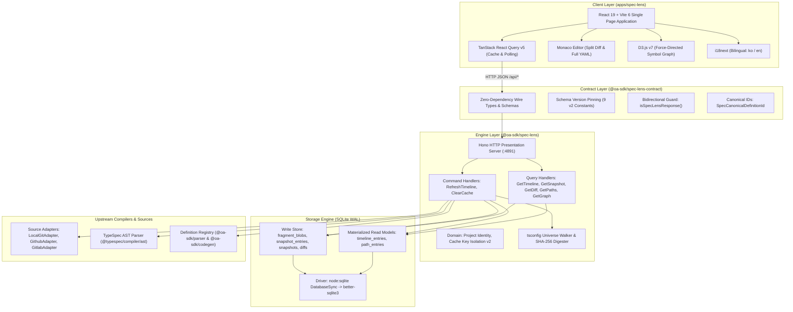
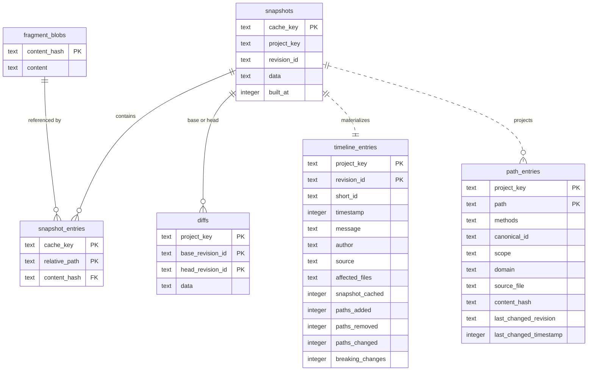
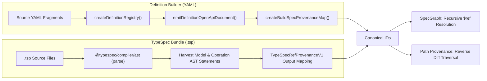

# Spec-Lens Platform Architecture & Operational Manual (`oa-spec-lens`)

Spec-Lens is the Tier 2 change management, observation, and visualization platform for OpenAPI 3.1/3.2 and TypeSpec projects in the `oa-sdk` monorepo. It tracks API evolution across historical git commits, isolates compiler toolchain environments, digests transitive TypeScript configurations, indexes schema symbols into a queryable graph, and serves an interactive web UI.

---

## 1. Platform Architecture & Topology

Spec-Lens operates on a **CQRS (Command Query Responsibility Segregation)** pattern backed by an embedded SQLite WAL database (`.spec-lens.db`), content-addressed blob storage, and a contract-first API boundary.

### 1.1 High-Level Platform Topology



---

## 2. SQLite WAL Lifecycle & Database Pragma Configuration

Spec-Lens stores its persistent cache in an embedded SQLite database (`.spec-lens.db`). The storage subsystem is implemented in `packages/spec-lens/src/infrastructure/cache/sqlite/sqlite-cache.ts`.

### 2.1 Database File Naming and Lifecycle

- **Default File Name**: `.spec-lens.db` located in the root of the repository or active project directory.
- **Resolution Precedence**:
  1. Configuration file property: `cfg.dbPath` in `spec-lens.config.yaml` / `.json`.
  2. Fallback default: `resolve(process.cwd(), cfg.dbPath ?? '.spec-lens.db')`.
- **Git Ignore Recommendations**:
  ```gitignore
  .spec-lens.db*
  .spec-lens-repos/
  ```
- **Process Signal Handling**: The CLI binds `SIGINT` and `SIGTERM` handlers to invoke `cache.close()`, flushing WAL buffers and releasing file locks cleanly.

### 2.2 Native Driver Fallback Hierarchy

Node.js environments vary across local development and CI containers. Spec-Lens implements an automated driver fallback mechanism:

```typescript
function loadSpecLensSqliteDriver(): SqliteDriver {
  const errors: string[] = []

  // 1. Preferred: Node.js 22+ built-in synchronous SQLite module
  try {
    const sqlite = require('node:sqlite') as NodeSqliteModule
    return {
      name: 'node:sqlite',
      open(path: string): SqliteDatabase {
        return new sqlite.DatabaseSync(path)
      },
    }
  } catch (error) {
    errors.push(`node:sqlite: ${errorMessage(error)}`)
  }

  // 2. Fallback: Native better-sqlite3 C++ addon
  try {
    const betterSqlite = require('better-sqlite3') as BetterSqliteModule
    return {
      name: 'better-sqlite3',
      open(path: string): SqliteDatabase {
        return betterSqlite(path)
      },
    }
  } catch (error) {
    errors.push(`better-sqlite3: ${errorMessage(error)}`)
  }

  throw new Error(`No supported SQLite driver found (${errors.join('; ')})`)
}
```

### 2.3 Mandatory Connection Pragmas

Upon opening the database connection, Spec-Lens executes four mandatory pragmas:

```sql
PRAGMA journal_mode = WAL;
PRAGMA busy_timeout = 5000;
PRAGMA foreign_keys = ON;
PRAGMA user_version = 2;
```

#### Operational Rationale for Pragmas
1. **`PRAGMA journal_mode = WAL`**: Write-Ahead Logging allows concurrent readers to query materialized views while the refresh worker writes new commits, preventing read/write contention.
2. **`PRAGMA busy_timeout = 5000`**: Sets a 5-second sleep-and-retry window on transient locks. Prevents immediate `SQLITE_BUSY` crashes during intensive write bursts.
3. **`PRAGMA foreign_keys = ON`**: Ensures relational integrity between `snapshot_entries` and `fragment_blobs`.
4. **`PRAGMA user_version = 2`**: Identifies schema generation v2 (incorporating project identity and compiler isolation).

### 2.4 Transaction Isolation with `BEGIN IMMEDIATE`

SQLite's default `BEGIN` (deferred) transaction starts in read mode and upgrades to write mode on the first DML statement, which causes deadlocks when multiple processes attempt concurrent writes. Spec-Lens enforces `BEGIN IMMEDIATE`:

```typescript
function runTransaction<T>(db: SqliteDatabase, callback: () => T): T {
  db.exec('BEGIN IMMEDIATE')
  try {
    const result = callback()
    db.exec('COMMIT')
    return result
  } catch (error) {
    try {
      db.exec('ROLLBACK')
    } catch {
      // Preserve original failure
    }
    throw error
  }
}
```

### 2.5 Reconciling Reachable Revisions via Temporary Table

When git history is rewritten (e.g., `git rebase` or `git commit --amend`), cached snapshots from abandoned branches become unreachable orphans. SQLite has a bound-variable parameter limit (`SQLITE_MAX_VARIABLE_NUMBER`, typically 999 or 32766). Passing thousands of revision IDs to a `WHERE revision_id IN (?, ?, ...)` query causes runtime panics.

Spec-Lens reconciles history using a temporary in-memory table with `WITHOUT ROWID`:

```sql
-- Step 1: Create lightweight in-memory temp table
CREATE TEMP TABLE IF NOT EXISTS spec_lens_reachable_revisions (
  revision_id TEXT PRIMARY KEY
) WITHOUT ROWID;

DELETE FROM spec_lens_reachable_revisions;

-- Step 2: Insert reachable commit hashes in batches
INSERT OR IGNORE INTO spec_lens_reachable_revisions (revision_id) VALUES (?);

-- Step 3: Delete orphaned snapshot entries
DELETE FROM snapshot_entries
WHERE cache_key IN (
  SELECT snapshots.cache_key FROM snapshots
  WHERE snapshots.project_key = ?
    AND NOT EXISTS (
      SELECT 1 FROM spec_lens_reachable_revisions reachable
      WHERE reachable.revision_id = snapshots.revision_id
    )
);

-- Step 4: Delete orphaned snapshots
DELETE FROM snapshots
WHERE project_key = ?
  AND NOT EXISTS (
    SELECT 1 FROM spec_lens_reachable_revisions reachable
    WHERE reachable.revision_id = snapshots.revision_id
  );

-- Step 5: Delete orphaned pairwise diffs
DELETE FROM diffs
WHERE project_key = ?
  AND (
    NOT EXISTS (
      SELECT 1 FROM spec_lens_reachable_revisions reachable
      WHERE reachable.revision_id = diffs.base_revision_id
    )
    OR NOT EXISTS (
      SELECT 1 FROM spec_lens_reachable_revisions reachable
      WHERE reachable.revision_id = diffs.head_revision_id
    )
  );

-- Step 6: Delete orphaned timeline entries
DELETE FROM timeline_entries
WHERE project_key = ?
  AND NOT EXISTS (
    SELECT 1 FROM spec_lens_reachable_revisions reachable
    WHERE reachable.revision_id = timeline_entries.revision_id
  );

-- Step 7: Reset path provenance projection before rebuild
DELETE FROM path_entries WHERE project_key = ?;

-- Step 8: Garbage collect unreferenced fragment blobs
DELETE FROM fragment_blobs
WHERE content_hash NOT IN (SELECT DISTINCT content_hash FROM snapshot_entries);
```

### 2.6 Transitive `tsconfig.json` Configuration Universe Hashing & Cache Invalidation

Implemented in `packages/spec-lens/src/infrastructure/cache/sqlite/tsconfig-universe.ts`. Changes in TypeScript compiler options (e.g. `strict`, `exactOptionalPropertyTypes`, or path mappings) can alter emitted types and AST projections. To guarantee zero cache poisoning, Spec-Lens digests the entire transitive configuration universe into the project cache key.

#### Transitive Closure Algorithm (`computeTsconfigUniverse`)
1. **Entrypoint Resolution**: Locates the root `tsconfig.json`.
2. **Recursive `extends` Resolution**: Recursively resolves extended configurations, supporting both single strings (`"extends": "./base.json"`) and TypeScript 5.0+ string arrays (`"extends": ["./base.json", "./paths.json"]`).
3. **Project References**: Crawls composite project references (`"references": [{ "path": "./packages/shared" }]`).
4. **JSONC Sanitization**: Strips single-line (`//`) and multi-line (`/* ... */`) comments via `stripJsonComments` and removes trailing commas via `removeTrailingCommas` without corrupting string literals.
5. **Root Extraction**: Identifies compiler root files (`roots`) across all referenced projects.
6. **Deterministic Digestion**: Calculates the SHA-256 hash for each configuration file and digests the sorted `{ configs, roots }` structure into `universeDigest`.

```typescript
export interface ContractConfigUniverse {
  readonly configs: readonly ContractConfigDigest[]
  readonly roots: readonly string[]
  readonly universeDigest: string
}
```

#### Cache Key Integration (`buildSpecProjectKey`)
In `packages/spec-lens/src/domain/project.ts`, `buildSpecProjectKey()` integrates `tsconfigUniverseDigest`:

```typescript
export function buildSpecProjectKey(input: SpecProjectKeyInput): string {
  const normalized = {
    builderVersion: input.builderVersion,
    manifestOrTargetDigest: input.manifestOrTargetDigest,
    snapshotSchemaVersion: input.snapshotSchemaVersion,
    sourceKind: input.sourceKind,
    sourceRoot: normalizeSourceRoot(input.sourceRoot),
    toolchainFingerprint: input.sourceKind === 'typespec-bundle'
      ? requireSha256(input.toolchainFingerprint, 'toolchainFingerprint')
      : requireNonEmptyString(input.toolchainFingerprint, 'toolchainFingerprint'),
    observation: normalizeObservationIdentity(input.observation),
    ...(input.tsconfigUniverseDigest !== undefined
      ? { tsconfigUniverseDigest: requireSha256(input.tsconfigUniverseDigest, 'tsconfigUniverseDigest') }
      : {}),
  }
  return sha256(JSON.stringify(normalized))
}
```

Whenever any configuration in the inheritance chain changes, the project key changes, creating a clean cache namespace in SQLite WAL without manual intervention.

---

## 3. Schema v2 Storage Architecture

The relational schema is divided into **normalized write-side tables** (content-addressable raw storage) and **denormalized read-side tables** (materialized query views).



### 3.1 Write-Side Normalized Tables

1. **`fragment_blobs`**:
   - Content-addressed store for individual YAML fragments and `.tsp` source files.
   ```sql
   CREATE TABLE IF NOT EXISTS fragment_blobs (
     content_hash TEXT PRIMARY KEY,
     content      TEXT NOT NULL
   );
   ```
2. **`snapshot_entries`**:
   - Associates a snapshot's cache key with virtualized file paths and blob hashes.
   ```sql
   CREATE TABLE IF NOT EXISTS snapshot_entries (
     cache_key     TEXT NOT NULL,
     relative_path TEXT NOT NULL,
     content_hash  TEXT NOT NULL REFERENCES fragment_blobs(content_hash),
     PRIMARY KEY (cache_key, relative_path)
   );
   ```
3. **`snapshots`**:
   - Stores serialized snapshot payloads (`SpecSnapshotStored`) excluding file contents.
   ```sql
   CREATE TABLE IF NOT EXISTS snapshots (
     cache_key   TEXT PRIMARY KEY,
     project_key TEXT NOT NULL,
     revision_id TEXT NOT NULL,
     data        TEXT NOT NULL,
     built_at    INTEGER NOT NULL
   );
   CREATE UNIQUE INDEX IF NOT EXISTS snapshots_project_revision_idx
     ON snapshots (project_key, revision_id);
   ```
4. **`diffs`**:
   - Stores precomputed pairwise diffs between revisions.
   ```sql
   CREATE TABLE IF NOT EXISTS diffs (
     project_key      TEXT NOT NULL,
     base_revision_id TEXT NOT NULL,
     head_revision_id TEXT NOT NULL,
     data             TEXT NOT NULL,
     PRIMARY KEY (project_key, base_revision_id, head_revision_id)
   );
   ```

### 3.2 Read-Side Materialized Models

1. **`timeline_entries`**:
   - Pre-aggregated git commit metadata and change metrics for immediate display.
   ```sql
   CREATE TABLE IF NOT EXISTS timeline_entries (
     project_key       TEXT NOT NULL,
     revision_id       TEXT NOT NULL,
     short_id          TEXT NOT NULL,
     timestamp         INTEGER NOT NULL,
     message           TEXT NOT NULL,
     author            TEXT,
     source            TEXT NOT NULL,
     source_ref        TEXT,
     affected_files    TEXT NOT NULL DEFAULT '[]',
     snapshot_cached   INTEGER NOT NULL DEFAULT 0,
     paths_added       INTEGER NOT NULL DEFAULT 0,
     paths_removed     INTEGER NOT NULL DEFAULT 0,
     paths_changed     INTEGER NOT NULL DEFAULT 0,
     breaking_changes  INTEGER NOT NULL DEFAULT 0,
     PRIMARY KEY (project_key, revision_id)
   );
   CREATE INDEX IF NOT EXISTS timeline_entries_ts_idx
     ON timeline_entries (project_key, timestamp DESC);
   ```
2. **`path_entries`**:
   - Materialized projection of every active endpoint in the latest valid snapshot.
   ```sql
   CREATE TABLE IF NOT EXISTS path_entries (
     project_key             TEXT NOT NULL,
     path                    TEXT NOT NULL,
     methods                 TEXT NOT NULL DEFAULT '[]',
     canonical_id            TEXT NOT NULL,
     scope                   TEXT NOT NULL,
     domain                  TEXT NOT NULL,
     source_file             TEXT NOT NULL,
     content_hash            TEXT NOT NULL,
     last_changed_revision   TEXT NOT NULL,
     last_changed_timestamp  INTEGER NOT NULL,
     PRIMARY KEY (project_key, path)
   );
   CREATE INDEX IF NOT EXISTS path_entries_filter_idx
     ON path_entries (project_key, scope, domain);
   ```

### 3.3 Schema Versioning and Migration

Schema version validation is enforced during initialization:
- If `PRAGMA user_version > 2`: Fails immediately with `spec-lens cache schema N is newer than supported schema 2`.
- If `PRAGMA user_version < 2`: Drops all legacy v1 tables and initializes schema v2 cleanly.
- Sets `PRAGMA user_version = 2;`.

---

## 4. Symbol Indexing & Query APIs

Spec-Lens provides symbol extraction across both Definition Builder YAML fragments and TypeSpec bundle projects.

### 4.1 Dual Symbol Extraction Pipeline



#### Canonical Identifier Formats
- **Definition Builder Format**:
  `${kind}:${scope}/${domain}/${localName}` (e.g. `schema:public/users/User`)
- **TypeSpec Bundle Format**:
  `${kind}:typespec/${sourcePath.replaceAll('/', '_')}/${symbol}` (e.g. `schema:typespec/models_user.tsp/User`)

### 4.2 Recursive `$ref` Dependency Graph Extraction

Implemented in `packages/spec-lens/src/application/queries/get-graph.query.ts`:
1. Traverses the emitted OpenAPI document recursively via `collectRefs()`.
2. Inspects all `$ref` keys (supporting OAS 3.1 sibling keywords like `description` alongside `$ref`).
3. Maps output JSON pointers to canonical IDs using `pointerToId` mapping table.
4. Generates directed graph nodes (`SpecGraphNode[]`) and edges (`SpecGraphEdge[]`).

### 4.3 Reverse-Chronological Path Provenance Indexing

Implemented in `populatePathEntries()` in `refresh-timeline.command.ts`:
1. Identifies the latest successfully compiled snapshot.
2. Iterates over historical diffs in reverse-chronological order (newest commit $\to$ oldest commit).
3. First-Hit Rule: The first time an API path is observed in the reverse walk, that commit's SHA and timestamp are recorded.
4. Populates the `path_entries` read model table.

### 4.4 Hono HTTP Query Endpoints

The presentation layer runs on Hono (`packages/spec-lens/src/presentation/http/server.ts`):

| Method | Route | Category | Description | Query Parameters / Body |
|---|---|---|---|---|
| `GET` | `/api/config` | Query | Server identity, project key, toolchain fingerprint, observation inputs | None |
| `POST` | `/api/refresh` | Command | Synchronizes git commits, builds missing snapshots, updates read models | None |
| `GET` | `/api/timeline` | Query | Retrieves denormalized commit list | `?limit=100` (default: 100) |
| `GET` | `/api/snapshot/:revisionId` | Query | Returns full snapshot; optionally loads fragment file contents | `?include=entries` |
| `GET` | `/api/diff/:baseId/:headId` | Query | Retrieves pairwise diff between two commits | None |
| `GET` | `/api/paths` | Query | Returns materialized path provenance list | `?scope=public&domain=users` |
| `GET` | `/api/graph` | Query | Retrieves symbol dependency graph for a revision | `?revision=<revisionId>` |
| `DELETE` | `/api/cache` | Command | Purges all cached records for the current projectKey | None |

---

## 5. Markdown Projection Engine

Spec-Lens integrates with `@oa-sdk/openapi-projection-contract` to generate verifiable, structured Markdown documentation from schema ASTs.

### 5.1 Unified Projection Envelopes

```typescript
export type OpenApiProjectionResult<T> = {
  profile: 'component-bundle' | 'operation-contract' | 'full-api-document'
  projection: T
  refs: SchemaRefEdge[]
  diagnostics: SchemaDiagnostic[]
  sources: Record<string, SchemaSourceCoordinate>
  versionHash: string
  typeTargets?: SchemaTypeTarget[]
}
```

Metadata extension fields preserved at root:
- `x-schema-engine-profile`
- `x-schema-engine-version-hash`
- `x-schema-engine-sources`
- `x-schema-engine-refs`

---

## 6. Contract-First Architecture & Wire Typing

The wire communication contract is strictly isolated in `@oa-sdk/spec-lens-contract` (`packages/spec-lens-contract/src/index.ts`).

### 6.1 Schema Version Pinning (9 v2 Constants)

Spec-Lens enforces strict version pinning across all schema envelopes:

```typescript
export const SPEC_LENS_SNAPSHOT_SCHEMA_VERSION = 'spec-lens.snapshot.v2' as const
export const SPEC_LENS_DIFF_SCHEMA_VERSION = 'spec-lens.diff.v2' as const
export const SPEC_LENS_COMPOSITION_REPORT_SCHEMA_VERSION = 'oa-gen.composition-report.v1' as const
export const SPEC_LENS_TYPESPEC_COMPILE_EVIDENCE_SCHEMA_VERSION = 'oa-sdk.spec-lens.typespec-compile.v1' as const
export const SPEC_LENS_TYPESPEC_TOOLCHAIN_EVIDENCE_SCHEMA_VERSION = 'oa-sdk.spec-lens.typespec-toolchain.v1' as const
export const SPEC_LENS_TYPESPEC_SOURCE_READ_BUDGET_SCHEMA_VERSION = 'oa-sdk.spec-lens.source-read-budget.v1' as const
export const SPEC_LENS_TYPESPEC_MANIFEST_SCHEMA_VERSION = 'oa-sdk.typespec-bundle.v1' as const
export const SPEC_LENS_TYPESPEC_RESTORE_CONTRACT_VERSION = 'oa-sdk.codegen.typespec-restore.v1' as const
export const SPEC_LENS_TYPESPEC_ISOLATION_POLICY_VERSION = 'oa-sdk.spec-lens.typespec-isolation.v2' as const
```

### 6.2 Discriminator Unions

1. **`SpecSnapshot`**:
   - `DefinitionBuilderSpecSnapshot` (kind: `'definition-builder'`, `targetName`, `scopes`, `domains`)
   - `TypeSpecBundleSpecSnapshot` (kind: `'typespec-bundle'`, `entrypoint`, `evidence`)
2. **`SpecTimelineDiff`**:
   - `DefinitionBuilderSpecTimelineDiff`
   - `TypeSpecBundleSpecTimelineDiff`
3. **`SpecPathsResult`**:
   - `{ status: 'available', paths: SpecPathItem[] }`
   - `{ status: 'unavailable', reason: 'output-pointer-mapping-unavailable' }`

### 6.3 Bidirectional Runtime Response Validation (`isSpecLensResponse`)

To guarantee zero contract drift across the HTTP boundary, client applications use `isSpecLensResponse(kind, value)`:

```typescript
export function isSpecLensResponse<K extends keyof SpecLensApiResponseMap>(
  kind: K,
  value: unknown,
): value is SpecLensApiResponseMap[K] {
  if (kind === 'timeline') return Array.isArray(value) && value.every(isTimelineEntry)
  if (!isRecord(value)) return false
  switch (kind) {
    case 'config':     return isServerConfig(value)
    case 'snapshot':   return isSnapshot(value)
    case 'diff':       return isTimelineDiff(value)
    case 'paths':      return isPathsResult(value)
    case 'graph':      return isGraph(value)
    case 'refresh':    return isRefreshResult(value)
    case 'clearCache': return isClearCacheResult(value)
  }
  return false
}
```

---

## 7. Applications & UI (`apps/spec-lens`)

`apps/spec-lens` (package `@oa-sdk/spec-lens-ui`) is the frontend visualization application built with React 19, Vite 6, and `@tanstack/react-query` v5.

### 7.1 Core Views
1. **Timeline View (`views/Timeline.tsx`)**:
   - Queries `GET /api/timeline` with 30s background polling using TanStack Query v5 pure options.
   - Arbitrary 2-Commit Compare Mode (`⇄` swap button).
   - Metric badges (`+N`, `−N`, `~N`, `⚡N`, `build failed`).
2. **Diff View (`views/DiffView.tsx`)**:
   - Pairwise diff with Changes, Full YAML (Monaco editor), Breaking, and Fragments tabs.
3. **Path Provenance View (`views/PathProvenance.tsx`)**:
   - Tabular endpoint view with sorting, clipboard copy, and search.
4. **Fragment Graph View (`views/FragmentGraph.tsx`)**:
   - Interactive D3 force-directed visualization with zoom controls, symbol search autocomplete, and 1-hop neighborhood focus.

---

## 8. Operational Recipes & Workflows

### 8.1 Configuration Recipes

#### Recipe 1: Definition Builder Project (`spec-lens.config.yaml`)
```yaml
source: local-git
project:
  kind: definition-builder
  sourceRoot: packages/schemas/src/fragments
  targetPath: packages/schemas/src/targets/book-notebook-api.yaml
  tsconfigPath: tsconfig.json
port: 4891
dbPath: .spec-lens.db
```

#### Recipe 2: TypeSpec Production Bundle (`spec-lens.config.yaml`)
```yaml
source: local-git
branch: main
project:
  kind: typespec-bundle
  sourceRoot: packages/schemas/typespec
  manifestPath: packages/schemas/typespec/oa-sdk.typespec-bundle.json
  tsconfigPath: tsconfig.json
  observation:
    evidence: [package.json, pnpm-lock.yaml]
    candidates: [packages/typespec-decorators]
port: 4891
dbPath: .spec-lens.db
```

### 8.2 Command Workflows

```bash
# 1. Start backend server
pnpm exec tsx packages/spec-lens/src/cli.ts

# 2. Start UI development server
pnpm --filter @oa-sdk/spec-lens-ui dev

# 3. Trigger timeline refresh via HTTP API
curl -X POST http://localhost:4891/api/refresh

# 4. Fetch latest timeline entries
curl http://localhost:4891/api/timeline?limit=20

# 5. Clear cache for current projectKey
curl -X DELETE http://localhost:4891/api/cache
```

---

## 9. Comprehensive Troubleshooting Matrix

| Symptom / Error | Root Cause | Remediation |
|---|---|---|
| `SQLITE_BUSY: database is locked` | Concurrent write attempt without `PRAGMA busy_timeout = 5000` | 1. Ensure `PRAGMA busy_timeout = 5000`.<br>2. Kill lingering Node.js processes holding `.spec-lens.db`.<br>3. Ensure all write transactions use `BEGIN IMMEDIATE`. |
| `spec-lens cache schema N is newer than supported schema 2` | Database file was written by a newer version of `@oa-sdk/spec-lens` | Upgrade `@oa-sdk/spec-lens` or delete `.spec-lens.db` and trigger `POST /api/refresh`. |
| `No supported SQLite driver found` | Neither Node.js built-in `node:sqlite` nor `better-sqlite3` is available | Upgrade Node.js to `>=22.0.0` or install `better-sqlite3`. |
| `too many SQL variables` during rebase | Bound variable parameter count exceeded SQLite limit in `reconcileReachableRevisions()` | Reconcile history using the temporary table `spec_lens_reachable_revisions WITHOUT ROWID`. |
| SQLite cache not updating after `tsconfig.json` changes | `tsconfigPath` was not declared in `spec-lens.config.yaml` | Add `tsconfigPath: tsconfig.json` to project config to enable transitive universe hashing. |
| `source-read-budget-exceeded` | Git commit tree exceeds source budget limits (256 files or 16 MiB aggregate) | Narrow `sourceRoot` or prune non-schema candidate directories. |
| Port collision on `4891` | Another instance of Spec-Lens is occupying port 4891 | Specify custom port via config: `port: 4895`. |

---

## 10. Verification Procedures

Execute these verification commands after making any modifications to Spec-Lens packages or documentation:

```bash
# 1. Run unit tests for contract package
pnpm --filter @oa-sdk/spec-lens-contract test

# 2. Run unit and integration tests for spec-lens engine
pnpm --filter @oa-sdk/spec-lens test

# 3. Run tsconfig configuration universe invalidation test suite
pnpm --filter @oa-sdk/spec-lens test src/__tests__/cache/sqlite-tsconfig-invalidation.test.ts

# 4. Run unit tests for UI package
pnpm --filter @oa-sdk/spec-lens-ui test

# 5. Perform TypeScript typechecks across Tier 2
pnpm --filter @oa-sdk/spec-lens-contract typecheck
pnpm --filter @oa-sdk/spec-lens typecheck
pnpm --filter @oa-sdk/spec-lens-ui typecheck

# 6. Verify documentation gates and agent governance
pnpm check:docs
pnpm check:cli-spec
pnpm check:release-policy
pnpm typecheck:all
```
