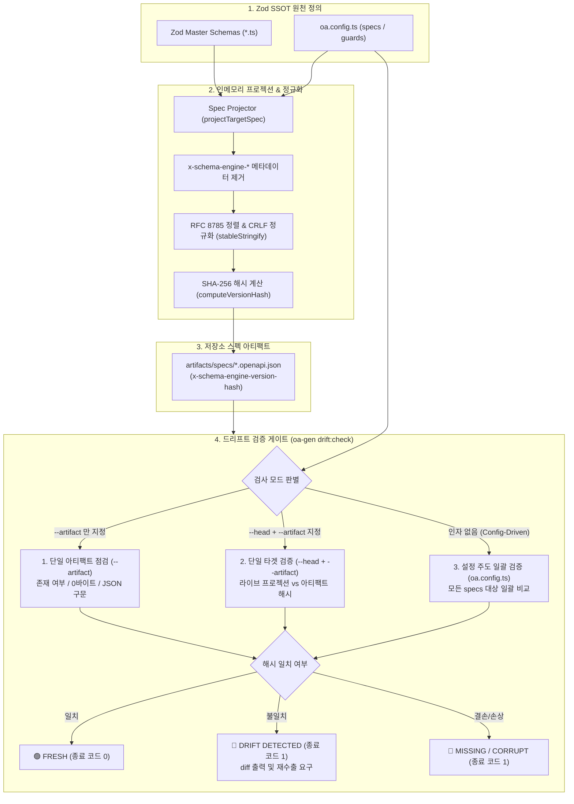
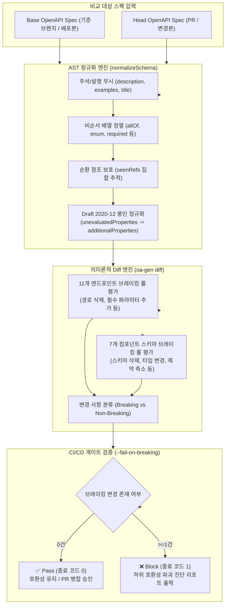
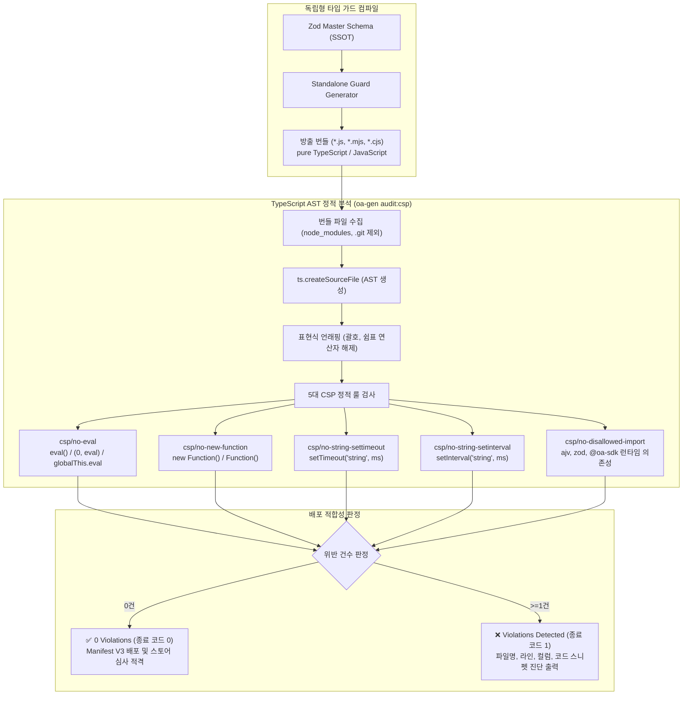

# CLI 거버넌스 및 스펙 검증 모델

이 문서는 `@oa-sdk` 모노레포의 CLI 거버넌스 체계, 결정론적 사양 버전 해싱, 자동화된 스펙 드리프트 검출, 의미론적 브레이킹 diff 엔진, 그리고 Manifest V3 CSP(Content Security Policy) 정적 감사 파이프라인의 아키텍처와 규격을 정의한다.

---

## 1. 개요 및 거버넌스 철학

`@oa-sdk`는 TypeScript/Zod 마스터 스키마를 단일 원천(SSOT)으로 하여 OpenAPI 3.1 사양 문서와 독립형 타입 가드를 컴파일하는 도구 체인이다. 모노레포 및 다운스트림 컨슈머(`browser-studio` 등) 환경에서 소스 코드와 배포 사양 간의 불일치를 원천 차단하고, 런타임 엔진 누출이 없는 순수 가드를 생산하기 위해 아래 4대 거버넌스 레이어를 제공한다:

1. **CLI 매니페스트 ECS 모델**: 언어 중립적 커맨드 엔티티 및 컴포넌트 모델
2. **결정론적 스펙 버전 해싱**: RFC 8785 정렬과 메타데이터 제거를 통한 안정적 SHA-256 식별자 (`x-schema-engine-version-hash`)
3. **스펙 최신성 및 드리프트 검출**: 형상 관리 아티팩트와 소스 스키마 간 실시간 동기화 보증 (`oa-gen drift:check`)
4. **의미론적 브레이킹 diff 엔진**: 11개 엔드포인트 룰과 7개 스키마 룰을 통한 배포 호환성 보증 (`oa-gen diff --fail-on-breaking`)
5. **Manifest V3 CSP 정적 감사**: 브라우저 확장 프로그램 보안 정책 위반 0건 보증 (`oa-gen audit:csp`)

---

## 2. CLI 거버넌스 매니페스트 (ECS 모델)

CLI governance manifest는 `oa-gen`과 `oa-contract` 거버넌스 커맨드를 엔티티-컴포넌트-시스템(ECS) 패턴으로 정의하는 언어 중립적 규격이다.

```
┌────────────────────────────────────────────────────────────────────────┐
│ CLI Governance Manifest Components                                     │
├───────────────────┬────────────────────────────────────────────────────┤
│ options           │ CLI 플래그, 인수 및 위치 기반 매개변수               │
│ inputs            │ OpenAPI 문서, 모듈 참조, 아티팩트 등 입력 소스     │
│ checks            │ validation, breaking diff, drift, freshness 시스템 │
│ reports           │ human, json, markdown 출력 및 리포트 스키마 ID     │
│ exitPolicy        │ CI 추천 판정 (APPROVE/REQUEST_CHANGES) 및 종료 코드│
└───────────────────┴────────────────────────────────────────────────────┘
```

- **Manifest 드리프트 검증**: `pnpm exec tsx scripts/check-cli-spec.ts` 스크립트를 통해 코드베이스의 커맨드 정의와 매니페스트 명세 간 불일치를 상시 검증한다.
- **세부 스펙 참조**: 전체 CLI 옵션 및 매니페스트 구조는 [CLI Spec](../cli-spec/README.md)을 참조한다.

---

## 3. 결정론적 SHA-256 스펙 버전 해싱 (`x-schema-engine-version-hash`)

OpenAPI 3.1 명세 문서는 생성 시점, 파일 포맷팅, 플랫폼(Windows CRLF vs POSIX LF), 그리고 내부 엔진 메타데이터에 영향을 받지 않고 오직 순수 스키마 내용에 의해서만 결정되는 고유 지문을 가져야 한다.

### 3.1 순환 무효화 방지 (`stripSchemaEngineExtensions`)
사양 문서에 버전 해시를 주입(`x-schema-engine-version-hash`)할 때, 주입된 해시 필드 자체가 해시 계산 대상에 포함되면 **무한 순환 해시 무효화(Circular Invalidation)**가 발생한다. 이를 방지하기 위해 해시 산출 직전 모든 `x-schema-engine-*` 벤더 확장 필드를 완전히 제거한다:

```typescript
// packages/codegen/src/spec-projector.ts
export function stripSchemaEngineExtensions<T extends Record<string, unknown>>(
  doc: T,
): Record<string, unknown> {
  const result: Record<string, unknown> = {}
  for (const [key, value] of Object.entries(doc)) {
    if (!key.startsWith('x-schema-engine-')) {
      result[key] = value
    }
  }
  return result
}
```

### 3.2 RFC 8785 정렬 및 개행 정규화 (`stableStringify`)
플랫폼 간 완전한 비트 단위 재현성을 위해 다음 규칙을 적용한다:
1. **UTF-16 코드 유닛 정렬**: 모든 객체의 키를 JavaScript UTF-16 코드 유닛 기준(`(a < b ? -1 : a > b ? 1 : 0)`)으로 사전순 정렬한다.
2. **크로스 플랫폼 CRLF 정규화**: 문자열 리터럴 내부의 `\r\n`을 `\n`으로 강제 치환하여 Git 체크아웃 옵션(`core.autocrlf`)에 따른 차이를 제거한다.
3. **Undefined 프로퍼티 배제**: 값이 `undefined`인 필드를 필터링하여 표준 JSON 스펙과 일치시킨다.

```typescript
// packages/codegen/src/spec-projector.ts
export function stableStringify(value: unknown): string {
  if (value === undefined) return 'null'
  if (value === null || typeof value !== 'object') {
    if (typeof value === 'string') {
      return JSON.stringify(value.replace(/\r\n/g, '\n'))
    }
    return JSON.stringify(value)
  }
  if (Array.isArray(value)) {
    return `[${value.map(item => (item === undefined ? 'null' : stableStringify(item))).join(',')}]`
  }
  const entries = Object.entries(value as Record<string, unknown>)
    .filter(([, v]) => v !== undefined)
    .sort(([a], [b]) => (a < b ? -1 : a > b ? 1 : 0))
  return `{${entries.map(([k, v]) => `${JSON.stringify(k)}:${stableStringify(v)}`).join(',')}}`
}
```

### 3.3 정규 해시 포맷
산출된 SHA-256 다이제스트는 표준 접두사를 포함한 소문자 64자리 16진수 문자열로 포맷팅된다:
```
sha256:7f83b1657ff1fc53b92dc18148a1d65dfc2d4b1fa3d677284addd200126d9069
```
이 값은 컴파일된 OpenAPI 아티팩트의 루트 또는 `info` 확장 필드인 `x-schema-engine-version-hash`에 기록된다.

---

## 4. 자동화된 스펙 최신성 및 드리프트 검출 (`oa-gen drift:check`)

개발자가 Zod 마스터 스키마를 수정한 후 OpenAPI 아티팩트를 다시 빌드하지 않거나, 생성된 아티팩트를 임의로 수동 편집한 경우 CI 파이프라인에서 이를 즉각 감지하여 차단해야 한다.

### 4.1 3가지 동작 모드

`oa-gen drift:check` (동의어: `oa-gen check-artifact`)는 전달된 인자에 따라 3가지 모드로 분기한다:

| 모드 | 인자 조건 | 수행 동작 | 판정 기준 |
|---|---|---|---|
| **모드 1: 단일 아티팩트 검사** | `--artifact <path>` 만 지정 | 파일의 물리적 건전성 검사 | 파일 존재 여부, 크기 > 0바이트, 유효한 JSON 구문 검증 |
| **모드 2: 명시적 단일 타겟 검사** | `--head <source>` + `--artifact <path>` | 원천 코드와 저장 아티팩트 간 1:1 비교 | 소스 스키마의 라이브 인메모리 프로젝션 해시와 아티팩트 해시 비교 |
| **모드 3: 설정 주도형 일괄 검사** | 타겟 인자 없음 (기본값) | `oa.config.ts`의 전체 `specs` 순회 검사 | 선언된 모든 타겟에 대해 라이브 프로젝션과 디스크 아티팩트 비교 |

### 4.2 4가지 최신성 상태 및 종료 코드 시맨틱

검사 결과는 4가지 명확한 상태로 분류된다:

- `🟢 FRESH`: 디스크 아티팩트의 해시와 소스 스키마의 라이브 프로젝션 해시가 비트 단위로 일치함.
- `🔴 DRIFT DETECTED`: 소스 스키마가 수정되었으나 아티팩트가 재생성되지 않았거나 내용이 불일치함 (상태 불일치 diff 출력).
- `🔴 MISSING`: `oa.config.ts`에 명시된 아티팩트 파일이 디스크에 존재하지 않음.
- `🔴 CORRUPT`: 파일이 0바이트이거나 JSON 문법이 손상되어 파싱할 수 없음.

> **종료 정책 (Exit Code Semantics)**:  
> 하나 이상의 타겟에서 `DRIFT DETECTED`, `MISSING`, 또는 `CORRUPT` 상태가 발견되면 명령은 즉시 **종료 코드 1(Exit Code 1)**을 반환하여 CI 빌드를 중단시킨다.

### 4.3 JSON 페이로드 스키마 (`oa-gen.artifact-freshness.v1`)

`--format json` 플래그 지정 시 CI 도구 및 자동화 스크립트 연동을 위한 기계 판독용 페이로드를 방출한다:

```json
{
  "$schema": "https://oa-sdk.dev/schemas/artifact-freshness.v1.json",
  "schemaVersion": "oa-gen.artifact-freshness.v1",
  "fresh": false,
  "summary": "Spec drift detected in 1 of 5 targets",
  "targets": [
    {
      "id": "surface-engine",
      "artifact": "artifacts/specs/surface-engine.openapi.json",
      "status": "drift",
      "fresh": false,
      "committedHash": "sha256:1111111111111111111111111111111111111111111111111111111111111111",
      "projectedHash": "sha256:2222222222222222222222222222222222222222222222222222222222222222",
      "differences": [
        "property patchOp schema changed in #/components/schemas/SurfacePatch"
      ]
    }
  ]
}
```

### 4.4 스펙 라이프사이클 및 드리프트 검출 워크플로우



---

## 5. 의미론적 브레이킹 diff 엔진 (`oa-gen diff --fail-on-breaking`)

`oa-gen diff`는 두 OpenAPI 명세서 간의 계약적 차이점을 비교하고, 클라이언트 관점에서 하위 호환성을 파괴하는 변경을 엄격히 분류한다. `--fail-on-breaking` 옵션을 활성화하면 브레이킹 변경이 1건이라도 존재할 경우 종료 코드 1로 실행을 중단한다.

### 5.1 11개 엔드포인트 브레이킹 룰 (Endpoint Breaking Rules)

HTTP 작업(Operation) 및 요청/응답 시그니처 변경에 적용되는 11대 규칙은 다음과 같다:

| 번호 | 룰 코드 (`code`) | 대상 포인터 | 의미론적 판정 기준 및 파괴 사유 |
|:---:|---|---|---|
| **1** | `endpoint-removed` | `METHOD /path` | 기존에 제공되던 HTTP 경로 또는 메서드 전체가 삭제됨. 기존 클라이언트 호출 시 404/405 에러 발생. |
| **2** | `operation-id-changed` | `METHOD /path` | `operationId` 문자열이 변경됨. SDK 클라이언트의 생성 메서드 명칭이 바뀌어 코드 레벨 컴파일 에러 발생. |
| **3** | `required-parameter-added` | `METHOD /path` | 새로운 필수(`required: true`) 파라미터(쿼리, 헤더, 패스, 쿠키)가 추가됨. 기존 호출은 검증 실패(400) 유발. |
| **4** | `parameter-removed` | `METHOD /path` | 기존에 존재하던 파라미터가 엔드포인트 서명에서 제거됨. |
| **5** | `parameter-required` | `METHOD /path` | 기존 선택적(`required: false`) 파라미터가 필수(`required: true`)로 변경됨. 기존 요청 실패 유발. |
| **6** | `parameter-schema-changed` | `METHOD /path` | 파라미터의 JSON 스키마 타입 또는 제약이 비호환적으로 변경됨 (지문 불일치). |
| **7** | `request-body-required` | `METHOD /path` | 선택적이던 요청 본문(`requestBody.required`)이 필수로 변경됨. 본문 없는 요청 거부. |
| **8** | `request-required-field-added` | `METHOD /path` | 요청 본문 JSON 스키마의 `required` 배열에 새로운 필드가 추가됨. 기존 클라이언트 페이로드 거부. |
| **9** | `request-schema-changed` | `METHOD /path` | 요청 본문 스키마의 속성 타입, 내부 구조 또는 제약 조건이 변경됨. |
| **10** | `response-removed` | `METHOD /path` | 기존에 문서화되어 있던 HTTP 응답 상태 코드(예: 200, 201)가 삭제됨. 클라이언트 응답 처리기 실패. |
| **11** | `response-schema-changed` | `METHOD /path` | 기존 응답 상태 코드의 반환 데이터 스키마가 호환되지 않게 변경됨. 클라이언트 역직렬화 실패. |

### 5.2 7개 컴포넌트 스키마 브레이킹 룰 (Component Schema Breaking Rules)

`#/components/schemas/*`의 재사용 스키마 또는 엔드포인트 내부 인라인 스키마에 적용되는 7대 규칙은 다음과 같다:

| 번호 | 룰 코드 (`code`) | 대상 포인터 | 의미론적 판정 기준 및 파괴 사유 |
|:---:|---|---|---|
| **1** | `schema-removed` | `#/components/schemas/{name}` | 공유 컴포넌트 스키마 정의가 완전히 삭제됨. 이를 참조하던 모든 계약 파괴. |
| **2** | `type-changed` | `.../properties/{prop}` | 필드의 기본 데이터 타입이 변경됨 (예: `string` -> `number`, `object` -> `array`). |
| **3** | `constraint-narrowed` | `.../properties/{prop}` | 허용 수치/길이 범위가 축소됨 (`maximum` 감소, `minimum` 증가, `maxLength` 단축). 기존 유효 데이터 거부. |
| **4** | `required-field-added` | `#/components/schemas/{name}` | 객체 스키마의 `required` 배열에 새 프로퍼티가 추가됨. 기존 클라이언트 페이로드 검증 실패. |
| **5** | `property-removed` | `.../properties/{prop}` | 객체 스키마에 문서화되어 있던 속성이 삭제됨. 클라이언트 필드 접근 시 undefined 유발. |
| **6** | `nullable-removed` | `.../properties/{prop}` | 기존 `nullable: true`이던 속성이 `false`가 되거나 제거되어 `null` 값 전송이 금지됨. |
| **7** | `property-schema-changed` | `.../properties/{prop}` | 깊은 AST 스키마 지문(`schemaFingerprint`) 비교 결과 내부 구조적 비호환성이 확인됨. |

### 5.3 허용되는 비파괴적 변경 (Non-Breaking Changes)

다음 변경 사항들은 하위 호환성을 해치지 않으므로 `severity: 'non-breaking'`으로 분류되며 게이트를 차단하지 않는다:
- 엔드포인트 추가 (`endpoint-added`)
- 선택적 파라미터 추가 (`optional-parameter-added`)
- 신규 응답 상태 코드 추가 (`response-added`)
- 컴포넌트 스키마 추가 (`schema-added`)
- 수치 제약 완화 (`constraint-widened`: `maximum` 증가, `minimum` 감소)
- 필수 필드의 선택적 전환 (`field-optional`)
- 신규 선택적 프로퍼티 추가 (`property-added`)

### 5.4 AST 정규화 및 오탐(False Positive) 방지 메커니즘

diff 엔진(`packages/codegen/src/cli/lib/openapi-breaking-diff.ts`)은 무의미한 차이로 인한 거짓 경보를 배제하기 위해 4단계 AST 정규화를 적용한다:

1. **문서화 주석 필터링**: `IGNORED_SCHEMA_KEYS = new Set(['description', 'examples', 'example', 'title'])`에 포함된 필드의 변경은 비교 대상에서 제외된다.
2. **비순서 배열 정렬**: `UNORDERED_ARRAY_KEYS = new Set(['allOf', 'anyOf', 'enum', 'oneOf', 'required'])`에 해당하는 배열은 사전순으로 자동 정렬된 후 비교된다.
3. **순환 참조 방어**: JSON 포인터 역참조(`resolveRef`) 시 `seenRefs: Set<string>`를 추적하여 재귀 스키마에 의한 무한 루프를 방지한다.
4. **객체 봉인 정규화**: JSON Schema Draft 2020-12의 `unevaluatedProperties: { not: {} }` 구조를 OpenAPI 3.1 호환 `additionalProperties: false`로 자동 변환하여 평가한다.

### 5.5 브레이킹 체인지 CI 게이트 워크플로우



---

## 6. Manifest V3 콘텐츠 보안 정책(CSP) 감사 (`oa-gen audit:csp`)

Chrome 확장 프로그램 Manifest V3 규격은 콘텐츠 스크립트 및 백그라운드 서비스 워커 환경에서 임의 문자열 동적 실행(`unsafe-eval`)을 전면 금지한다. `@oa-sdk`가 생성하는 독립형 타입 가드는 순수 정적 JavaScript로 컴파일되며, `oa-gen audit:csp`는 번들 산출물을 정적 분석하여 Chrome 웹 스토어 심사 거절 요소를 빌드 타임에 차단한다.

### 6.1 5대 정적 AST 감사 규칙

감사기는 TypeScript 컴파일러 API(`ts.createSourceFile`)를 사용하여 대상 파일(`.js`, `.mjs`, `.cjs`)의 AST를 순회하며 다음 5대 룰을 강제한다:

| 규칙 ID | 검사 대상 AST 노드 | 탐지 조건 | 위반 진단 메시지 |
|---|---|---|---|
| `csp/no-eval` | `CallExpression` | `eval(...)`, `window.eval(...)`, `globalThis.eval(...)`, `self.eval(...)`, `global.eval(...)` 호출 | `Disallowed eval() execution in Manifest V3 bundle` |
| `csp/no-new-function` | `NewExpression`<br>`CallExpression` | `new Function(...)` 또는 `Function(...)` 생성자 호출 | `Disallowed new Function() code evaluation in Manifest V3 bundle` |
| `csp/no-string-settimeout` | `CallExpression` | `setTimeout(code, delay)`의 첫 번째 인자가 문자열 리터럴 또는 템플릿 리터럴인 경우 | `Disallowed string code evaluation in setTimeout() in Manifest V3 bundle` |
| `csp/no-string-setinterval` | `CallExpression` | `setInterval(code, delay)`의 첫 번째 인자가 문자열 리터럴 또는 템플릿 리터럴인 경우 | `Disallowed string code evaluation in setInterval() in Manifest V3 bundle` |
| `csp/no-disallowed-import` | `ImportDeclaration`<br>`ExportDeclaration`<br>`ImportEqualsDeclaration`<br>`CallExpression` (require/import) | 모듈 식별자가 정규식 `/^(ajv(-[a-z0-9_]+)?(\/.*)?\|zod(\/.*)?\|@oa-sdk(\/.*)?)$/`에 매칭되는 경우 | `Disallowed heavy schema engine or SDK runtime import in Manifest V3 bundle: "{specifier}"` |

### 6.2 AST 표현식 언래핑 및 탐색 복원력
감사기는 개발자나 번들러가 삽입할 수 있는 난독화 패턴을 무력화하기 위해 `unwrapExpression` 유틸리티를 적용한다:
- **괄호 중첩 해제**: `((eval))('...')` -> `eval` 식별자 추출
- **쉼표 연산자 해제**: `(0, eval)('...')` -> 우측 피연산자 `eval` 추출
- **디렉토리 순회 배제**: 검사 대상 디렉토리 순회 시 `node_modules` 및 `.git` 하위 폴더는 자동으로 건너뛴다.

### 6.3 확장 프로그램 빌드 파이프라인 내 CSP 감사 흐름



---

## 7. 모노레포 CI/CD 거버넌스 게이트 통합 요약

모노레포의 모든 풀 리퀘스트(PR) 및 배포 파이프라인은 다음 4대 CLI 거버넌스 검증 게이트를 순차적으로 통과해야 한다:

| 단계 | 실행 커맨드 | 검증 목적 | 실패 조건 및 종료 코드 |
|:---:|---|---|---|
| **Gate 1** | `pnpm check:cli-spec` | CLI 매니페스트 및 명령어 엔티티 일치 검증 | 매니페스트와 CLI 구현 불일치 시 Exit 1 |
| **Gate 2** | `oa-gen drift:check` | Zod 소스 스키마와 커밋된 OpenAPI 아티팩트 일치 검증 | 해시 불일치, 파일 누락/손상 시 Exit 1 |
| **Gate 3** | `oa-gen diff --base <tag> --head HEAD --fail-on-breaking` | 이전 릴리스 대비 하위 비호환 계약 파괴 차단 | 11개 엔드포인트 / 7개 스키마 브레이킹 변경 감지 시 Exit 1 |
| **Gate 4** | `oa-gen audit:csp --bundle <outDir>` | 배포용 타입 가드 번들의 Manifest V3 보안 적합성 검증 | `eval`, `new Function`, 무거운 런타임 import 발견 시 Exit 1 |

이 4대 게이트가 모두 통과할 때만 모노레포는 안전한 릴리스 승인(`APPROVE`) 상태에 도달한다.
