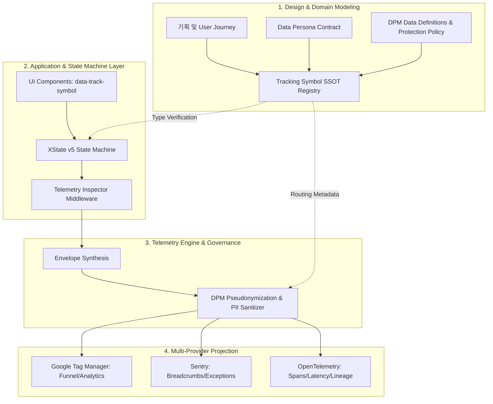

# Design-Driven Telemetry and Tracking Symbol Architecture

상태: active  
최종 검토: 2026-10-09  
정본: docs/concepts/design-driven-telemetry.md  

## 1. 개요와 설계 철학

이 문서는 개발 막바지에 마케팅/로그 코드를 임의로 덧붙이는 사후 추적(Ad-hoc Tagging)의 한계를 극복하고, **기획·도메인 모델링·XState 상태 머신(FSM)·UI 인터랙션 설계 단계부터 추적 심볼(Tracking Symbol)을 체계적으로 식별·할당·전파하는 '설계 주도 텔레메트리(Design-Driven Telemetry)' 표준 아키텍처**를 정의한다.

또한 본 아키텍처는 `@oa-sdk/personas`의 페르소나 계약(보안 및 관측성 trait) 및 `@oa-sdk/dpm`(Data Pseudonymization Manifest)의 **관계 보존 가명화(Relationship-Preserving Pseudonymization)** 엔진과 유기적으로 결합하여, **"완벽한 개인정보(PII) 보호"**와 **"끊김 없는 사용자 여정 및 분산 추적(E2E Data Lineage)"**을 동시에 달성한다.



---

## 2. 시스템의 존재 목적 (System Purpose)

> **핵심 목적**:  
> **"비즈니스 로직에 단 한 줄의 추적 코드도 침투시키지 않고, 시스템의 상태 전이 자체를 단일 진실 공급원(SSOT)으로 삼아, 개인정보를 완벽히 은닉하면서도 비즈니스 지표·품질·성능을 하나의 닫힌 계(Closed System)에서 결정론적으로 관측한다."**

### 2.1 4대 핵심 목적

1. **비즈니스 순수성 수호 (Zero-Intrusion)**: 컴포넌트나 상태 머신 내부에 로깅/마케팅 코드가 침투하여 도메인 로직을 오염시키는 것을 원천 차단한다.
2. **엔트로피 격리 (Closed System Encapsulation)**: W3C 트레이스 ID 생성, PII 살균, 복수 SDK 브릿지 등 복잡한 내부 배관을 계 내부에 봉인하여, 개발자가 마주하는 개념 표면을 극도로 단순화한다.
3. **프라이버시와 추적성의 양립 (Privacy-Preserving Lineage)**: DPM의 결정론적 가명화(Deterministic Pseudonymization)를 통해 PII는 완벽히 보호하면서도 동일 유저의 E2E 여정 및 연쇄 에러 추적성을 100% 보존한다.
4. **기획과 실시간 지표의 일치 (Design-to-KPI Alignment)**: 기획서의 퍼널 KPI, UI 상호작용 의도, FSM 상태 모델, GA4/Sentry 이벤트가 동일한 추적 심볼로 직결되어 지표 왜곡과 소통 비용을 0으로 만든다.

### 2.2 닫힌 계의 3원 원자 모델 (The Telemetry Triad)

외부 개발자나 도메인 모델러가 인지해야 하는 시스템의 표면은 오직 3개의 원자적 요소뿐이다.

```
       [ 1. Symbol (의미) ] ── (What: 어떤 의도가 주입되었는가?)
               │
               ▼
   ┌───────────────────────┐
   │  2. State Machine     │ ── (Where: 어떤 상태와 문맥에 있는가?)
   └───────────────────────┘
               │
               ▼
     [ 3. Projection (투영) ] ── (Whom: 어느 관측 도구에 비출 것인가?)
```

계 내부의 복잡성은 다음의 **3대 불변 법칙(Invariants)**으로 봉인되어 외부로 엔트로피가 누출되지 않는다:
- **정보 보존의 법칙 (Completeness)**: 머신이 동작하면 모든 이벤트·상태·에러·액터가 자동으로 100% 포착된다.
- **프라이버시 격리의 법칙 (Safety Boundary)**: 민감정보는 DPM 엔진에 의해 자동 마스킹 또는 가명화되어 유출 위험이 원천 차단된다.
- **단일 투영의 법칙 (Single Projection)**: 단 1회의 상태 전이가 GTM, Sentry, OTel로 동시 프로젝션되어 중복 코딩을 배제한다.

---

## 3. 추적 심볼(Tracking Symbol) 명명 체계

추적 심볼은 시스템 내 모든 관측 가능한 지점(Observable Points)을 정규화된 계층으로 식별하는 표준 토큰이다.

### 3.1 문법 (Grammar)

```text
[Layer]:[Domain]:[Entity]:[Action_or_State]:[Aspect]
```

| 세그먼트 | 필수 여부 | 설명 | 예시 |
| :--- | :--- | :--- | :--- |
| **Layer** | 필수 | 심볼이 발생하는 시스템 계층 | `UI`, `FSM`, `TX` (Transaction/API), `SYS` |
| **Domain** | 필수 | 상위 비즈니스 바운디드 컨텍스트 | `AUTH`, `CHECKOUT`, `WORKSPACE`, `BILLING` |
| **Entity** | 필수 | 대상이 되는 핵심 도메인 객체 | `USER`, `PAYMENT`, `CART`, `DOCUMENT` |
| **Action_or_State** | 필수 | 수행된 행동 또는 도달한 상태 노드 | `CLICK`, `SUBMIT`, `SELECTING`, `AUTHORIZING` |
| **Aspect** | 선택 | 결과(Outcome) 또는 부가 양상 | `SUCCESS`, `FAILURE`, `CANCEL`, `TIMEOUT` |

### 3.2 계층별 심볼 예시

- **UI 계층**: 사용자의 물리적/시각적 상호작용
  - `UI:AUTH:SIGN_IN_BTN:CLICK`
  - `UI:CHECKOUT:PAYMENT_METHOD:SELECT`
- **FSM 계층**: XState 상태 노드 및 내부 전이 이벤트
  - `FSM:CHECKOUT:STEP:SELECTING_METHOD`
  - `FSM:CHECKOUT:PAYMENT:TRIGGERED`
  - `FSM:CHECKOUT:PAYMENT:APPROVED`
  - `FSM:CHECKOUT:PAYMENT:FAILED`
- **TX 계층**: 비동기 API 요청 및 외부 연동 분산 트랜잭션
  - `TX:CHECKOUT:PG_APPROVAL:EXECUTE`
  - `TX:AUTH:TOKEN_REFRESH:EXECUTE`

---

## 4. 상호 연관성 및 시스템별 역할 정의

### 4.1 역할 분계선 (Role Boundary)

| 시스템 / 패키지 | 책임 및 역할 | 텔레메트리 관점의 기능 |
| :--- | :--- | :--- |
| **XState v5** | 순수 비즈니스 상태 전이, 이벤트 처리, 비동기 액터 실행 | 상태 머신의 전이(`@xstate.event`), 노드 진입(`@xstate.snapshot`), 액터 수명주기(`@xstate.actor`)를 방출하는 **이벤트 공급원** |
| **`@oa-sdk/personas`** | 주체-데이터 관계 계약(ECS Trait), 보안/관측성 정책 정의 | `skills.security` (`pii-masked-default`, `pseudonymized`) 및 `skills.observability` (`trace-context`)에 따른 **추적 정책 가이드** |
| **`@oa-sdk/dpm`** | 데이터 정의(Identity), 관계 모델, 가명화 매니페스트 | 단순 마스킹(`***`) 대신 부모-자식 관계를 보존하는 **결정론적 가명화(Tokenization) 및 PII 안전 경계** 제공 |
| **`@oa-sdk/telemetry`** | 심볼 레지스트리, 엔벨로프 합성, 다중 프로바이더 디스패치 | XState `inspect` 훅과 연계하여 심볼을 파싱하고 GTM/Sentry/OTel로 비침습 라우팅하는 **중앙 허브** |
| **GTM (DataLayer)** | 마케팅 퍼널, 전자상거래, 전환율 분석 | 비즈니스 화이트리스트 이벤트 수신 및 GA4 규격 치환 (`checkout_payment_approved`) |
| **Sentry** | 에러 모니터링, 세션 리플레이, 장애 진단 | 모든 전이를 Breadcrumbs로 누적하고, 에러 상태 시 XState Context 스냅샷 자동 첨부 |
| **OpenTelemetry** | 분산 트레이싱, 비동기 지연시간 계측, 데이터 리니지 | XState 비동기 액터 실행 시 Span 자동 생성 및 W3C `traceparent` 전파 |

---

## 5. DPM과의 상호 보완성: 관계 보존 가명화 (Relationship-Preserving Pseudonymization)

전통적인 프론트엔드 로깅의 가장 큰 딜레마는 **"개인정보 보호를 위해 마스킹하면 사용자 여정 및 연쇄 에러 추적이 불가능해진다"**는 점이다.

- **단순 마스킹(`***MASKED***`)의 한계**:
  `userId: "***"`, `orderId: "***"`로 전송되면, Sentry와 GTM에서 "특정 사용자가 겪은 일련의 에러 흐름"이나 "장바구니 ➔ 결제 이탈 경로"를 분석할 수 없다.
- **DPM의 해결책**:
  `@oa-sdk/dpm`의 가명화 엔진은 결정론적 토큰화(Deterministic Pseudonymization)를 지원한다.
  - `userId: "user_alice_123"` ➔ `pseudo_usr_a8f9`
  - `orderId: "ord_999"` ➔ `pseudo_ord_3c2d`
  - 동일한 엔티티는 세션/머신 전반에서 일관된 가명 토큰을 유지하므로, **개인 식별 정보(PII)는 원천 은닉하면서도 완벽한 관계 그래프 추적**이 가능하다.

---

## 6. 텔레메트리 엔벨로프(Telemetry Envelope) 규격

런타임에 심볼이 방출될 때, 실행 컨텍스트와 메타데이터가 결합된 표준 엔벨로프로 합성된다.

```typescript
export interface TelemetryEnvelope<T = Record<string, unknown>> {
  symbol: string;            // 표준 추적 심볼 (예: 'FSM:CHECKOUT:PAYMENT:APPROVED')
  timestamp: number;         // UTC Epoch 밀리초
  context: {
    traceId: string;         // W3C Trace ID
    spanId?: string;         // OTel Span ID
    actorId?: string;        // XState Actor ID
    stateNode?: string;      // XState State Node 심볼
    sessionId: string;       // 세션 식별자
    userId?: string;         // 식별된 가명 유저 토큰
  };
  environment: {
    appVersion: string;
    environment: 'development' | 'staging' | 'production';
  };
  payload: T;                // PII가 마스킹/가명화된 안전한 비즈니스 페이로드
}
```

---

## 7. 라이프사이클 및 거버넌스 규칙

1. **사전 정의 강제 (Closed Registry)**:
   - 모든 추적 심볼은 코드 작성 전 `SYMBOL_REGISTRY`에 등록되어야 하며, 등록되지 않은 심볼 방출 시 개발 환경 및 CI 테스트에서 에러를 발생시킨다.
2. **비침습성 (Non-Intrusiveness)**:
   - UI 컴포넌트나 상태 머신 액션 내부에 `gtm.push`나 `Sentry.captureException`을 직접 호출하는 것을 엄격히 금지한다.
   - 컴포넌트는 `data-track-symbol` 어트리뷰트 선언, 상태 머신은 `meta.symbol` 선언을 통해 선언적으로만 추적에 참여한다.
3. **PII 3단계 분류**:
   - `none`: 원본 전달
   - `masked`: 해시 또는 가명화 토큰으로 변환 (DPM 어댑터 연동)
   - `restricted`: 파이프라인 진입 즉시 Drop
