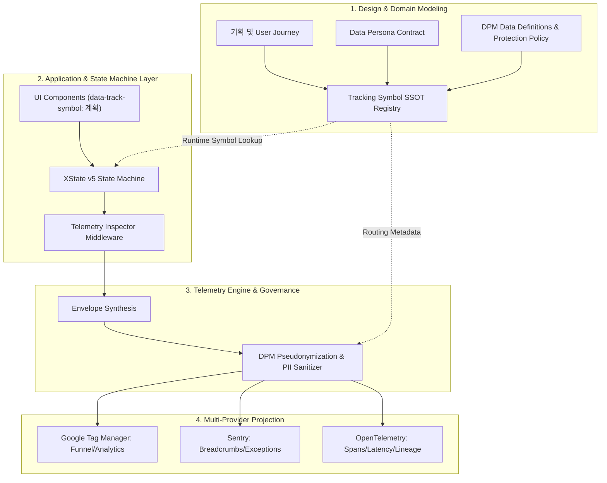

# Design-Driven Telemetry and Tracking Symbol Architecture

상태: active  
최종 검토: 2026-10-19  
정본: docs/concepts/design-driven-telemetry.md  

## 1. 개요와 설계 철학

이 문서는 개발 막바지에 마케팅/로그 코드를 임의로 덧붙이는 사후 추적(Ad-hoc Tagging)의 한계를 극복하고, **기획·도메인 모델링·XState 상태 머신(FSM)·UI 인터랙션 설계 단계부터 추적 심볼(Tracking Symbol)을 체계적으로 식별·할당·전파하는 '설계 주도 텔레메트리(Design-Driven Telemetry)' 표준 아키텍처**를 정의한다.

또한 본 아키텍처는 `@oa-sdk/personas`의 페르소나 계약(보안 및 관측성 trait) 및 `@oa-sdk/dpm`(Data Pseudonymization Manifest)의 **관계 보존 가명화(Relationship-Preserving Pseudonymization)** 개념과 결합하여, **"원천 단계의 PII 마스킹·가명화"**와 **"끊김 없는 사용자 여정 및 분산 추적(E2E Data Lineage)"**을 함께 지향한다.

> **현재 구현 범위 (`@oa-sdk/telemetry`)**: 패키지는 `@oa-sdk/dpm`에 의존하지 않는다. 가명화는 패키지에 내장된 동기식 키 기반 토크나이저(HMAC-SHA-256, 128비트 토큰)가 수행하며, `@oa-sdk/dpm`의 키 기반 실행기와의 연동은 `customTokenizer`를 통해 이루어진다. 브라우저 번들에 들어간 `tokenKey`는 비밀이 아니므로, 추측 가능한 식별자를 제3자로부터 보호해야 하면 서버가 발급한 토큰(`TelemetryIdentity.pseudonymToken`)이나 서버 기반 `customTokenizer`를 사용한다. 아래에서 "(계획)"으로 표시한 메커니즘은 아직 구현되지 않았다.



---

## 2. 시스템의 존재 목적 (System Purpose)

> **핵심 목적**:  
> **"비즈니스 로직에 단 한 줄의 추적 코드도 침투시키지 않고, 시스템의 상태 전이 자체를 단일 진실 공급원(SSOT)으로 삼아, 개인정보를 원천에서 마스킹·가명화하면서도 비즈니스 지표·품질·성능을 하나의 닫힌 계(Closed System)에서 결정론적으로 관측한다."**

### 2.1 4대 핵심 목적

1. **비즈니스 순수성 수호 (Zero-Intrusion)**: 컴포넌트나 상태 머신 내부에 로깅/마케팅 코드가 침투하여 도메인 로직을 오염시키는 것을 원천 차단한다.
2. **엔트로피 격리 (Closed System Encapsulation)**: W3C 트레이스 ID 생성, PII 살균, 복수 SDK 브릿지 등 복잡한 내부 배관을 계 내부에 봉인하여, 개발자가 마주하는 개념 표면을 극도로 단순화한다.
3. **프라이버시와 추적성의 양립 (Privacy-Preserving Lineage)**: 키 기반 결정론적 가명화(Deterministic Pseudonymization)로 식별자 원본을 관측 도구에 보내지 않으면서도, 같은 키를 쓰는 동안 동일 유저의 E2E 여정 및 연쇄 에러를 연결한다.
4. **기획과 실시간 지표의 일치 (Design-to-KPI Alignment)**: 기획서의 퍼널 KPI, UI 상호작용 의도, FSM 상태 모델, GA4/Sentry 이벤트가 동일한 추적 심볼로 직결되어 지표 왜곡과 소통 비용을 0으로 만든다.

### 2.2 닫힌 계의 3원 원자 모델 (The Telemetry Triad)

외부 개발자나 도메인 모델러가 인지해야 하는 시스템의 표면은 오직 3개의 원자적 요소뿐이다.

```
       [ 1. Symbol (의미) ] ── (What: 어떤 의도가 주입되었는가?)
               │
               ▼
   ┌───────────────────────┐
   │  2. State Machine     │ ── (Where: 어떤 상태와 문맥에 있는가?)
   └───────────────────────┘
               │
               ▼
     [ 3. Projection (투영) ] ── (Whom: 어느 관측 도구에 비출 것인가?)
```

계 내부의 복잡성은 다음의 **불변 법칙(Invariants)**으로 봉인되어 외부로 엔트로피가 누출되지 않는다:
- **정보 보존의 법칙 (Completeness)**: 머신이 동작하면 `xstate.*`가 아닌 모든 이벤트(`@xstate.event`), 모든 액터 에러(액션·가드·entry 예외, 자식 액터 실패; 액터당 한 번이며, 부모 체인으로 전파된 자식 에러는 처리되지 않았든 부모가 처리하며 위로 전달했든 발생한 자식에 대해 한 번), 그리고 tracer가 주어졌을 때 인스펙터 연결 후 시작된 액터마다 하나의 Span(시작~완료·중지·에러)이 자동 포착된다. 에러가 아닌 스냅샷과 상태 노드 진입 자체는 방출하지 않는다.
  - 실행 중인 액터가 보낸 `xstate.error.actor.*` 이벤트(전달·직접 전송)는 그 액터의 실패가 아니다. XState는 실패한 액터의 스냅샷을 `error`로 만든 뒤에만 에러를 부모로 전달하므로, 인스펙터는 보낸 쪽 스냅샷으로 둘을 구분한다.
  - 루트 액터는 inspection 이벤트의 `rootId`로 식별하므로 `actor.system.inspect()`로 `start()` 이후에 연결해도 이벤트와 에러는 보고된다. Span과 자식의 trace id 상속은 액터의 `xstate.init`을 관찰해야 하므로, 연결 시점에 이미 실행 중이던 액터에는 Span이 없고 그 자식들은 루트와 trace id를 공유하지 않는다.
- **프라이버시 격리의 법칙 (Safety Boundary)**: 민감 키는 모든 등급에서 마스킹되고, 식별자 키는 심볼의 `piiLevel`에 따라 마스킹 또는 키 기반 토큰으로 치환되며, 전역 identity의 원본 `userId`도 토큰화된다. 살균에 실패한 이벤트는 디스패치되지 않는다.
- **장애 격리의 법칙 (Failure Isolation)**: 텔레메트리 실패는 XState로 전파되지 않으며 `onError`로 보고된다(기본값: 비동기 재throw). 인스펙터는 액터를 구독하지 않으므로 XState의 미처리 에러 보고도 그대로 유지된다.
- **단일 투영의 법칙 (Single Projection)**: 단 1회의 상태 전이가 GTM, Sentry, OTel로 동시 프로젝션되어 중복 코딩을 배제한다.

---

## 3. 추적 심볼(Tracking Symbol) 명명 체계

추적 심볼은 시스템 내 모든 관측 가능한 지점(Observable Points)을 정규화된 계층으로 식별하는 표준 토큰이다.

### 3.1 문법 (Grammar)

```text
[Layer]:[Domain]:[Entity]:[Action_or_State]:[Aspect]
```

| 세그먼트 | 필수 여부 | 설명 | 예시 |
| :--- | :--- | :--- | :--- |
| **Layer** | 필수 | 심볼이 발생하는 시스템 계층 | `UI`, `FSM`, `TX` (Transaction/API), `SYS` |
| **Domain** | 필수 | 상위 비즈니스 바운디드 컨텍스트 | `AUTH`, `CHECKOUT`, `WORKSPACE`, `BILLING` |
| **Entity** | 필수 | 대상이 되는 핵심 도메인 객체 | `USER`, `PAYMENT`, `CART`, `DOCUMENT` |
| **Action_or_State** | 필수 | 수행된 행동 또는 도달한 상태 노드 | `CLICK`, `SUBMIT`, `SELECTING`, `AUTHORIZING` |
| **Aspect** | 선택 | 결과(Outcome) 또는 부가 양상 | `SUCCESS`, `FAILURE`, `CANCEL`, `TIMEOUT` |

### 3.2 계층별 심볼 예시

- **UI 계층**: 사용자의 물리적/시각적 상호작용
  - `UI:AUTH:SIGN_IN_BTN:CLICK`
  - `UI:CHECKOUT:PAYMENT_METHOD:SELECT`
- **FSM 계층**: XState 상태 노드 및 내부 전이 이벤트
  - `FSM:CHECKOUT:STEP:SELECTING_METHOD`
  - `FSM:CHECKOUT:PAYMENT:TRIGGERED`
  - `FSM:CHECKOUT:PAYMENT:APPROVED`
  - `FSM:CHECKOUT:PAYMENT:FAILED`
- **TX 계층**: 비동기 API 요청 및 외부 연동 분산 트랜잭션
  - `TX:CHECKOUT:PG_APPROVAL:EXECUTE`
  - `TX:AUTH:TOKEN_REFRESH:EXECUTE`

---

## 4. 상호 연관성 및 시스템별 역할 정의

### 4.1 역할 분계선 (Role Boundary)

| 시스템 / 패키지 | 책임 및 역할 | 텔레메트리 관점의 기능 |
| :--- | :--- | :--- |
| **XState v5** | 순수 비즈니스 상태 전이, 이벤트 처리, 비동기 액터 실행 | 이벤트(`@xstate.event`, 액터 시작 `xstate.init`과 자식 에러 `xstate.error.actor.*` 포함)와 스냅샷 상태(`@xstate.snapshot`의 `error`·`done`·`stopped`)를 방출하는 **이벤트 공급원** |
| **`@oa-sdk/personas`** | 주체-데이터 관계 계약(ECS Trait), 보안/관측성 정책 정의 | `skills.security` (`pii-masked-default`, `pseudonymized`) 및 `skills.observability` (`trace-context`)에 따른 **추적 정책 가이드** |
| **`@oa-sdk/dpm`** | 데이터 정의(Identity), 관계 모델, 가명화 매니페스트 | 단순 마스킹(`***`) 대신 부모-자식 관계를 보존하는 **결정론적 가명화(Tokenization) 및 PII 안전 경계** 제공. `@oa-sdk/telemetry`는 이 패키지에 의존하지 않으며 `customTokenizer`로 연동한다 |
| **`@oa-sdk/telemetry`** | 심볼 레지스트리, 엔벨로프 합성, 다중 프로바이더 디스패치 | XState `inspect` 훅과 연계하여 심볼을 파싱하고 GTM/Sentry/OTel로 비침습 라우팅하는 **중앙 허브** |
| **GTM (DataLayer)** | 마케팅 퍼널, 전자상거래, 전환율 분석 | 비즈니스 화이트리스트 이벤트 수신 및 GA4 규격 치환 (`checkout_payment_approved`) |
| **Sentry** | 에러 모니터링, 세션 리플레이, 장애 진단 | 디스패치된 이벤트마다 Breadcrumb을 누적하고 `setContext('xstate:<actorId>', { stateNode, traceId, lastSymbol })`를 갱신한다. 액터 에러는 `state_node`·`actor_id`·`trace_id` 태그와 `telemetry_context` extra를 붙여 `captureException`한다. 머신 Context 스냅샷은 첨부하지 않는다 |
| **OpenTelemetry** | 분산 트레이싱, 비동기 지연시간 계측, 데이터 리니지 | `@opentelemetry/api`의 `trace.getTracer()`·`trace.getActiveSpan()`을 그대로 받는다. `tracer`가 주어지면 인스펙터 연결 후 시작된 액터마다 Span을 하나 만들고 완료·중지·에러 시 종료한다. OTel이 표현할 수 없는 Span 속성 값은 버린다. 이벤트는 `getActiveSpan`이 돌려주는 활성 Span, 없으면 그 이벤트를 받은 액터 인스턴스의 Span(`xstate.actor.session_id`)에 기록한다. 에러는 활성 Span에 기록하고, 에러로 끝난 액터의 Span에는 종료 시 한 번 기록한다. W3C `traceparent` 전파는 (계획) |

---

## 5. DPM과의 상호 보완성: 관계 보존 가명화 (Relationship-Preserving Pseudonymization)

전통적인 프론트엔드 로깅의 가장 큰 딜레마는 **"개인정보 보호를 위해 마스킹하면 사용자 여정 및 연쇄 에러 추적이 불가능해진다"**는 점이다.

- **단순 마스킹(`***MASKED***`)의 한계**:
  `userId: "***"`, `orderId: "***"`로 전송되면, Sentry와 GTM에서 "특정 사용자가 겪은 일련의 에러 흐름"이나 "장바구니 ➔ 결제 이탈 경로"를 분석할 수 없다.
- **결정론적 토큰화 (Deterministic Pseudonymization)**:
  `@oa-sdk/dpm`의 가명화 모델처럼, 텔레메트리 어댑터(`createDpmTelemetryAdapter`)는 식별자 값을 키 기반 결정론적 토큰으로 치환한다.
  - `userId: "user_alice_123"` ➔ `dpm_tok_user_<HMAC-SHA-256 앞 128비트, 32 hex>`
  - `orderId: "ord_999"` ➔ `dpm_tok_order_<32 hex>`
  - 토큰의 네임스페이스는 이벤트 도메인(`CART`, `CHECKOUT`)이 아니라 **필드의 엔티티 종류**(`user`, `customer`, `order`, `account`, `email`, `phone`)다. 그래서 같은 엔티티는 도메인과 머신이 달라도 같은 토큰을 가지며, 장바구니 ➔ 결제 경로를 하나의 사용자로 연결할 수 있다.
  - 토큰의 일관성 범위는 키의 범위와 같다. `tokenKey`를 지정하면 그 키를 공유하는 모든 세션에서 일관되고, 생략하면 어댑터 인스턴스마다 무작위 키를 쓰므로 한 페이지 로드/프로세스 안에서만 일관된다. 공개 기본 솔트는 없다.
  - 키가 브라우저 번들에 있으면 키를 읽은 누구나 추측 가능한 값의 토큰을 다시 계산할 수 있다. 제3자 재식별을 막아야 하면 서버에서 토큰을 발급해 `TelemetryIdentity.pseudonymToken`으로 넘기거나 서버 기반 `customTokenizer`(예: `@oa-sdk/dpm` 키 기반 실행기)를 사용한다.

---

## 6. 텔레메트리 엔벨로프(Telemetry Envelope) 규격

런타임에 심볼이 방출될 때, 실행 컨텍스트와 메타데이터가 결합된 표준 엔벨로프로 합성된다.

```typescript
export interface TelemetryEnvelope<T = Record<string, unknown>> {
  symbol: string;            // 표준 추적 심볼 (예: 'FSM:CHECKOUT:PAYMENT:APPROVED')
  timestamp: number;         // UTC Epoch 밀리초
  context: {
    traceId: string;         // W3C Trace ID
    spanId?: string;         // OTel Span ID
    actorId?: string;        // XState Actor ID (같은 invoke/spawn id의 인스턴스들이 공유)
    actorSessionId?: string; // XState sessionId (액터 인스턴스마다 고유)
    stateNode?: string;      // XState State Node 심볼
    sessionId?: string;      // 세션 식별자 (기본값 'sess_anonymous')
    userId?: string;         // 가명 유저 토큰: identity.pseudonymToken, 없으면 identity.userId를 'user' 네임스페이스로 토큰화
    tenantId?: string;
  };
  environment: {
    appVersion: string;
    environment: 'development' | 'staging' | 'production' | 'test';
  };
  payload: T;                // PII가 마스킹/가명화된 안전한 비즈니스 페이로드
}
```

---

## 7. 라이프사이클 및 거버넌스 규칙

1. **사전 정의 강제 (Closed Registry)**:
   - 모든 추적 심볼은 코드 작성 전 심볼 레지스트리(`createSymbolRegistry`)에 등록한다. `register()`는 문법을 런타임으로 검증하고, strict 레지스트리(기본값)의 `get()`은 미등록 심볼 조회를 예외로 거부한다.
   - 인스펙터는 `has()`로 먼저 조회하므로 레지스트리가 strict여도 머신 이벤트 처리를 중단시키지 않는다. 미등록 이벤트는 정의 없이 디스패치되며 GTM 화이트리스트(`whitelistOnly`, 기본값)가 이를 걸러낸다.
   - `strictSymbols: true`이면 추적 심볼 문법에도 맞지 않고 등록되지도 않은 이벤트 타입을 위반으로 보고 디스패치하지 않으며 `onError`로 보고한다. `onError`를 지정하지 않으면 비동기 재throw되어 개발 환경과 CI 테스트에서 드러난다. 머신은 이벤트를 그대로 받는다.
2. **비침습성 (Non-Intrusiveness)**:
   - UI 컴포넌트나 상태 머신 액션 내부에 `gtm.push`나 `Sentry.captureException`을 직접 호출하는 것을 엄격히 금지한다.
   - 현재 상태 머신은 등록되었거나 문법에 맞는 추적 심볼을 이벤트 `type`으로 사용해 추적에 참여한다(예: `{ type: 'FSM:AUTH:USER:LOGIN_SUBMITTED' }`). 인스펙터는 이를 `@xstate.event`에서 라우팅하고, `@xstate.snapshot`은 에러·완료·중지 상태 처리에만 쓴다.
   - (계획) 상태 노드의 `meta.symbol` 선언에 따른 상태 진입 방출과 UI 컴포넌트의 `data-track-symbol` 어트리뷰트 수집은 아직 `@oa-sdk/telemetry`가 구현하지 않는다.
3. **PII 4단계 분류**:
   - `none`: 민감 키(`password`, `token`, `secret`, `apiKey`, `cardNumber`, `ssn`, `authorization` 등)만 `***MASKED***`로 치환하고 나머지는 원본 전달
   - `masked`: 민감 키와 식별자 키(`userId`, `customerId`, `orderId`, `accountId`, `email`, `phone` 및 그 변형)를 `***MASKED***`로 치환 (이벤트 간 연결 불가)
   - `pseudonymized`: 민감 키는 마스킹하고 식별자 키는 결정론적 키 기반 토큰 `dpm_tok_<entity>_<32 hex>`로 치환 (이벤트 간 연결 보존)
   - `restricted`: 페이로드 전체를 Drop하고 이벤트를 디스패치하지 않음
   - 식별자를 보호하면서 퍼널을 연결해야 하는 심볼에는 `pseudonymized`를 사용한다.
