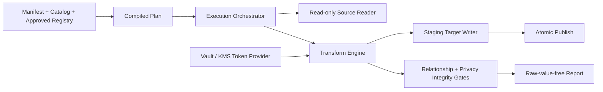

# DPM Execution Runtime Design

Status: Draft design baseline, 2026-07-17

이 문서는 DPM의 compiled plan을 실제 데이터 변환 작업으로 연결하는 runtime/data-plane의
설계 경계를 정의한다. 현재 `@oa-sdk/dpm/execution`은 이 설계의 in-memory 검증 slice만
구현한다. production DB, vault, target writer는 별도 runtime owner와 배포 계약이 필요하다.

## 1. 책임 경계



| 영역 | 책임 | 현재 상태 |
|---|---|---|
| Control plane | manifest, catalog, approved relationship, freshness, compiled plan | 구현됨 |
| Execution adapter | compiled plan을 caller-owned row batch에 적용 | `executeDpmRows()` 구현 |
| Source reader | source DB에서 read-only snapshot/batch 제공 | 설계만 |
| Transform engine | mask, redact, hash, relationship token 등 변환 | 일부 in-memory 구현 |
| Vault/KMS provider | key material 보호와 deterministic token provider | 설계만 |
| Target writer | staging, retry, commit/rollback, publish | 설계만 |
| Integrity/report | orphan, join consistency, residual PII, row-count 검증 | in-memory 일부 구현 |

DPM은 원본 DB를 수정하지 않는다. source는 read-only 입력이고, 변환 결과는 별도 target
dataset에 기록한다. AI consumer에는 source credential, vault, reverse token lookup 권한을
노출하지 않는다.

## 2. 실행 입력과 출력

실행의 권위 입력은 다음 세 가지다.

1. `DpmCompiledPlan`: manifest, catalog freshness, approved registry, namespace binding을 고정한다.
2. Source snapshot: 실행 중 동일한 기준으로 읽을 수 있는 source 데이터 범위다.
3. Runtime secrets: manifest에 저장하지 않는 caller/vault 제공 key material이다.

실행 결과는 target rows와 다음의 raw-value-free report다.

- plan identity와 freshness
- input/output row count
- 변환된 column count
- relationship별 matched/orphan count
- residual PII와 integrity diagnostics
- job id, attempt, source/target snapshot reference

원본 값, 샘플 payload, key material, reverse lookup map은 결과·로그·리포트에 포함하지 않는다.

## 3. 권장 adapter 계약

Runtime은 저장소·비밀관리 구현에 직접 결합하지 않고 다음 역할을 주입받는다.

```ts
interface DpmSourceReader {
  readBatch(input: {
    table: string
    columns: readonly string[]
    cursor?: string
    snapshot: string
  }): AsyncIterable<{ rows: readonly Record<string, unknown>[]; nextCursor?: string }>
}

interface DpmTokenProvider {
  token(input: {
    namespace: string
    canonicalKey: string
    purpose: 'relationship_token' | 'entity_token'
  }): Promise<string>
}

interface DpmTargetWriter {
  begin(input: { target: string; planIdentity: string }): Promise<void>
  write(input: { table: string; rows: readonly Record<string, unknown>[] }): Promise<void>
  commit(): Promise<void>
  rollback(): Promise<void>
}
```

`DpmTokenProvider`는 원본을 복원할 수 있는 API가 아니다. reversible token이 별도 정책으로
허용되더라도 reverse lookup은 runtime 내부의 제한된 운영 경계에만 남겨야 한다.

## 4. 실행 lifecycle

### Preflight

- plan이 stale이 아닌지 확인한다.
- 모든 relationship가 approved인지 확인한다.
- source/target이 같은 mutation 대상이 아닌지 확인한다.
- column transform, namespace binding, key encoding을 확인한다.
- target staging 위치와 idempotency key를 계산한다.

### Read and transform

- source는 repeatable snapshot 또는 명시적 version 기준으로 batch read한다.
- 각 batch는 `columnSteps` 순서로 변환한다.
- relationship token은 physical column이 아니라 logical relationship namespace와 component index를 사용한다.
- 같은 namespace의 parent/child 값은 source column명이 달라도 같은 token으로 변환되어야 한다.
- 일반 hash는 plain hash를 사용하지 않고 keyed digest 또는 vault/KMS provider를 사용한다.

### Integrity gate

- orphan policy를 적용한다.
- parent/child transformed key가 일치하는지 확인한다.
- row count와 required/nullability 규칙을 확인한다.
- residual PII가 남으면 `privacy_controls.residual_pii` 정책에 따라 차단한다.
- blocking diagnostic이 하나라도 있으면 target publish를 수행하지 않는다.

### Write and publish

- target staging dataset에 먼저 기록한다.
- batch retry는 idempotency key와 plan identity를 사용한다.
- 전체 gate 통과 후 atomic publish 또는 version pointer 전환을 수행한다.
- 실패 시 staging을 rollback/expire하고 report만 남긴다.

## 5. Transform 정책

| Transform | runtime 의미 | 설계 상태 |
|---|---|---|
| `keep` | 비민감 값을 그대로 유지 | 구현됨 |
| `redact` | 고정 placeholder로 치환 | 구현됨 |
| `mask` | format/type 정책에 따라 마스킹 | 현재 고정 placeholder, 정책 확장 필요 |
| `null` | `null`로 치환 | 구현됨 |
| `hash` | keyed digest로 비가역 변환 | in-memory 구현, provider 분리 필요 |
| `relationship_token` | approved relationship namespace의 deterministic token | in-memory 구현 |
| `generalize` | 날짜·주소·수치의 정책 기반 일반화 | 정책 스키마와 함께 구현 필요 |
| `polymorphic_relationship_token` | condition별 namespace token | condition resolver와 함께 구현 필요 |

`deterministic_token`이 deterministic하다는 사실은 법적 익명화를 보증하지 않는다. 재식별
위험, 소수 집단, quasi-identifier 조합, residual PII는 별도 privacy gate에서 평가한다.

## 6. 실패와 보안 원칙

- stale plan, missing key, unsupported transform, namespace mismatch는 fail-closed다.
- `block` orphan은 publish를 차단한다. `warn`은 report를 남기되 정책이 허용하는 경우에만 진행한다.
- source read error, target write error, integrity error는 commit 전에 rollback한다.
- key material은 manifest, job row, report, log, AI schema context에 저장하지 않는다.
- token provider 장애 시 새 token을 임의 생성하거나 plain value로 fallback하지 않는다.
- retry는 같은 input과 같은 plan identity에 대해 동일한 결과를 보장해야 한다.

## 7. 구현 순서

1. 현재 단계: in-memory executor와 raw-value-free integrity report를 contract fixture로 고정한다.
2. 다음 단계: `DpmSourceReader`, `DpmTokenProvider`, `DpmTargetWriter` interface와 execution report schema를 추가한다.
3. 그 다음: local/fixture-backed Postgres reader와 staging writer로 end-to-end smoke를 만든다.
4. 이후: KMS/vault provider, key rotation, token namespace versioning, retry/idempotency를 붙인다.
5. production 전환 전: snapshot isolation, access control, audit, retention/deletion, disaster recovery,
   residual PII scan, load test, rollback rehearsal을 별도 승인한다.

2단계까지는 `@oa-sdk/dpm`의 compatibility/runtime contract로 진행할 수 있다. 3단계 이후는
production data-plane owner, secret-management owner, target storage owner가 정해진 뒤 별도
goal로 승격한다.

## 8. 현재 구현과의 연결

- API: `@oa-sdk/dpm/execution`
- Entry point: `executeDpmRows()`
- 구현: `packages/dpm/src/execution/in-memory-executor.ts`
- contract types: `packages/dpm/src/execution/execution-types.ts`
- 테스트: `packages/dpm/test/execution-in-memory.test.ts`

현재 executor는 DB와 vault에 접근하지 않으며, `generalize`와
`polymorphic_relationship_token`을 명시적으로 차단한다. 이 제한을 제거하려면 해당 transform의
정책 입력, canonicalization, integrity gate, security review를 먼저 확정해야 한다.
