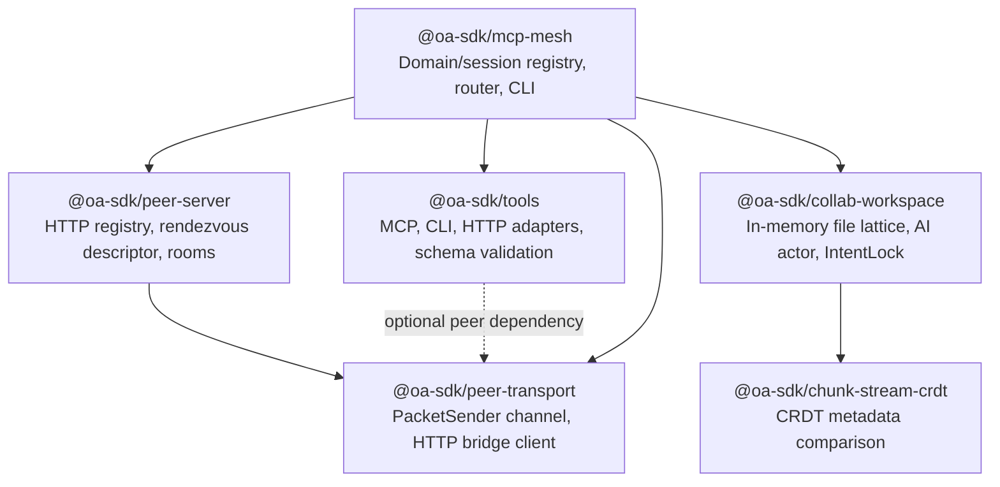

# WebMCP 피어링, 전송, 협업 및 MCP 메시 아키텍처

## 모듈 의존성

다음은 패키지에 선언된 내부 런타임 의존성이다. 화살표는 의존하는 패키지에서 의존 대상으로 향한다.
`tools`의 `peer-transport` 연결은 선택적 peer dependency다.

## 패키지별 책임

| 패키지 | 런타임 의존성 | 제공 기능 | 핵심 인터페이스 |
| --- | --- | --- | --- |
| `@oa-sdk/peer-server` | `@oa-sdk/peer-transport`, `ws` | 기본 포트 8787의 HTTP registry, `/p/:id/mcp` descriptor, Home MCP 진단 도구, 로컬 peer store, WebSocket signaling 및 패킷 중계(`@oa-sdk/peer-server/relay`), Cloud Transit Proxy(`/transit/:peer/mcp`, `@oa-sdk/peer-server/cloud`) | `createPeerServer()`, `SignalingRoom`, `PeerRelayManager`, `CloudTransitProxy`, `FilePeerStore`, `PeerRoomManager` |
| `@oa-sdk/peer-transport` | 외부 npm 의존성 없음; Node.js 및 브라우저 API 사용 | HTTP bridge client, 주입된 전송 함수를 사용하는 3채널 패킷 추상화, 제한된 메모리 큐, WebSocket 전송 어댑터 및 Cloud Transit 클라이언트(`@oa-sdk/peer-transport/adapters`), signaling wire protocol 계약 | `P2pTransportChannel`, `WebMcpBridgeClient`, `WebSocketTransportAdapter`, `CloudTransitClient`, `parseSignalMessage` |
| `@oa-sdk/collab-workspace` | `@oa-sdk/chunk-stream-crdt` | 인메모리 파일·라인 상태 병합, AI line/block edit, IntentLock, delta/presence 이벤트 | `WorkspaceTreeLattice`, `AiEditorActor`, `WorkspaceSyncer` |
| `@oa-sdk/mcp-mesh` | `tools`, `peer-server`, `peer-transport`, `collab-workspace`, Commander | 도메인별 스킬과 복수 세션 등록, namespace 라우팅, 메타 스킬 준비성 검사, CLI | `SkillRegistry`, `MeshRouter`, `SkillRegistry#hydratePeerSession()` |
| `@oa-sdk/tools` | Hono, MCP SDK, Commander, Ajv, ajv-formats 등 | MCP/HTTP/CLI adapter, JSON Schema Draft 2020-12 검증 | `defineTool()`, `createMcpServer()`, `createHttpApp()` |

`P2pTransportChannel`은 기본적으로 네트워크 비의존 추상화이며, `@oa-sdk/peer-transport/adapters`의
`WebSocketTransportAdapter`를 통해 WebSocket 릴레이 서버로 중계 연결하거나 사용자 정의 WebRTC DataChannel을
연결할 수 있다. 방화벽 환경에서 P2P 직접 연결이 제한될 때는 peer-server가 duplex packet relay 역할을 수행한다.
`WorkspaceSyncer`도 파일 watcher, 디스크 쓰기, 네트워크 구독 또는 커서 UI를 자동으로 설치하지 않는다.

## 보안·처리 경계

- `peer-server`는 loopback 외부 listener에 `publishKey`를 요구한다. 키가 설정되면 HTTP route에
  Bearer 또는 `X-Peer-Publish-Key` 인증을 적용하며, CORS preflight는 별도로 처리한다.
  요청 본문은 기본 1MiB, 설정 가능한 최대 16MiB이고, 상태 응답에서 peer token과 invitation URL을 제거한다.
- `WebMcpBridgeClient`는 redirect를 거부하고 Bearer token을 전달한다. 재시도는
  `503 PEER_UNAVAILABLE` 응답에 한정하며, 404·네트워크 오류·timeout을 자동 재시도하지 않는다.
- `P2pTransportChannel`은 패킷 크기, 채널, sequence/epoch 형식과 수신 순서를 검사한다.
  송신 큐는 채널별로 나누어 MCP, CRDT, presence 순서로 플러시한다. 가득 찬 큐는 presence,
  CRDT, MCP 순서로 기존 패킷을 제거하므로 무손실 전송을 보장하지 않는다. 송신 성공은 adapter의
  반환값이며 원격 처리 완료나 exactly-once 실행을 뜻하지 않는다.
- `collab-workspace`는 workspace-relative 경로와 원격 client/workspace identity를 검사한다.
  원격 ingress에는 로컬 transport adapter가 발급한 opaque capability가 필요하다. 이 표식은
  네트워크 인증을 수행하지 않으므로, adapter가 인증된 연결에 identity를 결합해야 한다.
  `authenticateRemoteSource`와 client allow-list로 호스트 정책을 추가할 수 있다.
- 원격 chunk watermark와 age window, 파일·chunk·content·presence 총량 제한, tombstone 정리,
  sparse render 상한을 제공한다. watermark는 메모리에 저장되므로 재시작 후 유지되지 않는다.
  호스트는 전달 순서, 재동기화 및 tombstone retention 정책을 함께 정해야 한다.
- AI line/block edit는 자신이 소유한 활성 IntentLock 범위를 요구한다. 잠금 TTL은 최대 5분이며
  갱신에는 증가하는 version이 필요하다. 이 검사는 모든 인간·원격 편집의 전역 잠금을 뜻하지 않는다.
- `mcp-mesh`는 catalog/JSON Schema, 활성 session, tool 입력을 dispatch 전에 검사한다.
  aggregate catalog는 여러 domain에 중복된 tool의 bare alias를 만들지 않는다.
- `tools` HTTP/MCP adapter는 auth/origin/body 정책을 공유한다. HTTP schema/docs도 인증 대상이며,
  `/health`는 기본 공개이고 `publicHealth: false`로 보호할 수 있다. JSON Schema 검증은 Ajv 기반이다.

## 주요 흐름

### HTTP bridge 탐색과 도메인·세션 등록

1. 호스트가 `/announce`로 peer metadata와 tool catalog를 등록한다. 이것만으로 실행 가능한
   provider socket이 연결되지는 않는다. 호스트의 signaling adapter가 room에 provider를 연결해야 한다.
2. `FilePeerStore`가 기본 `~/.webmcp/peers.json`을 갱신한다.
3. `WebMcpBridgeClient.listPeers()`가 HTTP 상태를 조회하고, 필요한 경우 로컬 store로 fallback한다.
4. `SkillRegistry.hydratePeerSession(peer, bridgeClient)`가 `wireframe-local` 같은 alias에서
   `wireframe` domain을 추출한다. 같은 domain의 catalog를 통합하고 각 peer를 session으로 바인딩한다.
5. `MeshRouter`는 지정된 활성 session 또는 사용 가능한 fallback session을 선택한다.
   라운드로빈 부하 분산은 구현하지 않는다.

### 협업 상태와 AI 편집

1. 호스트가 절대 `rootPath`와 workspace/client ID로 `WorkspaceSyncer`를 만든다.
2. 호스트가 파일 내용을 읽어 `applyHumanEdit()`에 전달하고, `onDelta()` 이벤트를 저장·전송 adapter에 연결한다.
3. `syncer.createAiEditor('assistant', 'AI Assistant')`로 `client:ai:assistant` 액터를 만든다.
4. AI는 `acquireIntent()`로 편집할 0-based 라인 범위를 확보한 뒤 `streamLineEdit()` 또는
   `streamBlockEdit()`를 호출한다. UI는 `onPresence()`와 활성 lock 정보를 사용해 커서를 표시할 수 있다.
5. 같은 파일·라인의 경쟁 변경은 CRDT metadata와 content tie-breaker로 결정된다.
   같은 chunk 집합의 결정적 병합을 제공하지만 경쟁한 텍스트를 모두 보존하거나 Git 충돌을 해결하지는 않는다.
6. 완료 후 `completeIntent(lock.id)`로 잠금을 해제한다.

### 연결 복구와 큐

1. 호스트 adapter가 연결 상태를 `setConnectionState()`로 알려주고 sender를 등록한다.
2. 연결이 없거나 직접 송신에 실패하면 패킷을 제한된 메모리 큐에 보관한다.
3. 다시 연결되면 아직 deadline을 넘지 않은 패킷을 채널 우선순위에 따라 송신한다.
   기본 packet deadline과 direct-send timeout은 각각 5초다.
4. 선택적 `heartbeatIntervalMs`는 presence heartbeat를 송신한다. 상대 heartbeat 감시와
   연결 실패 판정, 재접속은 호스트 adapter의 책임이다.
5. epoch은 같은 channel 인스턴스의 재접속 시 증가한다. 새 프로세스나 새 인스턴스 사이의
   epoch 저장·협상은 호스트가 처리해야 한다.

큐는 디스크에 영속화되지 않는다. 따라서 호스트 프로세스 자체의 종료·새로고침까지 복구하지는 않는다.
`PeerRoomManager`의 provider 대기와 `WebMcpBridgeClient`의 retry window는 이 큐와 별도의 정책이다.
