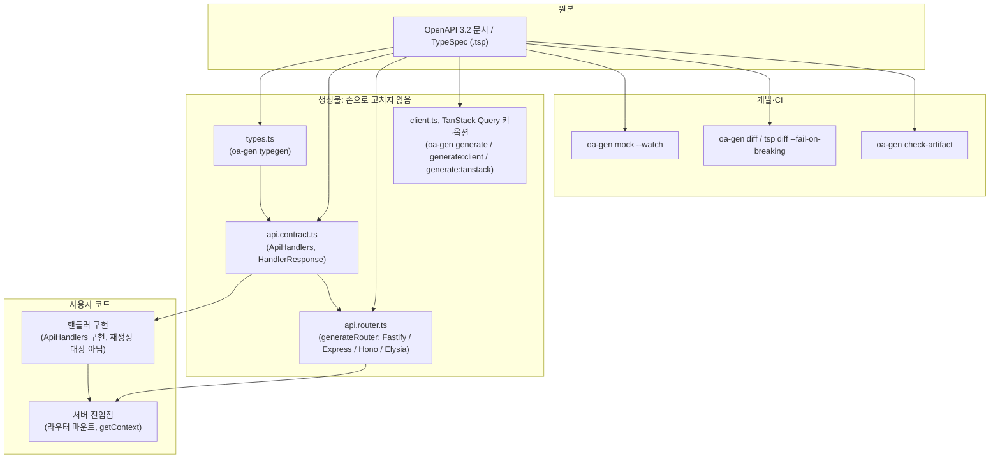

# 프로젝트 온보딩 & 점진적 도입 플레이북 (Onboarding & Adoption Playbook)

이 가이드는 신규(Greenfield) 및 기존(Brownfield) 백엔드/풀스택 프로젝트에 `oa-sdk`를 단계적으로 도입하는 순서와, Fastify·Express·Hono·Elysia·NestJS에 연결하는 방법을 정리한 실무 플레이북입니다. 기존 코드베이스를 한 번에 바꿀 필요 없이 **3계층 가치 도입 사다리(3-Tier Value Adoption Ladder)**를 따라 필요한 단계까지만 적용합니다.

이 문서는 `@oa-sdk/codegen` 0.9.0 기준입니다. 공개 패키지는 Node.js 22 이상에서 동작하며, 설치와 첫 실행은 [Quick Start](./quick-start.md)를, 어떤 명령에 어떤 동반 패키지가 필요한지는 [동반 패키지 안내](./cli-setup.md#동반-패키지-companion-packages)를 따릅니다.

> §1~§8은 다른 프로젝트에 `oa-sdk`를 도입하는 사용자용입니다. §9는 oa-sdk 저장소 자체에 기여하는 개발자용입니다.

---

## 1. 도입으로 줄어드는 반복 작업

API 계약이 여러 곳에 흩어져 있으면 아래 작업을 사람이 반복합니다. 표는 각 작업을 어떤 명령과 파일이 대신하는지 정리한 것이며, 도입 효과를 측정한 수치가 아닙니다. 가치별 근거는 [가이드 색인의 핵심 가치](./README.md#oa-sdk가-해결하는-문제와-핵심-가치)에 있습니다.

| # | 반복 작업 | 도입 전 | `oa-sdk`가 대신하는 것 | 명령·파일 |
|---|---|---|---|---|
| **1** | **동기화** | 스펙 문서, 서버 DTO, 클라이언트 타입을 손으로 맞추고 어긋난 곳을 리뷰에서 찾습니다. | 원본(OpenAPI 문서 또는 TypeSpec) 하나에서 타입, 클라이언트, 핸들러 계약을 다시 생성합니다. `oa-gen check-artifact`를 CI에 걸면 원본과 어긋난 생성 OpenAPI 문서가 실패로 드러납니다. | `oa-gen typegen`, `oa-gen generate`, `oa-gen check-artifact` |
| **2** | **덮어쓰기** | 생성 코드에 구현을 섞으면 다시 생성할 때 수정이 사라집니다. | 생성기는 핸들러 계약(`*.contract.ts`)만 쓰고, 구현은 그 인터페이스를 구현하는 별도 파일에 둡니다. 생성기는 구현 파일을 쓰지 않습니다. | `oa-gen generate`, `generateHandlerContract()` |
| **3** | **mock 대기** | 백엔드 구현 전까지 프론트엔드·QA가 기다리거나 일회성 가짜 서버를 만듭니다. | 같은 원본을 mock 서버로 바로 띄우고, 계약에 맞지 않는 요청은 422로 거절합니다. `--watch`는 원본이 바뀌면 서버를 재시작하지 않고 route를 교체합니다. | `oa-gen mock --watch` |
| **4** | **프레임워크 결합** | 비즈니스 로직이 프레임워크의 Request/Response 객체에 묶입니다. | 핸들러는 `{ params, query, body, context }`만 받는 함수입니다. 프레임워크 연결 코드는 `@oa-sdk/router`의 `generateRouter()`가 대상별로 만들므로, 대상을 바꿀 때는 `target` 값을 바꿔 다시 생성하고 서버 진입점을 고칩니다. | `generateRouter(spec, { target })` |
| **5** | **늦게 발견하는 breaking change** | 기존 소비자를 깨뜨리는 변경(breaking change)을 운영 오류로 처음 압니다. | PR에서 이전 계약과 비교해 breaking change가 있으면 실패시킵니다. OpenAPI 파일 비교는 선택 필드 추가도 breaking으로 보는 보수적 규칙이고, TypeSpec 비교는 호환 변경을 구분합니다. | `oa-gen diff --fail-on-breaking`, `oa-gen tsp diff --fail-on-breaking` |

---

## 2. 도입 후 구조

원본에서 생성물이 나오고, 사람이 쓰는 코드는 핸들러 구현과 서버 진입점뿐입니다.



---

## 3. 3계층 점진적 가치 도입 사다리 (3-Tier Value Adoption Ladder)

```
┌──────────────────────────────────────────────────────────────────┐
│  Tier 3: CI gate                                                 │
│  - breaking change 검사 (oa-gen diff / oa-gen tsp diff)           │
│  - 생성물 신선도 검사 (oa-gen check-artifact)                       │
├──────────────────────────────────────────────────────────────────┤
│  Tier 2: 계약 분리                                                │
│  - 핸들러 계약 (*.contract.ts) 구현                                 │
│  - generateRouter()로 만든 라우터 코드에 핸들러 연결                    │
├──────────────────────────────────────────────────────────────────┤
│  Tier 1: 검증·타입·mock                                            │
│  - oa-gen init, oa-gen validate, oa-gen typegen                  │
│  - oa-gen mock --watch (기존 서버 코드 수정 없음)                     │
└──────────────────────────────────────────────────────────────────┘
```

### Tier 1: 검증·타입·mock (기존 코드 수정 없음)
- **하는 일**: `oa-gen init`이 프레임워크(Fastify, Elysia, Hono, Express, NestJS)와 스펙(`.tsp`, `openapi.yaml`, `openapi.json`, `@oaOperation` JSDoc)을 감지해 `oa.config.ts`를 만들고 `package.json`에 스크립트와 의존성을 추가합니다. 이미 있는 항목은 `--force` 없이는 바꾸지 않습니다. 이어서 `oa-gen validate`로 계약을 검사하고, `oa-gen typegen`으로 타입을, `oa-gen mock`으로 mock 서버를 띄웁니다.
- **결과물**: `oa.config.ts`, 검증 결과, `types.ts`, 프론트엔드가 바로 쓸 수 있는 mock 서버. 기존 서버 코드는 바꾸지 않습니다.

### Tier 2: 계약 분리 (신규 엔드포인트부터 적용)
- **하는 일**: 핸들러 계약(`ApiHandlers`)을 구현하는 순수 함수로 비즈니스 로직을 쓰고, `@oa-sdk/router`의 `generateRouter()`가 만든 라우터 코드를 서버에 마운트합니다(§4). `oa-gen` 명령은 라우터 파일을 만들지 않으므로, 라우터 코드는 빌드 스크립트에서 생성합니다.
- **결과물**: 원본을 바꿔 다시 생성해도 구현 파일은 그대로인 구조. 계약이 바뀌어 구현이 맞지 않으면 `tsc`가 알려 줍니다.

### Tier 3: CI gate
- **하는 일**: PR마다 이전 계약과 비교해 breaking change가 있으면 실패시키고(§6.2), 커밋된 생성물이 원본과 같은지 `oa-gen check-artifact`로 확인합니다. OpenAPI 문서는 `oa-gen diff`(파일 경로 두 개), TypeSpec 원본은 `oa-gen tsp diff`로 비교합니다. `tsp diff`의 `--base`에는 파일, 디렉터리, git ref, `<ref>:<path>`를 주고, `--head`에는 파일 경로나 `<ref>:<path>`를 줍니다. `--head HEAD`처럼 경로 없는 git ref는 현재 base를 자기 자신과 비교하는 결함이 있어 쓰지 않습니다(§6.2).
- **결과물**: breaking change와 원본과 어긋난 생성물이 리뷰 전에 종료 코드로 드러납니다.

### 3.4 아키타입 선택 (Archetype)

`oa-gen init --archetype <mvp|microservice|enterprise>`는 `oa.config.ts`에 기록하는 설정값, 출력 위치, `package.json` 스크립트와 의존성의 묶음을 고릅니다. 기록된 gate·persona 설정(`core.gates.*`, `product.jitSchema`, `product.zeroCopy`, `core.client.wireFormatSafety`, `product.personas.enforceCoverage`)을 읽어 동작을 바꾸는 명령은 아직 없습니다. 그래서 `init`이 쓴 설정에서 `archetype`이나 이 값들을 나중에 바꿔도 `oa-gen generate`의 결과와 CI 동작은 달라지지 않으며, 아키타입의 차이는 `init` 시점에 추가되는 스크립트와 의존성에 남습니다. breaking change gate는 §6.2처럼 CI에 직접 등록합니다.

아키타입별 기록 값, 추가 스크립트, 그리고 `microservice`·`enterprise`가 추가하지만 그대로는 동작하지 않는 스크립트(알려진 결함)와 대신 쓸 명령은 [CLI 명령 레퍼런스의 아키타입 절](./cli-command-reference.md#아키타입---archetype)에 정리했습니다. persona 관련 기능은 저장소 전용 비공개 패키지 `@oa-sdk/personas`가 필요하므로 oa-sdk 저장소 밖에서는 쓸 수 없습니다.

```bash
# Fastify 대상, microservice 아키타입, FSD 출력 위치로 초기화
npx oa-gen init --target fastify --archetype microservice --routing fsd --yes

# 파일을 쓰지 않고 감지 결과와 변경 계획만 확인
npx oa-gen init --dry-run
```

---

## 4. 프레임워크 연결 레시피 (Framework Recipes)

`oa-gen generate`는 서버 쪽에 프레임워크와 무관한 핸들러 계약(`<id>.contract.ts`)만 생성합니다. Fastify·Express·Hono·Elysia 라우터 코드가 필요하면 빌드 스크립트에서 `@oa-sdk/router`의 `generateRouter()`를 호출해 파일로 씁니다. `oa-gen` 명령으로는 라우터 파일을 만들지 않으며, `init`이 프레임워크 대상에 추가하는 `generate:router` 스크립트(`oa-gen generate --target <프레임워크>`)도 `oa-gen generate`와 같은 일을 할 뿐 라우터 파일을 만들지 않습니다.

아래 레시피는 [Quick Start](./quick-start.md) 1단계의 `openapi.yaml`(operation `listUsers`, `createUser`, `getUser`)을 원본으로, `"type": "module"`인 TypeScript 프로젝트를 가정합니다. Fastify(5.8), Express(5), Hono(4) 레시피는 생성된 라우터와 아래 핸들러를 `tsc`로 검사하고 요청을 보내 200·201·404 응답을 확인했습니다. Elysia 레시피는 생성 코드의 시그니처를 기준으로 썼으며 `tsc`로 검사하지 않았습니다.

### 4.1 공통: 타입이 있는 핸들러 계약과 라우터 코드 생성

`oa-gen generate`가 만드는 `<id>.contract.ts`는 요청·응답 타입이 `unknown`입니다. 타입이 있는 계약이 필요하면 `oa-gen typegen` 출력과 함께 `generateHandlerContract()`로 계약을 만듭니다.

#### 1단계: 패키지 설치

```bash
npm install --save-dev @oa-sdk/codegen @oa-sdk/router @oa-sdk/client @oa-sdk/mock-server yaml
```

`yaml`은 빌드 스크립트가 `openapi.yaml`을 읽는 데 씁니다. 프레임워크 패키지(`fastify`, `express`, `hono`, `elysia`)는 각 레시피에서 설치합니다.

#### 2단계: 빌드 스크립트 작성 (`scripts/generate-server.mjs`)

```javascript
import { mkdirSync, readFileSync, writeFileSync } from 'node:fs'
import { parse } from 'yaml'
import { generateHandlerContract, generateRouter } from '@oa-sdk/router'

const spec = parse(readFileSync('openapi.yaml', 'utf8'))

mkdirSync('src/server', { recursive: true })
writeFileSync('src/server/api.contract.ts', generateHandlerContract(spec, { typesImport: './types.js' }))
writeFileSync(
  'src/server/api.router.ts',
  generateRouter(spec, {
    target: process.argv[2] ?? 'hono', // 'fastify' | 'express' | 'hono' | 'elysia'
    contractImport: './api.contract.js',
    typesImport: './types.js',
    contextInjection: true, // getContext로 요청별 컨텍스트를 핸들러에 전달
  }),
)
```

```bash
# 타입 생성 후 계약과 라우터 코드 생성 (Fastify 대상)
npx oa-gen typegen --spec ./openapi.yaml -o src/server/types.ts
node scripts/generate-server.mjs fastify
```

이 파일들은 `.oa-manifest.json`에 기록되지 않으므로 `oa-gen generate`의 생성물 정리(§4.8)가 지우지 않습니다. 원본이 바뀌면 두 명령을 다시 실행합니다. `package.json` 스크립트(예: `"generate:server"`)로 묶어 두면 편합니다.

#### 3단계: 생성되는 핸들러 계약 (`src/server/api.contract.ts`, 일부)

```typescript
// Auto-generated handler contracts from OpenAPI spec. Do not edit.
import type { CreateUserBody, CreateUserResponse, GetUserPathParams, GetUserResponse, ListUsersResponse } from './types.js'

export interface GetUserContext<TContext = unknown> {
  params: GetUserPathParams
  context?: TContext
}

export type GetUserHandler<TContext = unknown> = (
  ctx: GetUserContext<TContext>
) => HandlerResponse<GetUserResponse> | Promise<HandlerResponse<GetUserResponse>>

export interface ApiHandlers<TContext = unknown> {
  listUsers: ListUsersHandler<TContext>
  createUser: CreateUserHandler<TContext>
  getUser: GetUserHandler<TContext>
}
```

핸들러는 성공 본문을 그대로 반환하거나 `{ status, body, headers? }`를 반환합니다. 오류 응답도 `{ status: 404, body }`처럼 반환하며, 현재 생성되는 계약은 오류 본문의 타입을 operation별로 좁히지 않습니다(`HandlerResponse`의 기본 오류 맵은 `Record<number, unknown>`).

#### 4단계: 핸들러 구현 (`src/server/handlers.ts`, 사용자 작성 파일)

```typescript
import type { ApiHandlers } from './api.contract.js'

export interface AppContext {
  tenantId: string
}

export const handlers: ApiHandlers<AppContext> = {
  listUsers: async () => ({ items: [], total: 0 }),
  createUser: async ({ body }) => ({
    status: 201,
    body: { id: 'usr_1', email: body.email, name: body.name, role: body.role ?? 'user', createdAt: new Date().toISOString() },
  }),
  getUser: async ({ params, context }) => {
    if (params.userId === 'unknown') {
      return { status: 404, body: { code: 'NOT_FOUND', message: `User ${params.userId} not found` } }
    }
    return {
      id: params.userId,
      email: 'alice@example.com',
      name: `Alice (${context?.tenantId ?? 'default'})`,
      role: 'user',
      createdAt: '2026-01-01T00:00:00Z',
    }
  },
}
```

### 4.2 Fastify 레시피 (`FastifyPluginAsync`)

Fastify 대상의 라우터 코드는 `FastifyPluginAsync` 플러그인(`apiRouter`)이며, 각 route의 `schema.response`에 응답 JSON Schema를 넣으므로 Fastify가 그 스키마로 응답을 직렬화합니다.

```bash
npx oa-gen init --target fastify --yes
npm install fastify
node scripts/generate-server.mjs fastify
```

```typescript
// src/server/main.ts
import Fastify from 'fastify'
import { apiRouter } from './api.router.js'
import { handlers, type AppContext } from './handlers.js'

const server = Fastify()

await server.register(apiRouter, {
  prefix: '/api/v1',
  handlers,
  getContext: (request): AppContext => ({
    tenantId: String(request.headers['x-tenant-id'] ?? 'default'),
  }),
})

await server.listen({ port: 3000 })
```

`init --target fastify`는 `fastify` 의존성과 `dev`(`tsx watch src/server.ts`)·`build`(`tsc`) 스크립트를 추가하지만 서버 진입 파일과 `tsconfig.json`은 만들지 않습니다.

### 4.3 Express 레시피 (`Router`)

Express 대상의 라우터 코드는 `createRouter(handlers, options?)`가 돌려주는 Express `Router`입니다. 요청 본문은 `express.json()`이 파싱합니다.

```bash
npx oa-gen init --target express --yes
npm install express
node scripts/generate-server.mjs express
```

```typescript
// src/server/app.ts
import express from 'express'
import { createRouter } from './api.router.js'
import { handlers, type AppContext } from './handlers.js'

const app = express()
app.use(express.json())
app.use(
  '/api/v1',
  createRouter(handlers, {
    getContext: (req): AppContext => ({ tenantId: String(req.headers['x-tenant-id'] ?? 'default') }),
  }),
)

app.listen(3000)
```

### 4.4 Hono 레시피

Hono 대상의 라우터 코드는 `createRouter(handlers, options?)`가 돌려주는 `Hono` 앱입니다.

```bash
npx oa-gen init --target hono --yes
npm install hono
node scripts/generate-server.mjs hono
```

```typescript
// src/server/app.ts
import { Hono } from 'hono'
import { createRouter } from './api.router.js'
import { handlers, type AppContext } from './handlers.js'

const app = new Hono()
app.route(
  '/api/v1',
  createRouter(handlers, {
    getContext: (c): AppContext => ({ tenantId: c.req.header('x-tenant-id') ?? 'default' }),
  }),
)

export default app
```

### 4.5 Elysia 레시피

Elysia 대상의 라우터 코드는 `createRouter(handlers, options?)`가 돌려주는 `Elysia` 인스턴스입니다. `contextInjection` 없이 생성하면 각 route가 쓰는 필드만 구조분해하고, 켜면 `getContext`에 넘길 필드를 모두 구조분해합니다. `init --target elysia`는 Bun 런타임용 스크립트(`bun x oa-gen ...`, `bun --watch src/index.ts`)를 씁니다. Bun은 CI에서 검증하지 않으며 지원 환경으로 약속하지 않습니다.

```bash
npx oa-gen init --target elysia --yes
npm install elysia
node scripts/generate-server.mjs elysia
```

```typescript
// src/index.ts
import { Elysia } from 'elysia'
import { createRouter } from './server/api.router.js'
import { handlers, type AppContext } from './server/handlers.js'

new Elysia()
  .use(
    createRouter(handlers, {
      getContext: ({ headers }): AppContext => ({ tenantId: headers['x-tenant-id'] ?? 'default' }),
    }),
  )
  .listen(3000)
```

### 4.6 NestJS 레시피 (OpenAPI 산출물 수집)

NestJS는 컨트롤러와 데코레이터가 라우팅을 맡으므로 라우터 코드를 생성하지 않습니다. 대신 NestJS가 만드는 Swagger 문서를 수집해 그 서비스의 계약으로 관리하고, 그 계약에서 타입과 클라이언트를 만듭니다. 전체 흐름과 CI 템플릿은 [NestJS Swagger / FastAPI Governance](./use-cases/nestjs-swagger-governance.md)를, 참조 앱은 [`apps/nestjs-ref`](../../apps/nestjs-ref/openapi-governance.config.json)를 따릅니다.

#### 1단계: 온보딩 초기화
```bash
npx oa-gen init --target nestjs --yes
```
`init`은 `@nestjs/core` 또는 `nest-cli.json`을 감지하면 spec target을 `id: 'nestjs-api'`, `target: 'nestjs'`로 기록하고, `start:dev`(`nest start --watch`), `generate:contract`(`oa-gen generate`와 같음), `mock` 스크립트를 추가합니다.

#### 2단계: OpenAPI 추출 스크립트 작성 (`scripts/export-openapi.ts`)
HTTP 리스너를 열지 않고 NestJS 앱 메타데이터만 부트스트랩하여 OpenAPI 문서를 파일로 씁니다.
```typescript
import 'reflect-metadata';
import { NestFactory } from '@nestjs/core';
import { SwaggerModule, DocumentBuilder } from '@nestjs/swagger';
import { writeFileSync, mkdirSync } from 'node:fs';
import { dump as yamlDump } from 'js-yaml';
import { AppModule } from '../src/app.module.js';

async function exportOpenApi() {
  const app = await NestFactory.create(AppModule, { logger: false });
  const config = new DocumentBuilder()
    .setTitle('NestJS Production API')
    .setVersion('1.0.0')
    .build();

  const document = SwaggerModule.createDocument(app, config);
  await app.close();

  mkdirSync('contracts', { recursive: true });
  writeFileSync('contracts/openapi.raw.yaml', yamlDump(document, { noRefs: true }));
  console.log('✅ Exported: contracts/openapi.raw.yaml');
}

exportOpenApi();
```

#### 3단계: 수집·검증과 클라이언트/타입 생성
`oa-gen collect`는 원본(`openapi.raw.yaml`)을 그대로 두고 정규화본과 OpenAPI 3.2 분석본을 씁니다. 검증과 생성은 분석본으로 합니다.
```bash
npx oa-gen collect --spec contracts/openapi.raw.yaml --normalized contracts/openapi.normalized.yaml --upgraded contracts/openapi.upgraded.yaml --profile nestjs-swagger
npx oa-gen validate --spec contracts/openapi.upgraded.yaml --require-32
npx oa-gen typegen --spec contracts/openapi.upgraded.yaml -o src/api/types.ts
npx oa-gen generate:client --spec contracts/openapi.upgraded.yaml -o src/api/client.ts
```
서비스별 수집·검사 스크립트와 CI 설정은 `oa-gen scaffold-governance --root . --service <name> --profile nestjs-swagger`가 만듭니다.

### 4.7 응답 엔벨로프 충돌 방어 (Response Envelope Collision Defense)

핸들러가 반환하는 도메인 객체에 `status`나 `body` 필드가 들어 있는 경우가 많습니다(예: 주문 `{ id: 'order_1', status: 'PENDING', total: 5000 }`, 글 `{ id: 'p_1', title: 'Doc', body: '# Markdown', status: 'DRAFT' }`). `'status' in result || 'body' in result`처럼 검사하면 `'PENDING'`을 HTTP 상태 코드로 오인하거나 `body` 필드만 떼어 응답하는 데이터 손실이 생깁니다.

`generateRouter()`가 만드는 라우터 코드는 모든 대상(Fastify, Express, Hono, Elysia)에서 다음 조건을 모두 만족할 때만 반환값을 `{ status, body, headers }` 엔벨로프로 해석합니다.

```typescript
if (
  result !== undefined &&
  result !== null &&
  typeof result === 'object' &&
  'body' in result &&
  ((result as any).status === undefined || typeof (result as any).status === 'number') &&
  ((result as any).headers === undefined || typeof (result as any).headers === 'object')
)
```

- **조건 1**: 객체에 `'body'` 프로퍼티가 있어야 합니다.
- **조건 2**: `status`가 없거나, 있으면 `number`여야 합니다(`'PENDING'` 같은 문자열은 통과하지 못함).
- **조건 3**: `headers`가 없거나, 있으면 `object`여야 합니다.

조건을 만족하지 않는 반환값은 도메인 객체 그대로 HTTP 200 본문으로 직렬화됩니다.

### 4.8 출력 위치 지정 (`outputRouting`)과 생성물 정리

`oa-gen init --routing <default|fsd|monorepo|by-kind>`는 `product.outputRouting`을 기록해 `oa-gen generate`가 핸들러 계약, 클라이언트, TanStack Query 키·옵션을 쓸 위치를 정합니다.

- 경로 템플릿의 `{tag}`는 OpenAPI tag가 아니라 **spec target id**(예: `generic-api`)이고, `{kind}`는 `contract`, `client`, `keys`, `queries`입니다. spec target 하나가 종류별로 한 파일을 만들며, OpenAPI tag별로 파일이 나뉘지 않습니다.
- `<id>.openapi.json`과 `<id>.schema.json`은 outputRouting과 무관하게 spec target의 `outDir`에 씁니다.
- 파일이 서로 다른 디렉터리에 놓여도 생성 파일 사이의 상대 import는 다시 계산됩니다.

| 프리셋 | 결과 (spec target id `generic-api`) |
|---|---|
| `default` | `src/api/generic-api/generic-api.{contract,client,keys,queries}.ts` |
| `fsd` | `src/features/generic-api/api/generic-api.{contract,keys,queries}.ts`, `src/shared/api/client.ts` |
| `monorepo` | `packages/contracts/src/api.contract.ts`, `packages/client-sdk/src/index.ts`, `apps/web/src/api/{queries,keys}.ts` |
| `by-kind` | `src/contracts/generic-api.contract.ts`, `src/client/generic-api.client.ts`, `src/queries/generic-api.queries.ts`, `src/keys/generic-api.keys.ts` |

`fsd` 프리셋이 함께 기록하는 `rules`의 tag(`common`, `shared`, `auth`, `system`)는 OpenAPI tag가 아니라 spec target id와 비교되고, `kind: 'schemas'` 규칙과 `monorepo` 프리셋의 `guards`·`schemas` 항목은 현재 출력 위치를 바꾸지 않습니다. 프레임워크 라우터 코드는 outputRouting 대상이 아니므로 §4.1의 빌드 스크립트에서 경로를 정합니다.

`oa-gen generate`는 `.oa-manifest.json`에 기록된 생성 파일 중 이번 실행이 만들지 않고 내용도 바뀌지 않은 파일을 지웁니다. 지우는 파일은 manifest에 기록되어 있고(출처), 디스크의 내용 hash가 기록과 같으며(손으로 고치지 않음), 생성 배너가 남아 있는 파일뿐입니다. 손으로 고친 파일과 manifest에 없는 파일은 지우지 않습니다. 다만 `oa-gen generate:tanstack` 등 다른 명령이 같은 프로젝트에 쓴 파일도 지워지므로, `oa-gen generate`를 쓰는 프로젝트에서는 TanStack 코드도 `generate`가 만드는 `<id>.queries.ts`에서 가져옵니다. `outputRouting.pruneOrphans: false`는 현재 이 삭제를 막지 못합니다(알려진 결함).

### 4.9 TanStack Query (React Query) v5 3계층 구조

TanStack Query 코드는 쿼리 키 팩토리(Tier 1), 순수 옵션 팩토리(Tier 2), 훅(Tier 3)으로 나뉩니다. 옵션 팩토리는 React 훅이 아니라 `queryOptions()` 객체를 돌려주므로 Next.js Server Component의 `prefetchQuery`에서도 씁니다(§4.10). 클라이언트 초기화, 인증, 오류 처리는 [프론트엔드 SDK 및 쿼리 소비 가이드](./client-and-query-consumption.md)를 따릅니다.

아래 표의 옵션·훅 파일은 모두 `@tanstack/react-query`를 import하는 React용입니다(`oa-gen generate`는 항상 React용으로 씁니다). `generate:tanstack --framework vue|svelte` 출력은 현재 `tsc`가 실패합니다(알려진 결함). Vue·Svelte에서는 import가 없는 키 팩토리(`<id>.keys.ts` 또는 `generate:tanstack --tier keys` 출력)와 생성된 클라이언트만 가져다 쓰고, 옵션은 각 패키지의 `queryOptions()`로 직접 작성합니다([CLI 명령 레퍼런스](./cli-command-reference.md#generatetanstack-옵션-및-인수-명세)).

| 생성 경로 | 파일 | 포함하는 Tier |
|---|---|---|
| `oa-gen generate:tanstack --spec ./openapi.yaml -o src/api` | `src/api/tanstack-query.ts` (같은 디렉터리의 `./client.js`를 import) | 1·2·3 |
| `oa-gen generate:tanstack --spec ./openapi.yaml -o src/api --split` (outputRouting 없음) | `src/api/keys.ts`, `src/api/queries.ts`, `src/api/hooks.ts` | 1·2·3 (파일별) |
| `oa-gen generate` (outputRouting 있음, `init` 기본) | `<id>.keys.ts`, `<id>.queries.ts` | 1·2 (훅 없음) |
| `oa-gen generate` (outputRouting 없음) | `<id>.queries.ts` | 1·2·3 |

Quick Start의 `openapi.yaml`(tag `users`)에서 생성되는 이름은 다음과 같습니다.

- **Tier 1 키**: `usersKeys`(`all`, `lists()`, `list(filters?)`, `details()`, `detail(id)`, `subresource(...)`, `mutation(operationId)`와 operation별 `listUsers()`, `getUser(params)` 등), 별칭 `userKeys`, 전체 묶음 `queryKeys`.
- **Tier 2 옵션**: `listUsersQueryOptions(client, options?)`, `getUserQueryOptions(client, params, options?)`, `createUserMutationOptions(client, options?)`. 커서·페이지 파라미터가 있는 operation에는 `<operationId>InfiniteQueryOptions`도 생성됩니다.
- **Tier 3 훅**: `useListUsersQuery`, `useGetUserQuery`, `useCreateUserMutation`(첫 인자는 클라이언트), 그리고 클라이언트를 돌려주는 훅을 받아 이 인자를 없앤 훅을 만드는 `createApiHooks(useClient)`.

옵션 팩토리의 `queryFn`은 TanStack Query가 넘기는 `signal`을 클라이언트 호출에 전달합니다(`client.getUser(params, { signal })`). 그래서 컴포넌트가 언마운트되거나 쿼리가 취소되면 진행 중인 `fetch`가 중단됩니다. 생성된 클라이언트 메서드는 마지막 인자로 `{ signal?, headers? }`를 받고, 클라이언트 내부 타임아웃 시그널과 사용자 시그널을 `AbortSignal.any()`(없으면 `AbortController`)로 합칩니다.

타입 안전 캐시 무효화 패턴:
```typescript
import { useQueryClient } from '@tanstack/react-query'
import { usersKeys } from './api/generic-api/generic-api.keys.js'

export function useUserCacheInvalidation() {
  const queryClient = useQueryClient()
  return {
    // 1. 유저 관련 모든 캐시(목록, 상세, 하위 리소스) 무효화
    all: () => queryClient.invalidateQueries({ queryKey: usersKeys.all }),
    // 2. 목록 캐시만 무효화 (상세 캐시는 유지)
    lists: () => queryClient.invalidateQueries({ queryKey: usersKeys.lists() }),
    // 3. 특정 유저와 그 하위 리소스만 무효화
    detail: (id: string) => queryClient.invalidateQueries({ queryKey: usersKeys.detail(id) }),
  }
}
```

`generate:tanstack --types-import`에 `oa-gen typegen` 출력만 넘기면 `<Operation>ClientError` 타입이 없어 `tsc`가 실패합니다(TS2305, 알려진 결함). 타입 없이 쓰려면 클라이언트와 TanStack 모두 `--types-import` 없이 생성합니다. 타입이 필요하면 typegen 출력을 다시 export하고 `<Operation>ClientError` 별칭을 더한 모듈을 `--types-import`로 지정합니다([CLI 명령 레퍼런스](./cli-command-reference.md#generatetanstack-옵션-및-인수-명세)).

### 4.10 Next.js App Router SSR 프리페칭 & 하이드레이션

Tier 2 옵션 팩토리를 Server Component의 `prefetchQuery`와 Client Component의 `useQuery`에 같이 쓰면, 서버에서 받은 데이터로 바로 렌더링하고 클라이언트에서 다시 요청하지 않습니다. Server Component에서는 `'use client'` 지시문이 없는 옵션 파일을 import합니다. §4.9 표에서 `oa-gen generate`의 `<id>.queries.ts`(outputRouting 있음)와 `generate:tanstack --split`의 `queries.ts`가 여기에 해당하고, 훅을 담은 `tanstack-query.ts`와 `hooks.ts`는 `'use client'` 모듈입니다. `generate:tanstack --tier options`만 실행하면 이 명령이 쓰지 않는 `./keys.js`를 import하는 파일이 생겨 컴파일되지 않습니다([CLI 명령 레퍼런스](./cli-command-reference.md#generatetanstack-옵션-및-인수-명세)). 아래 예시는 `oa-gen generate`의 `<id>.queries.ts`를 쓰며, `@/` 경로 별칭은 `src/`를 가리킨다고 가정합니다.

#### 1단계: Server Component에서 프리페칭 (`app/users/[id]/page.tsx`)

```tsx
import { QueryClient, dehydrate, HydrationBoundary } from '@tanstack/react-query'
import { createClient } from '@/api/generic-api/generic-api.client'
import { getUserQueryOptions } from '@/api/generic-api/generic-api.queries'
import { UserDetailView } from './user-detail-view'

export default async function UserPage({ params }: { params: Promise<{ id: string }> }) {
  const { id } = await params
  const queryClient = new QueryClient()
  const client = createClient({ baseUrl: process.env.API_BASE_URL })

  // Tier 2 순수 옵션을 서버에서 그대로 프리페칭
  await queryClient.prefetchQuery(getUserQueryOptions(client, { userId: id }))

  return (
    // dehydrate()로 서버 쿼리 캐시를 클라이언트 경계에 넘김
    <HydrationBoundary state={dehydrate(queryClient)}>
      <UserDetailView userId={id} />
    </HydrationBoundary>
  )
}
```

#### 2단계: Client Component에서 소비 (`app/users/[id]/user-detail-view.tsx`)

```tsx
'use client'

import { useQuery } from '@tanstack/react-query'
import { createClient } from '@/api/generic-api/generic-api.client'
import { getUserQueryOptions } from '@/api/generic-api/generic-api.queries'

const client = createClient({ baseUrl: '/api' })

export function UserDetailView({ userId }: { userId: string }) {
  // 서버에서 프리페칭한 캐시로 바로 렌더링
  const { data: user } = useQuery(getUserQueryOptions(client, { userId }))
  return <pre>{JSON.stringify(user, null, 2)}</pre>
}
```

`oa-gen generate`가 만든 클라이언트와 `<id>.queries.ts`의 응답 타입은 `JsonPrimitive<unknown>`입니다. `<id>.queries.ts`는 `ApiClient` 타입을 `<id>.client.ts`에서 가져오므로, 타입이 있는 클라이언트(`oa-gen generate:client --types-import`)를 넘겨도 `data` 타입은 그대로이고 `user?.name`은 `tsc`에서 실패합니다(TS2339). 필드에 접근하려면 다음 중 하나를 씁니다.

- 응답을 타입 가드 등으로 좁힙니다.
- 옵션 팩토리의 타입 인자 `TData`에 `oa-gen typegen`이 만든 응답 타입을 지정합니다. 타입만 지정하며 응답을 런타임에 검증하지는 않습니다.
  ```tsx
  // npx oa-gen typegen --spec ./openapi.yaml -o src/api/types.ts
  import type { User } from '@/api/types'

  const { data: user } = useQuery(getUserQueryOptions<User>(client, { userId }))
  ```
- `oa-gen generate`를 쓰지 않는 프로젝트(outputRouting 없음)에서는 클라이언트와 `generate:tanstack --split`을 모두 `--types-import`로 생성합니다. `generate:tanstack`에는 typegen 출력에 `<Operation>ClientError` 별칭을 더한 모듈을 넘깁니다(§4.9, [CLI 명령 레퍼런스](./cli-command-reference.md#generatetanstack-옵션-및-인수-명세)). 이렇게 만든 `queries.ts`는 `'use client'`가 없으므로 위 예시의 `<id>.queries.ts` 자리에 씁니다.

---

## 5. Greenfield vs Brownfield 단계별 적용 전략

### Greenfield (신규 프로젝트)
1. **스펙 먼저 작성**: 프로젝트 루트에 `openapi.yaml` 또는 TypeSpec 진입점(`main.tsp` 등)을 둡니다. TypeSpec 작성에 필요한 패키지는 [TypeSpec 작성 의존성](./cli-setup.md#typespec-작성-의존성)을 따릅니다.
2. **초기화**:
   ```bash
   npx oa-gen init --yes
   ```
3. **병렬 개발**:
   - 프론트엔드: `npx oa-gen mock --spec ./openapi.yaml --watch --port 4010`으로 mock 서버를 띄우고 UI를 구현합니다.
   - 백엔드: §4.1처럼 타입이 있는 핸들러 계약(`src/server/api.contract.ts`)을 만들어 구현합니다. 타입이 필요 없다면 `oa-gen generate`가 만든 `src/api/<id>/<id>.contract.ts`를 구현해도 됩니다.

### Brownfield (기존 운영 프로젝트)
1. **변경 없이 미리보기**: 파일을 쓰지 않고 감지 결과와 변경 계획만 확인합니다.
   ```bash
   npx oa-gen init --dry-run
   ```
2. **스크립트 추가**: `--yes`로 설정 파일과 스크립트를 추가합니다. `package.json`에 이미 있는 항목은 `--force` 없이는 바꾸지 않습니다.
   ```bash
   npx oa-gen init --yes
   ```
3. **신규 엔드포인트부터 계약 분리**: 기존 컨트롤러를 한 번에 바꾸지 않고, 새로 추가하는 1~2개 경로만 원본에 선언한 뒤 §4의 라우터 코드를 별도 prefix(예: `/api/v1`)에 마운트해 검증하고 범위를 넓힙니다. 기존 서비스가 내보내는 OpenAPI가 있다면 먼저 `oa-gen collect`로 수집해 Tier 1(검증·타입)부터 적용합니다.

### 5.3 단계별 진화 런북 (Evolution Runbooks)

#### 런북 1: 아키타입을 바꾸며 진화하기 (MVP $\rightarrow$ Microservice $\rightarrow$ Enterprise)

아키타입은 기록하는 설정과 스크립트의 묶음이므로, 프로젝트가 커지면서 해야 할 일은 대부분 사용자가 직접 추가합니다. 핸들러 구현 파일은 생성기가 쓰지 않으므로 이 과정에서 바뀌지 않습니다. 계약이 바뀌면 다시 생성한 계약에 맞춰 구현을 고칩니다.

1. **MVP 단계**: `npx oa-gen init --target fastify --archetype mvp --yes`로 시작합니다. 프론트엔드는 `oa-gen mock --watch`로, 백엔드는 §4의 핸들러 계약으로 개발합니다.
2. **Microservice 단계**: 요청별 테넌트·추적 정보가 필요해지면 라우터 코드를 `contextInjection: true`로 생성하고 서버 진입점에서 `getContext`를 등록합니다(런북 2). `oa.config.ts`의 `archetype`을 `'microservice'`로 바꾸는 것만으로는 생성 결과가 달라지지 않습니다.
3. **Enterprise 단계**: 여러 팀이 같은 계약을 쓰면 §6.2의 breaking change gate와 `oa-gen check-artifact`를 CI에 등록합니다. `enterprise` 아키타입이 추가하는 `diff`·`ci:gate` 스크립트는 그대로는 동작하지 않으므로(알려진 결함) §6.2의 명령을 씁니다.

#### 런북 2: 기존 서비스의 인증·멀티테넌시 컨텍스트 연결

이미 쓰는 인증 미들웨어(Passport, JWT, Session)와 테넌트 헤더를 핸들러에 넘기는 방법입니다.

1. **문제**: 핸들러에서 `req.user`나 테넌트 ID를 읽으려고 공개 스펙에 내부용 파라미터를 추가하면 클라이언트 문서가 오염되고, 반대로 핸들러가 프레임워크 요청 객체를 직접 읽으면 프레임워크에 묶입니다.
2. **해결**: 공개 스펙에는 클라이언트가 실제로 보내는 파라미터(`Authorization` 헤더 등)만 선언하고, 내부 정보는 제네릭 `TContext`로 넘깁니다.
   - **컨텍스트 타입 정의 (`src/types/context.ts`)**:
     ```typescript
     export interface RequestContext {
       tenantId: string;
       user?: { id: string; email: string; roles: string[] };
     }
     ```
   - **핸들러에서 컨텍스트 사용**:
     ```typescript
     import type { ApiHandlers } from '../server/api.contract.js';
     import type { RequestContext } from '../types/context.js';

     export const secureHandlers: ApiHandlers<RequestContext> = {
       listUsers: async () => ({ items: [], total: 0 }),
       createUser: async ({ body }) => ({
         status: 201,
         body: { id: 'usr_' + Date.now(), email: body.email, name: body.name, role: body.role ?? 'user', createdAt: new Date().toISOString() },
       }),
       getUser: async ({ params, context }) => ({
         id: params.userId,
         email: context?.user?.email ?? 'anonymous@example.com',
         name: `tenant ${context?.tenantId ?? 'default'}`,
         role: 'user',
         createdAt: new Date().toISOString(),
       }),
     };
     ```
   - **라우터 코드에서 컨텍스트 추출 (`contextInjection: true`로 생성한 Fastify 라우터)**:
     ```typescript
     await server.register(apiRouter, {
       handlers: secureHandlers,
       getContext: (request): RequestContext => ({
         tenantId: String(request.headers['x-tenant-id'] ?? 'default'),
         user: (request as any).user, // 인증 미들웨어가 주입한 사용자 정보
       }),
     });
     ```
3. **효과**: 공개 API 명세에 내부 세션 구조가 드러나지 않고, 핸들러는 컨텍스트 객체만 바꿔 넣어 단위 테스트할 수 있습니다.

---

## 6. CI/CD 파이프라인 연동 & 실시간 Mocking 워크플로

### 6.1 mock 서버 (`oa-gen mock --watch`)

개발 중 스펙 파일(`openapi.yaml`, `main.tsp`, `@oaOperation` JSDoc이 있는 TypeScript 소스)을 수정하면, 100ms 디바운스 후 서버를 재시작하지 않고 인메모리 route 테이블을 교체합니다(`server.updateSpec`). 수정 중 문법 오류가 나면 직전에 유효했던 route를 유지합니다.

```bash
# OpenAPI YAML/JSON 기반 mock 서버 (포트 4010)
npx oa-gen mock --spec ./openapi.yaml --watch --port 4010

# TypeSpec 기반 mock 서버
npx oa-gen mock --tsp ./main.tsp --watch --port 4010
```

### 6.2 GitHub Actions CI 파이프라인 (breaking change 차단)

PR마다 base 브랜치의 계약과 비교해 breaking change가 있으면 실패시킵니다. `oa-gen diff`는 OpenAPI 파일 경로 두 개만 받으므로 base 브랜치의 파일을 먼저 꺼내 두고, TypeSpec 원본은 `oa-gen tsp diff`에 `<ref>:<path>`를 넘깁니다.

```yaml
name: API Contract Gate

on:
  pull_request:
    branches: [main]

jobs:
  contract-gate:
    runs-on: ubuntu-latest
    steps:
      - uses: actions/checkout@v4
        with:
          fetch-depth: 0

      - uses: actions/setup-node@v4
        with:
          node-version: 22

      - name: Install Dependencies
        run: npm ci

      - name: Verify API Breaking Changes (OpenAPI)
        run: |
          git show origin/main:openapi.yaml > base.openapi.yaml
          npx oa-gen diff --base base.openapi.yaml --head openapi.yaml --fail-on-breaking

      - name: Verify TypeSpec Breaking Changes (TypeSpec 프로젝트인 경우)
        run: npx oa-gen tsp diff --base origin/main:main.tsp --head main.tsp --fail-on-breaking

      - name: Verify Generated Artifacts Are Fresh
        run: npx oa-gen check-artifact
```

- `oa-gen diff`는 요청·응답·파라미터 스키마가 조금이라도 바뀌면 선택 필드 추가도 breaking으로 판정하는 보수적 규칙입니다. `--fail-on-breaking`을 CI에 걸면 호환 변경에서도 실패할 수 있습니다.
- `oa-gen tsp diff`는 TypeSpec 원본을 의미 단위로 비교해 선택 속성 추가 같은 호환 변경을 non-breaking으로 구분합니다. git ref는 `git archive`로 그 커밋을 꺼내므로 작업 트리를 보지 않습니다. 그래서 위처럼 `--head`에는 파일 경로(작업 트리, CI checkout)를 주고, 두 커밋을 비교할 때는 `--base HEAD~1:main.tsp --head HEAD:main.tsp`처럼 `<ref>:<path>`를 줍니다. `--head HEAD`처럼 경로 없는 git ref는 현재 base를 자기 자신과 비교하는 결함이 있어 쓰지 않습니다(알려진 결함). `--base`가 git ref이면 breaking change가 있어도 `No semantic changes detected`와 종료 코드 0을 내므로 `--fail-on-breaking` gate가 항상 통과합니다.
- `oa-gen check-artifact`는 커밋한 `<id>.openapi.json`이 원본에서 다시 만든 결과와 다르면 실패합니다. 생성물을 커밋하지 않는 프로젝트에서는 이 단계를 뺍니다.
- base 브랜치에 `openapi.yaml`이 아직 없는 첫 PR에서는 `git show`가 실패하므로, 그 경우를 건너뛰는 조건을 추가합니다.

---

## 7. 온보딩 문제 해결 (Troubleshooting Matrix)

| 증상 / 오류 메시지 | 근본 원인 | 해결 절차 |
|---|---|---|
| `TS6133: 'params' is declared but its value is never read` | 이전 `@oa-sdk/router`의 Elysia 라우터 코드가 파라미터가 없는 route에서도 모든 컨텍스트 필드를 구조분해함 | 최신 `@oa-sdk/router`로 라우터 코드를 다시 생성하십시오. Elysia 대상은 route가 쓰는 필드(`{ set }` 등)만 구조분해합니다. |
| `Existing config retained: <프로젝트 경로>/oa.config.ts` | 이미 설정 파일이 있어 `init`이 덮어쓰지 않음 | 설정을 다시 만들려면 `--force` (`-f`)를 추가하십시오: `npx oa-gen init --force`. `--force`는 충돌하는 스크립트도 덮어씁니다. |
| `[oa-gen generate] A requested output needs a companion package that is not installed` (여러 개면 `Requested outputs need companion packages that are not installed`) | `oa.config.ts`가 명시적으로 켠 산출물의 동반 패키지가 없음: `core.contracts.pureHandlers: true`는 `@oa-sdk/router`, `core.client.enabled: true`는 `@oa-sdk/client`가 필요하며, `oa-gen init`이 만든 설정도 두 스위치를 켭니다. `mock`, `generate:client`, `pack:client`, `generate:tanstack`도 같은 형식으로 필요한 패키지를 알립니다. | 오류에 출력된 설치 명령을 실행하십시오. 해당 산출물이 필요 없다면 스위치를 `false`로 설정합니다. [동반 패키지 안내](./cli-setup.md#동반-패키지-companion-packages)를 참고하십시오. |
| `[oa-gen generate] Skipped outputs whose companion package is not installed` (경고) | 기본값으로만 암시된 산출물(지정하지 않은 스위치와 아키타입 프리셋, TanStack Query 옵션, CRDT 모듈, `--spec` 직접 실행)의 동반 패키지가 없음 | 산출물이 필요하면 경고에 출력된 설치 명령을 실행하십시오. 이전 실행이 생성한 해당 파일은 삭제되지 않고 유지됩니다. |
| `import-not-found: Couldn't resolve import "@typespec/http"` | `.tsp`가 import하는 TypeSpec 라이브러리를 `.tsp` 파일 위치에서 찾지 못함(pnpm 등 끌어올리지 않는 레이아웃) | `@typespec/http`, `@typespec/openapi`, `@oa-sdk/typespec-decorators`를 프로젝트의 직접 개발 의존성으로 설치하십시오([TypeSpec 작성 의존성](./cli-setup.md#typespec-작성-의존성)). |
| `Cannot find package 'msw'` | MSW 어댑터(`@oa-sdk/mock-server/adapters/msw`, `@oa-sdk/mock-server/browser`)를 `msw` 없이 import함 | MSW 어댑터를 쓸 때만 `msw`를 설치하십시오. `oa-gen mock`과 패키지 루트, Node HTTP 어댑터는 `msw` 없이 동작합니다. |
| `oa-gen generate:tanstack` 출력이 사라짐 | 다음 `oa-gen generate` 실행이 `.oa-manifest.json`에 기록된 다른 명령의 생성물을 지움(알려진 결함) | `oa-gen generate`를 쓰는 프로젝트에서는 `generate`가 만드는 `<id>.queries.ts`를 쓰십시오(§4.8). |
| 스펙 수정 중 구문 오류 | 스키마 편집 중 일시적인 YAML·TypeSpec 문법 오류 | `oa-gen mock --watch`는 구문 오류가 나면 직전 유효 route를 유지하고 서버를 계속 실행합니다. 올바른 문법으로 저장하면 다시 교체합니다. |

---

## 8. 다음 단계 및 참조 문서

- [Quick Start 가이드](./quick-start.md) — 설치부터 검증·생성·mock 서버까지 한 프로젝트에서 실행
- [CLI 명령 레퍼런스](./cli-command-reference.md) — `oa-gen` 전체 서브커맨드 및 옵션 명세
- [백엔드 핸들러 계약 가이드](./backend-handler-contracts.md) — 핸들러 계약 구현 패턴
- [라이브러리 진입점 지도](./library-entrypoints.md) — 패키지별 배포 상태와 export
- [oa-sdk 모노레포 기여자 온보딩](#9-oa-sdk-모노레포-기여자-온보딩) — `oa-sdk` 저장소 기여자를 위한 개발 환경 및 거버넌스 안내
- [아키텍처 플랫폼 스코프](../internal/platform-scope.md) — 패키지 경계 및 릴리스 트랙

---

## 9. oa-sdk 모노레포 기여자 온보딩

이 섹션은 `oa-sdk` 모노레포 자체에 코드, 스펙, 문서를 직접 기여하는 개발자 및 메인테이너를 위한 내부 개발 환경 및 거버넌스 안내서입니다.

세부 거버넌스 규칙의 정본은 [문서·스펙 거버넌스](../spec-governance/README.md)가 소유하며, 본 가이드는 핵심 워크플로와 의사결정 경로를 명확히 제시합니다.

### 9.1 환경 준비 및 듀얼 레인 런타임 (Dual-Lane Runtime Environment)

`oa-sdk`는 안정적인 프로덕션 릴리스와 차세대 TypeScript 선행 호환성을 동시에 검증하기 위해 **듀얼 레인(Dual-Lane)** 환경을 운영합니다.

| 레인 (Lane) | Node.js 버전 | TypeScript 버전 | 도구 / 용도 | 설정 파일 기준 |
|---|---|---|---|---|
| **안정화 Lane (Stable)** | **Node.js 24 LTS** | **TypeScript 5.9.3** | 기본 CI, 빌드, 릴리스, 프로덕션 배포 | `.nvmrc` (기본값) |
| **선행 호환성 Lane (Current)** | **Node.js 26 Current** | **TypeScript 7.0.2** | `ttsc` 0.26.0, Core TS no-emit 타입 검증, 생성 선언 검증 | `.nvmrc.latest` |

> **주의**: Current 릴리스는 운영 build/declaration emission을 대체하지 않으며, 차세대 TS 컴파일러 호환성을 선행 점검하는 검증 lane입니다.

#### 레인 전환 셸 헬퍼

`pnpm` 스크립트는 부모 셸의 Node.js 버전을 변경할 수 없으므로, 현재 셸에서 레인을 전환하려면 아래 헬퍼를 `source`하여 실행합니다.

```bash
# Node.js 24 LTS 안정화 레인 활성화
source scripts/use-node-version.sh stable

# Node.js 26 Current 선행 호환성 레인 활성화
source scripts/use-node-version.sh node26
```

#### 모노레포 부트스트래핑

```bash
# Corepack 활성화 및 의존성 설치
corepack enable
pnpm install

# 스펙 거버넌스 무결성 검증
pnpm check:spec-governance
```

저장소 루트에서는 `oa-gen`이 PATH에 없습니다. `pnpm --filter @oa-sdk/codegen build` 후 `node packages/codegen/dist/cli/index.js <명령>`으로 실행합니다.

작업을 시작할 때는 루트의 [`.ai/spec-loader.yaml`](../../.ai/spec-loader.yaml)을 먼저 확인하고, [거버넌스 진입점](../spec-governance/README.md)과 [프로젝트 프로필](../spec-governance/project-profile.md)을 읽어 작업 범위와 검증 요건을 확정하십시오.

---

### 9.2 저장소 정본(Source of Truth) 결정 매트릭스

`oa-sdk` 모노레포에서는 변경하려는 대상에 따라 가장 먼저 확인해야 할 정본 문서와 수정 대상 파일이 분리되어 있습니다.

| 바꾸려는 대상 | 먼저 읽을 정본 문서 | 일반 변경 위치 |
|---|---|---|
| **제품 범위 / 패키지 경계** | [`platform-scope.md`](../internal/platform-scope.md) | scope 문서 및 아키텍처 결정 기록(ADR) |
| **구현된 기능 명세** | [`spec.md`](../internal/spec.md) | 패키지 소스/테스트, 완료 후 SSOT 반영 |
| **API 타입·함수 Export 표면** | [`api-index.md`](../internal/api-index.md) | 해당 패키지 소스 (`packages/*/src/index.ts`) |
| **TypeSpec API 계약** | [TypeSpec 작성 규칙](./typespec-authoring-conventions.md) | `packages/schemas/typespec/**/*.tsp` |
| **사용자 명령 / CLI 운영 흐름** | [CLI 명령 레퍼런스](./cli-command-reference.md) | 가이드 문서 또는 운영 런북 |
| **라이브러리 Import / 진입점** | [라이브러리 진입점 지도](./library-entrypoints.md) | 패키지 루트 export 및 소스 코드 |
| **패키지 릴리스 / 버전 의도** | [Release Readiness](../internal/release-readiness.md) | Changeset, 릴리스 기록, `release:preflight` |
| **아직 결정되지 않은 계획/설계** | [`plan.md`](../internal/plan.md) | `*.plan.md`, `goals/`, ADR 문서 |

> **절대 불변 원칙**: TypeSpec 계약을 변경할 때는 반드시 `packages/schemas/typespec/**/*.tsp` 원본 파일을 수정해야 합니다.
> `approved.openapi.yaml`, `.merged*.yaml`, `dist/`는 빌드 및 검토용 파생 산출물이므로 절대로 직접 수정해서는 안 됩니다.

---

### 9.3 명령과 라이브러리 선택 순서 (Decision Flow)

작업 목적에 따라 올바른 진입 경로를 선택하십시오:

1. **API 계약 자체를 변경하는가?**
   `pnpm schema:approve-typespec-reference` 및 TypeSpec 작성 경로를 따릅니다. CLI(`oa-gen`)로 임의 생성한 OpenAPI 파일은 프로덕션 TypeSpec 원본을 대체할 수 없습니다.
2. **이미 확정된 OpenAPI 스펙을 소비하는가?**
   - 공개 CLI 워크플로: [CLI 명령 레퍼런스](./cli-command-reference.md)의 `oa-gen validate`, `oa-gen typegen`, `oa-gen generate:zod`, `oa-gen generate:tanstack` 사용.
   - 내부 패키지 프로그래밍 방식 연동: `@oa-sdk/router`, `@oa-sdk/client`, `@oa-sdk/mock-server` API 및 [코드젠 워크플로](./use-cases/codegen-workflow.md) 활용.
3. **외부 서비스 산출물을 수집·비교·거버넌스하는가?**
   `scaffold-governance` $\rightarrow$ `collect` $\rightarrow$ `review-bundle` 파이프라인을 선택합니다.
4. **모노레포 내부 코드를 import하는가?**
   [라이브러리 진입점 지도](./library-entrypoints.md)에서 공개 패키지/서브패스를 확인하고, `api-index.md`에 명시된 심볼만을 import합니다.

---

### 9.4 TypeSpec 선언 유효성 경계 및 5대 증거 (5 Proofs of Contract Validity)

TypeSpec은 단순히 "API 계약을 문법적으로 표현할 수 있다"는 이유만으로 정본이 되지 않습니다. `oa-sdk`에서 유효한 TypeSpec 선언은 **복원된 OpenAPI가 승인 기준선(Approved Snapshot)과 일치하고, 실제 다운스트림 consumer가 그 산출물을 처리할 수 있음이 게이트로 증명된 선언**입니다.

새로운 계약 사실을 선언할 때 소유권은 다음 4단계 순서로 판단합니다:

1. **TypeSpec 네이티브 문법으로 안정적으로 emit되는가?**
   모델, 제약조건, HTTP 메서드/경로, 파라미터, 요청/응답 형태, 기본 Bearer 인증 등은 `.tsp` 원본이 소유합니다.
2. **OpenAPI에는 필요하지만 emitter가 기본 보존하지 못하는가?**
   이미 버전 관리 중인 OA SDK Extension이 있는지 [Authoring Ownership Guide](../internal/typespec-roundtrip/authoring-ownership-guide.md)를 확인합니다. (예: 재사용 파라미터/응답 식별자, 미디어 예시, 공개 보안 오버라이드, OAuth 메타데이터 등).
3. **생성 번들 또는 아직 표준화되지 않은 OpenAPI 고유 사실인가?**
   호환성 sidecar를 사용하거나, 새 extension schema와 복원 테스트를 먼저 설계합니다.
4. **Mock 우선순위, 페르소나, 어댑터 동작, 런타임 정책인가?**
   `.tsp`에 임의 주석이나 비표준 JSON으로 우회하지 말고, 해당 런타임 패키지나 별도 정책 설계 문서가 소유하도록 격리합니다.

#### 계약 판단 매트릭스

| 판단 영역 | TypeSpec-First 경로가 유효한 조건 | 추가 설계/분리가 필요한 위험 신호 |
|---|---|---|
| **모델·HTTP 계약** | 네이티브 emit 결과가 스냅샷/검증 게이트를 통과함 | Emitter 결과가 스키마의 `required`, `ref`, 타입 의미를 왜곡함 |
| **재사용 컴포넌트·예시·보안** | 기존 확장 버전이 복원 타겟을 명시함 | 새로운 임의의 `x-oa-sdk-*` 페이로드나 버전 없는 JSON 주입이 필요함 |
| **환경별 차이** | 서버 URL만 프로젝션 설정으로 분기 | 환경마다 경로, 스키마, 보안, 응답 규격이 달라짐 |
| **인증·가시성** | 네이티브 Bearer 요구사항 및 문서화된 Public 오버라이드 | 복합 인증 정책, 역할별 필드 읽기/쓰기 가시성 제어가 필요함 |
| **콜백·링크·웹훅** | 격리된 픽스처에서 네이티브 프로젝션 검증 완료 | 프로젝션 및 다운스트림 소비 의미가 아직 증명되지 않음 |
| **런타임 실행 정책** | OpenAPI 명세서에 포함되는 순수 예시 데이터 | Mock 우선순위, 페르소나, 재시도, 어댑터 실행 로직 |

#### 프로덕션 유효성의 5대 증거 (The 5 Proofs)

"컴파일 성공"은 첫 단계에 불과합니다. 다음 **다섯 가지 증거가 모두 검증**되어야 프로덕션 계약으로 인정됩니다:

1. **표현성 (Expressiveness)**: 네이티브 문법 또는 명시적으로 버전 관리된 Extension/Sidecar가 대상 사실을 명확히 소유한다.
2. **보존성 (Preservability)**: 복원된 OpenAPI와 승인된 스냅샷 간의 정규화된 diff가 의도된 변경과 정확히 일치한다.
3. **호환성 (Compatibility)**: Base/Head 브랜치 간 AST 시맨틱 breaking diff가 `ContractVersion`의 SemVer 규칙을 준수한다.
4. **소비 가능성 (Consumability)**: Parser, Codegen, Router, Client, Mock Server가 복원된 산출물을 오류 없이 정상 처리한다.
5. **참조 무결성 (Reference Integrity)**: Emit 및 복원 후 모든 OpenAPI `$ref`가 정상 해소되며, 누락/순환/미지원 참조가 진단 리포트로 명확히 보고된다.

---

### 9.5 참조 추적의 3개 층위 및 Production 검증 경계 (3 Layers of Reference Tracking)

모노레포의 참조 추적 체계는 서로 다른 3개 층위의 그래프를 명확히 구분하여 관리합니다.

| 층위 (Layer) | 현재 관리 및 검증하는 사실 | 보장하지 않는 사실 (주의) |
|---|---|---|
| **TypeSpec 선언 그래프** | 컴파일러가 import 및 심볼/타입 관계를 해석하고, Spec Lens가 엔트리에서 도달 가능한 모든 `.tsp` 파일을 수집 | 특정 선언/코드 스팬이 어느 OpenAPI JSON Pointer를 생성했는지의 세부 매핑 |
| **OpenAPI `$ref` 그래프** | Emit/복원된 문서의 내부/외부 `$ref`, 누락된 포인터/파일, 순환 참조를 `resolveRefGraph`로 정밀 수집·진단 | `$ref`의 원천이 된 TypeSpec 원본 파일 상의 정확한 소스 위치 |
| **선언-산출물 AST Provenance** | 프로덕션 게이트가 TypeSpec AST 선언/확장과 복원된 OpenAPI 포인터·`$ref` 원천을 매핑한 로컬 아티팩트를 생성 및 검증 | 컴파일러 네이티브 Source Map 수준의 미세 프로퍼티 매핑 |

#### Provenance 검증 게이트

프로덕션 게이트는 **아티팩트 수준의 참조 무결성**과 공개 오퍼레이션/컴포넌트의 **TypeSpec AST 선언 소유권**을 함께 증명합니다.

`pnpm schema:typespec-provenance-check`는 소스 해시와 복원된 OpenAPI 해시에 결속된 검증 아티팩트를 생성하며, 소유자가 없거나 `$ref`가 해소되지 않으면 즉각 빌드를 실패시킵니다. 현재 아티팩트의 `provenanceKind`는 `typespec-source-ast`이며, 아티팩트가 없던 과거 리비전은 `typespec-source-files` 파일 레벨 폴백으로 취급됩니다.

#### 현재 검증된 프로덕션 경계

현재 프로덕션 소스가 유효하다고 보증하는 범위는 `packages/schemas/typespec/oa-sdk.typespec-bundle.json`이 선언한 **OpenAPI 3.2 / OA SDK Extension v5 번들과 그 도메인 모듈**로 한정됩니다. 이 범위 밖의 기능이나 검증되지 않은 확장은 위 의사결정 매트릭스에 따라 추가 설계를 거쳐야 합니다.

---

### 9.6 TypeSpec 계약 변경 및 승인 워크플로 (Reference Approval & Promotion)

API 계약을 변경할 때는 반드시 아래의 승인 및 검증 루프를 완주해야 합니다:

```bash
# 1. 변경된 TypeSpec으로부터 OpenAPI 후보 생성 및 diff 검토
pnpm schema:approve-typespec-reference

# 2. 변경 사항이 의도된 것임을 확인한 후 스냅샷 승인 반영
pnpm schema:approve-typespec-reference -- --write

# 3. 스냅샷 일치 및 무결성 검증
pnpm schema:typespec-check
pnpm schema:typespec-provenance-check
pnpm schema:validate

# 4. 파서, 코드젠, 라우터, 클라이언트, 목 서버 영향 검증 (필요 시)
pnpm schema:downstream-check
```

#### PR 풀 리퀘스트 시 SemVer 호환성 점검

PR을 제출하기 전 base 브랜치(`origin/main`)와의 계약 파괴적 변경 여부를 점검합니다:

```bash
git fetch origin --prune
node --import tsx scripts/spec-diff.ts --git origin/main
pnpm schema:check-contract-version -- --base-ref origin/main
```

`pnpm spec:diff`는 `pnpm build:scripts`가 만드는 `scripts/dist/spec-diff.js`를 실행하는데, 현재 그 번들이 `Dynamic require of "fs" is not supported`로 실패합니다(알려진 결함). 고쳐질 때까지 위처럼 `tsx`로 소스를 직접 실행합니다.

- **버전 규칙**: Breaking change가 포함된 경우 `ContractVersion`이 SemVer 규칙에 따라 상향되어야 합니다 (v1.0 미만은 minor bump, v1.0 이상은 major bump 필수).
- **후보 격리**: 후보 파일은 `.oa-sdk/typespec-candidates/`에 임시 저장되며, 커밋되는 스냅샷(`approved.openapi.yaml`)만이 공식 검토 기준입니다.

---

### 9.7 문서 동기화 및 기여자 최소 완료 확인 게이트 (Completion Gates)

코드나 스펙을 변경한 후에는 관련 문서와 테스트 매트릭스를 반드시 동기화해야 합니다.

| 변경 유형 | 함께 갱신해야 할 문서 / 아티팩트 |
|---|---|
| **기능 추가 / 삭제** | `docs/internal/spec.md`, 관련 패키지 API 인덱스(`docs/internal/api-index.md`), `docs/internal/feature-test-matrix.{json,md}` |
| **API 계약 변경** | 대상 `.tsp` 파일, `approved.openapi.yaml`, 버전 상향 및 diff 요약 |
| **계획 / 작업 완료** | 해당 `*.plan.md` 문서 상태 갱신 및 검증 완료 내용을 `docs/internal/spec.md`로 승격 |
| **공식 거버넌스 기준 변경** | `docs/spec-governance/decision-log.md`에 날짜, 변경 내용, 이유, 영향 범위 기록 |
| **사용자 흐름 / CLI 변경** | 관련 사용자 가이드(`docs/guides/*.md`)의 명령어 예제 및 링크 갱신 |

#### 기여자 최소 완료 확인 게이트

PR을 열기 전 다음 세 가지 게이트를 로컬에서 실행해 모두 통과하는지 확인하십시오:

```bash
# 1. 스펙 거버넌스 및 정책 무결성 검증
pnpm check:spec-governance

# 2. 문서 로컬 링크, CLI 예제, 엔트리포인트 전수 검증
pnpm check:docs

# 3. Git 공백 및 파일 포맷 무결성 검증
git diff --check
```
