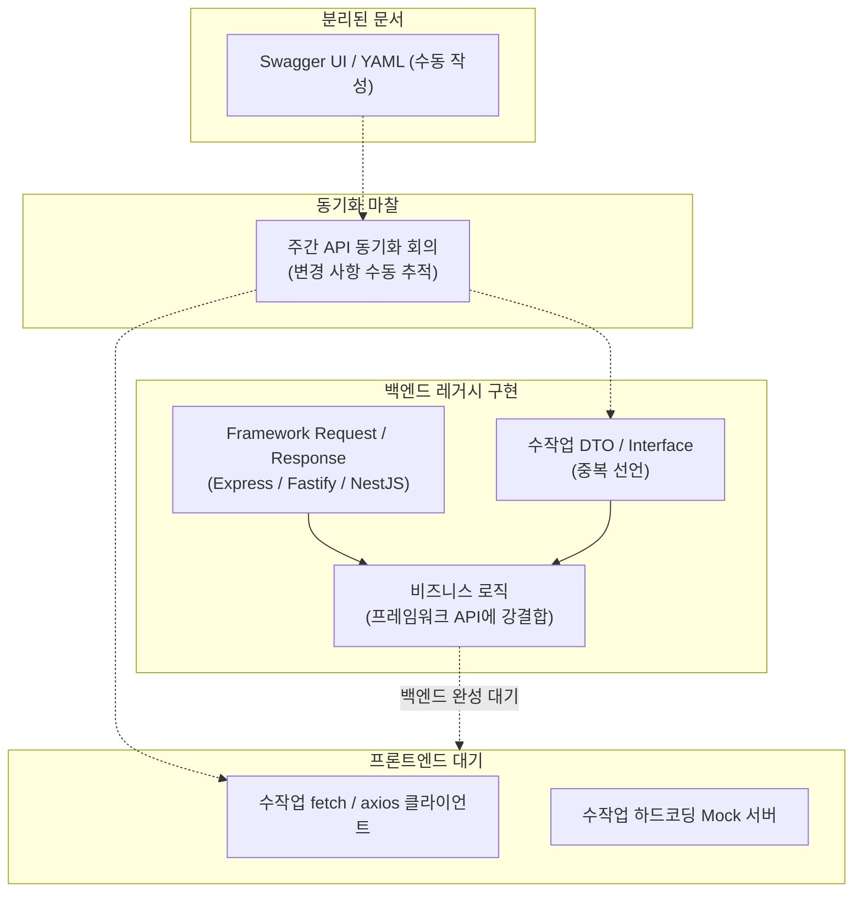
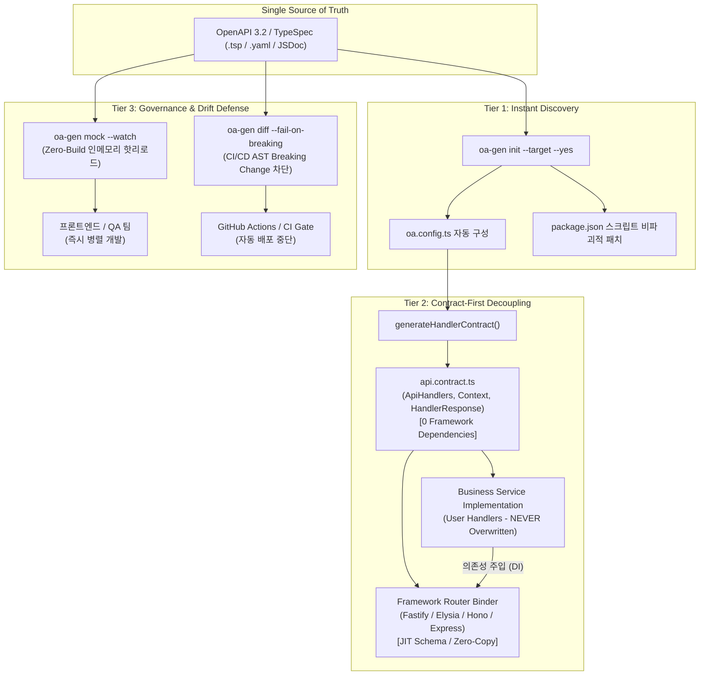

# 프로젝트 온보딩 & 점진적 도입 플레이북 (Onboarding & Adoption Playbook)

이 가이드는 신규(Greenfield) 및 기존(Brownfield) 백엔드/풀스택 프로젝트에서 **`oa-sdk` 생태계를 30초 만에 점진적으로 도입**하여 팀 내 무가치 관리 포인트(Zero-Value Management Points)를 완전히 제거하고, 단일 진실 공급원(SSOT) 기반의 무결점 API 거버넌스를 확립하기 위한 실무 표준 플레이북입니다.

기존 코드베이스를 전면 재작성할 필요 없이, **3계층 가치 도입 사다리(3-Tier Value Adoption Ladder)**를 따라 단계별로 즉시 측정 가능한 ROI를 회수할 수 있습니다.

---

## 1. 5대 무가치 관리 포인트(Zero-Value Management Points)의 완전한 제거

전통적인 API 개발 및 코드 생성 도구(Swagger Codegen, OpenAPI Generator 등)는 여러 계층의 마찰과 수동 동기화 비용을 초래합니다. `oa-sdk`는 다음 5대 무가치 관리 포인트를 코드 레벨에서 근본적으로 제거합니다.

| # | 무가치 관리 포인트 | 기존 레거시 방식의 고통 | `oa-sdk` 도입 후 제거 효과 | 정량적 ROI 지표 |
|---|---|---|---|---|
| **1** | **동기화 오버헤드<br>(Sync Overhead)** | 기획/백엔드/프론트엔드 간 API 변경 사항을 수동 문서화하고 정기 동기화 회의 진행. 문서와 코드 간 불일치 빈발. | TypeSpec / OpenAPI 3.2 단일 진실 공급원(SSOT)에서 타입, 클라이언트, 라우터 스텁이 자동 파생되어 수동 동기화가 불필요함. | 주당 **4~6시간**의 API 동기화 회의 완전 소멸 |
| **2** | **덮어쓰기 딜레마<br>(Overwrite Dilemma)** | 스키마 수정 후 코드 재생성 시 개발자가 손수 작성한 비즈니스 핸들러 로직이 덮어쓰여 충돌 발생 및 재생성 공포(Regeneration Anxiety) 유발. | `@oa-sdk/router`의 **핸들러 계약 분리(`*.contract.ts`)**: 순수 TypeScript 인터페이스만 재생성되며, 비즈니스 구현체는 독립 파일에 완전히 격리 보존됨. | 스키마 재생성 시 코드 충돌 및 덮어쓰기 사고 **0건 (100% 안전)** |
| **3** | **목업 병목 현상<br>(Mock Bottlenecks)** | 백엔드 API 구현이 완료될 때까지 프론트엔드/QA 팀이 대기하거나, 일회성 가짜 서버/하드코딩 JSON을 수동 작성. | **제로-빌드 실시간 핫리로드 Mock 서버 (`oa-gen mock --watch`)**: 스키마 수정 즉시 소켓 단절 없이 인메모리 라우트가 원자적으로 갱신됨. | 프론트엔드 개발 착수 지연 시간 **수일 $\rightarrow$ 0초** |
| **4** | **프레임워크 락인<br>(Framework Lock-In)** | 특정 웹 프레임워크(Express, Fastify, NestJS 등)의 전용 Request/Response 객체에 비즈니스 로직이 강결합되어 프레임워크 마이그레이션 불가능. | 순수 데이터 컨텍스트(`{ params, query, body }`) 기반 핸들러 계약. `@oa-sdk/router`는 런타임 프레임워크 의존성이 0개이며, 바인더 파일 교체만으로 타겟 전환 가능. | 프레임워크 전환 비용 **수주 $\rightarrow$ 바인더 교체(수분)** |
| **5** | **무음 파괴적 드리프트<br>(Silent Breaking Drift)** | 배포 전 필드 삭제, 타입 변경, 필수값 추가 등 파괴적 변경(Breaking Changes)을 인지하지 못해 운영 환경에서 런타임 에러 발생. | CI/CD 파이프라인에서 **`oa-gen diff --fail-on-breaking`** 실행으로 Git ref 간 AST 시맨틱 파괴적 변경을 100% 사전에 자동 차단. | 배포 후 API 불일치로 인한 운영 핫픽스 **0건 (Zero Drift)** |

---

## 2. Before / After 아키텍처 비교

### 기존 레거시 아키텍처 (Before: High Friction & Coupling)

수동 작성된 DTO, 수작업 클라이언트 코드, 런타임 프레임워크 객체에 직접 결합된 비즈니스 로직, 덮어쓰기 위험이 있는 모놀리식 스텁:



### `oa-sdk` 3계층 아키텍처 (After: Contract-First Decoupled)

단일 진실 공급원(SSOT)에서 생성되는 순수 핸들러 계약, 프레임워크 바인더와 비즈니스 로직의 완전한 격리, 실시간 무중단 Mocking 및 CI 파괴적 드리프트 방어:



---

## 3. 3계층 점진적 가치 도입 사다리 (3-Tier Value Adoption Ladder)

`oa-sdk`는 코드베이스의 성숙도와 마이그레이션 일정에 맞춰 3단계로 점진 적용할 수 있도록 설계되었습니다.

```
┌─────────────────────────────────────────────────────────────┐
│  Tier 3: Automated Governance & Drift Defense               │
│  - CI/CD AST 시맨틱 diff 게이트 (oa-gen diff --fail-on-breaking) │
│  - 실시간 무중단 인메모리 핫리로드 Mock 서버 (oa-gen mock --watch) │
├─────────────────────────────────────────────────────────────┤
│  Tier 2: Contract-First Decoupling                          │
│  - 핸들러 계약 분리 (api.contract.ts vs 라우터 바인더)             │
│  - 프레임워크 런타임 제로 락인 (순수 Context 데이터 객체)        │
│  - 스키마 갱신 시 비즈니스 로직 덮어쓰기 공포 완전 박멸           │
├─────────────────────────────────────────────────────────────┤
│  Tier 1: Instant Discovery & Zero-Friction Scan             │
│  - 30초 마찰 제로 온보딩 (oa-gen init)                      │
│  - 프레임워크 & 스키마 자동 감지, 비파괴적 package.json 패치    │
│  - 기존 비즈니스 코드 수정 0줄                               │
└─────────────────────────────────────────────────────────────┘
```

### Tier 1: 즉각적 발견 및 마찰 제로 스캔 (Instant Discovery & Zero-Friction Scan)
- **소요 시간**: 30초
- **코드 수정**: 0줄
- **동작 원리**: `oa-gen init` 명령어가 프로젝트 루트를 스캔하여 Fastify, Bun Elysia, Hono, Express, NestJS 등 프레임워크를 판별하고, `.tsp`, `openapi.yaml`, `openapi.json`, `@oaOperation` JSDoc 등의 스키마를 자동 탐색합니다.
- **결과물**: 최적화된 `oa.config.ts` 생성 및 `package.json` 스크립트/의존성 비파괴적 병합 (들여쓰기, 개행 문자 100% 보존).

### Tier 2: 계약 우선 분리 (Contract-First Decoupling)
- **소요 시간**: 1~2시간 (신규 엔드포인트부터 점진 적용 가능)
- **코드 수정**: 라우팅 진입점 연결
- **동작 원리**: `@oa-sdk/router`의 `generateHandlerContract`를 통해 생성된 `*.contract.ts`를 구현합니다. 비즈니스 로직은 `ApiHandlers` 인터페이스를 구현하는 순수 함수로 작성되며, 프레임워크의 HTTP 세부 사항(Fastify JIT 직렬화, Bun zero-copy destructuring 등)은 자동 생성된 라우터 바인더가 전담합니다.
- **결과물**: 스키마 재생성 시에도 비즈니스 로직 코드가 손상되지 않는 영구적인 분리 구조 확립.

### Tier 3: 자동화된 거버넌스 및 드리프트 방어 (Automated Governance & Drift Defense)
- **소요 시간**: 15분 (CI 스크립트 설정)
- **코드 수정**: `.github/workflows/ci.yml` 등록
- **동작 원리**: PR 생성 시 `oa-gen diff --base origin/main --fail-on-breaking`을 실행하여 필드 삭제, 라우트 변경, 필수값 추가 등 클라이언트를 파괴하는 변경 사항을 원천 차단합니다. 로컬에서는 `oa-gen mock --watch`로 프론트엔드와 백엔드가 완벽하게 병렬 작업합니다.
- **결과물**: 프로덕션 런타임 API 드리프트 0건 달성.

### 3.4 Day 1 수명주기 아키타입 결정 매트릭스 (Day 1 Lifecycle Archetype Decision Matrix)

`oa-sdk`는 모든 프로젝트에 일률적인 구성을 강요하지 않고, 서비스의 성숙도와 요구 조건에 맞춤화된 3대 **제품 수명주기 아키타입(Product Lifecycle Archetypes)**을 제공합니다. `oa-gen init --archetype <mvp|microservice|enterprise>` 플래그로 초기화할 수 있습니다:

| 비교 차원 / 기능 | MVP 아키타입 (`mvp`) | 마이크로서비스 아키타입 (`microservice`) | 엔터프라이즈 아키타입 (`enterprise`) |
|---|---|---|---|
| **도입 목적 및 대상** | 빠른 가설 검증, POC, 초기 스타트업 프로토타입 (Day 1) | 대규모 트래픽 처리, 고성능 내부/외부 프로덕션 서비스 (Day 60+) | 다수 팀 협업, 규제 준수, 금융/SaaS 엔터프라이즈 플랫폼 (Day 180+) |
| **처리량 & 직렬화 가속** | 표준 JSON 파싱/직렬화 (최소 오버헤드) | Fastify JIT 인라인 스키마 (`fast-json-stringify`) 또는 Bun Elysia Zero-Copy 컨텍스트 비구조화 | 다중 타겟 번들 투영, 서브밀리초 직렬화, 컴파일 타임 사전 인덱싱 |
| **와이어 타입 안전성 (Wire Typing)** | 완화된 기본 타입 생성 | 엄격한 와이어 안전성 (`wireFormatSafety: true`, `JsonPrimitive<T>`) | 와이어 안전성 + 순환 참조 `z.lazy()` 해결 + 스키마 봉인 (`unevaluatedProperties: false`) |
| **계약 단위 테스트 (Contract Testing)** | 수동 검증 또는 프론트엔드 실시간 Mock 연동 | 자동화된 핸들러 계약 단위 테스트 (`vitest` / Bun 네이티브 `bun test`) | Mock Mesh 서비스 시뮬레이션 + E2E 컨트랙트 통합 테스트 스위트 |
| **CI/CD 파괴적 변경 게이트** | 권고/경고 수준 diff (Non-blocking) | PR 병합 차단 게이트 (`oa-gen diff --fail-on-breaking`) | 무관용 차단 (`--fail-on-breaking`) + TypeSpec 시맨틱 Diff + 페르소나 커버리지 감사 |
| **컨텍스트 주입 (Context Injection)** | 정적 컨테이너 또는 컨텍스트 생략 | 요청별 테넌시(`tenantId`) 및 분산 트레이싱(`traceId`) 주입 | 엔터프라이즈 IAM 세션 (`user`, `roles`, `permissions`, `auditSpan`) 완비 |
| **페르소나 거버넌스 (Personas)** | 미사용 (`personas: undefined`) | 민감 엔드포인트 선택적 역량 태깅 | 전사 `@personaCapability` 검증, `@pseudonymize` 비식별화 마스킹 |
| **CLI 초기화 명령어** | `oa-gen init -t <target> -a mvp` | `oa-gen init -t <target> -a microservice` | `oa-gen init -t <target> -a enterprise` |

---

## 4. 프레임워크별 퀵 레시피 (Copy-Pasteable Recipes)

### 4.1 Fastify 레시피 (`FastifyPluginAsync` + `fast-json-stringify` JIT)

Fastify는 고성능 직렬화를 위해 인라인 스키마를 요구합니다. `oa-sdk` Fastify 타겟은 OpenAPI 스펙을 파싱하여 Fastify 라우트 옵션의 `schema: { params, querystring, body, response }`에 JSON Schema를 인라인으로 주입하여 **2~3배의 응답 직렬화 성능 향상**을 이끌어냅니다.

#### 1단계: 온보딩 초기화
```bash
npx oa-gen init --target fastify --yes
```

#### 2단계: 생성되는 순수 핸들러 계약 (`src/generated/api.contract.ts`)
```typescript
// 자동 생성 파일 — 직접 편집하지 마십시오. (재생성 시 덮어써짐)
export type HandlerResponse<TBody = unknown, THeaders = Record<string, string>> =
  | TBody
  | { status?: number; body: TBody; headers?: THeaders };

export interface GetUserByIdContext<TContext = unknown> {
  params: { id: string };
  headers: Record<string, string | undefined>;
  context?: TContext;
}

export interface CreateUserContext<TContext = unknown> {
  body: { name: string; email: string };
  headers: Record<string, string | undefined>;
  context?: TContext;
}

export type GetUserByIdHandler<TContext = unknown> = (
  ctx: GetUserByIdContext<TContext>,
) => Promise<HandlerResponse<{ id: string; name: string }>>;
export type CreateUserHandler<TContext = unknown> = (
  ctx: CreateUserContext<TContext>,
) => Promise<HandlerResponse<{ id: string; name: string; email: string }>>;

export interface ApiHandlers<TContext = unknown> {
  getUserById: GetUserByIdHandler<TContext>;
  createUser: CreateUserHandler<TContext>;
}
```

#### 3단계: 비즈니스 핸들러 구현체 (`src/services/user.service.ts`)
```typescript
// 사용자 작성 파일 — 스키마가 변경되어도 절대 덮어써지지 않습니다!
import type { ApiHandlers } from '../generated/api.contract.js';

export interface AppContext {
  tenantId?: string;
  user?: { id: string; role: string };
}

export const userHandlers: ApiHandlers<AppContext> = {
  getUserById: async ({ params, context }) => {
    return {
      status: 200,
      body: { id: params.id, name: `Alice (Tenant: ${context?.tenantId ?? 'default'})` },
    };
  },
  createUser: async ({ body }) => {
    return {
      status: 201,
      body: { id: 'usr_' + Date.now(), name: body.name, email: body.email },
    };
  },
};
```

#### 4단계: Fastify 서버 연결 (`src/server.ts`)
```typescript
import Fastify from 'fastify';
import { apiRouter } from './generated/api.router.js';
import { userHandlers } from './services/user.service.js';

const server = Fastify({ logger: true });

// 자동 생성된 FastifyPluginAsync 플러그인 등록 및 getContext를 통한 커스텀 컨텍스트 주입
await server.register(apiRouter, {
  prefix: '/api/v1',
  handlers: userHandlers,
  getContext: async (request) => ({
    tenantId: request.headers['x-tenant-id'] as string,
    user: (request as any).user,
  }),
});

await server.listen({ port: 3000, host: '0.0.0.0' });
```

---

### 4.2 Bun Elysia 레시피 (Fluent Chaining + Zero-Copy Destructuring)

Bun 런타임의 C++ 초고속 HTTP 파서와 Elysia 프레임워크를 사용할 때, 불필요한 객체 할당을 방지하고 `noUnusedLocals` 경고를 방지하기 위해 사용되는 필드(`{ params, query, body, set }`)만 선택적으로 비구조화 할당합니다.

#### 1단계: 온보딩 초기화 (엄격한 Bun 런타임 격리 — Node 도구 일체 배제)
```bash
bun x oa-gen init --target elysia --yes
```

#### 2단계: 생성되는 Elysia 라우터 바인더 (`src/generated/api.router.ts`)
```typescript
// 자동 생성 파일 — Elysia Fluent Chaining 및 Bun Zero-Copy 최적화
import { Elysia } from 'elysia';
import type { ApiHandlers } from './api.contract.js';

export interface ElysiaRouterOptions<TContext = unknown> {
  getContext?: (ctx: any) => Promise<TContext> | TContext;
  context?: TContext;
}

export function createRouter<TContext = unknown>(
  handlers: ApiHandlers<TContext>,
  options?: ElysiaRouterOptions<TContext>,
) {
  return new Elysia({ prefix: '/api/v1' })
    .get('/users/:id', async ({ params, headers, request, set }) => {
      const context = options?.getContext ? await options.getContext({ params, headers, request, set }) : options?.context;
      const result = await handlers.getUserById({
        params: params as any,
        headers: {},
        ...(context !== undefined ? { context } : {}),
      });
      if (result && typeof result === 'object' && ('status' in result || 'body' in result)) {
        if (result.status) set.status = result.status;
        return result.body;
      }
      return result;
    })
    .post('/users', async ({ body, headers, request, set }) => {
      const context = options?.getContext ? await options.getContext({ body, headers, request, set }) : options?.context;
      const result = await handlers.createUser({
        body: body as any,
        headers: {},
        ...(context !== undefined ? { context } : {}),
      });
      if (result && typeof result === 'object' && ('status' in result || 'body' in result)) {
        if (result.status) set.status = result.status;
        return result.body;
      }
      return result;
    });
}
```

#### 3단계: Bun 서버 진입점 (`src/index.ts`)
```typescript
import { Elysia } from 'elysia';
import { createRouter } from './generated/api.router.js';
import { userHandlers } from './services/user.service.js';

const app = new Elysia()
  .use(createRouter(userHandlers, {
    getContext: async ({ request }) => ({
      tenantId: request.headers.get('x-tenant-id') ?? 'default',
    }),
  }))
  .listen(3000);

console.log(`🦊 Elysia server listening on http://localhost:${app.server?.port}`);
```

---

### 4.3 Express 레시피 (`router.all()` + 메서드 가드)

기존의 방대한 레거시 Express 애플리케이션에서도 OAS 3.2 비표준 메서드(`QUERY`, `HEAD`, `TRACE`)를 안전하게 처리할 수 있도록 인라인 메서드 가드가 포함된 Express 라우터를 바인딩합니다.

#### 1단계: 온보딩 초기화
```bash
npx oa-gen init --target express --yes
```

#### 2단계: Express 라우터 바인딩 및 컨텍스트 주입 (`src/app.ts`)
```typescript
import express from 'express';
import { createRouter } from './generated/api.router.js';
import { userHandlers } from './services/user.service.js';

const app = express();
app.use(express.json());

// 계약 기반 라우터 장착 및 getContext를 통한 미들웨어 컨텍스트 전달
const router = createRouter(userHandlers, {
  getContext: (req) => ({
    tenantId: req.headers['x-tenant-id'] as string,
    user: (req as any).user,
  }),
});
app.use('/api/v1', router);

app.listen(3000, () => {
  console.log('🚀 Express server listening on port 3000');
});
```

---

### 4.4 NestJS 레시피 (`apps/nestjs-ref` 아티팩트 브릿징)

NestJS는 IoC 컨테이너와 데코레이터 기반 아키텍처를 채택하고 있으므로, 프레임워크 컨트롤러를 무리하게 바꾸지 않고도 **Swagger 문서 추출 파이프라인과 거버넌스 브릿지**를 구축할 수 있습니다.

참조 레퍼런스 앱 경로: [`apps/nestjs-ref`](../../apps/nestjs-ref/openapi-governance.config.json)

#### 1단계: 온보딩 초기화
```bash
npx oa-gen init --target nestjs --yes
```
`NestJSTargetProfile`은 `@nestjs/core` 또는 `nest-cli.json`을 감지하여 `oa.config.ts` 타겟을 `generic`으로 안전하게 설정하고, 기존 `nest start --watch`를 유지합니다.

#### 2단계: 무중단 OpenAPI 추출 스크립트 작성 (`scripts/export-openapi.ts`)
HTTP 리스너를 열지 않고 NestJS 앱 인스턴스 메타데이터만 부트스트랩하여 OpenAPI 스펙을 디스크로 추출합니다:
```typescript
import 'reflect-metadata';
import { NestFactory } from '@nestjs/core';
import { SwaggerModule, DocumentBuilder } from '@nestjs/swagger';
import { writeFileSync, mkdirSync } from 'node:fs';
import { dump as yamlDump } from 'js-yaml';
import { AppModule } from '../src/app.module.js';

async function exportOpenApi() {
  const app = await NestFactory.create(AppModule, { logger: false });
  const config = new DocumentBuilder()
    .setTitle('NestJS Production API')
    .setVersion('1.0.0')
    .build();

  const document = SwaggerModule.createDocument(app, config);
  await app.close();

  mkdirSync('contracts', { recursive: true });
  writeFileSync('contracts/openapi.raw.yaml', yamlDump(document, { noRefs: true }));
  console.log('✅ Exported: contracts/openapi.raw.yaml');
}

exportOpenApi();
```

#### 3단계: 계약 거버넌스 및 클라이언트/타입 자동 동기화
`contracts/openapi.raw.yaml`로부터 타입 및 계약을 자동 생성하여 프론트엔드 및 마이크로서비스 간 SSOT 동기화를 완성합니다:
```bash
npx oa-gen validate --spec contracts/openapi.upgraded.yaml --require-32
# 또는 원본 OAS 3.0 명세 검증:
npx oa-gen validate --spec contracts/openapi.raw.yaml
```

---

### 4.5 Feature-Sliced Design (FSD) 산출물 커스텀 라우팅 레시피

대규모 프론트엔드 프로젝트나 Feature-Sliced Design (FSD) 아키텍처를 채택한 코드베이스에서는 모든 생성 산출물을 단일 폴더(`src/api/generated/`)에 모아두는 기존 방식이 슬라이스 격리 원칙을 위배합니다.

`oa-sdk`의 **산출물 경로 라우팅 커스터마이징 엔진 (`OutputRoutingConfig`)**은 OpenAPI 스펙의 태그(`{tag}`)와 산출물 종류(`{kind}`) 토큰을 동적으로 해석하여 피처별 슬라이스 디렉터리로 정확히 분산 배치합니다.

#### 1단계: `oa.config.ts` 라우팅 규칙 정의

```typescript
import { defineConfig } from '@oa-sdk/codegen';

export default defineConfig({
  rootDir: '.',
  // outputRouting은 최상위 또는 product.outputRouting에 선언 가능
  outputRouting: {
    // 템플릿 패턴: 태그명 기반의 Feature 슬라이스 경로 (kebab-case 자동 정규화)
    pattern: 'src/features/{tag}/api/{tag}.{kind}.ts',

    // 규칙 매처: 공통 인프라 및 전역 모델은 shared 슬라이스로 우회
    rules: [
      {
        tag: ['common', 'shared', 'auth', 'system'],
        target: 'src/shared/api/{tag}.{kind}.ts',
      },
      {
        kind: 'schemas',
        target: 'src/shared/api/schemas.ts',
      },
    ],

    // 종류별 명시적 경로 매핑 (byKind)
    byKind: {
      client: 'src/shared/api/client.ts',
    },
  },
});
```

#### 2단계: 자동 분산 산출물 파일 구조

위 설정으로 코드 생성을 수행하면 다음과 같은 FSD 표준 디렉터리 구조가 자동으로 구성됩니다:

```text
src/
├── features/
│   ├── users/
│   │   └── api/
│   │       ├── users.contract.ts   # Handler Contract (Tier 2)
│   │       ├── users.keys.ts       # Query Key Factory (Tier 1)
│   │       └── users.queries.ts    # Pure Options & Hooks (Tier 2/3)
│   └── posts/
│       └── api/
│           ├── posts.contract.ts
│           ├── posts.keys.ts
│           └── posts.queries.ts
└── shared/
    └── api/
        ├── client.ts               # 공통 Typed Fetch SDK
        ├── schemas.ts              # Zod / TypeGuard 스키마
        └── auth.queries.ts         # 공통 인증 쿼리
```

#### 3단계: 동적 상대 경로(Relative Import) 자동 재계산

산출물이 서로 다른 디렉터리로 분산될 때, `users.queries.ts`가 `shared/api/client.ts`나 `users.keys.ts`를 import하는 상대 경로(`path.relative`)가 자동으로 재계산되어 빌드 타임 컴파일 오류가 전혀 발생하지 않습니다:

```typescript
// src/features/users/api/users.queries.ts 내부 (자동 생성)
import type { ApiClient } from '../../../shared/api/client.js';
import { usersKeys } from './users.keys.js';
```

#### 4단계: `.oa-manifest.json` 기반 3-Gate 안전 고아 파일 정리 (Safe Orphan Pruning)

OpenAPI 스펙에서 특정 태그나 엔드포인트가 삭제되거나 이름이 변경되면, `.oa-manifest.json` 추적 매니페스트가 작동하여 더 이상 사용되지 않는 고아(Orphan) 생성 파일만 안전하게 제거합니다:
- **Gate 1 (출처 검증, Provenance)**: 매니페스트에 등록되지 않은 개발자 수작업 파일은 절대 삭제 목록에 포함되지 않습니다.
- **Gate 2 (해시 무결성, Hash Integrity)**: 생성 후 개발자가 코드를 일부 수정한 경우(SHA-256 불일치), 파일 보호를 위해 정리를 즉시 중단합니다.
- **Gate 3 (배너 가드, Banner Guard)**: 자동 생성 배너 주석(`@generated`)이 누락된 파일은 삭제가 차단됩니다.

---

### 4.6 모노레포 풀스택 분산 라우팅 레시피 (Monorepo Multi-Package Distribution)

pnpm 워크스페이스 또는 Turborepo 기반의 풀스택 모노레포에서는 백엔드와 프론트엔드가 별도의 패키지로 격리되어 있습니다. `oa-sdk`를 사용하면 **단 하나의 OpenAPI 3.2 스펙**으로부터 패키지 경계를 가로질러 산출물을 다중 투영할 수 있습니다.

#### 1단계: 모노레포 아키텍처 및 목표 산출물 배치

- `packages/contracts/src/`: 순수 핸들러 계약 (`*.contract.ts`) 및 타입 가드
- `packages/server/src/api/`: Fastify / Elysia 라우터 바인더 (`*.router.ts`)
- `packages/client-sdk/src/`: 플랫폼 중립 Typed Fetch SDK (`*.client.ts`)
- `apps/web/src/api/`: TanStack Query v5 옵션 및 리액트 훅 (`*.queries.ts`, `*.keys.ts`)

#### 2단계: `oa.config.ts` 모노레포 분산 라우팅 구성

```typescript
import { defineConfig } from '@oa-sdk/codegen';

export default defineConfig({
  rootDir: '.',
  outputRouting: {
    byKind: {
      contract: 'packages/contracts/src/api.contract.ts',
      guards: 'packages/contracts/src/guards.ts',
      schemas: 'packages/contracts/src/schemas.ts',
      client: 'packages/client-sdk/src/index.ts',
      queries: 'apps/web/src/api/queries.ts',
      keys: 'apps/web/src/api/keys.ts',
    },
    rules: [
      {
        kind: 'queries',
        target: 'apps/web/src/api/{tag}.queries.ts',
      },
      {
        kind: 'keys',
        target: 'apps/web/src/api/{tag}.keys.ts',
      },
    ],
  },
});
```

#### 3단계: 모노레포 패키지 간 import 경로 바인딩

TypeScript `tsconfig.json`의 path alias(`@repo/contracts`, `@repo/client-sdk`)와 연동되어 프론트엔드와 백엔드가 동일한 와이어 인터페이스를 완벽한 컴파일 타임 타입 검사로 공유합니다.

---

### 4.7 TanStack Query (React Query) v5 3계층 아키텍처 도입 가이드

전통적인 클라이언트 코드 생성 도구는 UI 프레임워크에 강결합된 1:1 리액트 훅(`useGetUserQuery()`)을 무분별하게 쏟아내어 Next.js App Router 서버 컴포넌트나 캐시 무효화 제어에서 심각한 한계를 노출합니다.

`oa-sdk`의 **TanStack Query v5 3계층 생성기**는 쿼리 키 팩토리, 순수 옵션 팩토리, 그리고 선택적 컴포지션 훅을 철저히 분리하여 최고의 유연성을 제공합니다.

#### 3계층 아키텍처 구성

```
┌─────────────────────────────────────────────────────────────────────────┐
│ Tier 3: Client Composition Hook Helpers (선택적 씬 래퍼)               │
│ - useUserByIdQuery, useUpdateUserMutation, createApiHooks()             │
│ - 오픈 제네릭 (TData, TError), 옵션 오버라이드 (select, enabled) 지원     │
├─────────────────────────────────────────────────────────────────────────┤
│ Tier 2: Pure Query & Mutation Options Factory (순수 함수형 옵션)         │
│ - getUserByIdQueryOptions(client, params), updateUserMutationOptions()  │
│ - UI 프레임워크 락인 0: React, Vue, Svelte, Next.js Server Components 호환│
│ - 엄격한 와이어 타입 보장: JsonPrimitive<TResponse>, Resolved<TBody>     │
├─────────────────────────────────────────────────────────────────────────┤
│ Tier 1: Hierarchical Query Key Factory (계층형 쿼리 키 팩토리)          │
│ - userKeys.all, userKeys.lists(), userKeys.detail(id), userKeys.subresource │
│ - 순수 TypeScript 튜플 (as const), 런타임 의존성 0개                       │
│ - 직관적이고 타입 안전한 단일/부분/전체 캐시 무효화                       │
└─────────────────────────────────────────────────────────────────────────┘
```

#### Tier 1: 계층형 쿼리 키 팩토리 (`userKeys`)

```typescript
// 순수 TypeScript 튜플로 방출 — 외부 의존성 0개
export const usersKeys = {
  all: ['users'] as const,
  lists: () => [...usersKeys.all, 'list'] as const,
  list: (filters?: Record<string, unknown>) => [...usersKeys.lists(), filters] as const,
  details: () => [...usersKeys.all, 'detail'] as const,
  detail: (id: string | number) => [...usersKeys.details(), id] as const,
  subresource: (id: string | number, sub: string, query?: Record<string, unknown>) =>
    [...usersKeys.detail(id), sub, query] as const,
  mutation: (operationId: string) => [...usersKeys.all, 'mutation', operationId] as const,
};

// 단수형 별칭 지원
export const userKeys = usersKeys;
```

타입 안전 캐시 무효화 패턴:
```typescript
import { useQueryClient } from '@tanstack/react-query';
import { userKeys } from './users.keys.js';

const queryClient = useQueryClient();

// 1. 유저 관련 모든 캐시(목록, 상세, 하위리소스) 일괄 무효화:
queryClient.invalidateQueries({ queryKey: userKeys.all });

// 2. 유저 목록 캐시만 정밀 타겟 무효화 (상세 캐시는 보존):
queryClient.invalidateQueries({ queryKey: userKeys.lists() });

// 3. 특정 유저 및 그 하위 리소스만 정밀 무효화:
queryClient.invalidateQueries({ queryKey: userKeys.detail('usr_123') });
```

#### Tier 2: 순수 옵션 팩토리 (`queryOptions` & `mutationOptions`)

순수 옵션 객체(`queryKey`, `queryFn`, `mutationKey`, `mutationFn`)만을 방출하므로 UI 프레임워크 종속성이 없습니다. `@oa-sdk/client`의 `JsonPrimitive<T>`와 결합하여 날짜(`Date` $\rightarrow$ `string`) 및 함수가 제거된 순수 JSON 와이어 타입을 엄격히 보장합니다.

```typescript
import { queryOptions, mutationOptions } from '@tanstack/react-query';
import type { JsonPrimitive, Resolved } from '@oa-sdk/client';
import type { ApiClient } from './client.js';
import type { GetUserByIdResponse, UpdateUserBody, UpdateUserResponse } from './types.js';
import { userKeys } from './users.keys.js';

export function getUserByIdQueryOptions(client: ApiClient, params: { id: string }) {
  return queryOptions({
    queryKey: userKeys.detail(params.id),
    queryFn: async ({ signal }): Promise<JsonPrimitive<GetUserByIdResponse>> => {
      return client.getUserById({ path: { id: params.id }, signal });
    },
  });
}

export function updateUserMutationOptions(client: ApiClient) {
  return mutationOptions({
    mutationKey: userKeys.mutation('updateUser'),
    mutationFn: async (variables: {
      id: string;
      body: Resolved<UpdateUserBody>;
    }): Promise<JsonPrimitive<UpdateUserResponse>> => {
      return client.updateUser({ path: { id: variables.id }, body: variables.body });
    },
  });
}
```

#### Tier 3: 컴포지션 훅 헬퍼 (`use*Query`, `use*Mutation`)

리액트 환경에서 가장 적은 보일러플레이트로 사용할 수 있도록 오픈 제네릭(`select`를 통한 데이터 슬라이싱)을 지원하는 얇은 래퍼를 제공합니다:

```typescript
'use client';
import { useQuery, useMutation, type UseQueryOptions } from '@tanstack/react-query';
import { getUserByIdQueryOptions, updateUserMutationOptions } from './users.queries.js';

export function useUserByIdQuery<TData = JsonPrimitive<GetUserByIdResponse>>(
  client: ApiClient,
  params: { id: string },
  options?: Omit<UseQueryOptions<JsonPrimitive<GetUserByIdResponse>, Error, TData>, 'queryKey' | 'queryFn'>,
) {
  return useQuery({
    ...getUserByIdQueryOptions(client, params),
    ...options,
  });
}
```

---

### 4.8 Next.js App Router SSR / Server Component 프리페칭 & 하이드레이션 레시피

Tier 2 순수 옵션 팩토리는 Next.js 15 App Router 환경에서 진가를 발휘합니다. 리액트 훅을 실행할 수 없는 서버 컴포넌트에서 `prefetchQuery`를 수행하고, 클라이언트 컴포넌트로 상태를 즉각 하이드레이션하여 **네트워크 워터폴 0, 로딩 스피너 없는 즉각 렌더링**을 구현합니다.

#### 1단계: 서버 컴포넌트에서 프리페칭 (`app/users/[id]/page.tsx`)

```tsx
import { QueryClient, dehydrate, HydrationBoundary } from '@tanstack/react-query';
import { createServerClient } from '@/shared/api/server-client';
import { getUserByIdQueryOptions } from '@/features/users/api/users.queries';
import { UserDetailView } from './user-detail-view';

interface PageProps {
  params: Promise<{ id: string }>;
}

export default async function UserPage({ params }: PageProps) {
  const { id } = await params;
  const queryClient = new QueryClient();
  const client = createServerClient();

  // Tier 2 순수 옵션을 서버 컴포넌트에서 직접 프리페칭:
  await queryClient.prefetchQuery(getUserByIdQueryOptions(client, { id }));

  return (
    // dehydrate()를 통해 서버 쿼리 캐시 상태를 클라이언트 경계로 주입
    <HydrationBoundary state={dehydrate(queryClient)}>
      <UserDetailView userId={id} />
    </HydrationBoundary>
  );
}
```

#### 2단계: 클라이언트 컴포넌트에서 데이터 소비 (`app/users/[id]/user-detail-view.tsx`)

```tsx
'use client';

import { useQuery } from '@tanstack/react-query';
import { useBrowserClient } from '@/shared/api/browser-client';
import { getUserByIdQueryOptions } from '@/features/users/api/users.queries';

export function UserDetailView({ userId }: { userId: string }) {
  const client = useBrowserClient();

  // 서버에서 이미 프리페칭되어 하이드레이션되었으므로 로딩 없이 즉시 렌더링:
  const { data: user } = useQuery(getUserByIdQueryOptions(client, { id: userId }));

  return (
    <div className="user-profile">
      <h1>{user?.name}</h1>
      <p>이메일: {user?.email}</p>
      <span className="badge">서버 프리페칭 완료 (0 Network Waterfall)</span>
    </div>
  );
}
```

---

## 5. Greenfield vs Brownfield 단계별 적용 전략

### Greenfield (신규 프로젝트)
1. **스펙 우선(Spec-First) 시작**:
   - `packages/schemas/typespec/main.tsp` 또는 루트 `openapi.yaml` 작성.
2. **초기화 실행**:
   ```bash
   npx oa-gen init --yes
   ```
3. **병렬 개발 가동**:
   - 프론트엔드: `npx oa-gen mock --spec ./openapi.yaml --watch --port 4010` 구동 후 即시 UI 구현.
   - 백엔드: 생성된 `api.contract.ts` 인터페이스를 주입받아 도메인 비즈니스 로직 작성.

### Brownfield (기존 운영 프로젝트)
1. **무중단 스캔**:
   기존 파일 변경 없이 감지 결과만 미리보기:
   ```bash
   npx oa-gen init --dry-run
   ```
2. **점진적 스크립트 병합**:
   `--yes` 플래그로 기존 `package.json`의 포맷팅(들여쓰기, 줄바꿈)을 100% 보존하면서 개발 스크립트만 추가:
   ```bash
   npx oa-gen init --yes
   ```
3. **카나리 엔드포인트부터 계약 분리 적용**:
   기존 컨트롤러 전체를 한 번에 전환할 필요 없이, 신규 추가되는 1~2개 API 경로에만 생성된 `apiRouter`를 마운트하여 안정성을 입증한 후 점진적 확대.

### 5.3 단계별 무중단 진화 런북 (Zero-Breakage Evolution Runbooks)

#### 런북 1: 신규 프로젝트 무중단 수명주기 진화 (Day 1 MVP $\rightarrow$ Day 60 Microservice $\rightarrow$ Day 180 Enterprise)

`oa-sdk`의 가장 강력한 아키텍처적 가치는 **비즈니스 서비스 로직과 핸들러 계약이 프로젝트의 생애주기 전반에 걸쳐 100% 불변(Invariant)**으로 유지된다는 점입니다.

```
[Day 1: MVP]                 [Day 60: Microservice]              [Day 180: Enterprise]
- archetype: "mvp"           - archetype: "microservice"         - archetype: "enterprise"
- mock --watch 실시간 목업     - Fastify JIT / Bun Zero-Copy       - oa-gen diff --fail-on-breaking
- 즉각 Client SDK 배포        - wireFormatSafety: true            - @personaCapability & @pseudonymize
                             - getContext (테넌시/트레이싱 주입)    - 엔터프라이즈 IAM 세션 완비
        │                                  │                                  │
        ▼                                  ▼                                  ▼
 ┌──────────────────────────────────────────────────────────────────────────────────┐
 │  불변 공유 코어 (INVARIANT CORE): api.contract.ts & src/services/user.service.ts  │
 │  - 스키마 와이어 인터페이스: 0줄 수정                                              │
 │  - 비즈니스 핸들러 구현체: 0줄 수정 (100% 보존)                                   │
 └──────────────────────────────────────────────────────────────────────────────────┘
```

1. **Day 1: MVP 단계 (초기 가설 검증 & 초고속 프로토타이핑)**:
   - 초기화: `npx oa-gen init --target fastify --archetype mvp --yes`
   - 산출물: `oa.config.ts` (`archetype: 'mvp'`), 기본 `api.contract.ts`.
   - 워크플로: 프론트엔드는 `oa-gen mock --watch`로 즉시 개발에 착수하고, 백엔드는 `src/services/user.service.ts`에 순수 핸들러를 작성합니다.
2. **Day 60: Microservice 단계로의 진화 (고성능 직렬화 & 테넌시 컨텍스트 주입)**:
   - 배경: 트래픽 증가로 인해 응답 직렬화 지연 시간을 최소화하고, 다중 테넌트 격리가 필요해졌습니다.
   - 설정 승격: `oa.config.ts`의 `archetype`을 `'microservice'`로 변경합니다:
     ```typescript
     // oa.config.ts
     export default defineConfig({
       rootDir: '.',
       archetype: 'microservice',
       core: {
         client: { enabled: true, wireFormatSafety: true },
         gates: { driftCheck: true, failOnBreaking: true },
       },
       product: {
         archetype: 'microservice',
         framework: 'fastify',
         jitSchema: true,
       },
     });
     ```
   - 컨텍스트 주입: 서버 진입점(`src/server.ts`)에서 `getContext` 콜백을 등록하여 HTTP 헤더의 테넌트 ID와 요청별 트레이싱 ID를 핸들러로 전달합니다.
   - **불변 보장**: `src/services/user.service.ts`의 비즈니스 코드와 `api.contract.ts`의 와이어 파라미터는 단 한 줄도 바꿀 필요가 없습니다.
3. **Day 180: Enterprise 단계로의 진화 (CI 무음 파괴 차단 & 페르소나 거버넌스)**:
   - 배경: 다수 팀 협업과 금융/개인정보 보호 규제(GDPR, PII) 준수가 요구됩니다.
   - 설정 승격: `oa.config.ts`의 `archetype`을 `'enterprise'`로 승격합니다.
   - CI/CD 게이트 가동: GitHub Actions 워크플로에 `oa-gen diff --base origin/main --fail-on-breaking`을 등록하여 파괴적 변경 배포를 0건으로 차단합니다.
   - 페르소나 데코레이터 적용: 민감 필드에 `@pseudonymize` 및 `@personaCapability`를 부착하여 데이터 마스킹과 역할별 프로젝션을 가동합니다.
   - **불변 보장**: 공유 플랫폼 코어와 핸들러 구현체는 회귀 없이 100% 무결성을 유지합니다.

#### 런북 2: 브라운필드 서비스 컨텍스트 연동 (인증/멀티테넌시 무오염 통합)

기존 운영 중인 Express 또는 Fastify 서비스에서 이미 사용 중인 인증 미들웨어(Passport, JWT, Session)와 테넌시 헤더를 `oa-sdk` 계약 기반 핸들러에 통합하는 표준 절차입니다:

1. **레거시 문제점 (와이어 스펙 오염 딜레마)**:
   - 기존 컨트롤러 방식에서는 `req.user`나 `req.tenantId`에 접근하기 위해 Swagger 스키마에 내부 전용 query/header 파라미터를 추가하여 클라이언트 문서가 오염되거나, 반대로 자동 생성된 핸들러에서 세션 객체를 읽지 못해 프레임워크 락인이 발생하는 문제가 있었습니다.
2. **`oa-sdk` 해결책 (제네릭 `TContext` 무오염 분리)**:
   - **공개 스펙 순수성 유지**: `openapi.yaml`에는 클라이언트가 실제로 전송하는 표준 파라미터(`Authorization` 헤더 등)만 선언합니다.
   - **타입 안전한 컨텍스트 정의 (`src/types/context.ts`)**:
     ```typescript
     export interface RequestContext {
       tenantId: string;
       user: { id: string; email: string; roles: string[] };
     }
     ```
   - **핸들러 구현체에서 컨텍스트 소비**:
     ```typescript
     import type { ApiHandlers } from '../generated/api.contract.js';
     import type { RequestContext } from '../types/context.js';

     export const secureHandlers: ApiHandlers<RequestContext> = {
       getUserById: async ({ params, context }) => {
         // 타입 안전한 내부 인프라 접근:
         const tenantId = context?.tenantId;
         const currentUser = context?.user;
         return {
           status: 200,
           body: { id: params.id, name: currentUser?.email ?? 'anonymous' },
         };
       },
       createUser: async ({ body }) => {
         return {
           status: 201,
           body: { id: 'usr_' + Date.now(), name: body.name, email: body.email },
         };
       },
     };
     ```
   - **프레임워크 라우터 바인더에서 추출 어댑터 연결**:
     ```typescript
     // Fastify 환경:
     await server.register(apiRouter, {
       handlers: secureHandlers,
       getContext: async (request) => ({
         tenantId: request.headers['x-tenant-id'] as string,
         user: (request as any).user, // 인증 미들웨어가 주입한 유저 정보
       }),
     });
     ```
3. **효과**: 공개 API 명세서에 내부 데이터베이스 풀이나 세션 구조가 1도 노출되지 않으며(Zero Wire Pollution), 비즈니스 로직은 Mocking 및 격리 테스트가 즉시 가능해집니다.

---

## 6. CI/CD 파이프라인 연동 & 실시간 Mocking 워크플로

### 6.1 실시간 무중단 Mock 서버 (`oa-gen mock --watch`)

개발 중 스펙 파일(`openapi.yaml`, `main.tsp`, `@oaOperation` JSDoc)을 수정하면, 100ms 디바운스 후 활성 HTTP 소켓을 끊지 않고 인메모리 라우트 테이블을 원자적으로 핫스왑(`server.updateSpec`)합니다.

```bash
# OpenAPI YAML/JSON 기반 실시간 Mock 서버 구동 (포트 4010)
npx oa-gen mock --spec ./openapi.yaml --watch --port 4010

# TypeSpec 기반 제로-빌드 실시간 Mock 서버 구동
npx oa-gen mock --tsp ./main.tsp --watch --port 4010
```

### 6.2 GitHub Actions CI 파이프라인 (파괴적 드리프트 자동 차단)

PR이 열릴 때 base 브랜치와 head 브랜치 간의 OpenAPI / TypeSpec AST를 비교하여 breaking change 발견 시 빌드를 즉각 차단합니다.

```yaml
name: API Contract Drift Defense Gate

on:
  pull_request:
    branches: [main]

jobs:
  contract-gate:
    runs-on: ubuntu-latest
    steps:
      - uses: actions/checkout@v4
        with:
          fetch-depth: 0

      - name: Setup Node.js & pnpm
        uses: pnpm/action-setup@v4
        with:
          version: 10

      - name: Install Dependencies
        run: pnpm install --frozen-lockfile

      - name: Verify API Breaking Changes (OpenAPI)
        run: |
          npx oa-gen diff \
            --base origin/main \
            --head ./openapi.yaml \
            --fail-on-breaking

      - name: Verify TypeSpec Semantic Drift (TypeSpec 프로젝트인 경우)
        run: |
          npx oa-gen tsp diff \
            --base origin/main \
            --head ./main.tsp \
            --fail-on-breaking
```

---

## 7. 온보딩 문제 해결 (Troubleshooting Matrix)

| 증상 / 오류 메시지 | 근본 원인 | 해결 절차 |
|---|---|---|
| `TS6133: 'params' is declared but its value is never read` | Elysia 라우터 생성 시 파라미터가 없는 엔드포인트에서 모든 컨텍스트를 과도하게 비구조화함 | 최신 `@oa-sdk/router`를 사용하십시오. 선택적 비구조화 할당(`destructureFields`) 엔진이 사용된 필드(`{ set }`)만 추출하여 strict TS 빌드를 통과합니다. |
| `Existing config retained: oa.config.ts` | 이미 설정 파일이 존재하여 비파괴 원칙에 따라 생성이 건너뛰어짐 | 설정을 강제로 재생성하려면 `--force` (`-f`) 플래그를 추가하십시오: `npx oa-gen init --force`. |
| `Bun project contains tsx or nodemon` | Bun 프로젝트에 Node 도구가 주입되어 런타임 격리 불변식 위반 | `oa-gen init --target elysia`를 실행하십시오. Elysia 프로필은 순수 Bun 도구(`bun --watch`, `bun x`)만을 주입합니다. |
| `Mock server drops socket on spec syntax error` | 스키마 편집 중 일시적인 구문 오류 발생 | `oa-gen mock --watch`는 에러 쉴딩(Error Shielding)이 내장되어 있습니다. 구문 오류 시 직전 유효 라우트를 유지하므로 소켓이 끊어지지 않으며, 올바른 문법으로 저장하면 즉시 회복됩니다. |

---

## 8. 다음 단계 및 참조 문서

- [Quick Start 가이드](./quick-start.md) — 5분 안에 전 파이프라인 체험하기
- [CLI 명령 레퍼런스](./cli-command-reference.md) — `oa-gen` 전체 서브커맨드 및 옵션 명세
- [라이브러리 진입점 명세](./library-entrypoints.md) — 모노레포 패키지별 export 및 사용법
- [시스템 온보딩 가이드](./system-onboarding.md) — `oa-sdk` 내부 기여자를 위한 개발 환경 안내
- [아키텍처 플랫폼 스코프](../internal/platform-scope.md) — 패키지 경계 및 릴리스 트랙
