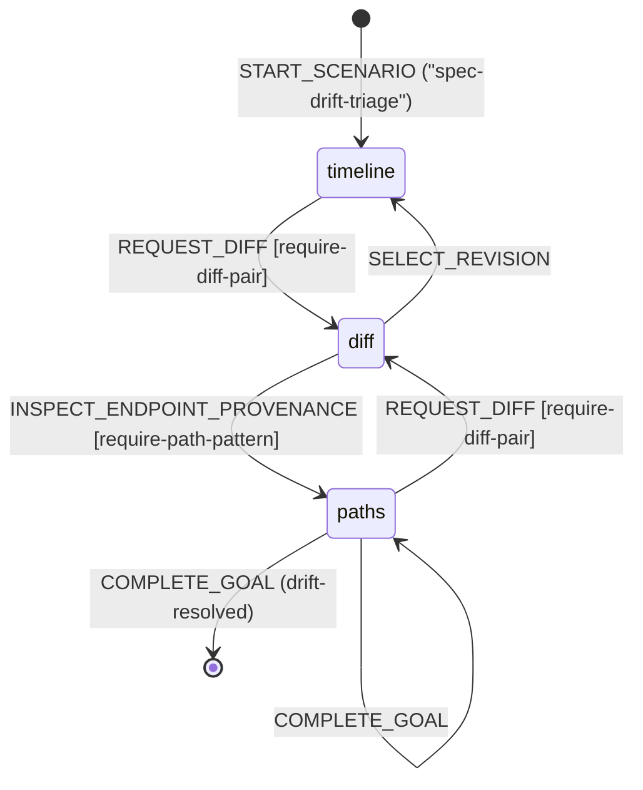

# 유저 시나리오 주제 단위 화면 네비게이션 & BEHAVIOR FSM 엔진 가이드

이 문서는 복잡한 웹 대시보드 및 API 도구 생태계에서 화면 간 이동 경로(Navigation Paths)를 무분별하게 나열하여 발생하는 **상태 공간 폭발(State Explosion)**을 방지하고, **유저 시나리오 주제(User Scenario Topics)** 단위로 Bounded Context를 형성하여 유한 상태 기계(FSM) 및 행동(BEHAVIOR) 흐름을 정형화하는 아키텍처 및 구현 표준을 정의합니다.

---

## 1. 아키텍처 배경 및 해결 과제

### 1.1 평면적 화면 전이 모델의 한계
전통적인 SPA 프론트엔드 라우팅 및 단순 상태 머신은 화면 뷰 집합($V$)과 이벤트/버튼 액션($A$)을 단일 평면 그래프로 다룹니다:
* 화면 수가 증가할수록 잠재적 전이 경로가 $O(|V| \times |A|)$로 폭발합니다.
* 사용자가 **어떤 목적(JTBD: Jobs To Be Done)**을 가지고 특정 화면에 도달했는지에 대한 맥락이 상실되어, 필수 데이터(예: Diff 비교를 위한 base/head 파라미터)가 누락된 채 진입하는 오류가 런타임에 빈번하게 발생합니다.
* 전체 전이 흐름을 나열(Enumeration)하더라도 수백 개의 간선이 얽힌 스파게티 다이어그램이 되어 유저 여정(User Journey)의 완결성을 정적으로 검증할 수 없습니다.

### 1.2 해결책: 유저 시나리오 주제 단위 개념 추상화 (Thematic Scenario Abstraction)
* **목표 지향적 격리 (Bounded View Subgraph)**: 전체 화면 뷰 중 해당 유저 시나리오의 목적 달성에 필요한 화면들만 서브그래프로 선언합니다.
* **행동 계약 (BEHAVIOR Contract)**: 단순 클릭 이벤트(`onClick`)가 아닌 도메인 의도가 명시된 `LensBehaviorAction`(`REQUEST_DIFF`, `INSPECT_ENDPOINT_PROVENANCE`, `HIGHLIGHT_DEPENDENCY_CYCLE` 등)을 디스패치합니다.
* **결정론적 경로 수집기 (Flow Enumerator)**: 빌드 타임 및 런타임에 시나리오별 유효 전이 행렬(Transition Matrix), 미완료 고아 뷰(Dead Ends), 목표 도달 경로(Terminal Paths)를 100% 정적 분석하고 Mermaid/DOT 다이어그램으로 시각화합니다.

---

## 2. 3계층 아키텍처 모델 (3-Tier Model)

```
┌─────────────────────────────────────────────────────────────────────────────┐
│  Tier 1: Scenario Domain Abstraction (주제 단위 개념 추상화)                 │
│  - ScenarioTopicDefinition (id, title, persona, initialView, boundedViews)  │
│  - ScenarioRegistry: 시나리오 카탈로그 및 동적 등록 관리                   │
│  - Terminal Goals: 완료 조건 명시 (drift-resolved, impact-assessed 등)      │
└──────────────────────────────────────┬──────────────────────────────────────┘
                                       │ compiles / enforces
                                       ▼
┌─────────────────────────────────────────────────────────────────────────────┐
│  Tier 2: Hierarchical FSM & Action (BEHAVIOR) Engine (전이 및 흐름 수집)    │
│  - scenarioTransitionReducer: 순수 FSM 리듀서 (순수 TypeScript)             │
│  - ScenarioFlowEnumerator: DFS/BFS 기반 도달 가능성 및 전이 행렬 수집       │
│  - ScenarioBreadcrumbs: 단순 브라우저 뒤로가기를 넘어선 시나리오 스텝백     │
└──────────────────────────────────────┬──────────────────────────────────────┘
                                       │ typed by / executed in
                                       ▼
┌─────────────────────────────────────────────────────────────────────────────┐
│  Tier 3: Context-Action Runtime & Schema Contracts (실행 및 화면 연동)      │
│  - @oa-sdk/spec-lens-contract: 순수 FSM 엔진 및 타입 계약                   │
│  - apps/spec-lens/src/scenario/: Context-Action 패턴 React 컴포넌트         │
│  - ScenarioProgressHUD, ScenarioSelector, ScenarioFlowModal                 │
└─────────────────────────────────────────────────────────────────────────────┘
```

---

## 3. 4대 표준 시나리오 주제 정의

Spec-Lens 대시보드는 다음 4가지 핵심 시나리오 주제를 기본 내장합니다:

| 시나리오 ID | 시나리오 명칭 | 페르소나 | 초기 뷰 | 제한 뷰 서브그래프 | 완료 목표 (Terminal Goal) |
| :--- | :--- | :--- | :--- | :--- | :--- |
| `spec-drift-triage` | 스펙 드리프트 감지 및 원인 규명 | `ApiArchitect` | `timeline` | `timeline` $\to$ `diff` $\to$ `paths` | 드리프트 발생 원인 단편 및 책임 커밋 식별 완료 (`drift-resolved`) |
| `endpoint-exploration` | 엔드포인트 및 타입 계약 탐색 | `ApiConsumer` | `paths` | `paths` $\to$ `graph` | 엔드포인트 입출력 DTO 및 스키마 의존성 검증 완료 (`contract-verified`) |
| `breaking-impact-analysis` | 스키마 변경 파급 효과 분석 | `ReleaseManager` | `timeline` | `timeline` $\to$ `diff` $\to$ `graph` | 파괴적 변경 영향 도메인 그래프 분석 완료 (`impact-assessed`) |
| `circular-ref-diagnostic` | 순환 참조 및 고아 스키마 진단 | `SpecAuthor` | `graph` | `graph` $\to$ `paths` | 순환 참조 의존 경로 및 책임 스키마 파일 격리 완료 (`cycle-isolated`) |

---

## 4. 핵심 구현 컴포넌트

### 4.1 순수 FSM 전이 리듀서 (`stateMachine.ts`)
```typescript
import {
  type LensBehaviorAction,
  type ScenarioMachineContext,
  type ScenarioTransitionResult,
  ScenarioRegistry,
} from '@oa-sdk/spec-lens-contract'

export function scenarioTransitionReducer(
  state: ScenarioMachineContext,
  action: LensBehaviorAction,
  registry: ScenarioRegistry = new ScenarioRegistry(),
): ScenarioTransitionResult {
  // 1. START_SCENARIO / SWITCH_SCENARIO / STEP_BACK
  // 2. 가드(Guards) 평가 (미충족 시 에러 반환 및 전이 차단)
  // 3. 브레드크럼(Breadcrumbs) 감사 추적 기록
  // 4. 컨텍스트 변환(TransformContext) 및 차기 뷰 전이
}
```

### 4.2 정적 경로 및 흐름 수집기 (`flowEnumerator.ts`)
`ScenarioFlowEnumerator`는 선언된 시나리오 규칙을 분석하여 빌드 타임 및 런타임에 다이어그램과 전이 행렬을 생성합니다:
```typescript
import { ScenarioFlowEnumerator, SPEC_DRIFT_TRIAGE_SCENARIO } from '@oa-sdk/spec-lens-contract'

// 1. 도달 가능성 및 미완료 고아 뷰 검사
const analysis = ScenarioFlowEnumerator.enumerate(SPEC_DRIFT_TRIAGE_SCENARIO)
console.log(analysis.deadEnds) // [] (안전: 고아 상태 없음)
console.log(analysis.terminalPaths.length) // 최소 1개 이상의 완료 경로 보장

// 2. Mermaid stateDiagram-v2 추출
const mermaid = ScenarioFlowEnumerator.toMermaidStateDiagram(SPEC_DRIFT_TRIAGE_SCENARIO)
```

#### 생성되는 Mermaid 흐름도 예시:


---

## 5. UI 계층 연동 (Context-Action Architecture)

`apps/spec-lens/src/scenario/`에 구현된 Context-Action 레이어는 자유 탐색(Free Exploration) 모드와 시나리오 모드를 같은 경로로 처리합니다. 모든 화면 이동은 `ScenarioProvider`의 `dispatch`를 거쳐 FSM 리듀서(`scenarioTransitionReducer`)로 들어갑니다. 자유 탐색 모드에서는 리듀서가 그대로 허용하고, 시나리오 안에서는 현재 뷰에서 허용된 전이만 화면을 바꿉니다. 시나리오 안에서 대시보드 셸은 `machineState.currentView`를 렌더링하므로 렌더링 뷰, FSM 뷰, URL은 항상 같습니다.

1. **`ScenarioSelector`**:
   - 사이드바 상단에서 사용자가 `🌐 자유 탐색` 또는 `🎯 시나리오 주제`를 드롭다운으로 선택합니다. 시나리오는 자신의 `initialView`에서 시작합니다(`START_SCENARIO`).
2. **`ScenarioProgressHUD`**:
   - 시나리오가 활성화되면 메인 화면 최상단에 페르소나 뱃지, 현재 단계(Step N: 뷰), 다음 단계 버튼, 목표 달성 CTA 버튼, 이전 단계 복귀(`← 이전 단계`, `STEP_BACK`), 흐름도 보기, 시나리오 종료 버튼이 노출됩니다.
   - **다음 단계 버튼**: 현재 뷰에서 나가는 전이 규칙(`COMPLETE_GOAL`, `START_SCENARIO`, `SWITCH_SCENARIO` 제외)마다 버튼 하나를 그립니다(`resolveScenarioIntents`). 페이로드는 현재 뷰가 게시한 선택(`publishSelection`)에서 가져오고, 없으면 머신 컨텍스트의 마지막 값으로 채웁니다. Diff 항목은 JSON Pointer에서 경로(`/paths/...`) 또는 컴포넌트 심볼(`/components/<kind>/<name>`)을, Path Provenance 행은 경로와 canonical ID를, Fragment Graph 노드는 심볼 ID와 이름을 게시합니다. Timeline의 리비전 비교는 버튼 없이 `REQUEST_DIFF`를 바로 보냅니다. 페이로드가 없거나 가드가 거절할 단계(`evaluateTransitionGuards`로 미리 검사)는 비활성화되고 사유가 버튼 툴팁에 표시됩니다.
   - **목표 CTA**: 목표의 `targetView`가 현재 뷰인 완료 목표를 `COMPLETE_GOAL`로 완료합니다.
   - **이전 단계**: `← 이전 단계`(그리고 Diff 화면의 뒤로 버튼)는 `STEP_BACK`을 보냅니다. 리듀서는 직전 브레드크럼의 뷰와 시나리오를 복원하고, 그 단계가 리비전 쌍을 기록한 diff 단계이면 `baseId`/`headId`도 그 쌍으로 복원합니다. 브라우저 뒤로가기도 같은 `STEP_BACK`으로 되돌리므로, 어느 뒤로가기를 쓰든 같은 단계는 같은 뷰와 리비전 쌍으로 렌더링됩니다.
   - **거절 사유**: 리듀서가 거절한 마지막 전이(예: 시나리오 안에서 허용되지 않은 사이드바 이동 `NAVIGATE_VIEW`)의 사유를 다음 전이가 성공할 때까지 표시합니다. 시나리오를 종료하면 자유롭게 이동할 수 있습니다.
3. **`ScenarioFlowModal`**:
   - 사용자가 언제든지 클릭하여 현재 시나리오의 전체 FSM 전이 행렬과 Mermaid 다이어그램을 조회하고, 현재 위치한 뷰를 하이라이트로 확인할 수 있습니다.
4. **URL 동기화 (`useUrlState.ts`)**:
   - **공유 URL 스토어**: `useUrlState()`는 창(window)마다 하나뿐인 스토어(`getUrlStateStore`)를 `useSyncExternalStore`로 구독합니다. `ScenarioProvider`와 대시보드 셸을 포함한 모든 소비자가 같은 URL 상태를 보며, `popstate`(뒤로가기/앞으로가기)는 구독자가 있는 동안 한 번만 처리됩니다.
   - **전이 하나 = 히스토리 항목 하나**: `update(patch, mode)`는 항상 최신 상태 위에 패치를 적용(`applyUrlStatePatch`)하고 히스토리를 한 번만 씁니다(`push` 또는 `replace`). 성공한 전이는 머신이 소유한 필드(`scenario`, `view`, diff이면 `base`/`head`)를 한 패치로 씁니다(`machineUrlPatch`). URL이 바뀌지 않는 갱신(예: `COMPLETE_GOAL`, `FILTER_BREAKING_CHANGES` 같은 자기 전이)은 히스토리 항목을 추가하지 않습니다.
   - **딥링크 초기 뷰**: `?scenario=<id>`의 `view`가 시나리오의 `boundedViews` 안에 있으면 그 뷰에서, 아니면 시나리오의 `initialView`에서 시작하고 URL을 그 뷰로 교체(`replaceState`)합니다. 알 수 없는 시나리오 ID는 URL에서 제거됩니다. diff 딥링크의 `base`/`head`와 딥링크의 `revision`, `search`는 컨텍스트 초기값(`baseId`/`headId`, `revisionId`, `pathPattern`)이 됩니다.
   - **뒤로가기/앞으로가기**: 머신이 쓰지 않은 URL 변경은 `reconcileMachineWithUrl`이 판정합니다. 시나리오 안에서 URL이 직전 히스토리 항목(현재 URL과 다른, 가장 가까운 이전 브레드크럼의 URL)과 같으면 브라우저 뒤로가기로 보고, 그 단계까지 `STEP_BACK`으로 되돌립니다. 히스토리 항목을 남기지 않은 단계(목표 완료, URL을 유지한 자기 전이)는 함께 건너뛰고, `SWITCH_SCENARIO` 이전 시나리오로도 같은 방식으로 돌아갑니다. diff 단계끼리는 브레드크럼에 기록된 `baseId`/`headId`로 구분하고, 되돌아간 diff 단계의 리비전 쌍은 `STEP_BACK` 자체가 복원합니다(HUD의 `← 이전 단계`와 같은 결과). 다른 `scenario=`로 바뀐 URL은 그 시나리오를 시작하고, `scenario=`가 사라지면 자유 탐색으로 돌아갑니다. 그 밖의 이동(앞으로가기, 직전 항목을 넘는 이동, 직접 고친 뷰)은 FSM이 허용하는 전이가 아니므로 URL을 현재 단계로 교체(`replaceState`)합니다. 자유 탐색 모드에서는 머신이 URL을 그대로 따릅니다.

---

## 6. 검증 및 품질 보장

* **100% 경로 커버리지 테스트**: `packages/spec-lens-contract/src/scenario.test.ts`
  - 4대 표준 시나리오의 도달 가능성 및 고아 뷰(0 Dead Ends) 검증.
  - 가드 실패 시 전이 거절 및 컨텍스트 보존 검증.
  - 브레드크럼 스택 기반 `STEP_BACK` 및 시나리오 간 `SWITCH_SCENARIO` 핸드오프 검증, diff 단계 브레드크럼의 리비전 쌍 기록과 `STEP_BACK`의 리비전 쌍 복원 검증, 기록되는 브레드크럼 필드가 `scenario.tsp`의 `ScenarioStepProvenance`에 모두 선언되어 있는지 검증.
* **UI 통합 테스트**:
  - `apps/spec-lens/src/App.test.tsx`: 실제 대시보드 셸, `ScenarioProvider`, HUD, URL 스토어를 마운트한 상호작용 테스트. 4대 시나리오를 선택기부터 목표 CTA까지 UI로 구동하고, 딥링크 초기 뷰와 URL 교체, 브라우저 뒤로가기(목표 완료와 `FILTER_BREAKING_CHANGES` 뒤 포함, `replaceState` 없음), HUD·Diff·브라우저 뒤로가기가 같은 diff 단계를 같은 리비전 쌍으로 렌더링하는지, 허용되지 않은 사이드바 이동의 거절, 자유 탐색 모드의 이동을 검증합니다.
  - `apps/spec-lens/src/scenario/navigation.test.ts`: 머신·URL·렌더링 뷰를 잇는 순수 함수(`machineUrlPatch`, `reconcileMachineWithUrl`, `resolveScenarioIntents`, `resolveShellView`, 선택 헬퍼)와 모든 시나리오의 터미널 경로 구동, 히스토리 항목을 남기지 않은 단계를 건너뛰는 뒤로가기 판정을 검증합니다.
  - `apps/spec-lens/src/scenario/views/ScenarioFlowModal.test.tsx`: 열린 모달의 대화상자, 전이 행렬, Mermaid 흐름도, 현재 뷰 하이라이트 렌더링을 검증합니다.
  - `apps/spec-lens/src/scenario/scenario.test.tsx`는 자유 탐색 모드의 기본 마크업, 닫힌 모달이 렌더링되지 않음, `ScenarioProvider` 단위의 딥링크와 공유 URL 스토어 구동을 검증합니다. `apps/spec-lens/src/hooks/useUrlState.test.ts`는 URL 스토어(공유, 단일 히스토리 항목, no-op 생략, `popstate`)를 검증합니다.
