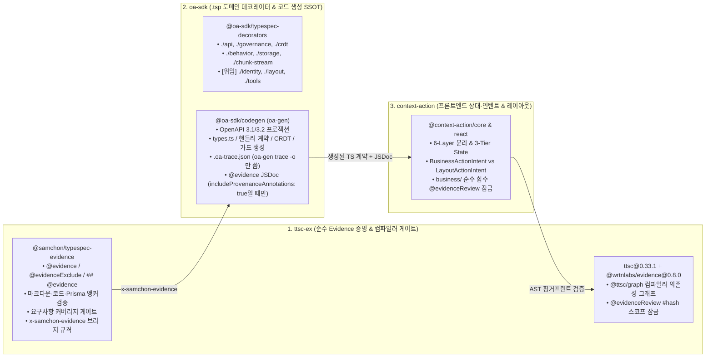

# `ttsc-ex` · `oa-sdk` · `context-action` 책임 분리 및 `.tsp` 위임 동기화 가이드

> **상태**: Official Cross-Repository Delegation & Synchronization Guide  
> **관련 문서**: [멀티 티어 스키마 아키텍처 및 `ttsc` 가이드](./schema-architecture-and-ttsc-guide.md), [TypeSpec 데코레이터 레퍼런스](./typespec/03-decorators-reference.md), [라이브러리 진입점 지도](./library-entrypoints.md)  
> **상대 워크스페이스 참조 문서**:  
> - `ttsc-ex` 정본 허브: `/Users/junwoobang/workflow/samchon/docs/cross-repo-responsibility-and-sync-guide.md`  
> - `context-action` 동기화 가이드: `/Users/junwoobang/workflow/context-action/docs/ko/context-layered/triad-evidence-sync-guide.md`

---

## 1. 목적 (Purpose)

`oa-sdk`, `ttsc-ex`(`@samchon/typespec-evidence` / `ttsc@0.33.1` / `@wrtnlabs/evidence@0.8.0`), `context-action` 3대 워크스페이스는 하나의 통합 트라이어드(Unified Triad) 생태계를 구성합니다.  
초기 아키텍처 검증 과정에서 일부 도메인 `.tsp` 데코레이터와 비-OpenAPI 상수 생성기가 `ttsc-ex/packages/typespec-evidence` 내부에 프로토타입 및 자기 호스팅 검증용으로 함께 구현되었으나, **장기적인 유지보수성과 단일 책임 원칙(Single Responsibility Principle)을 위해 `.tsp` 도메인 계약 모델링 및 코드 생성 책임은 `oa-sdk`로 일원화하고, `ttsc-ex`는 순수 Evidence 증명 및 컴파일러 그래프 게이트만 전담**합니다.

이 문서는 `oa-sdk` 작업자 및 AI 에이전트가 **`ttsc-ex`에서 정의·검증된 스펙과 `.tsp` 관련 구현을 어떤 기준과 흐름으로 가져와(Pull) `oa-sdk`에 통합·동기화해야 하는지**를 안내합니다.

---

## 2. 3대 워크스페이스 책임 경계 (Responsibility Boundaries)



| 구분 | `oa-sdk`가 소유하는 책임 (Contract & Codegen SSOT) | `ttsc-ex`에 남는 고유 책임 (Verification & Gate SSOT) |
| :--- | :--- | :--- |
| **TypeSpec 데코레이터** | 도메인·아키텍처·거버넌스 데코레이터 전종 (`@oa-sdk/typespec-decorators`의 `./api`, `./governance`, `./crdt`, `./behavior`, `./storage`, `./chunk-stream` 및 위임 대상 `./identity`, `./layout`, `./tools`) | 순수 증명 데코레이터 (`@evidence`, `@evidenceExclude`, Heading-Form `## @evidence`) |
| **OpenAPI 확장** | `x-oa-sdk-*` 버전드 확장 발행 및 `x-samchon-evidence` 수신·통합 | `x-samchon-evidence` (`requirements`, `upstreamRequirement`, `typeSpecSource`, `excluded`, `excludeReason`) 주입 |
| **TypeScript 코드 생성** | `oa-gen typegen`·`oa-gen generate`를 통한 DTO/인터페이스와 라우터 핸들러 계약, `oa-gen trace -o .oa-trace.json`(이 파일을 쓰는 유일한 명령)을 통한 `.oa-trace.json`, 그리고 `generateTypes` / `generateTypesFromSpec` 라이브러리 호출에 `includeProvenanceAnnotations: true`를 줄 때만 붙는 JSDoc 출처 증명(`@oa-source`, `@oa-requirement`, `@evidence`, `## @evidence`, `@evidenceExclude`) 합성. `oa-gen typegen`과 `oa-gen generate`는 이 옵션을 넘기지 않으므로 출력에 출처 태그가 없습니다 | 코드 생성기가 만든 TypeScript 산출물에 대한 `evidence check` 및 `@evidenceReview #hash` 스코프 핑거프린트 검증 |

---

## 3. `ttsc-ex`에서 `oa-sdk`로 가져올 항목 및 동기화 현황 (Delegation & Sync Matrix)

### 3.1 완료된 코어 브리지 동기화 항목 (Completed)

| 영역 | `oa-sdk` 반영 파일 | 반영 내용 |
| :--- | :--- | :--- |
| **`x-samchon-evidence` 추적성 브리지** | [`packages/codegen/src/traceability/spec-traceability.ts`](../../packages/codegen/src/traceability/spec-traceability.ts) | `x-oa-sdk-trace`와 `x-samchon-evidence`를 `.oa-trace.json`으로 병합하고, `contentHash` 계산 시 두 확장을 모두 스트리핑하여 순수 증명 수정 시 해시 드리프트 방지 |
| **생성 TS JSDoc 증명 합성 (`ttsc@0.33.1` 호환)** | [`packages/codegen/src/typegen/generate-types.ts`](../../packages/codegen/src/typegen/generate-types.ts) | `@oa-source`, `@oa-requirement`와 함께 단일 라인 `@evidence <target> - <reason>`, 멀티라인 Heading-Form `## @evidence <target>`, `@evidenceExclude` 방출. `includeProvenanceAnnotations: true`를 준 `generateTypes` / `generateTypesFromSpec` 호출에서만 붙고, `oa-gen typegen`·`oa-gen generate` 출력에는 없음 |
| **중첩 TypeSpec AST 선언 좌표 추출** | [`packages/codegen/src/cli/lib/typespec-ref-provenance.ts`](../../packages/codegen/src/cli/lib/typespec-ref-provenance.ts) | 중괄호 `namespace { ... }` 및 `interface { op ... }` 내부 선언의 AST 소스 좌표를 재귀적으로 수집 |
| **추적성 데코레이터 (`./governance`)** | [`packages/typespec-decorators/lib/governance.tsp`](../../packages/typespec-decorators/lib/governance.tsp) | `@traceId`, `@replaces`, `@requirement` 데코레이터 제공 및 문서화([`README.md`](../../packages/typespec-decorators/README.md)) |

### 3.2 `ttsc-ex`에서 `oa-sdk`로 단계적 흡수(Pull)할 `.tsp` 도메인 슬라이스

`ttsc-ex`의 `/Users/junwoobang/workflow/samchon/packages/typespec-evidence`에 정의된 아래 도메인 데코레이터 및 생성기 규칙은 기능 확장 시 `oa-sdk`의 해당 패키지로 가져와 통합합니다:

| # | `ttsc-ex` 원천 참조 경로 (`/Users/junwoobang/workflow/samchon/...`) | 위임 대상 데코레이터 / 기능 | `oa-sdk` 수용 위치 | 참조 명세 문서 (`ttsc-ex`) |
| :-: | :--- | :--- | :--- | :--- |
| **1** | `packages/typespec-evidence/lib/identity.tsp`<br>`packages/typespec-evidence/src/identity-decorators.ts` | `@idStrategy`, `@lookupKey`, `@identityRepresentation`, `@promotableId` | `packages/typespec-decorators` (`./identity` 서브패스 신설) | `docs/distributed-identity-and-aspect-lifecycle-spec.md` |
| **2** | `packages/typespec-evidence/lib/aspect-storage.tsp`<br>`packages/typespec-evidence/src/aspect-storage-decorators.ts` | `@entityRoot`, `@aspectOf`, `@storage` (Anti-God-Table 분리 저장 관점) | [`packages/typespec-decorators/lib/storage.tsp`](../../packages/typespec-decorators/lib/storage.tsp) (`@storageRef`, `@storageCatalog`와 통합) | `docs/distributed-identity-and-aspect-lifecycle-spec.md` |
| **3** | `packages/typespec-evidence/lib/layout-hierarchy.tsp`<br>`packages/typespec-evidence/src/layout-decorators.ts` | `LayoutSlotCategory`, `MenuNode`, `SemanticZIndexToken`, `DomainTopologyProfiles` | `packages/typespec-decorators` (`./layout` 서브패스 신설) | `docs/menu-driven-layout-hierarchy-guide.md` |
| **4** | `packages/typespec-evidence/lib/tool-protocol.tsp`<br>`packages/typespec-evidence/src/tool-decorators.ts` | `@tool`, `@mcpTool`, `@webMcpTool` | `packages/typespec-decorators` (`./tools` 서브패스) 및 `@oa-sdk/tools` | `packages/typespec-evidence/docs/SPEC.md` |
| **5** | `packages/typespec-evidence/src/emitter.ts`<br>`packages/typespec-evidence/src/auto-synthesizer.ts` | • 비-OpenAPI 상수(`identity.ts`, `aspect-storage.ts`, `tools.ts`) 방출<br>• DTO 속성 제약(`@minimum`, `@pattern` 등) JSDoc 보존 | [`packages/codegen`](../../packages/codegen/README.md) (`generate-types.ts` 및 아티팩트 생성 파이프라인) | `packages/typespec-evidence/docs/SPEC.md` |

---

## 4. 자율 업데이트 흐름 및 검증 절차 (Self-Serve Update Workflow)

`ttsc-ex`에서 새로운 `.tsp` 계약 패턴이나 Evidence 규약이 업데이트되었을 때, `oa-sdk`에서는 다음 4단계 절차로 변경사항을 가져옵니다:

1. **Step 1 — 원천 명세 확인 (Discovery)**
   - `/Users/junwoobang/workflow/samchon/docs/cross-repo-responsibility-and-sync-guide.md` 및 `/Users/junwoobang/workflow/samchon/AGENTS.md`에서 변경된 데코레이터 시그니처, `x-samchon-evidence` 필드, 또는 JSDoc 주석 형식을 확인합니다.
2. **Step 2 — 데코레이터 및 진입점 반영 (`@oa-sdk/typespec-decorators`)**
   - [`packages/typespec-decorators`](../../packages/typespec-decorators/README.md)에 서브패스(`.tsp` + `.ts`)를 추가하거나 갱신할 경우, 반드시 [`package.json`](../../packages/typespec-decorators/package.json)의 `exports`, [`docs/guides/library-entrypoints.md`](./library-entrypoints.md), [`docs/internal/api-index.md`](../internal/api-index.md), 그리고 `spec-lens` allowlist를 함께 갱신합니다.
3. **Step 3 — 코드 생성 및 추적성 브리지 반영 (`@oa-sdk/codegen`)**
   - [`spec-traceability.ts`](../../packages/codegen/src/traceability/spec-traceability.ts)와 [`generate-types.ts`](../../packages/codegen/src/typegen/generate-types.ts)에서 확장 메타데이터가 `.oa-trace.json`과 생성 TS JSDoc에 무손실로 투영되고 `contentHash`가 안정적으로 유지되는지 단위 테스트([`spec-traceability.test.ts`](../../packages/codegen/src/__tests__/traceability/spec-traceability.test.ts))로 검증합니다.
4. **Step 4 — `oa-sdk` 5대 거버넌스 게이트 및 `ttsc` 호환성 검증**
   ```bash
   corepack pnpm check:docs
   corepack pnpm check:spec-governance
   corepack pnpm check:cli-spec
   corepack pnpm check:api-index
   node --import tsx scripts/check-ts7.ts
   ```
