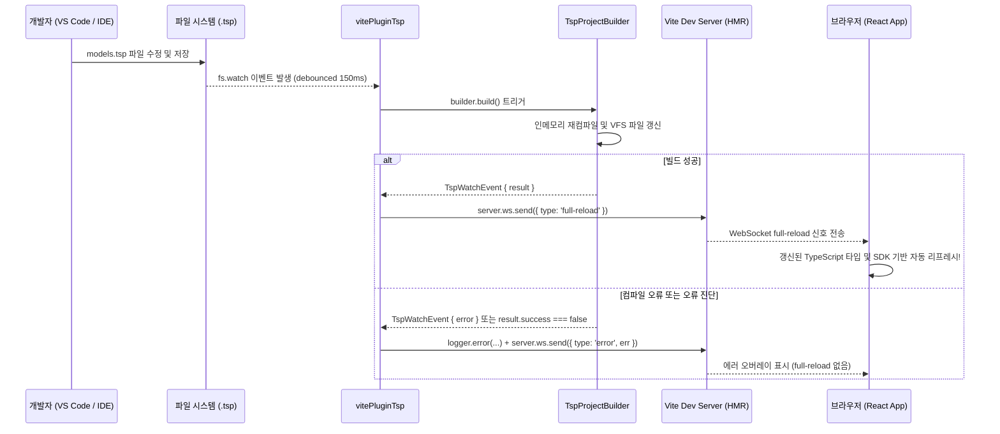

# TypeSpec 빌더 플랫폼 및 openapi-ts SDK 가이드 (TypeSpec Builder Platform Guide)

TypeSpec(`.tsp`)을 단일 정본(SSOT: Single Source of Truth)으로 삼고, 디스크 중간 아티팩트 없이 인메모리 컴파일과 플러그인 위상 정렬(DAG)을 거쳐 openapi-ts 스타일의 타입 안전 클라이언트 SDK, TanStack Query v5 3계층 코드, 백엔드 라우터 및 바이너리 코덱을 생성하는 **TypeSpec 빌더 플랫폼(TypeSpec Builder Platform)** 공식 가이드입니다.

이 문서는 `@oa-sdk/codegen` 0.10.0, `@oa-sdk/client` 0.3.0, `@oa-sdk/router` 0.2.5, `@typespec/compiler` 1.16.0 기준입니다.

- 저장소 전반의 빠른 시작 및 CLI 사용법은 [Quick Start](./quick-start.md)를 참고하십시오.
- TypeSpec 정본 작성 규칙과 네임스페이스 구조는 [TypeSpec 작성 규칙](./typespec-authoring-conventions.md)을 참고하십시오.
- 생성된 클라이언트 및 TanStack Query의 일반 소비 패턴은 [클라이언트 및 쿼리 소비 가이드](./client-and-query-consumption.md)를 참고하십시오.
- 서버 프레임워크 라우터 및 순수 핸들러 계약은 [백엔드 핸들러 계약 가이드](./backend-handler-contracts.md)를 참고하십시오.
- 목 서버(Mock Server) 연동은 [Mock 서버 사용 가이드](./mock-server-usage.md)를 참고하십시오.

---

## 1. 아키텍처 및 파이프라인 라이프사이클 (Architecture & Lifecycle)

TypeSpec 빌더 플랫폼은 기존의 파일 기반 CLI(`tsp compile -> openapi.yaml -> codegen`) 파편화를 해결하고, 하나의 빌더 인스턴스에서 스펙 분석, 프로그래머블 인트로스펙션, 가상 파일 시스템(VFS) 기반 다중 타겟 코드 생성을 단일 인메모리 파이프라인으로 처리합니다.

### 1.1 플랫폼 토폴로지 (Platform Architecture Topology)

```mermaid
flowchart TD
    subgraph SSOT [1. TypeSpec 단일 정본 (SSOT)]
        TSP["TypeSpec 스펙 (.tsp)\nmain.tsp / models.tsp"]
    end

    subgraph CoreEngine [2. 인메모리 컴파일 & 인트로스펙션 엔진]
        Compiler["compileTypeSpecInMemory()\nNodeHost + OpenAPI 3.2 Emitter"]
        AST["TypeSpec Program AST & OasDocument"]
        Introspect["TspProjectBuilder.introspect()\n캐시 기반 고속 메타데이터 분석 (<5ms)"]
    end

    subgraph PluginPipeline [3. 플러그인 DAG 및 가상 파일 시스템 (VFS)]
        Sorter["sortPlugins()\nKahn 알고리즘 기반 위상 정렬 & 순환 탐지"]
        Context["TspPluginContext\n가상 파일 맵 / 상대 경로 임포트 해석 / 플러그인 상태 공유"]
        
        P_TS["pluginTypescript\nmodels / enums / guards"]
        P_Client["pluginClient (pluginSdk)\nopenapi-ts 스타일 SDK"]
        P_Query["pluginTanstackQuery\nKeys / Options / Hooks"]
        P_Router["pluginRouter\nContracts / Hono / Express / Fastify / Elysia"]
        P_Wire["pluginWire\nProtobuf / MessagePack / RPC"]
    end

    subgraph OutputTargets [4. 출력 대상 및 런타임 연동]
        DiskOut["디스크 파일 출력 (Disk Emission)\ntypes.ts, client.ts, queries.ts, router.ts"]
        ViteDev["Vite 개발 서버 (vitePluginTsp)\n파일 감시 (watch) & 브라우저 HMR full-reload"]
    end

    TSP --> Compiler
    Compiler --> AST
    AST --> Introspect
    AST --> Sorter
    Sorter --> Context
    Context --> P_TS
    P_TS --> P_Client
    P_Client --> P_Query
    P_TS --> P_Router
    P_TS --> P_Wire
    Context --> DiskOut
    Context --> ViteDev
```

### 1.2 핵심 설계 원칙 (Core Architectural Invariants)

1. **Zero-Disk In-Memory SSOT**:
   중간 `.yaml` 또는 `.json` 파일을 디스크에 기록하지 않고 메모리 상에서 직접 TypeSpec AST를 컴파일하고 `OasDocument`를 추출합니다. 컴파일 결과는 `oldProgram` 캐시로 보존되어 변경이 없을 시 0ms에 가깝게 인트로스펙션을 반환합니다.
2. **Kahn 위상 정렬 기반 플러그인 DAG**:
   플러그인은 자신의 `dependencies`(`['typescript']`, `['typescript', 'client']`)를 선언하며, 빌더는 Kahn 알고리즘으로 실행 순서를 보장합니다. 상호 순환 참조(`A -> B -> A`)가 발생하면 `TspPluginCycleError`를 발생시켜 빌드를 안전하게 차단합니다.
3. **가상 파일 시스템(VFS) 격리 및 상대 경로 임포트 자동 해석**:
   모든 플러그인은 `context.addFile()`을 통해 메모리 상의 `TspGeneratedFile`로 아티팩트를 등록합니다. `context.resolveImport(fromFile, targetFile)`는 두 가상 파일 간의 정확한 상대 ESM 경로(예: `./types.js`)를 계산하므로, 사용자가 수동으로 파일 경로를 조합할 필요가 없습니다.
4. **openapi-ts 규격 호출 인터페이스**:
   개별 인자 나열 방식 대신 단일 파라미터 객체 `{ path, query, body, headers }` 패턴을 적용하고, 반환값을 `{ data, error, response }` Discriminated Union으로 정의하여 런타임 `isErrorStatus()` 가드와 함께 컴파일 타임 에러 타입 축소를 보장합니다.

---

## 2. 프로그래머블 빌더 API 명세 (Builder API Reference)

빌더 플랫폼의 핵심 진입점은 `createTspBuilder` 팩토리 함수와 `TspProjectBuilder` 클래스입니다.

### 2.1 `createTspBuilder` 및 `TspProjectBuilder`

```typescript
import { createTspBuilder, defineTspConfig } from '@oa-sdk/codegen';

// 1. 단일 .tsp 파일 또는 디렉터리 경로로 초기화
const builder = createTspBuilder('./api/main.tsp', {
  openApiVersion: '3.2.0',
  cwd: process.cwd(),
});

// 2. 또는 완전한 TspConfig 객체로 초기화
const configuredBuilder = createTspBuilder(
  defineTspConfig({
    input: './api/main.tsp',
    output: './src/generated',
    openApiVersion: '3.2.0',
  }),
);
```

#### 메서드 시그니처 상세

| 메서드 | 시그니처 | 설명 |
|---|---|---|
| `use(plugin)` | `use(plugin: TspPluginEntry): this` | 플러그인을 파이프라인에 체이닝 등록합니다. 메서드 체이닝(`builder.use(...).use(...)`)을 지원합니다. |
| `introspect(forceFresh?)` | `introspect(forceFresh?: boolean): Promise<TspIntrospectionReport>` | TypeSpec을 인메모리 컴파일하고 엔드포인트, 모델, 제약조건, 파라미터 메타데이터 리포트를 반환합니다. 결과는 캐시됩니다. |
| `getOperations()` | `getOperations(): Promise<readonly TspIntrospectedOperation[]>` | 스펙에 정의된 모든 HTTP 오퍼레이션 목록을 반환합니다. |
| `getModels()` | `getModels(): Promise<readonly TspIntrospectedModel[]>` | 스펙에 정의된 모든 스키마 모델 목록 및 필드 제약조건을 반환합니다. |
| `getOperation(idOrPath)` | `getOperation(idOrPath: string): Promise<TspIntrospectedOperation \| undefined>` | operationId 또는 URL 경로로 특정 오퍼레이션을 조회합니다. |
| `getModel(name)` | `getModel(name: string): Promise<TspIntrospectedModel \| undefined>` | 모델명으로 특정 데이터 모델을 조회합니다. |
| `build(overrideConfig?)` | `build(overrideConfig?: Partial<TspConfig>): Promise<TspPipelineResult>` | 등록된 모든 플러그인을 위상 정렬 순서로 실행하고 산출물을 생성합니다. 매 호출마다 (override가 반영된) 입력을 다시 컴파일하므로 `introspect()` 이후의 `.tsp` 수정도 반영됩니다. 이전 컴파일 결과는 증분 컴파일 힌트(`oldProgram`)로만 쓰입니다. `output` 또는 `outputDir` override는 둘 중 무엇을 넘겨도 출력 디렉터리를 바꿉니다(둘 다 넘기면 `output` 우선). |
| `watch(listener, options?)` | `watch(listener: (event: TspWatchEvent) => void, options?: TspWatchOptions): TspWatcherHandle` | `.tsp` 파일 변경을 감시하여 캐시(인트로스펙션 리포트와 컴파일 결과)를 무효화하고 자동 리빌드합니다. 리빌드가 예외로 실패하면(예: TypeSpec 컴파일 오류) `event.result` 대신 `event.error`가 채워집니다. |
| `getConfig()` | `getConfig(): TspConfig` | 정규화 및 검증된 빌더 설정을 반환합니다. |

`createTspBuilder(input, { cwd })`의 `cwd`는 상대 `input`(문자열, `entrypoint`, `tspDir`)과 `output`의 기준 디렉터리이며, `build()`, `introspect()`, `watch()`가 모두 같은 기준으로 같은 파일을 해석합니다. 생략하면 `process.cwd()`입니다.

### 2.2 인트로스펙션 데이터 모델 (`TspIntrospectionReport`)

`builder.introspect()`는 외부 코드 생성기, 문서 생성 도구, 테스트 러너에서 즉시 소비할 수 있는 표준화된 메타데이터 객체를 제공합니다.

```typescript
const report = await builder.introspect();

console.log(`API 타이틀: ${report.title} (${report.version})`);
console.log(`라우트 수: ${report.routesCount}`);
console.log(`참조 파일: ${report.sourceFiles.join(', ')}`);

for (const op of report.operations) {
  console.log(`[${op.method}] ${op.path} (ID: ${op.id})`);
  console.log(`- 통신 포맷: ${op.wireFormat}`); // 'json' | 'protobuf' | 'msgpack'
  console.log(`- 에러 상태 맵:`, op.errorStatusMap); // { '404': 'NotFoundError', '400': 'ValidationError' }
}

for (const model of report.models) {
  console.log(`모델: ${model.name}`);
  for (const prop of model.properties) {
    console.log(`  - ${prop.name}: ${prop.type} (필수: ${prop.required})`);
    if (prop.constraints?.minimum !== undefined) {
      console.log(`    제약조건: min=${prop.constraints.minimum}`);
    }
  }
}
```

### 2.3 플러그인 인터페이스 및 라이프사이클 (`TspPlugin`)

커스텀 플러그인을 제작할 때는 `TspPlugin` 인터페이스를 구현합니다:

```typescript
import type { TspPlugin, TspPluginContext } from '@oa-sdk/codegen';

export function myCustomPlugin(): TspPlugin {
  return {
    name: 'my-custom-plugin',
    dependencies: ['typescript'], // pluginTypescript가 먼저 실행되어야 함
    enforce: 'post', // 'pre' | 'post' (선택 사항)

    setup(context: TspPluginContext) {
      // TypeSpec 컴파일 이후, transform 이전에 한 번 호출됩니다. context.document는 이미 채워져 있으므로
      // .tsp 입력을 만드는 용도가 아니라 실행 단위 초기화에 사용합니다.
      context.log('info', '초기화 단계 실행');
    },

    transform(context: TspPluginContext) {
      // 컴파일된 context.document (OpenAPI 3.2) 수정 또는 어노테이션 추가
    },

    generate(context: TspPluginContext) {
      // 가상 파일 생성 및 VFS 등록
      const typesImport = context.resolveImport('custom-helper.ts', 'types.ts');
      
      context.addFile({
        path: 'custom-helper.ts',
        content: `import type * as Types from '${typesImport}';\n\nexport const helperVersion = '1.0.0';\n`,
        sourcePlugin: 'my-custom-plugin',
        kind: 'helper',
        exports: ['helperVersion'],
      });
    },

    emit(context: TspPluginContext) {
      // 최종 번들링 또는 포맷팅 단계
    },
  };
}
```

- 실행 순서: TypeSpec 컴파일(또는 미리 받은 document 수락) → 모든 플러그인의 `setup` → `transform` → `generate` → `emit` → 디스크 기록.
- `addFile()`에 `banner`를 지정하지 않으면 `// @generated by @oa-sdk/codegen. DO NOT EDIT.` 배너가 `//` 주석을 쓸 수 있는 파일(JS/TS, `.proto`, `.jsonc`)에만 붙습니다. `.json` 같은 파일은 플러그인이 만든 내용 그대로 기록됩니다. `banner: ''`는 배너를 끕니다.
- `clean: true`(기본값)는 출력 디렉터리가 작업 디렉터리(`cwd`) 또는 OS 임시 디렉터리의 **엄격한 하위 디렉터리**이고, `cwd` 자신이나 그 상위가 아니며, TypeSpec 소스를 포함하지 않을 때만 디렉터리를 지웁니다. 그 밖의 경우 지우지 않고 `TSP_CLEAN_SKIPPED` 경고 진단을 남깁니다.

---

## 3. openapi-ts 스타일 클라이언트 SDK 컨벤션 (Client SDK Conventions)

`pluginClient`는 현대 웹 번들러 환경과 TypeScript 개발자 경험에 최적화된 **openapi-ts(Hey API)** 호출 규격을 준수합니다.

### 3.1 단일 객체 파라미터 호출 규격 (`RequestParameters`)

기존의 복잡한 다중 인자 나열(`client.getPetById(id, tag, headers, abortSignal)`) 대신, 단일 객체 인자로 경로, 쿼리, 본문, 헤더를 명확하게 전달합니다:

```typescript
// 생성된 오퍼레이션별 Data 인터페이스 (petstore 픽스처의 Pets_getPetById)
export interface GetPetByIdData {
  path: PetsGetPetByIdPathParams;                       // { petId: string }
  headers?: PetsGetPetByIdHeaderParams | undefined;     // { 'x-request-id'?: string }
}

// 1. 트리셰이킹 가능한 독립 함수 호출
import { getPetById } from './src/generated/client.js';

const res = await getPetById({
  path: { petId: 'pet-42' },
  headers: { 'x-request-id': 'req-1' },
});
```

- 함수 이름은 operationId에서 옵니다. TypeSpec `Pets.getPetById`는 operationId `Pets_getPetById`가 되고, 짧은 이름 `getPetById`(모든 오퍼레이션에서 유일할 때)와 전체 이름 `petsGetPetById`가 함께 export됩니다. 짧은 이름이 여러 네임스페이스에서 겹치면(`Pets.list`, `Users.list`) 전체 이름(`petsList`, `usersList`)만 쓰입니다.
- 함수로 선언할 수 없는 이름은 피합니다. 짧은 이름이 예약어(`Pets.delete`의 `delete`, `Orders.export`의 `export`)이거나 `client.ts`가 직접 선언하는 이름(`createClient`, `client`, `isErrorStatus` 등)이거나 다른 오퍼레이션의 전체 이름과 같으면 전체 이름(`petsDelete`, `ordersExport`)만 export됩니다. 전체 이름 자체가 그런 이름이면(루트 수준 `op delete`, `op createClient`) 끝에 `_`를 붙입니다(`delete_`, `createClient_`; 이미 쓰인 이름이면 `_2`, `_3`, ...). 타입 이름은 그대로입니다(`DeleteData`, `DeleteErrors`). 다만 타입 이름이 `client.ts`가 선언하는 타입(전송 클래스, `ClientResponse`·`ClientResult`·`RequestOptions`·`ClientConfig` 등 helper)이나 참조하는 global 타입과 같으면 타입에도 `_`를 붙입니다. 루트 수준 `op client`의 응답 타입은 `client.ts`에서 `ClientResponse_`이고(성공 응답이 없으면 `void`), `ClientResponse`는 helper 그대로입니다. types 파일의 이름은 바뀌지 않습니다. 실제 함수 이름은 `client:sdk` 매니페스트(4.2절)의 `functionName`/`primaryFunctionName`에 있습니다.
- 헤더 값은 `string`이 아니어도 됩니다. 숫자·불리언은 문자열로, 배열은 `a,b`로 직렬화되며(OpenAPI `simple` 스타일), `undefined`/`null` 헤더는 보내지 않습니다.

### 3.2 `{ data, error, response }` Discriminated Union 반환 구조

`ClientResult<TData, TError, TErrors>`는 성공과 실패 상태가 타입 레벨에서 배타적으로 좁혀지는 Discriminated Union입니다. 세 번째 타입 인자 `TErrors`는 오퍼레이션의 상태 코드별 에러 맵(`<Operation>Errors`)이며, 선언된 상태마다 `response.status`가 그 리터럴인 분기를 만듭니다:

```typescript
export type ClientResult<TData = unknown, TError = unknown, TErrors = Record<number, TError>> =
  | { data: TData; error: undefined; response: Response }
  | { data: undefined; error: TError; response: Response }          // 모든 에러 상태 (에러 유니온)
  | { [K in KnownErrorStatus<TErrors>]: {                            // 선언된 상태별 분기
      data: undefined; error: TErrors[K]; response: Response & { status: K }
    } }[KnownErrorStatus<TErrors>];
```

#### 소비 예시 (안전한 타입 좁힘)

```typescript
const result = await getPetById({ path: { petId: 'pet-101' } });

if (result.data !== undefined) {
  // result.data는 PetsGetPetByIdResponse 타입입니다. petstore 픽스처는 PetError를 @error 없이 선언하므로
  // 200 응답 본문이 Pet | PetError이고, 먼저 둘을 구분합니다.
  if ('name' in result.data) console.log(`반환된 펫: ${result.data.name}`);
} else {
  // result.data는 undefined이며, result.error는 에러 응답 본문입니다.
  console.error(`요청 실패 (HTTP ${result.response.status}):`, result.error);
}
```

- `result.error === undefined`로 성공 분기를 좁히려면 오퍼레이션이 4xx/5xx/`default` 에러 응답 모델을 선언해야 합니다(3.3 예시). 에러 응답을 선언하지 않은 오퍼레이션의 `TError`는 `unknown`이라 `error === undefined` 검사가 에러 분기를 배제하지 못하므로, 위처럼 `result.data !== undefined`로 좁힙니다.

### 3.3 HTTP 상태 코드별 에러 타입 축소 (`isErrorStatus` & `ErrorUnion`)

스펙에 4xx/5xx/`default` 응답 모델이 선언된 오퍼레이션은 `pluginTypescript`가 만든 `<BaseName>ErrorByStatus` 맵을 그대로 `<Function>Errors`로 export합니다. `isErrorStatus(res, status)`는 선언된 상태라면 `res.error`를 그 상태의 모델로 좁히고, 선언되지 않은 상태라면 `response.status`만 좁히고 `res.error`는 에러 유니온으로 남겨 둡니다:

```typescript
// TypeSpec: op getUser(@path userId: string): User | NotFound | Conflict;  (NotFound=404, Conflict=409)
import { getUser, isErrorStatus, type GetUserErrors } from './src/generated/client.js';

const res = await getUser({ path: { userId: 'u-1' } });

if (res.error !== undefined) {
  if (isErrorStatus(res, 404)) {
    // res.error: NotFound (= GetUserErrors[404])
    console.warn(res.error.message);
  } else if (isErrorStatus(res, 409)) {
    // res.error: Conflict (= GetUserErrors[409])
    console.error(res.error.conflictKey);
  } else {
    // 기타 HTTP 오류: res.error는 NotFound | Conflict
    console.error(`서버 에러 (${res.response.status}):`, res.error);
  }
}
```

- `ErrorUnion<GetUserErrors>`(`GetUserErrorUnion`)는 `{ status: 404; error: NotFound } | { status: 409; error: Conflict }` 형태의 상태 판별 유니온입니다. `default` 응답이 있으면 `{ status: number; error: <모든 에러 모델> }` 멤버가 추가됩니다.
- `isErrorStatus`는 에러 본문이 있는 응답(`res.error !== undefined`)에서만 참입니다.

### 3.4 트리셰이킹 독립 함수와 `Client` 클래스 듀얼 익스포트

`pluginClient`는 번들러 최적화를 위해 두 가지 사용 모드를 모두 제공합니다:

1. **독립 함수 (`standalone: true`)**: 사용한 엔드포인트 함수만 번들에 포함되므로 마이크로 프론트엔드나 번들 크기에 민감한 환경에 이상적입니다.
2. **중앙 `Client` 인스턴스 (`clientClass: true`)**: 기본 헤더(인증 토큰 포함), 베이스 URL, `fetch` 구현을 단일 위치에서 관리할 수 있습니다.

```typescript
import { createClient, getPetById, setDefaultClient } from './src/generated/client.js';

// 중앙 클라이언트 인스턴스 구성 (인증 토큰은 기본 헤더로 전달합니다. 별도 토큰 setter는 없습니다)
const client = createClient({
  baseUrl: 'https://api.petstore.example.com/v1',
  headers: {
    'Accept-Language': 'ko-KR',
    Authorization: `Bearer ${token}`,
  },
});

// 클라이언트를 명시적으로 전달하여 호출
const res = await getPetById({
  client,
  path: { petId: 'pet-10' },
});

// 또는 client 인자를 생략한 모든 호출이 쓰는 기본 클라이언트를 교체
setDefaultClient(client);
```

- `clientClass: false`이면 `Client` 클래스, `createClient`, `getDefaultClient`/`setDefaultClient`는 export되지 않습니다. 독립 함수는 모듈 내부의 전송 계층(`baseUrl` 옵션으로 구성)을 사용하며, `RequestOptions`에 `client` 필드가 없습니다.

---

## 4. 다중 타겟 플러그인 매트릭스 (Multi-Target Plugin Matrix)

TypeSpec 빌더 플랫폼은 프론트엔드부터 백엔드까지 필요한 모든 계층의 산출물을 생성할 수 있는 5대 공식 플러그인을 제공합니다.

| 플러그인 명칭 | 의존성 | 기본 산출물 | 핵심 기능 |
|---|---|---|---|
| `pluginTypescript` | 없음 | `types.ts`, `guards.ts` | 순수 TypeScript 모델, Enum(union/ts/js), JSDoc 보존, Standalone Zero-Eval 타입 가드 |
| `pluginClient` (`pluginSdk`) | `typescript` | `client.ts` | openapi-ts 규격 Fetch/Axios SDK, 단일 객체 파라미터, Discriminated Union 반환 |
| `pluginTanstackQuery` | `typescript`, `client` | `queries.ts` (또는 split 3파일) | TanStack Query v5 3계층 (Keys, Options, React Hooks), 무한 스크롤 쿼리 지원 |
| `pluginRouter` | `typescript` | `api.contract.ts`, `router.ts` | 순수 TypeScript 핸들러 계약(`ApiHandlers`), Hono/Express/Fastify/Elysia 바인딩, 충돌 방지 휴리스틱 |
| `pluginWire` | `typescript` | `wire.ts`, `schema.proto` | Zero-eval CSP 준수 Protobuf/MessagePack 코덱, proto3 스키마 내보내기, 바이너리 협상 어댑터 |

---

### 4.1 `pluginTypescript` 상세

```typescript
import { pluginTypescript } from '@oa-sdk/codegen';

builder.use(
  pluginTypescript({
    output: 'types.ts',
    enums: 'union',            // 'union' | 'typescript' | 'javascript'
    typeGuards: true,          // Zero-eval 런타임 타입 가드 생성 (guards.ts)
    guardsOutput: 'guards.ts',
    comments: true,            // TypeSpec @doc 주석을 JSDoc으로 변환
    style: 'type',             // 'type' | 'interface'
  }),
);
```

- **Standalone 타입 가드**: `typeGuards: true`를 지정하면 외부 의존성(Zod/Typia 등)이 전혀 없는 순수 TypeScript 함수(예: `isPet(v: unknown): v is Pet`)를 생성합니다.

### 4.2 `pluginClient` (`pluginSdk`) 상세

```typescript
import { pluginClient } from '@oa-sdk/codegen';

builder.use(
  pluginClient({
    output: 'client.ts',
    httpClient: 'fetch',       // 'fetch' | 'axios'
    baseUrl: 'https://api.example.com',
    standalone: true,          // 트리셰이킹 가능한 개별 함수 생성
    clientClass: true,         // Client 클래스, createClient, get/setDefaultClient export
    clientName: 'Client',      // 전송 클래스 이름 (기본값 'Client')
  }),
);
```

- **`clientName` 검증**: 전송 클래스 이름은 식별자여야 하고, 예약어나 TypeScript 기본 타입 이름(`string` 등), `client.ts`가 선언하는 다른 이름(`createClient`, `client`, `ClientConfig`, `ClientResponse` 등), `client.ts`가 참조하는 global(`fetch`, `Response`, `Record` 등), 클래스를 참조하는 자리에서 묶이는 이름(`TData`, `TError`, `config`)이면 안 됩니다. 그런 이름이면 `CLIENT_INVALID_CLIENT_NAME` 오류 진단으로 빌드가 실패하고 `client.ts`를 만들지 않습니다. 오퍼레이션 함수·타입과 같은 이름은 허용되며 오퍼레이션 쪽 이름에 `_`를 붙입니다.

- **응답 본문 읽기**: 두 전송 방식 모두 본문을 텍스트로 읽어 같은 규칙으로 해석합니다. 빈 본문(공백만 있는 본문 포함)은 `undefined`, JSON이면 파싱한 값, 그 밖의 텍스트는 문자열 그대로입니다. 그래서 빈 본문의 실패 응답은 `error === undefined`이고 `isErrorStatus`도 거짓입니다. `axios` 전송은 이를 위해 요청마다 `responseType: 'text'`를 지정하므로, 인스턴스의 `transformResponse`는 원문 텍스트를 받습니다. 인스턴스(또는 사용자 어댑터)가 그래도 이미 디코딩한 값을 돌려주면 그 값을 그대로 씁니다.

`pluginClient`는 생성한 SDK 정보(파일 경로, 클래스 이름, 오퍼레이션별 함수 이름)를 플러그인 데이터 `client:sdk`(`@oa-sdk/codegen/plugin`의 `readClientSdkManifest(context)`로 조회)로 공개하며, `pluginTanstackQuery`는 이를 이용해 SDK 위에 어댑터를 생성합니다.

### 4.3 `pluginTanstackQuery` 상세 (3-Tier Architecture)

TanStack Query v5 어댑터는 관심사 분리를 위해 3단계 계층 구조를 지원합니다:

```typescript
import { pluginTanstackQuery } from '@oa-sdk/codegen';

builder.use(
  pluginTanstackQuery({
    output: 'queries.ts',
    tier: 'all',               // 'all' | 'keys' | 'options' | 'hooks' (누적: options는 keys 포함, hooks는 keys+options 포함)
    split: true,               // keys.ts, queries.ts, hooks.ts 3개 파일로 분할
    keysOutput: 'keys.ts',
    optionsOutput: 'queries.ts',
    hooksOutput: 'hooks.ts',
    adapterOutput: 'api-client.ts', // pluginClient 어댑터 파일 (기본값)
    queryPackage: '@tanstack/react-query',
    includeHooks: true,        // React 컴포넌트 훅 (use*Query) 포함
  }),
);
```

#### `ApiClient` 어댑터 (`api-client.ts`)

생성된 옵션 팩토리는 오퍼레이션마다 메서드를 가진 클라이언트를 위치 인자로 호출합니다(`client.petsGetPetById(params, headers, { signal })`). 같은 파이프라인에서 `pluginClient`가 실행되고 `clientFile`을 지정하지 않으면, 플러그인은 `pluginClient`의 독립 함수 위에 이 호출 규약을 구현한 `api-client.ts`를 함께 생성합니다:

- `export interface ApiClient` — 생성된 쿼리·훅이 받는 클라이언트 타입 (`clientName`으로 이름 변경 가능)
- `export function createApiClient(client?: Client): ApiClient` — 각 메서드는 대응하는 SDK 함수를 `throwOnError: false`로 호출하고(클라이언트 설정의 `throwOnError`보다 우선) 2xx 응답의 `data`로 resolve합니다. `client`를 생략하면 SDK의 현재 기본 클라이언트를 씁니다.
- 2xx가 아닌 응답의 reject 값은 생성된 TanStack 코드가 선언한 에러 타입을 따릅니다:
  - 오퍼레이션이 그 상태에 `application/json` 에러 모델을 선언했다면(명시적 4xx/5xx 상태, 또는 다른 응답 항목이 다루지 않는 상태의 `default`) 파싱한 에러 본문 자체로 reject합니다. TanStack 코드는 이 오퍼레이션의 쿼리/뮤테이션 에러를 `<Operation>Error`(선언된 에러 모델의 유니온, 예: 3.3절 `getUser`의 `GetUserError = NotFound | Conflict`)로 선언하므로 `query.error`와 `onError(error)`가 실제 값과 일치합니다.
  - 그 밖의 실패(에러 모델이 없는 상태, `4XX`/`5XX` 범위 응답, `fetch`·`axios` 어느 전송에서든 빈 본문)는 `export class ApiClientResponseError extends Error`(`status`, 파싱한 `body`, `response` 보유, `clientName`을 바꾸면 `<clientName>ResponseError`)로 reject합니다. 에러 모델을 하나도 선언하지 않은 오퍼레이션의 TanStack 에러 타입은 `Error`이므로 그대로 맞습니다. 에러 모델을 선언한 오퍼레이션에서 선언되지 않은 상태가 오면(네트워크 오류·abort와 마찬가지로) 선언된 에러 타입에 포함되지 않으니 `error instanceof ApiClientResponseError`로 먼저 좁힙니다.

```typescript
import { createClient } from './src/generated/client.js';
import { ApiClientResponseError, createApiClient } from './src/generated/api-client.js';
import type { GetUserError } from './src/generated/types.js'; // 3.3절의 getUser: NotFound(404) | Conflict(409)

export const apiClient = createApiClient(createClient({ baseUrl: 'https://api.example.com' }));

// getUser 쿼리/뮤테이션의 에러: 선언된 에러 본문(GetUserError) 또는 ApiClientResponseError
export function describeUserError(error: GetUserError | ApiClientResponseError): string {
  if (error instanceof ApiClientResponseError) return `HTTP ${error.status}`;
  return 'conflictKey' in error ? error.conflictKey : error.message;
}
```

- `pluginClient({ standalone: false })`와 함께 쓰면 호출할 함수가 없으므로 `TANSTACK_CLIENT_ADAPTER_NO_STANDALONE` 오류 진단으로 빌드가 실패합니다.
- `pluginClient`가 보낼 수 없는 인자(OpenAPI 3.2 `querystring` 파라미터, JSON이 아닌 요청 본문)를 쓰는 오퍼레이션은 `TANSTACK_CLIENT_ADAPTER_UNSUPPORTED` 경고 진단을 남깁니다. 그 인자가 선택(optional)이면 인자를 넘긴 호출만 reject되고, 필수(required)이면 그 `ApiClient` 메서드는 항상 reject되며 진단 메시지도 "always rejects"라고 알립니다.
- 직접 작성한 클라이언트 모듈을 쓰려면 `clientFile`(그리고 필요하면 `clientName`)을 지정합니다. 이때 어댑터는 생성되지 않으며, 그 모듈이 위 호출 규약의 메서드를 제공해야 합니다. `clientAdapter: false`로 어댑터만 끌 수도 있습니다.

#### 계층별 생성물 및 사용법

TanStack 심볼 이름은 operationId에서 옵니다. `Pets_getPetById`는 접두사 `petsGetPetById`가 됩니다(SDK의 짧은 별칭 `getPetById`와 다릅니다).

1. **Tier 1 (Query Keys)**:
   ```typescript
   import { petsKeys } from './src/generated/keys.js';
   // 태그 단위 무효화: petsKeys.all은 함수가 아니라 튜플입니다 (queryKeys.pets.all과 동일)
   queryClient.invalidateQueries({ queryKey: petsKeys.all });
   // 오퍼레이션 단위 키
   queryClient.invalidateQueries({ queryKey: petsKeys.petsGetPetById({ petId: 'pet-1' }) });
   ```
2. **Tier 2 (Query Options)**: 위치 인자 `(client, params, headers?, options?)`
   ```typescript
   import { petsGetPetByIdQueryOptions } from './src/generated/queries.js';
   // 프레임워크 비종속 Prefetching 및 라우터 로더 연동
   await queryClient.prefetchQuery(petsGetPetByIdQueryOptions(apiClient, { petId: 'pet-1' }));
   ```
3. **Tier 3 (React Hooks)**:
   ```typescript
   import { usePetsGetPetByIdQuery } from './src/generated/hooks.js';

   function PetProfile({ id }: { id: string }) {
     const { data, isLoading } = usePetsGetPetByIdQuery(apiClient, { petId: id });
     if (isLoading) return <div>로딩 중...</div>;
     return <h1>{data && 'name' in data ? data.name : ''}</h1>;
   }
   ```
   컨텍스트에서 클라이언트를 꺼내 쓰려면 `const hooks = createApiHooks(() => apiClient)` 후 `hooks.usePetsGetPetById({ petId: id })`를 사용합니다.

### 4.4 `pluginRouter` 상세 (백엔드 핸들러 계약 & 라우터 바인딩)

```typescript
import { pluginRouter } from '@oa-sdk/codegen';

builder.use(
  pluginRouter({
    contractOutput: 'api.contract.ts',
    output: 'router.ts',
    target: 'hono',            // 'hono' | 'express' | 'fastify' | 'elysia'
    mode: 'contract',          // 'contract' (순수 계약 + 라우터) | 'stub' (목업 스텁)
    contractName: 'ApiHandlers',
    contextInjection: true,    // Hono/Express 등의 Context 객체 주입 활성화
    contextTypeName: 'AppContext',
    contextImport: './context.js',
  }),
);
```

#### 프레임워크 런타임 비종속 순수 핸들러 계약 (`api.contract.ts`)

`HandlerResponse<TSuccess, TErrorMap, THeaders>` 유니온 타입을 기반으로 작성되어, 백엔드 비즈니스 로직이 특정 웹 프레임워크에 종속되지 않습니다:

```typescript
// 순수 비즈니스 로직 구현체 (핸들러 키는 operationId에서 온 petsGetPetById)
export const handlers: Partial<ApiHandlers> = {
  async petsGetPetById({ params }) {
    const pet = await db.pets.findById(params.petId);
    if (!pet) {
      return { status: 404, body: { message: '펫이 존재하지 않습니다.' } };
    }
    return { status: 200, body: pet };
  },
};
```

- **3중 응답 엔벨로프 충돌 방지 휴리스틱**: 핸들러의 반환값이 순수 모델 DTO인지 또는 `{ status, body, headers }` 엔벨로프 객체인지 정밀하게 판별하여 직렬화 충돌을 방지합니다.

### 4.5 `pluginWire` 상세 (Zero-Eval 바이너리 코덱 바인딩)

```typescript
import { pluginWire } from '@oa-sdk/codegen';

builder.use(
  pluginWire({
    output: 'wire.ts',
    codecs: ['protobuf', 'msgpack', 'proto3', 'rpc-contract'],
    proto3Output: 'schema.proto',
    zeroEval: true,            // Manifest V3 및 CSP strict 환경을 위한 zero-eval 보장
  }),
);
```

- `wire.ts`(`resolveBinaryCodec` 포함)는 어떤 `codecs` 조합에서도 생성되며, `proto3`만 선택해도 컴파일됩니다(`BinaryCodecAdapter`는 type-only import).
- `'raw-binary'`는 예약된 값으로 아직 바인딩을 만들지 않으며, 선택하면 경고 진단을 남깁니다.

#### 바이너리 RPC 클라이언트 (`rpc-contract`)

`rpc-contract` codec은 서비스별 `<Service>ServerHandlers` 인터페이스와 `<Service>RpcClient`를 만든다.
서비스와 메서드 이름은 `@rpc(#{ serviceName, methodName })`, 없으면 첫 tag와 operationId에서 온다.
클라이언트는 선언된 route를 path·query·header·cookie 파라미터로 채우고, body와 응답은 선언된 media type에
맞춰 처리한다. JSON은 그대로 직렬화하고, Protobuf·MessagePack 메시지는 model 이름으로 찾은 codec으로
인코딩·디코딩한다. 요청 메시지의 codec이 없으면 요청을 보내지 않고 실패하고, 응답 메시지의 codec이 없으면
`TypeError`로 reject된다. 2xx가 아닌 응답은 `status`와 디코딩한 `body`를
가진 `WireRpcError`로 reject된다.

```typescript
import { getGeneratedProtobufCodecs, OrderServiceRpcClient, WireRpcError } from './src/generated/wire.js';

const orders = new OrderServiceRpcClient({
  baseUrl: 'https://api.example.com',
  codecs: getGeneratedProtobufCodecs(), // model 이름 → codec. 여러 map을 배열로 넘길 수 있다
});

// body가 있으면 (request, params, options), 없으면 (params, options)
const order = await orders.getOrder({ orderId: 'o-1', expand: ['items'] });
await orders.createOrder({ id: 'draft', amount: 7 });
```

서버 핸들러는 `(request, context, params)`를 받으며, 파라미터가 없는 메서드는 `params` 인자가 없다.
JSON 계약을 dotted-name procedure로 호출하거나 JSON-RPC 2.0으로 제공하려면 `pluginRpc`와
[`@oa-sdk/rpc`](../../packages/rpc/README.md)를 사용한다. 두 경로의 비교, Protobuf 타입 매핑과 한계는
[TypeSpec 계약을 RPC로 쓰기](./typespec-rpc.md)에 정리되어 있다.

#### 동적 미디어 타입 협상 헬퍼

```typescript
import { resolveBinaryCodec } from './src/generated/wire.js';

// HTTP 헤더의 Content-Type에 맞춰 알맞은 코덱을 자동 조회
const codec = resolveBinaryCodec('application/x-protobuf', 'TelemetryData');
if (codec) {
  const binaryPayload = codec.encode(data);
  const decodedData = codec.decode(binaryPayload);
}
```

---

## 5. Vite 개발 루프 통합 (`vitePluginTsp`)

TypeSpec 빌더 플랫폼은 Vite 개발 서버 및 빌드 파이프라인과 완벽하게 통합되는 `vitePluginTsp` 플러그인을 제공합니다.

### 5.1 `vite.config.ts` 설정

```typescript
import { defineConfig } from 'vite';
import react from '@vitejs/plugin-react';
import {
  vitePluginTsp,
  pluginTypescript,
  pluginClient,
  pluginTanstackQuery,
} from '@oa-sdk/codegen';

export default defineConfig({
  plugins: [
    react(),
    vitePluginTsp({
      config: {
        input: './api/main.tsp',
        output: './src/generated',
        plugins: [
          pluginTypescript(),
          pluginClient(),
          pluginTanstackQuery(), // queries.ts + pluginClient 위의 api-client.ts 어댑터
        ],
      },
      runOnDev: true,          // 개발 서버 기동 시 초기 코드 생성 실행 (false면 dev에서 생성하지 않음)
      runOnBuild: true,        // 프로덕션 vite build 시 최신 코드 생성 보장
      watch: true,             // .tsp 파일 실시간 감시 활성화
      debounceMs: 150,         // 파일 변경 감지 디바운스 밀리초 (기본값: 150)
      onBuildSuccess(result) {
        console.log(`[oa-sdk:tsp] 생성 완료: ${result.files.length}개 파일`);
      },
    }),
  ],
});
```

### 5.2 개발 서버 핫 리로드 라이프사이클 (HMR Dev Loop)



- 개발 서버(`vite`/`vite dev`)에서는 `configureServer`가 시작 시 한 번 빌드하고 감시를 시작합니다. `buildStart`는 dev에서 아무것도 하지 않으므로 기동 시 생성은 한 번만 일어나며, `runOnDev: false`면 dev에서는 생성하지 않습니다. `vite build`에서는 `buildStart`가 빌드합니다(`runOnBuild: false`로 끔).
- 상대 경로 `config`는 Vite `root` 기준으로 해석됩니다.
- 개발 서버가 종료되거나 번들이 닫힐 때(`closeBundle`), 내부의 `watcherHandle.unwatch()`가 호출되어 파일 디스크립터 누수 없이 깔끔하게 종료됩니다.

---

## 6. 5분 빠른 시작 (5-Minute Quickstart)

TypeSpec 스펙 작성부터 클라이언트 호출까지 5분 만에 구축하는 엔드-투-엔드 튜토리얼입니다.

### 1단계: TypeSpec 스펙 작성 (`api/main.tsp`)

```typespec
import "@typespec/http";
import "@typespec/openapi";

using Http;
using OpenAPI;

@service(#{ title: "Petstore Service" })
@info(#{ version: "1.0.0" })
namespace Petstore;

model Pet {
  id: int32;
  name: string;
  tag?: string;
}

model PetError {
  code: int32;
  message: string;
}

@route("/pets")
namespace Pets {
  @get op listPets(): Pet[];

  @get op getPetById(@path petId: int32): Pet | PetError;

  @post op createPet(@body pet: Pet): {
    @statusCode statusCode: 201;
    @body body: Pet;
  };
}
```

### 2단계: 빌드 스크립트 작성 (`scripts/build-api.ts`)

```typescript
import {
  createTspBuilder,
  pluginTypescript,
  pluginClient,
  pluginTanstackQuery,
  pluginRouter,
} from '@oa-sdk/codegen';

async function main() {
  const builder = createTspBuilder('./api/main.tsp', {
    openApiVersion: '3.2.0',
  });

  builder
    .use(pluginTypescript({ output: 'types.ts', typeGuards: true }))
    .use(pluginClient({ output: 'client.ts' }))
    .use(pluginTanstackQuery({ output: 'queries.ts' }))
    .use(pluginRouter({ target: 'hono', output: 'router.ts' }));

  const result = await builder.build({
    output: './src/generated',
    clean: true,
  });

  console.log(`성공적으로 생성된 파일 (${result.files.length}개):`);
  for (const f of result.files) {
    console.log(`- ${f.path} (작성자: ${f.sourcePlugin})`);
  }
}

main().catch(console.error);
```

### 3단계: 빌드 실행 및 클라이언트 코드 소비

빌드 실행 후 프론트엔드 코드에서 즉시 임포트하여 사용합니다:

```typescript
import { listPets, createPet } from './src/generated/client.js';

// 1. 목록 조회
const listRes = await listPets({});
if (listRes.data) {
  console.log('펫 목록:', listRes.data);
}

// 2. 신규 생성
const createRes = await createPet({
  body: { id: 1, name: '초코', tag: 'dog' },
});
if (createRes.data) {
  console.log('생성 완료:', createRes.data.name);
}
```

TanStack Query에서는 같은 빌드가 만든 `api-client.ts` 어댑터를 클라이언트로 넘깁니다:

```typescript
import { createClient } from './src/generated/client.js';
import { createApiClient } from './src/generated/api-client.js';
import { petsListPetsQueryOptions } from './src/generated/queries.js';

const apiClient = createApiClient(createClient({ baseUrl: 'https://api.example.com' }));
const pets = await queryClient.fetchQuery(petsListPetsQueryOptions(apiClient));
```

---

## 7. 기존 워크플로우에서의 마이그레이션 안내 (Migration Guide)

기존의 파편화된 코드 생성 방식에서 TypeSpec 빌더 플랫폼으로 전환하는 절차입니다.

### 7.1 레거시 CLI 방식 vs 빌더 플랫폼 비교

| 항목 | 레거시 CLI 워크플로우 | TypeSpec 빌더 플랫폼 |
|---|---|---|
| **스펙 컴파일** | `tsp compile`로 디스크에 `openapi.yaml` 기록 필요 | `compileTypeSpecInMemory`로 0-disk 인메모리 컴파일 |
| **코드 생성 파이프라인** | `oa-gen typegen`, `generate:client`, `generate:tanstack`을 순차 셸 스크립트로 호출 | 단일 `builder.build()` 파이프라인 내 위상 정렬 일괄 생성 |
| **타입 동기화** | 파일 생성 시점마다 상대 경로 import 깨짐 발생 가능 | `context.resolveImport()`를 통한 VFS 자동 경로 정규화 |
| **HMR 개발 루프** | nodemon 등으로 CLI 전체 프로세스 재시작 필요 | `vitePluginTsp`의 인메모리 캐시 재사용 및 브라우저 full-reload |
| **인터페이스 컨벤션** | 다중 인자 전달 및 예외 try/catch 의존 | `{ path, query, body }` 단일 인자 및 `{ data, error }` 유니온 |

### 7.2 마이그레이션 단계별 가이드

1. **빌드 스크립트 단일화**:
   기존 `package.json`의 연속된 CLI 생성 스크립트를 `createTspBuilder` 기반 단일 빌드 함수로 통합합니다.
2. **클라이언트 호출부 마이그레이션**:
   - 기존: `await client.getPetById(petId)`
   - 변경: `await getPetById({ path: { petId } })` (트리셰이킹 함수 활용)
3. **에러 핸들링 패턴 개선**:
   - 기존: `try { ... } catch (err) { ... }`
   - 변경: `if (res.error) { if (isErrorStatus(res, 404)) { ... } }`
4. **Vite 플러그인 등록**:
   - `vite.config.ts`에 `vitePluginTsp`를 등록하여 스펙 파일 수정 시 별도의 빌드 명령 없이 브라우저에서 최신 API 계약이 즉시 반영되도록 구성합니다.

---

## 8. 관련 문서 및 레퍼런스 (Related References)

- [가이드 색인 및 아키텍처 지도](./README.md)
- [시작하기 (Quick Start)](./quick-start.md)
- [CLI 설정 및 명령어 체계](./cli-setup.md)
- [CLI 전체 명령어 레퍼런스](./cli-command-reference.md)
- [TypeSpec 작성 규칙 (SSOT)](./typespec-authoring-conventions.md)
- [클라이언트 및 TanStack Query 소비 가이드](./client-and-query-consumption.md)
- [백엔드 핸들러 계약 및 멀티 프레임워크 라우터 가이드](./backend-handler-contracts.md)
- [Mock 서버 개발 가이드](./mock-server-usage.md)
- [선언적 스펙 설정 (oa.config.ts)](./declarative-spec-configuration.md)
- [@oa-sdk/codegen 패키지 안내](../../packages/codegen/README.md)
