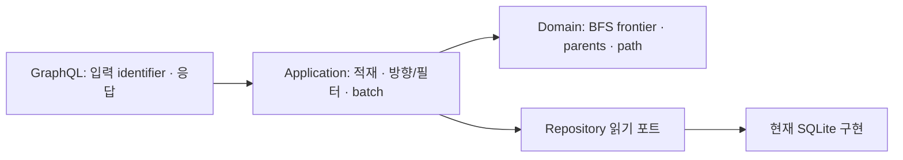

# Kuzu 설계의 복합 분석과 Bun Graph DB 적용

Kuzu에서 흡수할 핵심은 **알고리즘의 상태와 저장소 읽기를 분리하고, 동작의 의미를
API 원본·정본 설명·정답 테스트로 연결하는 방식**이다. 알고리즘만 추가하면 전송 계층의
중복이 늘고, 문서만 정리하면 실제 동작과 어긋날 수 있다. 세 관점을 함께 다뤄야 다른
API나 저장소에서도 검증된 알고리즘을 재사용할 수 있다.

기준은 [기능 비교](./bun-graph-db-kuzu-comparison.md)에 고정한 Kuzu
`89f0263cc7a1fd9c396d2c4953747a013556a7f9`와 Bun Graph DB
`c0655576e9d1d02bd78a6f598e8b27ab2b141d67`이다. 아래의 **적용**은 그 Bun 기준에서
시작한 이번 로컬 변경을 뜻한다. **후속**은 아직 구현하지 않은 제안이다.

## 장점과 적용 판단

| 관점 | Kuzu에서 확인한 설계 | Bun Graph DB에서 얻는 효과 | 비용·적용 판단 |
|---|---|---|---|
| 알고리즘 상태 | frontier, 방문 상태, single-parent 경로 저장, output writer 분리 | 경로 전체를 큐에 복사하지 않고 필요한 결과만 복원. entity/GraphQL 없이 정답 테스트 가능 | **적용:** import 없는 `BreadthFirstSearch`, 레벨 확장과 경로 복원 분리. Kuzu C++ 메모리/동시성 구현을 이식하지 않는다. |
| 그래프 접근 | `Graph` 인터페이스와 vertex/neighbor scan | 알고리즘이 물리 저장소 대신 필요한 읽기 작업에만 의존 | **적용:** `GraphTraversalService`가 repository 읽기 포트와 batching을 담당하고, SQLite는 `findAdjacentByNodeIds` bulk scan을 제공한다. 미지원 저장소는 per-node fallback을 쓴다. |
| 실행 계층 | parser → binder → planner/optimizer → processor와 별도 storage/transaction | 입력 해석·실행 계획·실행·저장소 변경을 각각 검토/검증 가능 | **일부 적용:** GraphQL identifier/응답 처리, application 읽기, domain BFS를 분리. 범용 Cypher planner 구현은 현재 요구에 비해 크다. |
| 분석 알고리즘 | 반복 PageRank, SCC/WCC, Louvain 등은 별도 `algo` 확장 | 근사 정렬과 정확한 분석 결과의 계약을 구별하고 필요할 때 추가 가능 | **적용:** import 없는 iterative-stack Kosaraju SCC와 bounded power-iteration PageRank를 추가했다. 기존 SQL 근사 정렬은 그대로 둔다. |
| 실행 최적화 | sparse/dense frontier, graph-aware planning, batch scan | sparse graph와 높은 fan-out에서 서로 다른 전략을 평가할 근거 | **부분 적용:** 관계 bulk adjacency와 traversal metrics로 round trip·적재량을 관측한다. dense frontier 전환은 ID mapping·초기화·메모리 비용 측정 후 결정한다. |
| API 문서 | 언어별 binding 원본에서 JSDoc/pdoc/Javadoc/Doxygen 생성 | 시그니처와 설명의 중복 감소, artifact 재생성 가능 | **적용:** SDL 설명을 고치고 GraphQL types/introspection 재생성. 기존 `check:codegen`과 projection 계약 검사를 유지한다. |
| 설명·기록 | API 참조, 언어별 예제, 테스트 corpus의 역할 분리 | 현재 동작과 과거 보고서·설계 제안의 혼동 감소 | **적용:** 탐색 계약과 문서 정책을 canonical로 등록하고 구현/테스트 경로를 연결. 날짜·링크·근거 경로를 `check:docs`로 검사한다. |
| 정답 검증 | shortest/recursive/weighted 경로별 예상 결과 corpus | 최적화를 해도 결과 의미를 독립적으로 확인 가능 | **적용:** 64개의 3-node 방향 그래프에서 Floyd–Warshall과 대조. 고차수·cycle·타입 필터·깊이·배치 경계는 서비스 테스트로 분리한다. |
| 소스 수명 | 문서 생성 workflow와 별도 호스팅, 고정 가능한 코드 | 외부 사이트가 바뀌어도 어떤 코드에서 학습했는지 추적 | **적용:** submodule commit과 근거 소스 고정. archived 상태와 수동 문서 workflow를 고려해 현재성은 별도 검증한다. |

이 판단은 소스 구조와 이번 변경에서 확인한 사실을 바탕으로 한다. Kuzu의 처리량이나
품질이 모든 항목에서 더 높다는 평가가 아니다. Bun Graph DB는 이미 헥사고날 계층,
문서 메타데이터, MCP registry와 OpenAPI projection 검사가 있어 그 기반을 확장했다.

## 알고리즘을 흡수할 때의 기준

### 경로 의미를 먼저 고정한다

Kuzu는 single shortest, all shortest, variable-length, weighted shortest를 별도 코드/테스트로
다룬다. Bun Graph DB의 `connectedNodes`는 node마다 한 번 방문하는 도달성 탐색이고,
`shortestPath`는 양방향 edge를 따라 최소 hop 경로 하나를 반환한다.
SQL recursive CTE의 simple path 열거와는 다른 문제다. 따라서 모든 경로를 하나의
"traversal" 옵션으로 합치기 전에 중복/방향/비용/제한을 각각 명시해야 한다.

이번에는 node-unique BFS만 분리했다. 최초 발견 시 부모와 edge 하나를 저장하고,
`pathTo(target)`에서만 복원한다. 이 구조는 BFS 상태 O(V), 경로 복원 O(L)이며,
frontier마다 경로 배열을 복사하던 비용을 제거한다. 인접 목록과 entity 적재 비용은 별도다.
최단 경로를 모두 반환하려면 부모 목록과 결과 폭증 제한이 필요하므로 single-parent 모듈에
옵션 하나만 추가해 같은 보장으로 취급할 수 없다.

관계 `strength`는 현재 도메인의 0–4 값이며 곧바로 거리 비용이 되지 않는다.
weighted shortest 도입 시 값의 단위·방향·0 비용 허용·동률·불가능한 경로와 반환 형태부터
정해야 한다. PageRank도 감쇠율·dangling node·초기값·정규화·오차·최대 반복을 정의한 뒤
반복 구현을 넣어야 기존 가중 degree 근사와 비교할 수 있다.

### 실행 정책과 알고리즘을 분리한다

이번 경계는 다음과 같다.



이 경계는 다른 저장소를 실제로 지원한다는 뜻이 아니다. 새 읽기 구현을 시험할 때
알고리즘과 전송 형식을 함께 바꾸지 않아도 되는 최소 접점을 만든 것이다.
현재 연결 탐색의 hydration은 500 node씩, 인접 적재는 64 node씩 처리한다.
`BOTH`일 때 최대 128개의 읽기 호출이 동시에 발생한다. 이것은 concurrency 제한이지
Kuzu의 chunk scan과 동등한 한 번의 bulk SQL이 아니다.

`findAdjacentByNodeIds` bulk 포트는 이제 SQLite 관계 저장소에 적용되어 있다. 반환 순서·누락 node·
관계 타입·table scope·snapshot을 계약으로 정하고 기존 per-node fallback 결과와 대조한다.
요청이 끝난 뒤 살아남는 캐시나 공유 frontier를 먼저 도입하면 freshness와 격리 문제가
생기므로 이번 상태는 호출마다 독립적으로 생성한다.

GraphQL `NodeFieldResolvers`와 legacy `NodeResolver`가 새 경계를 공유한다. REST/SQL/RelationQueries는
별도 경로이므로 전 API가 통합됐다고 보고하지 않는다. 이 경로들을 합칠 때는 기존 응답과
의미 차이를 fixture로 드러낸 뒤 이전한다. graph runtime에 auth나 MCP 정책을 넣지 않는다.

## 문서를 구현의 일부로 관리한다

Kuzu의 `gen-docs.yml`은 여러 언어 API를 원본 주석에서 생성하지만 수동 실행 workflow다.
따라서 "생성 가능"과 "매 변경에서 최신임을 검증"은 다르다. Bun Graph DB에는 다음을 적용했다.

| 대상 | 정본 | 이번에 적용한 연결 |
|---|---|---|
| API 시그니처/설명 | GraphQL SDL, MCP registry | SDL 설명 수정 → codegen 실행, 기존 검사로 types/introspection의 임시 생성 성공 확인 |
| 탐색 의미/계층 | Bun 저장소의 `docs/architecture/graph-traversal.md` | 범위·동률·깊이·필터·missing node·batch와 구현/테스트 경로 기록 |
| 문서 유지 규칙 | Bun 저장소의 `docs/development/DOCUMENTATION_POLICY.md` | canonical metadata, 코드/테스트 근거, proposal/history 처리와 갱신 순서 |
| 문서 정합성 | Bun 저장소의 `scripts/check-docs.ts` | canonical 문서의 필수 메타데이터·실재 날짜·로컬 링크·명시된 근거 경로를 정적 게이트에 편입 |
| 동작 보장 | 독립적인 정답과 repository/resolver 테스트 | metadata/링크 검사와 별도로 실행. `lastVerified`나 테스트 파일 존재를 통과 결과로 취급하지 않는다. |

과거 문서를 일괄 삭제하거나 모두 정본으로 승격하지 않았다. 기존 canonical 문서에는
선택적 근거 목록을 소급 강제하지 않는다. 검증 결과를 쓸 때는 해당 명령·날짜·범위와
실행하지 않은 부분을 함께 남긴다. 이는 새 문서 사이트 도입보다 먼저 할 수 있는 개선이다.

## 적용된 변화와 후속 순서

| 상태 | 항목 | 완료 조건 또는 결과 |
|---|---|---|
| 적용 | Domain BFS 상태 / Application 적재 / GraphQL 입력·응답 분리 | 알고리즘에 transport/storage import가 없고, 기존 GraphQL 회귀 fixture를 유지한다. |
| 적용 | 부모 포인터와 지연 경로 복원 | 알려진 정답, cycle/parallel edge, 10,000-hop 비재귀 복원으로 검증한다. |
| 적용 | 명시적 `depth=0` 존중 | `|| 1`을 `?? 1`로 수정하고 resolver 테스트에서 빈 결과를 확인한다. |
| 적용 | canonical 문서 게이트 | 새 검사기·회귀 테스트와 `check:static`/엄격 타입 검사에 포함한다. |
| 적용 | bulk adjacency 포트 | SQLite `IN` query가 방향별 adjacency를 한 번에 로드하고, 기존 per-node fallback과 같은 결과를 반환한다. |
| 적용 | 정확한 SCC | self-loop·중복/미지 edge·모든 3-node 방향 그래프·10,000-node chain을 검증한다. |
| 적용 | GraphQL 탐색 경로 통합 | 두 GraphQL resolver가 동일한 traversal service를 사용하고, HTTP GraphQL 회귀 17개가 통과한다. REST/SQL/RelationQueries는 별도 의미로 남긴다. |
| 적용 | REST/SQL/RelationQueries 경로 통합 | RelationQueries의 path/dependency 조회가 node table을 확인한 뒤 `IGraphRepository`의 SQLite 구현을 사용한다. REST와 SQL 결과 fixture가 GraphQL comprehensive 8개 테스트에서 통과한다. |
| 후속 1 | REST/SQL 고급 경로 확장 | enhanced relation analytics와 weighted path까지 같은 저장소 계약에 연결하고, 방향·깊이·동률·scope를 더 넓은 fixture로 검증한다. |
| 적용 | traversal 관측 | GraphQL 로그에 node/adjacency batch, bulk/per-node 호출, 적재 관계, 최대 frontier, elapsed time을 기록한다. HTTP 전체 왕복과 저장소 지표는 분리한다. |
| 후속 2 | 실행 계획 고도화 | 저장소 query plan, RSS, cold/warm, HTTP 왕복을 같은 fixture로 기록해 최적화 후보를 판단한다. |
| 적용 | 정식 PageRank | 감쇠율·dangling node·초기값·정규화·오차·최대 반복을 `PageRank` API와 테스트로 고정했다. SQL 정렬 근사식과는 별도다. |
| 적용 | 벡터/대규모 저장 기준선 | Exact cosine index, SQLite bulk/per-node benchmark, Kuzu HNSW/CSR 비교 조건을 [기준선 문서](../../../references/bun-graph-db/docs/architecture/vector-and-storage-comparison.md)에 고정했다. |

Kuzu는 설계 레퍼런스로 사용하며 이번 구현에는 런타임 의존성을 추가하지 않았다.
성능 배수, 전체 API의 의미 동등성, Kuzu 실행 호환성은 이번 변경의 결과가 아니다.

## 근거 소스

| 분야 | Kuzu 근거 |
|---|---|
| 그래프 읽기와 chunk | [Graph](../../../references/kuzu/src/include/graph/graph.h) |
| frontier | [sparse/dense frontier](../../../references/kuzu/src/include/function/gds/gds_frontier.h) |
| 부모와 single shortest | [BFS parent 상태](../../../references/kuzu/src/include/function/gds/bfs_graph.h), [single shortest 실행/출력](../../../references/kuzu/src/function/gds/ssp_paths.cpp) |
| 분석 확장 | [PageRank](../../../references/kuzu/extension/algo/src/function/page_rank.cpp), [알고리즘 모음](../../../references/kuzu/extension/algo/src/function) |
| 계층 | [parser](../../../references/kuzu/src/parser), [binder](../../../references/kuzu/src/binder), [planner](../../../references/kuzu/src/planner), [optimizer](../../../references/kuzu/src/optimizer), [processor](../../../references/kuzu/src/processor) |
| 문서 생성 | [언어별 문서 workflow](../../../references/kuzu/.github/workflows/gen-docs.yml), [Node API](../../../references/kuzu/tools/nodejs_api/src_js/connection.js) |
| 정답 corpus | [최단 경로](../../../references/kuzu/test/test_files/shortest_path), [weighted shortest](../../../references/kuzu/test/test_files/function/gds/weighted_shortest.test) |

| 분야 | Bun Graph DB 적용 근거 |
|---|---|
| 코드 | [BFS 상태](../../../references/bun-graph-db/src/domain/services/graph/BreadthFirstSearch.ts), [적재 서비스](../../../references/bun-graph-db/src/application/services/GraphTraversalService.ts), [리졸버](../../../references/bun-graph-db/src/presentation/graphql/field-resolvers/NodeFieldResolvers.ts) |
| 계약·정책 | [탐색 계약](../../../references/bun-graph-db/docs/architecture/graph-traversal.md), [문서 정책](../../../references/bun-graph-db/docs/development/DOCUMENTATION_POLICY.md) |
| 검사 | [canonical 문서 검사](../../../references/bun-graph-db/scripts/check-docs.ts), [검사기 회귀 테스트](../../../references/bun-graph-db/tests/unit/check-docs.test.ts) |
| 알고리즘 검증 | [독립 거리 oracle](../../../references/bun-graph-db/tests/unit/breadth-first-search.test.ts), [적재/리졸버 회귀](../../../references/bun-graph-db/tests/unit/node-field-resolvers-graph-traversal.test.ts) |
| bulk/SCC 검증 | [bulk adjacency 회귀](../../../references/bun-graph-db/tests/unit/sqlite-graph-repository-traversal.test.ts), [SCC oracle](../../../references/bun-graph-db/tests/unit/strongly-connected-components.test.ts) |
| PageRank 검증 | [PageRank 정답·수렴 테스트](../../../references/bun-graph-db/tests/unit/page-rank.test.ts) |
| 벡터/저장소 검증 | [Exact vector 테스트](../../../references/bun-graph-db/tests/unit/exact-vector-index.test.ts), [benchmark](../../../references/bun-graph-db/scripts/benchmark-vector-storage.ts), [비교 기준선](../../../references/bun-graph-db/docs/architecture/vector-and-storage-comparison.md) |
| REST/SQL 통합 검증 | [RelationQueries](../../../references/bun-graph-db/src/presentation/graphql/queries/RelationQueries.ts), [GraphQL traversal comprehensive](../../../references/bun-graph-db/tests/comprehensive/graph-traversal-comprehensive.test.ts) |

## 검증 기록

2026-10-27, 위 Bun Graph DB 기준 commit에 이번 로컬 변경을 적용한 작업 트리에서 실행했다.

| 범위 | 실행 | 결과 |
|---|---|---|
| 알고리즘·문서 검사기·서비스/리졸버·기존 SQL/검색/트랜잭션·lane 분류 | 아래 11개 unit 파일 | 61 pass, 0 fail, 3,277 assertions |
| 실제 HTTP GraphQL 경로 | `bun test tests/graph-traversal-advanced.test.ts` | 격리 DB/서버에서 17 pass, 0 fail, 64 assertions |
| projection 계약 | `bun run projection:check` | 4 pass, 0 fail, 39 assertions |
| Bun 정적 검증 | `bun run check:static` | canonical 문서 8개, 버전, lint, 세 타입 검사, codegen, build 통과 |
| 최종 문서/SDL 조정 후 | `bun run check:docs`, `bun run check:codegen`, 변경 파일 lint, 문서 검사기 테스트 | 통과. codegen은 임시 생성물 두 개의 생성 성공을 확인한다. |
| OA SDK 루트 | `pnpm check:docs`, `pnpm check:cli-spec`, `pnpm check:release-policy`, `pnpm check:api-index`, `pnpm typecheck:all` | 모두 통과. 루트 타입 검사는 Turbo 56개 task 전체 cache hit이며 Bun 검사를 대신하지 않는다. |

11개 unit 파일 실행은 Bun Graph DB 디렉터리에서 다음과 같이 재현한다.

```bash
bun test tests/unit/breadth-first-search.test.ts \
  tests/unit/strongly-connected-components.test.ts \
  tests/unit/page-rank.test.ts \
  tests/unit/exact-vector-index.test.ts \
  tests/unit/check-docs.test.ts \
  tests/unit/node-field-resolvers-graph-traversal.test.ts \
  tests/unit/sqlite-graph-repository-traversal.test.ts \
  tests/unit/sqlite-node-search-fulltext.test.ts \
  tests/unit/sqlite-node-mutation-repository.test.ts \
  tests/unit/graphql-root-resolvers.test.ts \
  tests/unit/test-lanes-script.test.ts
```

이번 선택 범위는 **61개 테스트, 3,277 assertions**다.
전체 test lane, 모든 API 구현의 동등성, Kuzu C++/바인딩 실행, 엔진 간 성능 비교는 실행하지 않았다.
수정은 Bun Graph DB submodule의 로컬 작업 트리에 있으며, commit/push나 상위 gitlink 갱신은 하지 않았다.
