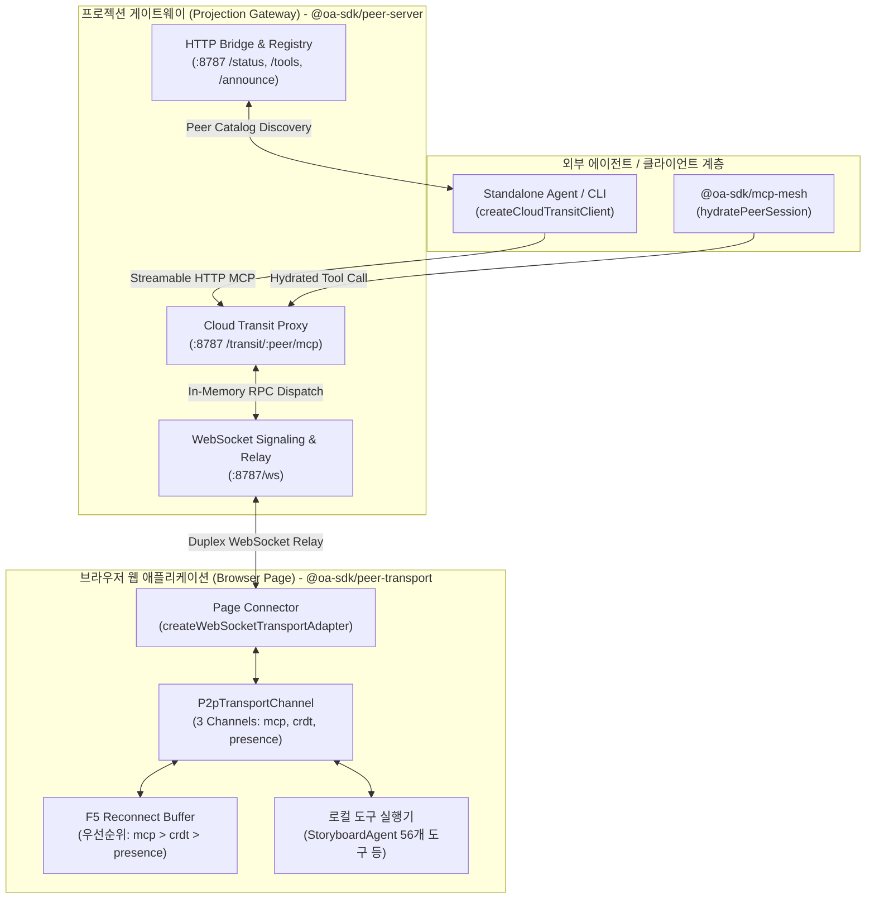

# WebMCP 프로젝션 게이트웨이 및 P2P 중계 연동 가이드

브라우저 내 웹 애플리케이션(예: Wireframe/Storyboard 툴킷, 캔버스 에디터, 게임 엔진 등)의 내부 상태와 실행 도구를 외부 AI 에이전트(LLM)에 노출하고, 방화벽/NAT 환경에서도 안정적인 양방향 통신을 보장하기 위한 **WebMCP 프로젝션 게이트웨이(Projection Gateway)** 및 **P2P 중계 전송(Peer Transport)** 실무 가이드입니다.

전체 개념 및 모듈 의존성 구조는 [WebMCP 피어링·전송·협업·메시 아키텍처](../concepts/webmcp-peering-mesh-and-collab.md), 보안 경계 및 운영 규칙은 [WebMCP 보안 감사 및 경계 계약](../security/webmcp-hardening.md)을 참조하십시오.

---

## 1. 해결하는 문제와 3계층 아키텍처

### 1.1 브라우저 도구 노출의 한계
- **인바운드 포트 수신 불가**: 웹 브라우저 환경은 보안 샌드박스로 인해 직접 TCP/HTTP 리스닝 소켓을 열 수 없습니다.
- **방화벽 및 NAT 제약**: 로컬 개발 PC나 클라우드 샌드박스 내부의 브라우저는 외부 에이전트가 직접 IP로 접근할 수 없습니다.
- **새로고침(F5) 시 RPC 유실**: 사용자가 브라우저를 새로고침하거나 일시적으로 탭을 비활성화할 때 소켓이 끊어지며, 에이전트가 발행한 도구 호출이 유실될 위험이 있습니다.

### 1.2 3계층 프로젝션 토폴로지 (Projection Gateway Topology)

`oa-sdk`는 브라우저를 직접 외부에 노출하지 않고, 경량 게이트웨이 데몬과 우선순위 전송 채널을 통해 도구를 중계 투영(Projection)합니다.



---

## 2. 패키지 구조 및 서브패스 진입점

라이브러리는 브라우저 번들 크기를 최소화하고 Node.js/Edge 환경을 명확히 분리하기 위해 2개의 패키지와 세부 서브패스로 나뉩니다.

### 2.1 `@oa-sdk/peer-transport` (브라우저 & Node.js 겸용)
- **외부 런타임 의존성 0개** (`dependencies: {}`)로 설계되어 웹 번들러(Vite, Webpack 등)에 안전하게 포함됩니다.
- 서브패스:
  - `@oa-sdk/peer-transport`: `P2pTransportChannel`, `WebMcpBridgeClient`, 와이어 프로토콜 스키마, 바이트 상한 상수 (`MAX_SIGNAL_BYTES = 64KB`, `MAX_RELAY_BYTES = 1MB`).
  - `@oa-sdk/peer-transport/adapters`: `createWebSocketTransportAdapter` (중계 전송 어댑터), `createCloudTransitClient` (클라우드 경유 도구 호출 클라이언트).

### 2.2 `@oa-sdk/peer-server` (Node.js 22+ 및 Edge/Workers)
- HTTP 피어 레지스트리, 랑데부 디스크립터, WebSocket 시그널링/패킷 중계, Cloud Transit 프록시를 제공합니다.
- 서브패스:
  - `@oa-sdk/peer-server`: `createPeerServer()`, `FilePeerStore`.
  - `@oa-sdk/peer-server/relay`: `SignalingRoom` (7단계 FSM & 티켓 수락), `PeerRelayManager`, `attachWebSocketRelay`.
  - `@oa-sdk/peer-server/cloud`: `CloudTransitProxy`, `handleCloudTransitWorker`, `createCloudTransitProxy`.

---

## 3. 실전 구현 레시피

### [레시피 1] Projection Gateway 로컬 데몬 구동 (`scripts/gateway.mjs`)
웹 애플리케이션의 정적 빌드 파일 서빙과 WebMCP 게이트웨이를 결합하여 띄웁니다.

```typescript
// scripts/gateway.mjs
import http from 'node:http'
import { createPeerServer } from '@oa-sdk/peer-server'

// 1. WebMCP 게이트웨이 서버 초기화
const peerServer = createPeerServer({
  port: 8787,
  hostname: '127.0.0.1',
  enableRelay: true,          // WebSocket 시그널링 및 P2P 패킷 중계 활성화 (/ws)
  enableCloudTransit: true,   // Streamable HTTP MCP 경유 엔드포인트 활성화 (/transit/:peer/mcp)
  allowedOrigins: ['http://localhost:5173', 'http://127.0.0.1:4173'],
})

const { port } = await peerServer.start()
console.log(`[WebMCP Gateway] Listening at http://127.0.0.1:${port}`)
console.log(`[WebMCP Gateway] Cloud Transit endpoint: http://127.0.0.1:${port}/transit/:peer/mcp`)
console.log(`[WebMCP Gateway] WebSocket Relay endpoint: ws://127.0.0.1:${port}/ws`)
```

---

### [레시피 2] 브라우저 Page Connector 구현 (`src/integration/webmcp-connector.ts`)
브라우저 애플리케이션이 로드될 때 게이트웨이의 WebSocket 릴레이에 연결하여 도구 포트를 개설합니다.

```typescript
// src/integration/webmcp-connector.ts
import { P2pTransportChannel } from '@oa-sdk/peer-transport'
import { createWebSocketTransportAdapter } from '@oa-sdk/peer-transport/adapters'

export interface PageConnectorOptions {
  gatewayUrl: string // 예: 'ws://127.0.0.1:8787/ws'
  roomId: string
  clientTicket: string
  localAgent: {
    listTools: () => Array<{ name: string; description?: string; inputSchema: object }>
    invoke: (name: string, input?: Record<string, unknown>) => Promise<unknown>
  }
}

export async function attachPageToGateway(options: PageConnectorOptions) {
  // 1. 브라우저용 3-채널 전송 레이어 생성
  const channel = new P2pTransportChannel({
    peerId: 'browser-page-host',
    alias: 'wireframe-storyboard',
  })

  // 2. 게이트웨이 WebSocket 릴레이 어댑터 바인딩
  const adapter = createWebSocketTransportAdapter(channel, {
    url: `${options.gatewayUrl}?room=${options.roomId}`,
    tokenOrTicket: options.clientTicket,
    role: 'provider', // 도구를 제공하는 Provider 역할
    autoReconnect: true,
  })

  // 3. mcp-jsonrpc 채널로 수신된 도구 호출 처리
  channel.on('mcp-jsonrpc', async (packet) => {
    const { id, method, params } = packet.payload

    if (method === 'tools/list') {
      const tools = options.localAgent.listTools()
      await channel.send('mcp-jsonrpc', {
        jsonrpc: '2.0',
        id,
        result: { tools },
      })
      return
    }

    if (method === 'tools/call') {
      try {
        const toolResult = await options.localAgent.invoke(params.name, params.arguments)
        await channel.send('mcp-jsonrpc', {
          jsonrpc: '2.0',
          id,
          result: toolResult,
        })
      } catch (err: any) {
        // MCP 규약: 애플리케이션 레벨 실패는 isError: true 및 content 반환
        await channel.send('mcp-jsonrpc', {
          jsonrpc: '2.0',
          id,
          result: {
            isError: true,
            content: [{ type: 'text', text: err?.message || String(err) }],
          },
        })
      }
    }
  })

  await adapter.connect()
  return { channel, adapter }
}
```

---

### [레시피 3] 외부 에이전트/CLI에서 브라우저 도구 호출 (`client-caller.ts`)
에이전트는 브라우저 내부 구조를 알 필요 없이 Cloud Transit Proxy를 통해 일반 HTTP MCP 서버처럼 도구를 호출합니다.

```typescript
// client-caller.ts
import { createCloudTransitClient } from '@oa-sdk/peer-transport/adapters'

const client = createCloudTransitClient({
  serverUrl: 'http://127.0.0.1:8787',
  peerAlias: 'wireframe-storyboard',
  timeoutMs: 10000,
})

// 1. 브라우저가 노출한 도구 목록 조회
const tools = await client.listTools()
console.log('Available tools in browser:', tools.map((t) => t.name))

// 2. 브라우저 캔버스에 페이지 생성 도구 호출
const result = await client.callTool({
  tool: 'storyboard_page_create',
  args: { title: '01_사용자_온보딩_화면' },
})

if (result.status === 'ok') {
  console.log('Page created successfully:', result.result)
} else {
  console.error('Failed to create page in browser:', result.error)
}
```

---

### [레시피 4] `@oa-sdk/mcp-mesh` 세션 수화 및 통합 오케스트레이션
여러 피어(브라우저, 로컬 데몬, 원격 워커)를 단일 LLM 에이전트 스킬 레지스트리로 결합합니다.

```typescript
// agent-orchestrator.ts
import { SkillRegistry, hydratePeerSession } from '@oa-sdk/mcp-mesh'
import { createCloudTransitClient } from '@oa-sdk/peer-transport/adapters'

const registry = new SkillRegistry()

// WST 브라우저 도구 수화
const wstClient = createCloudTransitClient({
  serverUrl: 'http://127.0.0.1:8787',
  peerAlias: 'wireframe-storyboard',
})

await hydratePeerSession(
  {
    id: 'wst-session-01',
    domain: 'wireframe',
    transport: 'cloud-transit',
  },
  wstClient,
  { registry, prefix: 'wst' }
)

// 이제 LLM 에이전트는 'wst_storyboard_page_create' 형태로 도구를 조회하고 실행할 수 있습니다.
const res = await registry.dispatch('wst_storyboard_page_create', { title: 'Home' })
```

---

## 4. 회복 탄력성(Resilience) 및 새로고침(F5) 버퍼링

브라우저가 새로고침되거나 순간적으로 연결이 끊어졌을 때 패킷 유실을 막기 위해 `P2pTransportChannel`은 3채널 메모리 버퍼와 우선순위 플러시 정책을 유지합니다.

```
[연결 단절 감지 (F5 등)]
         │
         ▼
[송신 요청 큐 적재 (In-Memory Queue, bounded by maxQueuePerChannel)]
         │
         ▼
[WebSocket 재연결 수립 (setConnectionState('connected'))]
         │
         ▼
[엄격한 채널 우선순위 순차 플러시]
  1순위: 'mcp-jsonrpc' ──> 에이전트 요청/응답 패킷 우선 보존
  2순위: 'crdt-delta'   ──> 동시 편집 상태 동기화 델타 플러시
  3순위: 'presence'     ──> 커서 및 하트비트 (가장 먼저 drop 허용)
```

- **데드라인 만료 처리**: 기본 5,000ms(`DEFAULT_PACKET_DEADLINE_MS`)를 초과한 패킷은 자동 폐기되어 메모리 누수를 방지합니다.
- **큐 오버플로 방어**: 채널별 최대 큐 크기(`maxQueuePerChannel = 256`) 초과 시 `presence` $\to$ `crdt-delta` $\to$ `mcp-jsonrpc` 순으로 기존 패킷을 드롭하여 RPC 채널의 무결성을 최우선 보호합니다.

---

## 5. 보안 및 적대적 공격 방어 (Hardening)

| 위협 요소 | 방어 메커니즘 | 동작 규약 |
| :--- | :--- | :--- |
| **티켓 재전송 공격 (Ticket Replay)** | 48-hex 단일 사용 토큰(One-Time Token) | Provider 또는 Client가 이미 수락한 티켓으로 재접속 시도시 `409 ROOM_BUSY` 반환 및 연결 거절 |
| **시그널링 플러딩 공격 (Signaling Flood)** | 세션당 최대 32 프레임 상한 (`MAX_SIGNAL_FRAMES`) | 32회를 초과하여 시그널링 메시지를 전송하는 소켓은 즉시 룸에서 퇴출 및 강제 종료 |
| **대용량 페이로드 DoS** | 와이어 바이트 상한 검증 | 시그널링 메시지 64KB(`MAX_SIGNAL_BYTES`), 중계 릴레이 패킷 1MB(`MAX_RELAY_BYTES`) 초과 시 소켓 종료 |
| **불법 교차 출처 공격** | `allowedOrigins` Origin 화이트리스트 | 허가되지 않은 도메인에서 브라우저 WebSocket 접속 시 핸드셰이크 단계에서 차단 |
| **원격 무단 실행 방지** | Loopback 외부 `publishKey` 필수 강제 | 외부 인터페이스(`0.0.0.0`) 바인딩 시 `publishKey`가 없으면 서버 시작 거부 (Fail-Closed) |

---

## 6. 테스트 및 검증 명령어

구현된 게이트웨이와 브라우저 어댑터의 동작 무결성을 모노레포 환경에서 검증합니다.

```bash
# 1. peer-transport 3개 테스트 스위트 (34개 테스트)
pnpm --filter @oa-sdk/peer-transport test

# 2. peer-server E2E 릴레이 라이프사이클 포함 5개 스위트 (36개 테스트)
pnpm --filter @oa-sdk/peer-server test

# 3. mcp-mesh 세션 수화 및 도메인 바인딩 (17개 테스트)
pnpm --filter @oa-sdk/mcp-mesh test

# 4. 전체 87개 테스트 동시 검증
pnpm --filter @oa-sdk/peer-transport --filter @oa-sdk/peer-server --filter @oa-sdk/mcp-mesh test
```

---

## 7. 실전 도입 트러블슈팅 및 8대 함정(Gotchas) 방어 가이드

실제 프로덕션 환경 및 대규모 모노레포(예: `wireframe-storyboard-toolkit`, `scene-platform`)에 게이트웨이를 도입하는 과정에서 마주치기 쉬운 8대 함정과 구체적인 해결 패턴입니다.

### [Gotcha 1] `enableCloudTransit: true` 및 `enableRelay: true` 플래그 누락
- **현상**: `createPeerServer({ port: 8787 })` 구동 후 `POST /transit/:peer/mcp` 호출 시 `404 Not Found` 또는 WebSocket `/ws` 접속 시 핸드셰이크 거절.
- **원인**: 보안상 기본값이 `false`로 설정되어 있어 명시적으로 켜지 않으면 라우트가 마운트되지 않습니다.
- **해결책**:
  ```typescript
  // 올바른 설정
  const peerServer = createPeerServer({
    port: 8787,
    enableRelay: true,          // WebSocket 시그널링 & 패킷 릴레이 (/ws)
    enableCloudTransit: true,   // Cloud Transit 프록시 (/transit/:peer/mcp)
  })
  ```

---

### [Gotcha 2] 동적 에페머럴 포트(`port: 0`) 바인딩 시점 및 포트 획득
- **현상**: 테스트나 다중 인스턴스 환경에서 `port: 0`을 전달했으나 `peerServer.port`가 여전히 `0`이라 클라이언트가 연결하지 못함 (`ECONNREFUSED`).
- **원인**: 생성 시점에는 소켓 바인딩이 완료되지 않으며, `peerServer.port` 프로퍼티는 초기 요청 포트(0)를 보유합니다.
- **해결책**:
  ```typescript
  // 반드시 await server.start()를 호출하고 반환된 port 또는 server.address().port를 사용
  const peerServer = createPeerServer({ port: 0, enableCloudTransit: true })
  const { port } = await peerServer.start()
  // 또는: const actualPort = peerServer.server.address().port
  ```

---

### [Gotcha 3] MCP 도구 호출 결과와 내부 도구 에러 매핑 규약 (`isError: true` vs Protocol Error)
- **현상**: 내부 도구 실행에서 `{ ok: false, error: { message: '실패 원인' } }` 객체를 반환했는데, `CloudTransitClient`가 이를 `status: 'success'`로 반환하여 에이전트/테스트가 실패를 감지하지 못함.
- **원인**: MCP(Model Context Protocol)는 도구 실행 실패를 HTTP 500이나 JSON-RPC 에러가 아니라 `result: { isError: true, content: [{ type: 'text', text: message }] }`로 전달하도록 규정합니다. Provider가 `isError: true`를 지정하지 않으면 게이트웨이는 일반 성공 페이로드로 간주하여 `{ isError: false }`로 래핑합니다.
- **해결책**:
  ```typescript
  // Provider 브리지 메시지 핸들러에서 ok: false를 isError: true로 변환
  const invokeResult = await agent.invoke(toolName, toolArgs)
  if (invokeResult && typeof invokeResult === 'object' && 'ok' in invokeResult && invokeResult.ok === false) {
    peerServer.roomManager.handleProviderMessage(alias, {
      type: 'mcp',
      message: {
        id,
        result: {
          isError: true,
          content: [{ type: 'text', text: invokeResult.error?.message || 'Tool execution failed' }],
        },
      },
    })
    return
  }
  ```

---

### [Gotcha 4] MCP `CallToolResult` 텍스트 엔벨로프(`content[0].text`) 언패킹
- **현상**: `const res = await client.callTool(...)` 호출 후 `res.result.myField`에 직접 접근하면 `undefined` 발생.
- **원인**: MCP 표준 규약상 도구 반환값은 항상 `content: Array<{ type: 'text', text: string }>` 형태로 JSON 문자열화되어 전달됩니다.
- **해결책**:
  ```typescript
  const res = await client.callTool({ tool: 'storyboard_context_get', args: {} })
  if (res.status === 'success' && res.result?.content?.[0]?.text) {
    const payload = JSON.parse(res.result.content[0].text)
    console.log('실제 도구 반환 데이터:', payload)
  }
  ```

---

### [Gotcha 5] 코어 번들러 제로-의존성(Zero-Dependency) 격리 아키텍처
- **현상**: 웹 애플리케이션 코어 `src/`에 `@oa-sdk/peer-transport`를 직접 import했다가 번들러 빌드 단계에서 `External runtime import` 에러 발생 (WST `scripts/build.mjs` 등).
- **원인**: 순수 브라우저 저작 코어는 0-의존성 IIFE/ESM 번들 무결성을 보장하기 위해 외부 패키지 import를 금지하는 경우가 많습니다.
- **해결책**: 네트워크 전송 레이어(`@oa-sdk/peer-transport`)를 코어 `src/`에 직접 import하지 않고, `scripts/` (게이트웨이 데몬), `packages/` (전용 확장 모듈), 또는 브라우저 엔트리포인트 어댑터로 격리하여 의존성 주입(Dependency Injection) 형태로 연결합니다.

---

### [Gotcha 6] AST 주석 스캐너의 템플릿 리터럴 격리 면역성 (Literal String Immunity)
- **현상**: 소스 코드 내에 `/* @editable */` 주석이 분명히 적혀 있음에도 `findAnchors`가 0개를 반환함.
- **원인**: TypeScript/Babel 기반 AST 스캐너는 문자열 및 백틱 템플릿 리터럴 내부의 텍스트를 주석 트리비아가 아닌 텍스트 리터럴로 취급하여 건너뜁니다 (`if (isInsideLiteral) continue;`). 프리셋이 템플릿 문자열(`PRESETS.code = \`...\``)로 정의되어 있을 때 전체 파일을 파싱하면 주석이 무시됩니다.
- **해결책**: 파일 전체를 파싱하지 않고 템플릿 리터럴 내부의 실제 소스 코드 문자열을 별도로 추출하여 `findAnchors`에 전달합니다.

---

### [Gotcha 7] 단일 게이트웨이 다중 피어 멀티 테넌트 공존 (Single Gateway Multi-Peer Routing)
- **현상**: 로컬 개발 환경에서 여러 프로젝트(WST, Scene Platform 등)를 동시에 띄울 때 포트를 각각 분리(`8787`, `8788`)하여 관리해야 하는 번거로움과 포트 충돌 위험.
- **원인 및 해결책**: `@oa-sdk/peer-server`는 단일 포트(`8787`)에서 URL 경로별 피어 alias 라우팅을 지원하므로, 하나의 데몬에서 충돌 없이 완전 격리 운영이 가능합니다:
  - `http://127.0.0.1:8787/transit/wireframe-storyboard/mcp` $\to$ WST (68개 도구)
  - `http://127.0.0.1:8787/transit/scene-stage/mcp` $\to$ Scene Platform (6개 도구)

---

### [Gotcha 8] 런타임 권한 객체의 엄격한 속성 검증 (Strict Key Validation)
- **현상**: `authority` 제공 시 `AUTHORITY_UNAVAILABLE` 에러가 발생하며 쓰기 도구 호출이 거부됨.
- **원인**: 런타임 타입 가드가 `hasKeys`를 통해 허용되지 않은 키(예: `display`에 `{ handle }` 포함)나 누락된 필수 키(예: `grant`에 `documentId` 누락)를 감지하고 Fail-Closed 방식으로 차단함.
- **해결책**:
  ```typescript
  // 허용된 정확한 키만을 전달
  const principal = {
    principalId: 'p-agent-1',
    kind: 'automation',
    display: { name: 'Agent', role: 'assistant' }, // role 필수, 임의의 handle 등 제외
  }
  const grant = {
    id: 'grant-1',
    principalId: 'p-agent-1',
    documentId: document.id,                        // documentId 필수
    commandFamilies: ['slide.*', 'sequence.*'],
    expiresAt: new Date(Date.now() + 60_000).toISOString(),
    revocationVersion: 1,
  }
  ```

---

## 8. 모노레포 및 외부 프로젝트 검증 체크리스트

새로운 웹 프로젝트에 WebMCP 게이트웨이를 연결할 때 다음 체크리스트를 순서대로 확인하십시오:

- [ ] **패키지 링크**: `node_modules/@oa-sdk/peer-transport` 및 `node_modules/@oa-sdk/peer-server` 심볼릭 링크 또는 의존성 설치 확인.
- [ ] **게이트웨이 플래그**: `createPeerServer` 호출 시 `enableRelay: true`, `enableCloudTransit: true` 설정 확인.
- [ ] **실제 포트 바인딩**: `await server.start()` 호출 및 `server.address().port` 확인.
- [ ] **에러 매핑**: Provider 메시지 핸들러에서 실패 응답을 `{ isError: true, content: [{ type: 'text', text: msg }] }` 형태로 래핑하는지 확인.
- [ ] **엔벨로프 언패킹**: 클라이언트 측에서 `JSON.parse(res.result.content[0].text)`로 실제 페이로드를 언패킹하는지 확인.
- [ ] **CORS 설정**: 브라우저 오리진(`http://localhost:5173` 등)이 `allowedOrigins`에 등록되어 있는지 확인.
- [ ] **멀티 테넌트 격리**: 서로 다른 피어 alias 간 도구 목록 및 호출이 완벽히 분리되는지 확인.

