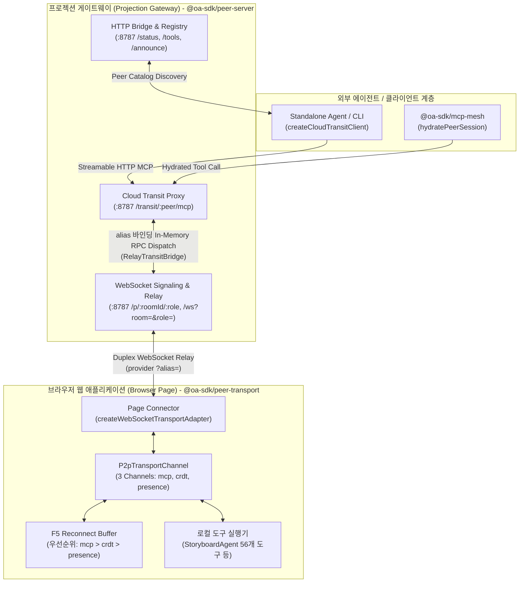

# WebMCP 프로젝션 게이트웨이 및 P2P 중계 연동 가이드

브라우저 내 웹 애플리케이션(예: Wireframe/Storyboard 툴킷, 캔버스 에디터, 게임 엔진 등)의 내부 상태와 실행 도구를 외부 AI 에이전트(LLM)에 노출하고, 방화벽/NAT 환경에서도 안정적인 양방향 통신을 보장하기 위한 **WebMCP 프로젝션 게이트웨이(Projection Gateway)** 및 **P2P 중계 전송(Peer Transport)** 실무 가이드입니다.

전체 개념 및 모듈 의존성 구조는 [WebMCP 피어링·전송·협업·메시 아키텍처](../concepts/webmcp-peering-mesh-and-collab.md), 보안 경계 및 운영 규칙은 [WebMCP 보안 감사 및 경계 계약](../security/webmcp-hardening.md)을 참조하십시오.

이 가이드는 두 relay 구현을 다룹니다. 1~8절의 `/p/:roomId/:role`, `/relay/rooms`, Cloud Transit 레시피와 5절의 표는 `@oa-sdk/peer-server`·`@oa-sdk/peer-transport`의 것입니다. `@oa-sdk/webmcp-peer`도 `/p/:id/...` 경로를 쓰지만 다른 protocol(`webmcp-peer/1`)이며, 그 wire 규칙(엔드포인트, frame, 오류 이름, 상한)의 정본은 [WebMCP relay protocol](../internal/webmcp-relay-protocol.md)입니다. 두 패키지의 같은 이름의 경로를 섞어 쓰지 마십시오(예: 이미 쓴 초대로 join하면 `@oa-sdk/peer-server`는 `409 ROOM_BUSY`, `@oa-sdk/webmcp-peer`는 `409 INVITE_TOKEN_CONSUMED`로 답합니다).

---

## 1. 해결하는 문제와 3계층 아키텍처

### 1.1 브라우저 도구 노출의 한계
- **인바운드 포트 수신 불가**: 웹 브라우저 환경은 보안 샌드박스로 인해 직접 TCP/HTTP 리스닝 소켓을 열 수 없습니다.
- **방화벽 및 NAT 제약**: 로컬 개발 PC나 클라우드 샌드박스 내부의 브라우저는 외부 에이전트가 직접 IP로 접근할 수 없습니다.
- **새로고침(F5) 시 RPC 유실**: 사용자가 브라우저를 새로고침하거나 일시적으로 탭을 비활성화할 때 소켓이 끊어지며, 에이전트가 발행한 도구 호출이 유실될 위험이 있습니다.

### 1.2 3계층 프로젝션 토폴로지 (Projection Gateway Topology)

`oa-sdk`는 브라우저를 직접 외부에 노출하지 않고, 경량 게이트웨이 데몬과 우선순위 전송 채널을 통해 도구를 중계 투영(Projection)합니다.



`Cloud_Transit ↔ WS_Relay` 경로는 `createPeerServer({ enableRelay: true, enableCloudTransit: true })`에서만 활성화됩니다. Provider(페이지 커넥터)가 릴레이 룸에 `alias=<피어 alias>` 쿼리를 붙여 접속하면 서버의 `RelayTransitBridge`가 그 룸의 client 측(가상 client)을 맡고, `/transit/:peer/mcp`·`/call`로 들어온 `tools/call`을 `mcp-jsonrpc` relay 패킷으로 provider에 전달한 뒤 provider의 JSON-RPC 응답으로 호출을 완료합니다. 같은 alias를 새 룸이 바인딩하면(예: 페이지 새로고침) 이전 룸은 `TRANSIT_ALIAS_REBOUND`로 종료됩니다. relay 프레임(`{type:'relay', packet}`)이 `MAX_RELAY_BYTES`를 넘는 호출은 그 호출만 `PAYLOAD_TOO_LARGE`로 실패하고(`/call`은 413, `/transit/:peer/mcp`는 `isError` 결과) provider의 relay 세션은 그대로 유지됩니다. 기본 `maxBodyBytes`(1 MiB)는 `MAX_RELAY_BYTES`와 같으므로 본문 상한에 가까운 인자는 relay 봉투 때문에 이 상한에 걸릴 수 있습니다. 프로세스 내부 provider는 `server.roomManager.setProviderSocket`/`handleProviderMessage`로 직접 연결할 수도 있습니다.

---

## 2. 패키지 구조 및 서브패스 진입점

라이브러리는 브라우저 번들 크기를 최소화하고 Node.js/Edge 환경을 명확히 분리하기 위해 2개의 패키지와 세부 서브패스로 나뉩니다.

### 2.1 `@oa-sdk/peer-transport` (브라우저 & Node.js 겸용)
- **외부 런타임 의존성 0개** (`dependencies: {}`)로 설계되어 웹 번들러(Vite, Webpack 등)에 안전하게 포함됩니다.
- 서브패스:
  - `@oa-sdk/peer-transport`: `P2pTransportChannel`, `WebMcpBridgeClient`, 와이어 프로토콜 스키마, 바이트 상한 상수 (`MAX_SIGNAL_BYTES = 64KB`, `MAX_RELAY_BYTES = 1MB`).
  - `@oa-sdk/peer-transport/adapters`: `createWebSocketTransportAdapter` (중계 전송 어댑터), `createCloudTransitClient` (클라우드 경유 도구 호출 클라이언트).

### 2.2 `@oa-sdk/peer-server` (Node.js 22+ 및 Edge/Workers)
- HTTP 피어 레지스트리, 랑데부 디스크립터, WebSocket 시그널링/패킷 중계, Cloud Transit 프록시를 제공합니다.
- 서브패스:
  - `@oa-sdk/peer-server`: `createPeerServer()`, `FilePeerStore`, `RelayTransitBridge` (릴레이 provider ↔ Cloud Transit 바인딩).
  - `@oa-sdk/peer-server/relay`: `SignalingRoom` (7단계 FSM & 티켓 수락), `PeerRelayManager`, `attachWebSocketRelay`, `MAX_SIGNAL_FRAMES`.
  - `@oa-sdk/peer-server/cloud`: `CloudTransitProxy`, `handleCloudTransitHttpRequest`, `handleCloudTransitWorker`.

### 2.3 `@oa-sdk/webmcp-peer` (3-Tier 단일 통합 패키지 및 기능 의도 단위 모듈화)
- 룸 기반 Streamable HTTP MCP 라우터(`/p/:id/mcp`), WebSocket 시그널링 데몬(`/p/:id/provider`, `/p/:id/client`), 브라우저 Provider, 외부 에이전트/CLI 세션 클라이언트를 **단일 패키지(`dependencies: {}`)**로 통합한 패키지입니다 (상세: [`packages/webmcp-peer/README.md`](../../packages/webmcp-peer/README.md)). 세 계층이 주고받는 규칙은 [WebMCP relay protocol](../internal/webmcp-relay-protocol.md)이 요건 ID(`R-…`) 단위로 정하며, 아래 목록은 모듈의 위치와 역할만 요약합니다.
- 서브패스 및 기능 의도 단위 모듈:
  - `@oa-sdk/webmcp-peer/config`:
    - `config/invitation.ts`: URL 정규화 및 `#invite=...` 초대 링크 파서/빌더 (`normalizePeerUrl`, `parseInvitationUrl`, `buildInvitationUrl`)
    - `config/profile.ts`: 휴대용 피어 설정 프로필 직렬화/파싱 (`createPeerConfigProfile`, `parsePeerConfig`)
    - `config/probe.ts`: 연결 전 `/health` 및 `/config` 프로브 (`probePeerHealth`, `fetchPeerServerConfig`)
  - `@oa-sdk/webmcp-peer/client`:
    - `client/catalog-hash.ts`: 순서 무관 SHA-256 도구 카탈로그 해시 및 검증 (`hashTools`, `normalizeTools`)
    - `client/transport.ts`: Streamable HTTP MCP 및 WebSocket 클라이언트 전송 어댑터 (`normalizeServerUrl`, `websocketUrl`, `parseRoomId`)
    - `client/session.ts`: 단일 룸 MCP JSON-RPC 세션 상태 머신 및 카탈로그 드리프트 Fail-Closed 가드 (`PeerMcpSession`, `createPeerMcpSession`)
    - `client/service.ts`: 다중 세션 레지스트리 및 원자적 JSON 파일 카탈로그 저장소 (`PeerMcpService`, `JsonPeerMcpStore`)
    - `client/room-lifecycle.ts`: 룸 카탈로그 탐색, 초대 조인, 승인 폴링, 룸 로테이션 (`discoverPeerCatalog`, `joinPeerRoom`, `waitForPeerApproval`, `rotatePeerRoom`)
  - `@oa-sdk/webmcp-peer/provider`:
    - `provider/commit-receipt.ts`: 호스트 커밋 영수증(`CommitReceipt`) 계약 및 런타임 타입 가드 (`isCommitReceipt`, `isUtcTimestamp`)
    - `provider/ai-run-controller.ts`: 다단계 AI 실행 수명주기, 커서 궤적 및 역순 롤백 코디네이터 (`AiRunController`)
    - `provider/ai-run-ledger.ts`: AI 오퍼레이션 멱등성 원장 및 상태 역행 차단 (`AiRunLedger`, `InMemoryAiRunLedgerStore`)
    - `provider/peer-client.ts`: 브라우저/호스트 Provider 런타임, F5 리스 재점유, 승인 게이트, WebRTC DataChannel 프레이밍 (`WebMcpPeerClient`, `WebMcpHostAdapter`)
  - `@oa-sdk/webmcp-peer/server`:
    - `server/ws-upgrade.ts`: 무의존성 RFC 6455 WebSocket 핸드셰이크 및 프레이밍 (`upgradeWebSocket`)
    - `server/durable-file.ts`: 프로세스 간 파일 잠금 및 `fsync` JSONL 헬퍼 (`withFileLockSync`, `appendDurableLineSync`, `readDurableJsonLinesSync`, `truncateUnterminatedTailSync`). `readDurableJsonLinesSync(filePath, errorCode, schema, options)`는 모든 행을 행 스키마(`DurableJsonRowSchema`)로 검증하고, `ignoreUnterminatedTail: true`이면 개행으로 끝나지 않은 마지막 조각(완료되지 않은 append)을 건너뜁니다. `truncateUnterminatedTailSync(filePath)`는 마지막 개행 뒤에 남은 찢어진 마지막 행을 바이트 오프셋 기준으로 잘라 내고(앞선 행의 멀티바이트 UTF-8은 자르지 않음), 잘라 냈으면 `true`를 반환합니다. 이 함수는 잠금을 직접 잡지 않으므로 호출자가 반드시 `withFileLockSync` 안에서, 다음 append 전에 호출해야 합니다. 잠금 없이 호출하면 다른 프로세스가 그 순간 append 중인 행을 잘라 낼 수 있습니다.
    - `server/rate-limit.ts`: 룸 발행(`POST /p`) 속도 제한기 (`InMemoryPublishRateLimitStore`, `FilePublishRateLimitStore`, `SqlitePublishRateLimitStore`, `createPublishRateLimitStoreFromEnv`). 세 저장소 모두 키별 **고정 윈도우**(키의 첫 요청 시각에 고정)이므로 윈도우 경계를 사이에 두고 최대 약 `2 × max`건이 통과할 수 있습니다. publish key가 없어도 기본으로 켜지며(주소당 60초에 30회, `publishRateLimitMax: 0`이면 끔), 버킷 키는 요청 주소(`trustProxy`가 신뢰하는 proxy 뒤면 그 proxy가 알린 주소)와 발행 키 해시(발행 키를 설정하지 않았으면 `anonymous`)이고, 발행 키 인증에 실패한 시도는 주소마다 하나의 `unauthenticated` 버킷을 공유합니다(틀린 키를 바꿔 가며 새 버킷을 얻을 수 없음, spec R-ROOM-010).
    - `server/deployment-catalog.ts`: 콜드 스타트 배포 카탈로그 로더 (`loadDeploymentCatalog`, `hashDeploymentCatalog`)
    - `server/server-config.ts`: CLI/환경변수/JSON 설정 해석 및 Origin/Host 보안 가드 (`resolvePeerServerConfig`, `isOriginAllowed`, `isHostAllowed`). loopback에 bind하거나 `allowedHosts`를 정한 relay는 목록 밖 host를 403 `HOST_NOT_ALLOWED`로 거절하고, 정한 Origin·host 목록은 기본 목록을 대신하며, `X-Forwarded-*`는 `trustProxy`가 신뢰하는 proxy에게서만 읽습니다(spec R-HTTP-012, R-HTTP-020, R-HTTP-021). `resolvePeerServerConfig`를 직접 호출하면 `argv` 기본값은 `process.argv.slice(2)`이고, `.env.local`/`.env`를 `process.env`로 읽어 들입니다(`loadEnvFiles` 기본 `true`).
    - `server/ledger-stores.ts`: `AiRunLedger`용 파일 및 SQLite WAL 영속 저장소 (`FileAiRunLedgerStore`, `SqliteAiRunLedgerStore`)
    - `server/peer-server.ts`: 룸 제어 평면, Streamable HTTP MCP 라우터 및 커스텀 훅 (`WebMcpPeerServer`, `createWebMcpPeerServer`). 임베드된 `WebMcpPeerServer`는 CLI 플래그를 명시적인 `argv` 옵션에서만 읽고(기본값 없음), `.env` 파일은 `loadEnvFiles: true`일 때만 로드합니다. 프로세스 환경 변수는 그대로 적용되며, CLI 진입점은 `argv: process.argv.slice(2)`로 옵트인합니다.

---

## 3. 실전 구현 레시피

### [레시피 1] Projection Gateway 로컬 데몬 구동 (`scripts/gateway.mjs`)
웹 애플리케이션의 정적 빌드 파일 서빙과 WebMCP 게이트웨이를 결합하여 띄웁니다.

```typescript
// scripts/gateway.mjs
import http from 'node:http'
import { createPeerServer } from '@oa-sdk/peer-server'

// 1. WebMCP 게이트웨이 서버 초기화
const peerServer = createPeerServer({
  port: 8787,
  hostname: '127.0.0.1',
  enableRelay: true,          // WebSocket 시그널링 및 P2P 패킷 중계 활성화 (/p/:roomId/:role, /ws?room=&role=)
  enableCloudTransit: true,   // Streamable HTTP MCP 경유 엔드포인트 활성화 (/transit/:peer/mcp)
  allowedOrigins: ['http://localhost:5173', 'http://127.0.0.1:4173'],
})

const { port } = await peerServer.start()
console.log(`[WebMCP Gateway] Listening at http://127.0.0.1:${port}`)
console.log(`[WebMCP Gateway] Cloud Transit endpoint: http://127.0.0.1:${port}/transit/:peer/mcp`)
console.log(`[WebMCP Gateway] WebSocket Relay endpoint: ws://127.0.0.1:${port}/p/:roomId/:role (룸은 POST /relay/rooms로 생성)`)
```

---

### [레시피 2] 브라우저 Page Connector 구현 (`src/integration/webmcp-connector.ts`)
브라우저 애플리케이션이 로드될 때 릴레이 룸을 만들고, provider 역할로 접속하면서 `alias`를 바인딩하여 Cloud Transit 호출을 받습니다. 릴레이 업그레이드는 룸 ID와 역할(`provider`/`client`)이 모두 필요하며(`/p/:roomId/:role` 또는 `/ws?room=:roomId&role=:role`), 둘 중 하나라도 없으면 `400`으로 거절됩니다. 어댑터에는 `role` 옵션이 없고 역할은 URL로 지정합니다.

```typescript
// src/integration/webmcp-connector.ts
import { P2pTransportChannel } from '@oa-sdk/peer-transport'
import { createWebSocketTransportAdapter } from '@oa-sdk/peer-transport/adapters'

export interface PageConnectorOptions {
  gatewayUrl: string // 예: 'http://127.0.0.1:8787'
  alias: string      // Cloud Transit에서 호출할 피어 alias (예: 'wireframe-storyboard')
  localAgent: {
    listTools: () => Array<{ name: string; description?: string; inputSchema: Record<string, unknown> }>
    invoke: (name: string, input?: Record<string, unknown>) => Promise<unknown>
  }
}

interface ToolCallRequest {
  id: number
  method: string
  params: { name: string; arguments?: Record<string, unknown> }
}

export async function attachPageToGateway(options: PageConnectorOptions) {
  // 1. 릴레이 룸 생성 (publishKey가 설정된 게이트웨이는 X-Peer-Publish-Key 헤더가 필요)
  const created = await fetch(`${options.gatewayUrl}/relay/rooms`, { method: 'POST' })
  const { id: roomId, providerToken } = await created.json() as { id: string; providerToken: string }

  // 2. 브라우저용 3-채널 전송 레이어 생성
  const channel = new P2pTransportChannel({
    peerId: 'browser-page-host',
    alias: options.alias,
  })

  // 3. mcp-jsonrpc 채널로 수신된 도구 호출 처리
  //    어댑터는 릴레이의 'approved' 신호 전에 도착한 relay 패킷을 버리므로, 승인 전 호출은 여기에 도달하지 않습니다.
  channel.on('mcp-jsonrpc', async (packet) => {
    const { id, method, params } = packet.payload as ToolCallRequest
    if (method !== 'tools/call') return
    try {
      const toolResult = await options.localAgent.invoke(params.name, params.arguments)
      await channel.send('mcp-jsonrpc', { jsonrpc: '2.0', id, result: toolResult })
    } catch (err: unknown) {
      // MCP 규약: 애플리케이션 레벨 실패는 isError: true 및 content 반환
      await channel.send('mcp-jsonrpc', {
        jsonrpc: '2.0',
        id,
        result: {
          isError: true,
          content: [{ type: 'text', text: err instanceof Error ? err.message : String(err) }],
        },
      })
    }
  })

  // 4. Provider 역할로 접속하며 alias를 Cloud Transit에 바인딩
  const relayBase = options.gatewayUrl.replace(/^http/, 'ws')
  const adapter = createWebSocketTransportAdapter(channel, {
    url: `${relayBase}/p/${roomId}/provider?alias=${encodeURIComponent(options.alias)}`,
    tokenOrTicket: providerToken,
  })
  // 'ready'(티켓 수락)에서 resolve되고, 이어지는 'approved'에서 채널이 개통되어 버퍼된 패킷이 플러시됩니다.
  await adapter.connect()

  // 5. 도구 카탈로그 공지: Cloud Transit의 tools/list와 GET /tools가 이 카탈로그를 반환합니다.
  await fetch(`${options.gatewayUrl}/announce`, {
    method: 'POST',
    headers: { 'Content-Type': 'application/json' },
    body: JSON.stringify({ alias: options.alias, cachedTools: options.localAgent.listTools() }),
  })

  return { channel, adapter, roomId }
}
```

- `alias` 바인딩은 게이트웨이가 `enableRelay`와 `enableCloudTransit`을 모두 켰을 때만 허용되며, 아니면 업그레이드가 `400`으로 거절됩니다. 바인딩된 룸은 즉시 승인 상태가 되고 초대(`POST /p/:id/join`)는 `409 ROOM_BUSY`로 거절됩니다.
- 실제 원격 client(에이전트)와 1:1로 중계할 때는 `alias` 없이 접속하고, `onSignal`에서 `request`를 받아 `sendSignal({ type: 'decision', requestId, allow: true, allowedTools: [...] })`로 승인합니다. 릴레이는 승인 전 relay 패킷을 `RELAY_NOT_APPROVED`로 거절하고, `allowedTools` 밖의 client `tools/call`은 provider에 전달하지 않고 JSON-RPC 오류(`-32602`, `TOOL_NOT_ALLOWED`)로 응답합니다.

---

### [레시피 3] 외부 에이전트/CLI에서 브라우저 도구 호출 (`client-caller.ts`)
에이전트는 브라우저 내부 구조를 알 필요 없이 Cloud Transit Proxy를 통해 일반 HTTP MCP 서버처럼 도구를 호출합니다.

```typescript
// client-caller.ts
import { createCloudTransitClient } from '@oa-sdk/peer-transport/adapters'

const client = createCloudTransitClient({
  serverUrl: 'http://127.0.0.1:8787',
  peerAlias: 'wireframe-storyboard',
  timeoutMs: 10000,
})

// 1. 브라우저가 노출한 도구 목록 조회
const tools = await client.listTools()
console.log('Available tools in browser:', tools.map((t) => t.name))

// 2. 브라우저 캔버스에 페이지 생성 도구 호출
const result = await client.callTool({
  tool: 'storyboard_page_create',
  args: { title: '01_사용자_온보딩_화면' },
})

if (result.status === 'success') {
  console.log('Page created successfully:', result.result)
} else {
  console.error('Failed to create page in browser:', result.error)
}
```

---

### [레시피 4] `@oa-sdk/mcp-mesh` 세션 수화 및 통합 오케스트레이션
여러 피어(브라우저, 로컬 데몬, 원격 워커)를 단일 LLM 에이전트 스킬 레지스트리로 결합합니다.

```typescript
// agent-orchestrator.ts
import { SkillRegistry, MeshRouter } from '@oa-sdk/mcp-mesh'
import { createCloudTransitClient } from '@oa-sdk/peer-transport/adapters'

const registry = new SkillRegistry()
const router = new MeshRouter(registry)

// WST 브라우저 도구 수화
const wstClient = createCloudTransitClient({
  serverUrl: 'http://127.0.0.1:8787',
  peerAlias: 'wireframe-storyboard',
})

// SkillRegistry#hydratePeerSession은 동기 메서드입니다. alias에서 정규 domain을 만들며
// (-local/-cloud/-relay/-tab-N 등의 접미사는 제거), 도구 카탈로그는 피어 레코드의 cachedTools로 전달합니다.
registry.hydratePeerSession(
  {
    alias: 'wireframe-storyboard',
    id: 'wst-session-01',
    status: 'connected',
    cachedTools: await wstClient.listTools(),
  },
  wstClient,
)

// 도구는 '{domain}__{tool}' 형태로 노출되며, 한 domain에만 있는 도구는 bare 이름으로도 호출할 수 있습니다.
const res = await router.dispatchTool('wireframe-storyboard__storyboard_page_create', { title: 'Home' })
```

---

## 4. 회복 탄력성(Resilience) 및 새로고침(F5) 버퍼링

브라우저가 새로고침되거나 순간적으로 연결이 끊어졌을 때 패킷 유실을 막기 위해 `P2pTransportChannel`은 3채널 메모리 버퍼와 우선순위 플러시 정책을 유지합니다.

```
[연결 단절 감지 (F5 등)]
         │
         ▼
[송신 요청 큐 적재 (In-Memory Queue, bounded by bufferLimit: 전 채널 합산, 기본 1000)]
         │
         ▼
[릴레이 재연결 및 'approved' 수신 (setConnectionState(true, sendHandler))]
         │
         ▼
[엄격한 채널 우선순위 순차 플러시]
  1순위: 'mcp-jsonrpc' ──> 에이전트 요청/응답 패킷 우선 보존
  2순위: 'crdt-delta'   ──> 동시 편집 상태 동기화 델타 플러시
  3순위: 'presence'     ──> 커서 및 하트비트 (가장 먼저 drop 허용)
```

- **데드라인 만료 처리**: 기본 5,000ms(`DEFAULT_PACKET_DEADLINE_MS`)를 초과한 패킷은 자동 폐기되어 메모리 누수를 방지합니다.
- **큐 오버플로 방어**: 큐 한도는 채널별이 아니라 전 채널 합산 `bufferLimit` 하나입니다(`P2pChannelConfig.bufferLimit`, 기본 1000, 0~100000 정수, 0이면 버퍼링 끔). 버퍼된 패킷 총수가 한도에 이르면 `presence` $\to$ `crdt-delta` $\to$ `mcp-jsonrpc` 순으로 가장 오래된 패킷을 드롭하여 RPC 채널의 무결성을 최우선 보호합니다.

### 4.1 릴레이 세션 수명

- **티켓은 1회용**입니다. 소켓이 끊기면 룸이 종료되므로(`PEER_LEFT_BEFORE_HANDOFF`) 같은 티켓으로는 다시 붙을 수 없고, 새 룸을 만들어야 합니다. `WebSocketTransportAdapter`는 `closed`/`released` 신호나 1000·1008 종료 코드 뒤에는 재연결하지 않으며, 비정상 단절(예: 1006)에서만 `maxReconnectAttempts` 한도 안에서 재연결합니다. `disconnect()`/`dispose()` 뒤에는 재연결하지 않습니다.
- **승인 전**: 룸 TTL(기본 5분, `DEFAULT_ROOM_TTL_MS`)이 적용됩니다.
- **승인 후 시그널링**: offer/answer/release 프레임은 승인 시점부터 60초(`SIGNALING_WINDOW_MS`) 안에 끝나야 하며, 그 뒤에 도착한 시그널링 프레임은 룸 전체를 `ROOM_EXPIRED`로 종료합니다(양쪽 피어 모두 `{type:'closed'}`를 받습니다).
- **승인 후 relay 패킷**: 별도 수명을 가집니다. 양방향 relay 프레임마다 갱신되는 유휴 한도(`relayIdleTimeoutMs`, 기본 5분, 0이면 끔)와 하드 한도(`relayMaxSessionMs`, 기본 24시간)를 넘으면 `RELAY_EXPIRED`로 종료됩니다. 장시간 유휴 세션은 `heartbeatIntervalMs`로 presence 하트비트를 보내 유지합니다. Cloud Transit에 바인딩된 룸에는 유휴 한도가 적용되지 않습니다(호출이 외부 에이전트에서 오기 때문). 두 값은 `createPeerServer`/`PeerRelayManager` 옵션으로 조정하며, 범위를 벗어난 값(`relayIdleTimeoutMs`는 0..2^31-1 정수, `relayMaxSessionMs`는 1..2^31-1 정수)은 룸 생성 시가 아니라 `createPeerServer`/`new PeerRelayManager` 호출 시점에 `RangeError`를 던집니다.

---

## 5. 보안 및 적대적 공격 방어 (Hardening)

아래 표는 `@oa-sdk/peer-server` relay의 방어입니다. `@oa-sdk/webmcp-peer` relay의 방어(publish key, `ticket.<token>` subprotocol, 승인 gate, Host·Origin 검사, 상한)는 [보안 감사의 webmcp-peer 절](../security/webmcp-hardening.md)과 [WebMCP relay protocol](../internal/webmcp-relay-protocol.md)에 있습니다.

| 위협 요소 | 방어 메커니즘 | 동작 규약 |
| :--- | :--- | :--- |
| **티켓 재전송 공격 (Ticket Replay)** | 48-hex 단일 사용 토큰(One-Time Token) | `@oa-sdk/peer-server`에서 이미 사용된 초대 토큰으로 `POST /p/:id/join` 재시도 시 `409 ROOM_BUSY`(`@oa-sdk/webmcp-peer`는 `409 INVITE_TOKEN_CONSUMED`); 이미 붙은 티켓으로 WebSocket 재접속 시 `{type:'closed'}`(`ALREADY_ATTACHED`/`WRONG_PHASE`/`NOT_FOUND`) 후 1008 종료 |
| **시그널링 위조·플러딩 (Signaling Forgery/Flood)** | 릴레이 전용 신호 차단 + 룸당 최대 32 시그널링 프레임 (`MAX_SIGNAL_FRAMES`, `@oa-sdk/peer-server/relay`) | 피어가 보낸 `ready`/`request`/`approved`/`released`/`closed`는 전달하지 않고 `FORBIDDEN_SIGNAL`로 즉시 종료; 단계에 맞지 않는 프레임은 `WRONG_PHASE`로 종료; 32회를 넘는 시그널링 프레임은 `SIGNAL_LIMIT`로 종료 |
| **승인 전 도구 호출** | 승인 게이트 + `allowedTools` | `approved` 전 relay 패킷은 `RELAY_NOT_APPROVED`로 거절; decision의 `allowedTools`는 `approved` 신호로 양측에 전달되고, 범위 밖 client `tools/call`은 JSON-RPC 오류로 응답 |
| **대용량 페이로드 DoS** | 와이어 바이트 상한 검증 | 시그널링 메시지 64KB(`MAX_SIGNAL_BYTES`), 중계 릴레이 패킷 1MB(`MAX_RELAY_BYTES`) 초과 시 소켓 종료 |
| **불법 교차 출처 공격** | `allowedOrigins` Origin 화이트리스트 | 허가되지 않은 도메인에서 브라우저 WebSocket 접속 시 핸드셰이크 단계에서 차단 |
| **원격 무단 실행 방지** | Loopback 외부 `publishKey` 필수 강제 | 외부 인터페이스(`0.0.0.0`) 바인딩 시 `publishKey`가 없으면 서버 시작 거부 (Fail-Closed). `publishKey`는 `POST /p/:id/join`을 제외한 모든 HTTP 요청에 필요하며(초대 조인은 룸 초대 토큰이 자격), WebSocket 업그레이드는 룸 티켓으로 인가됩니다. 독립 실행 `handleCloudTransitHttpRequest`/`handleCloudTransitWorker`도 `publishKey`(401)와 `allowedOrigins`(403, 미설정 시 loopback 오리진만)를 강제합니다 |

---

## 6. 테스트 및 검증 명령어

구현된 게이트웨이와 브라우저 어댑터의 동작 무결성을 모노레포 환경에서 검증합니다.

```bash
# 1. peer-transport 5개 테스트 스위트 (55개 테스트)
pnpm --filter @oa-sdk/peer-transport test

# 2. peer-server E2E 릴레이 라이프사이클 포함 8개 스위트 (74개 테스트)
pnpm --filter @oa-sdk/peer-server test

# 3. mcp-mesh 세션 수화 및 도메인 바인딩 (17개 테스트)
pnpm --filter @oa-sdk/mcp-mesh test

# 4. 전체 146개 테스트 동시 검증
pnpm --filter @oa-sdk/peer-transport --filter @oa-sdk/peer-server --filter @oa-sdk/mcp-mesh test
```

---

## 7. 실전 도입 트러블슈팅 및 8대 함정(Gotchas) 방어 가이드

실제 프로덕션 환경 및 대규모 모노레포(예: `wireframe-storyboard-toolkit`, `scene-platform`)에 게이트웨이를 도입하는 과정에서 마주치기 쉬운 8대 함정과 구체적인 해결 패턴입니다.

### [Gotcha 1] `enableCloudTransit: true` 및 `enableRelay: true` 플래그 누락
- **현상**: `createPeerServer({ port: 8787 })` 구동 후 `POST /transit/:peer/mcp` 호출 시 `404 Not Found` 또는 WebSocket 릴레이(`/p/:roomId/:role`) 접속 시 핸드셰이크 실패.
- **원인**: 보안상 기본값이 `false`로 설정되어 있어 명시적으로 켜지 않으면 라우트가 마운트되지 않습니다.
- **해결책**:
  ```typescript
  // 올바른 설정
  const peerServer = createPeerServer({
    port: 8787,
    enableRelay: true,          // WebSocket 시그널링 & 패킷 릴레이 (/p/:roomId/:role, /ws?room=&role=)
    enableCloudTransit: true,   // Cloud Transit 프록시 (/transit/:peer/mcp)
  })
  ```

---

### [Gotcha 2] 동적 에페머럴 포트(`port: 0`) 바인딩 시점 및 포트 획득
- **현상**: 테스트나 다중 인스턴스 환경에서 `port: 0`을 전달했으나 `peerServer.port`가 여전히 `0`이라 클라이언트가 연결하지 못함 (`ECONNREFUSED`).
- **원인**: 생성 시점에는 소켓 바인딩이 완료되지 않으며, `peerServer.port` 프로퍼티는 초기 요청 포트(0)를 보유합니다. 서버가 응답에 담는 URL(`/relay/rooms`의 `descriptorUrl`, `/p/:id/mcp`의 `signaling`)은 실제 바인딩된 포트를 사용합니다.
- **해결책**:
  ```typescript
  // 반드시 await server.start()를 호출하고 반환된 port 또는 server.address().port를 사용
  const peerServer = createPeerServer({ port: 0, enableCloudTransit: true })
  const { port } = await peerServer.start()
  // 또는: const actualPort = peerServer.server.address().port
  ```

---

### [Gotcha 3] MCP 도구 호출 결과와 내부 도구 에러 매핑 규약 (`isError: true` vs Protocol Error)
- **현상**: 내부 도구 실행에서 `{ ok: false, error: { message: '실패 원인' } }` 객체를 반환했는데, `CloudTransitClient`가 이를 `status: 'success'`로 반환하여 에이전트/테스트가 실패를 감지하지 못함.
- **원인**: MCP(Model Context Protocol)는 도구 실행 실패를 HTTP 500이나 JSON-RPC 에러가 아니라 `result: { isError: true, content: [{ type: 'text', text: message }] }`로 전달하도록 규정합니다. Provider가 `isError: true`를 지정하지 않으면 게이트웨이는 일반 성공 페이로드로 간주하여 `{ isError: false }`로 래핑합니다.
- **해결책**:
  ```typescript
  // Provider 브리지 메시지 핸들러에서 ok: false를 isError: true로 변환
  const invokeResult = await agent.invoke(toolName, toolArgs)
  if (invokeResult && typeof invokeResult === 'object' && 'ok' in invokeResult && invokeResult.ok === false) {
    peerServer.roomManager.handleProviderMessage(alias, {
      type: 'mcp',
      message: {
        id,
        result: {
          isError: true,
          content: [{ type: 'text', text: invokeResult.error?.message || 'Tool execution failed' }],
        },
      },
    })
    return
  }
  ```

---

### [Gotcha 4] MCP `CallToolResult` 텍스트 엔벨로프(`content[0].text`) 언패킹
- **현상**: `const res = await client.callTool(...)` 호출 후 `res.result.myField`에 직접 접근하면 `undefined` 발생.
- **원인**: MCP 표준 규약상 도구 반환값은 항상 `content: Array<{ type: 'text', text: string }>` 형태로 JSON 문자열화되어 전달됩니다.
- **해결책**:
  ```typescript
  const res = await client.callTool({ tool: 'storyboard_context_get', args: {} })
  if (res.status === 'success' && res.result?.content?.[0]?.text) {
    const payload = JSON.parse(res.result.content[0].text)
    console.log('실제 도구 반환 데이터:', payload)
  }
  ```

---

### [Gotcha 5] 코어 번들러 제로-의존성(Zero-Dependency) 격리 아키텍처
- **현상**: 웹 애플리케이션 코어 `src/`에 `@oa-sdk/peer-transport`를 직접 import했다가 번들러 빌드 단계에서 `External runtime import` 에러 발생 (WST `scripts/build.mjs` 등).
- **원인**: 순수 브라우저 저작 코어는 0-의존성 IIFE/ESM 번들 무결성을 보장하기 위해 외부 패키지 import를 금지하는 경우가 많습니다.
- **해결책**: 네트워크 전송 레이어(`@oa-sdk/peer-transport`)를 코어 `src/`에 직접 import하지 않고, `scripts/` (게이트웨이 데몬), `packages/` (전용 확장 모듈), 또는 브라우저 엔트리포인트 어댑터로 격리하여 의존성 주입(Dependency Injection) 형태로 연결합니다.

---

### [Gotcha 6] AST 주석 스캐너의 템플릿 리터럴 격리 면역성 (Literal String Immunity)
- **현상**: 소스 코드 내에 `/* @editable */` 주석이 분명히 적혀 있음에도 `findAnchors`가 0개를 반환함.
- **원인**: TypeScript/Babel 기반 AST 스캐너는 문자열 및 백틱 템플릿 리터럴 내부의 텍스트를 주석 트리비아가 아닌 텍스트 리터럴로 취급하여 건너뜁니다 (`if (isInsideLiteral) continue;`). 프리셋이 템플릿 문자열(`PRESETS.code = \`...\``)로 정의되어 있을 때 전체 파일을 파싱하면 주석이 무시됩니다.
- **해결책**: 파일 전체를 파싱하지 않고 템플릿 리터럴 내부의 실제 소스 코드 문자열을 별도로 추출하여 `findAnchors`에 전달합니다.

---

### [Gotcha 7] 단일 게이트웨이 다중 피어 멀티 테넌트 공존 (Single Gateway Multi-Peer Routing)
- **현상**: 로컬 개발 환경에서 여러 프로젝트(WST, Scene Platform 등)를 동시에 띄울 때 포트를 각각 분리(`8787`, `8788`)하여 관리해야 하는 번거로움과 포트 충돌 위험.
- **원인 및 해결책**: `@oa-sdk/peer-server`는 단일 포트(`8787`)에서 URL 경로별 피어 alias 라우팅을 지원하므로, 하나의 데몬에서 충돌 없이 완전 격리 운영이 가능합니다:
  - `http://127.0.0.1:8787/transit/wireframe-storyboard/mcp` $\to$ WST (68개 도구)
  - `http://127.0.0.1:8787/transit/scene-stage/mcp` $\to$ Scene Platform (6개 도구)

---

### [Gotcha 8] 런타임 권한 객체의 엄격한 속성 검증 (Strict Key Validation)
- **현상**: `authority` 제공 시 `AUTHORITY_UNAVAILABLE` 에러가 발생하며 쓰기 도구 호출이 거부됨.
- **원인**: 런타임 타입 가드가 `hasKeys`를 통해 허용되지 않은 키(예: `display`에 `{ handle }` 포함)나 누락된 필수 키(예: `grant`에 `documentId` 누락)를 감지하고 Fail-Closed 방식으로 차단함.
- **해결책**:
  ```typescript
  // 허용된 정확한 키만을 전달
  const principal = {
    principalId: 'p-agent-1',
    kind: 'automation',
    display: { name: 'Agent', role: 'assistant' }, // role 필수, 임의의 handle 등 제외
  }
  const grant = {
    id: 'grant-1',
    principalId: 'p-agent-1',
    documentId: document.id,                        // documentId 필수
    commandFamilies: ['slide.*', 'sequence.*'],
    expiresAt: new Date(Date.now() + 60_000).toISOString(),
    revocationVersion: 1,
  }
  ```

---

## 8. 모노레포 및 외부 프로젝트 검증 체크리스트

새로운 웹 프로젝트에 WebMCP 게이트웨이를 연결할 때 다음 체크리스트를 순서대로 확인하십시오:

- [ ] **패키지 링크**: `node_modules/@oa-sdk/peer-transport` 및 `node_modules/@oa-sdk/peer-server` 심볼릭 링크 또는 의존성 설치 확인.
- [ ] **게이트웨이 플래그**: `createPeerServer` 호출 시 `enableRelay: true`, `enableCloudTransit: true` 설정 확인.
- [ ] **실제 포트 바인딩**: `await server.start()` 호출 및 `server.address().port` 확인.
- [ ] **에러 매핑**: Provider 메시지 핸들러에서 실패 응답을 `{ isError: true, content: [{ type: 'text', text: msg }] }` 형태로 래핑하는지 확인.
- [ ] **엔벨로프 언패킹**: 클라이언트 측에서 `JSON.parse(res.result.content[0].text)`로 실제 페이로드를 언패킹하는지 확인.
- [ ] **CORS 설정**: 브라우저 오리진(`http://localhost:5173` 등)이 `allowedOrigins`에 등록되어 있는지 확인.
- [ ] **멀티 테넌트 격리**: 서로 다른 피어 alias 간 도구 목록 및 호출이 완벽히 분리되는지 확인.

