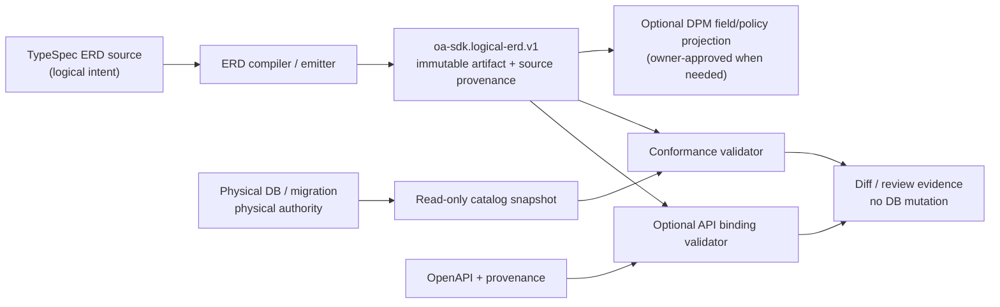

# TypeSpec 논리 ERD 프로필 — 구현 계획

> **Prototype in progress — not yet an adoption contract.** `@oa-sdk/logical-erd-contract`와
> `@oa-sdk/typespec-erd`의 독립 artifact/emitter/CLI slice와 portable JSON Schema gate는
> 구현되어 있다. Catalog adapter, DPM bridge, review-bundle integration, external distribution은
> owner-approved adoption 전까지 구현 대상이 아니다. DPM contract와의 현재 compatibility
> verdict는 [compatibility assessment](./logical-erd-dpm-compatibility-assessment.md)를 따른다.

## 0. 설계 한눈에 보기

| 항목 | 내용 |
| --- | --- |
| 변경 목적 | TypeSpec로 논리 ERD의 엔터티·필드·키·관계를 선언하고, 선언 위치까지 추적 가능한 중립 artifact와 diff를 만든다. |
| 영향 영역 | 새 TypeSpec ERD library/compiler emitter, 중립 artifact/CLI, DPM adapter contract, catalog comparison, provenance/review tooling. |
| 권위 분리 | TypeSpec은 **논리** 모델의 선언 권위다. 실제 DB catalog/migration은 **물리** 모델의 권위이며, 이 기능은 DB를 변경하지 않는다. |
| 가장 큰 위험 | ERD 논리 관계와 DPM의 선택적 pseudonymization execution policy를 같은 registry로 오인하여 권위를 뒤섞는 것. |
| 구현 시작점 | 독립 `@oa-sdk/typespec-erd` prototype → `oa-sdk.logical-erd.v1` artifact → DPM/DB evidence adapter 순서. |

## 1. 입력·근거·제약

### 1-1. 확인된 근거

| 근거 | 확인된 사실 | 설계에 주는 제약 |
| --- | --- | --- |
| `docs/internal/goals/dpm-master-roadmap.md` | DPM은 pseudonymization에 필요한 logical/API/catalog evidence와 execution policy를 묶는다. | ERD entity/key/relationship authority를 DPM으로 이전하거나 자동 mapping하지 않는다. |
| `packages/dpm/src/model/data-identity-types.ts` | `objectId`, `revisionId`, dataset/namespace/entity/field locator, catalog snapshot, API pointer/version을 분리한다. | ERD artifact도 논리 ID, source locator, 물리/API binding을 섞지 않는다. |
| `packages/dpm/src/model/relationship-types.ts` | 명시적 parent/child endpoint, cardinality, namespace, composite-key 정책을 제공한다. | 관계는 이름 추론이 아니라 선언과 endpoint 검증으로만 만든다. |
| `packages/typespec-decorators/src/decorators.ts` | 현 library는 좁은 OpenAPI operation extension만 허용한다. | ERD 메타데이터를 기존 API OpenAPI extension에 끼워 넣지 않는다. |
| `docs/internal/plan.md` | DPM의 catalog snapshot과 physical FK recommendation은 source DB mutation과 구분된다. | ERD emitter/CLI는 DDL·migration·physical FK 생성 기능을 갖지 않는다. |

### 1-2. 명시적 가정과 승인 필요 사항

| 구분 | 내용 | 처리 |
| --- | --- | --- |
| 확인됨 | `data_definitions` 1.0은 frozen compatibility contract이고 1.1 identity contract는 experimental이다. | 첫 ERD release가 기존 wire format을 바꾸지 않는다. |
| 확인됨 | DPM의 canonical external owner는 `mineclover/data-governance`이며, `oa-sdk`의 DPM은 maintenance/source compatibility 경계다. | DPM에 새 persisted schema 또는 resolver를 넣는 단계는 owner 승인 후 external owner에서 수행한다. |
| 가정 | ERD author가 logical stable ID를 직접 관리할 수 있다. | prototype에서 `@entity(id)`, `@field(id)`, `@relationship(id)`를 required로 검증한다. |
| 가정 | 실제 DB의 read-only catalog snapshot을 얻을 수 있다. | 불가능한 환경에서는 TypeSpec-only validation은 통과시키되 physical conformance는 `unknown`으로 보고한다. |
| 위험 | TypeSpec의 model shape가 API DTO와 DB entity를 항상 1:1로 뜻하지 않는다. | API binding은 opt-in edge이며 ERD entity 자체를 API schema와 동일시하지 않는다. |

## 2. 현재 구조 (As-Is)

| 경계 | 파일/심볼 | 현재 역할 | 판단 |
| --- | --- | --- | --- |
| API TypeSpec extension | `packages/typespec-decorators/src/decorators.ts`, `$oaUseResponseComponent` | OpenAPI operation response component 연결만 안전하게 설정 | ERD와 분리 유지 |
| 논리 data identity | `packages/dpm/src/model/data-identity-types.ts` | logical field의 object/revision/locator, DB/API reference 분리 | ERD adapter의 target vocabulary |
| 관계 모델 | `packages/dpm/src/model/relationship-types.ts`, `createLogicalRelationship()` | endpoint, cardinality, namespace, composite/polymorphic/temporal 제약 | ERD semantic validation의 기준 |
| physical evidence | `packages/dpm/src/catalog/` | catalog snapshot, freshness, PostgreSQL read-only profile | TypeSpec model의 물리 적합성 비교 대상 |
| API provenance | `packages/codegen/src/cli/lib/typespec-ref-provenance.ts`, parallel evidence/review bundle | TypeSpec/OpenAPI/TS declaration reference와 review evidence 연결 | ERD source span과 API binding을 동일한 review envelope에 추가할 후보 |

현재 경로는 다음처럼 분리되어 있다.



## 3. 변경 설계 (To-Be)

### 3-1. 권위와 책임

| 대상 | 권위 | ERD profile이 하는 일 | ERD profile이 하지 않는 일 |
| --- | --- | --- | --- |
| 논리 entity/field/key/relation | TypeSpec ERD source | stable logical ID, cardinality, requiredness, key semantics, source provenance 선언 | table/column naming을 canonical truth로 채택 |
| 물리 table/column/FK/index/migration | DB catalog와 migration repository | catalog snapshot과 대조하여 match/mismatch/unknown을 보고 | DB/DDL/migration/foreign key를 생성·수정 |
| API DTO/operation | production TypeSpec/OpenAPI bundle | opt-in binding edge를 검증하고 provenance에 연결 | ERD entity를 API schema로 자동 추론 |
| pseudonymization lifecycle | canonical DPM owner | selected ERD field를 DPM identity/policy vocabulary로 explicit projection | owner 승인 없이 DPM wire contract 또는 persistence 변경; ERD relationship authority 획득 |

### 3-2. 패키지와 artifact 경계

| 경계 | 제안 패키지/경로 | 책임 | 의존성 |
| --- | --- | --- | --- |
| TypeSpec authoring library | `packages/typespec-erd/` → `@oa-sdk/typespec-erd` | decorators, diagnostics, compiler state, `.tsp` declarations, source-provenance emitter | `@typespec/compiler`; OpenAPI emitter에 의존하지 않음 |
| neutral contract | `packages/logical-erd-contract/` → `@oa-sdk/logical-erd-contract` | `oa-sdk.logical-erd.v1` JSON Schema/TS types, stable serialization, semantic diff vocabulary | no DPM runtime dependency |
| CLI/review integration | `packages/codegen/src/cli/commands/erd-*.ts` | emit, check, diff, catalog compare, review-bundle input adapter | neutral contract and TypeSpec library |
| DPM compatibility adapter | canonical `mineclover/data-governance` owner | selected neutral field → data identity/policy mapping and owner lifecycle | owner-owned only; ERD relationship 자동 mapping 금지 |

새 library를 기존 `@oa-sdk/typespec-decorators`에 합치지 않는다. 기존 package는 OpenAPI operation extension의 좁은 보안 경계를 유지해야 하며, ERD의 entity/relation semantics를 넣으면 API artifact의 의미와 review diff가 혼합된다.

### 3-3. authoring surface — v0 prototype

아래 표면은 **구현 목표 문법**이다. TypeSpec compiler API와 decorator target 제약을 prototype에서 확인한 뒤 그대로 고정하거나 호환 alias를 제공한다.

```typespec
import "@oa-sdk/typespec-erd";

using OaSdkErd;

@dataset("commerce")
namespace Commerce {

@entity("commerce.sales.customer")
model Customer {
  @field("commerce.sales.customer.id")
  @primaryKey
  id: string;

  @field("commerce.sales.customer.email")
  @unique
  email: string;
}

@entity("commerce.sales.order")
model Order {
  @field("commerce.sales.order.id")
  @primaryKey
  id: string;

  @field("commerce.sales.order.customer-id")
  @foreignKey(Customer.id)
  customerId: string;
}

@relationship("commerce.sales.order-customer", Order.customerId, Customer.id,
              "many-to-one")
namespace Relationships {}
}
```

| 선언 | 의미 | 초기에 required인가 | 비고 |
| --- | --- | --- | --- |
| `@dataset(id)` | logical dataset scope | 예 | namespace/path와 분리된 canonical scope |
| `@entity(id)` | rename-safe logical entity ID | 예 | model 이름은 locator/UI name일 뿐 canonical ID가 아님 |
| `@field(id)` | rename-safe field ID | 예 | v1에서는 TypeSpec property name만으로 ID를 만들지 않음 |
| `@primaryKey`, `@unique` | logical key constraint | 아니오 | `@primaryKey(groupId, order)`가 ordered composite primary-key component를 명시 |
| `@foreignKey(target)` | candidate field endpoint | 아니오 | DB FK를 생성하지 않음; `@relationship`과 모순 시 diagnostic |
| `@relationship(id, from, to, cardinality)` | 명시적 relationship edge | 예 (관계를 표현할 때) | one-to-one, one-to-many, many-to-one만 직접 지원; N:N은 join entity의 두 directed relation으로 표현 |
| `@apiBinding(...)` | API artifact pointer/provenance에 대한 opt-in edge | 아니오 | API DTO 자동 동치는 금지 |
| `@physicalHint(...)` | 사람이 읽는 table/column 후보 | 아니오 | canonical physical ID가 아니며 catalog evidence로만 확인 |

**extension을 써야 하는 정확한 기준**은 다음과 같다.

1. TypeSpec model/property 자체로 표현할 수 없는 **논리 identity, relationship endpoint/cardinality, lifecycle/provenance binding**만 custom decorator로 표현한다.
2. 구조와 primitive type, nullable/optional, description은 표준 TypeSpec 모델·property·`@doc`을 사용한다.
3. arbitrary JSON을 담는 범용 `@extension`/`@metadata` decorator는 만들지 않는다. 새 의미는 versioned decorator와 typed diagnostic을 먼저 추가한다.
4. OpenAPI만 소비하는 metadata는 ERD에 넣지 않고 production API TypeSpec/sidecar에 남긴다.
5. physical DB 이름은 `@physicalHint`로도 권위를 획득하지 않는다. snapshot 참조가 있어야 only `confirmed`가 된다.

### 3-4. `oa-sdk.logical-erd.v1` artifact

artifact는 source `.tsp`보다 review/diff/adapter가 소비하는 immutable 결과물이다. 최소 top-level shape는 다음과 같다.

```json
{
  "kind": "oa-sdk.logical-erd.v1",
  "artifactId": "logical-erd:commerce@<content-hash>",
  "source": { "package": "@acme/commerce-schema", "files": [{ "path": "commerce.tsp", "hash": "..." }] },
  "datasets": [{ "id": "commerce" }],
  "entities": [{ "id": "commerce.sales.customer", "locator": "Commerce.Customer", "fields": [] }],
  "relationships": [{ "id": "commerce.sales.order-customer", "from": {}, "to": {}, "cardinality": "many-to-one" }],
  "provenance": [{ "subject": "entity:commerce.sales.customer", "file": "commerce.tsp", "span": { "line": 7, "column": 1 } }]
}
```

필수 invariants:

- entity/field/relationship ID는 artifact 안에서 unique하며 rename과 source path 변경에 안정적이다.
- field endpoint는 같은 artifact의 existing entity/field를 정확히 가리킨다. 문자열 이름 추론은 금지한다.
- ordered composite key와 relationship component가 있으면 순서도 artifact에 저장한다.
- many-to-many는 two directed relations과 explicit join entity로 표현한다. hidden join table 추론은 하지 않는다.
- artifact ID/content hash와 individual logical object ID를 구분한다. hash는 revision/evidence이고 stable object ID의 대체가 아니다.
- source provenance는 TypeSpec AST declaration/property node의 file/span과 decorator argument span을 보존한다. 즉, diff의 한 relationship이 어떤 `.tsp` 줄의 선언에서 나왔는지 역추적할 수 있다.
- API pointer와 catalog coordinate는 optional `bindings` edge로만 저장하며, logical subject의 identity 입력값이 아니다.

### 3-5. 검증·diff·review 흐름

| 명령(제안) | 입력 | 출력 | 실패 조건 |
| --- | --- | --- | --- |
| `oa-gen erd emit` | `.tsp` + compiler config | v1 artifact + provenance | duplicate ID, unsupported decorator target/type, unresolved endpoint |
| `oa-gen erd check` | v1 artifact | diagnostics JSON/SARIF | field/relation invariant violation, no stable ID, invalid cardinality/key |
| `oa-gen erd diff --base --next` | two artifacts | deterministic added/changed/removed classification | `--fail-on-breaking` 시 breaking logical diff |
| `oa-gen erd catalog-check` | artifact + read-only catalog snapshot | confirmed/mismatch/unknown evidence | `--require-catalog-match` 시 mismatch; snapshot absent는 unknown |
| `oa-gen review-bundle --erd ...` | existing review input + artifact/evidence | parallel review envelope | required provenance/metric gate failure |

logical diff classification v1:

| 변경 | 기본 등급 | 이유 |
| --- | --- | --- |
| entity/optional field/optional relationship 추가 | additive | 기존 logical reference를 제거하지 않음 |
| required field 추가, key 추가/변경, endpoint/cardinality 변경 | potentially breaking | consumers/validation meaning이 달라질 수 있음 |
| stable ID 삭제, relation 삭제, entity/field ID 재사용 | breaking | reverse reference를 안전하게 보존할 수 없음 |
| locator/model/property rename + stable ID/alias 유지 | non-breaking rename | human name은 바뀌지만 logical object가 유지됨 |
| physical hint 변경 | evidence change | DB authority와 catalog comparison에서 별도 평가 |

catalog check은 SQL 실행/DDL/migration을 절대 수행하지 않는다. 결과는 `confirmed`, `mismatch`, `unbound`, `unknown` 네 상태로 보고한다. `mismatch`는 논리 선언을 자동 수정하지 않고 review blocker가 될지 policy로만 정한다.

### 3-6. 코드젠 영향

| 출력 | 영향 | 초기 정책 |
| --- | --- | --- |
| OpenAPI emission | 없음 | ERD library는 OpenAPI emitter를 호출·변경하지 않는다. |
| existing TypeScript typegen | 직접 변경 없음 | ERD object를 TS DTO로 자동 생성하지 않는다. 필요해지면 별도 codegen proposal. |
| DPM neutral/data artifact | optional field adapter | owner 승인 후 selected logical field identity/policy로 explicit mapping; relationship는 별도 use case 없이는 projection하지 않음. |
| review bundle/provenance | optional input 확장 | existing API ↔ TS pointer metric와 ERD relation coverage를 별도 metric family로 기록한다. |
| DB/migration tools | mutation 없음 | catalog adapter는 read-only evidence input만 소비한다. |

### 3-7. 버전 정책

| 대상 | 정책 |
| --- | --- |
| decorator surface | `@oa-sdk/typespec-erd` SemVer. decorator argument 의미/diagnostic code removal은 major; optional decorator/enum member 추가는 minor. |
| artifact wire format | `oa-sdk.logical-erd.v1` 명시 버전. v1에서는 optional field 추가만 허용한다. meaning/requiredness/identity encoding 변경은 v2 artifact 또는 major migration tool을 요구한다. |
| logical object | stable ID는 재사용 금지, rename은 alias/lifecycle edge로 표현한다. artifact hash는 revision identity다. |
| catalog evidence | catalog snapshot ID + version hash를 함께 기록한다. DB의 live state는 artifact version을 바꾸지 않으며, freshness mismatch로만 나타난다. |
| DPM bridge | `data_definitions` 1.0을 바꾸지 않는다. v1.1 및 owner wire change는 external canonical owner의 별도 승인/compatibility test를 요구한다. |

## 4. 구현 단계와 변경 계획

### Phase 0 — ownership, vocabulary, fixtures (승인 gate)

목적: DPM owner와 API/DB owners가 artifact ownership과 meaning을 합의한다.

- `docs/adr/` 또는 owner repository에 authority matrix ADR을 작성한다: logical ID naming, lifecycle/alias, DPM bridge owner, catalog source, breaking-change approver.
- representative fixture 세 개를 승인한다: simple 1:N, composite key, API DTO와 logical entity가 다른 case.
- `many-to-many`, polymorphic, temporal, inheritance/embedded object는 v1 non-goal로 문서화한다. many-to-many join entity만 fixture로 허용한다.
- exit: artifact schema field, ID namespace, diagnostic code prefix, catalog snapshot format owner가 sign-off한다.

### Phase 1 — standalone TypeSpec ERD prototype

예상 파일:

- `packages/typespec-erd/package.json`, `lib/main.tsp`, `lib/decorators.tsp`
- `packages/typespec-erd/src/lib.ts`, `src/decorators.ts`, `src/index.ts`
- `packages/typespec-erd/src/semantic-validation.ts`, `src/provenance.ts`
- `packages/typespec-erd/src/*.test.ts`, `packages/typespec-erd/examples/*.tsp`

구현:

1. decorator state maps로 model/property/namespace declarations를 수집한다.
2. strict diagnostics를 제공한다: `ERD001 duplicate-id`, `ERD002 missing-id`, `ERD003 unresolved-endpoint`, `ERD004 invalid-cardinality`, `ERD005 invalid-key`, `ERD006 unsupported-shape`.
3. semantic validator는 compiler semantic graph로 target type과 endpoint 존재를 확인한다. text/identifier based reference resolution은 금지한다.
4. `provenance.ts`는 AST node의 file/span/decorator argument location을 normalized source coordinate로 만든다.
5. standalone package test에서 compiler test host로 valid/invalid TSP fixture를 compile한다.

exit: simple 1:N, composite key, renamed locator with same stable ID, invalid endpoint가 deterministic artifact/diagnostic golden test를 가진다.

### Phase 2 — neutral artifact and deterministic diff

예상 파일:

- `packages/logical-erd-contract/src/types.ts`, `src/schema.ts`, `src/normalize.ts`, `src/diff.ts`, `src/provenance.ts`
- `packages/logical-erd-contract/schema/oa-sdk.logical-erd.v1.schema.json`
- `packages/typespec-erd/src/emitter.ts`
- fixture snapshots and semantic diff tests

구현:

1. stable ordering, content hash, schema validation, pointer/source span serialization을 구현한다.
2. object identity와 artifact revision identity를 독립적으로 golden-vector test한다.
3. semantic diff가 rename/alias, endpoint/cardinality/key, physical hint, evidence freshness를 다른 category로 내보내게 한다.
4. `--fail-on-breaking` policy는 logical breaking classification만 평가한다. catalog mismatch는 phase 3 policy에서 결합한다.

exit: source file 재정렬/formatting은 semantic diff가 empty이고, property rename with stable ID is non-breaking이며, relation endpoint change is breaking임을 보인다.

### Phase 3 — read-only catalog conformance

예상 파일:

- `packages/codegen/src/cli/commands/erd-catalog-check.ts`
- `packages/codegen/src/cli/lib/erd-catalog-check.ts`
- DPM catalog fixture adapter (implementation location은 owner approval 후 확정)
- `packages/codegen/src/__tests__/erd-catalog-check.test.ts`

구현:

1. existing DPM catalog snapshot shape를 input adapter로 재사용한다. 새로운 DB introspection format을 만들지 않는다.
2. physical hint/binding이 있을 때 table, column, primary/unique key, FK evidence를 비교한다.
3. snapshot freshness/hash를 결과에 보존하고 `confirmed/mismatch/unbound/unknown`을 deterministic하게 만든다.
4. only read-only profile/snapshot file input을 허용한다. connection string mutation path, DDL emitter, migration writer는 제공하지 않는다.

exit: DB에 실제 mutation 없이 fixture로 confirmed/mismatch/unknown 세 결과를 모두 재현한다.

### Phase 4 — DPM field-policy/API provenance bridge and review gate

예상 파일:

- external owner: selected logical ERD field → DPM identity/policy adapter and owner tests
- `packages/codegen/src/cli/commands/review-bundle.ts` input extension
- `packages/codegen/src/cli/lib/parallel-evidence.ts` ERD metric family
- `docs/internal/typespec-roundtrip/` review contract update

구현:

1. owner-approved adapter가 선택된 ERD field만 DPM data field object/revision/locator 및 pseudonymization policy vocabulary로 explicit mapping한다. mapping을 oa-sdk에서 independent state로 persist하지 않는다. ERD relationship은 이 bridge의 입력·출력이 아니며, 관계 인지 가명화는 별도 승인된 use case로 제안한다.
2. optional API binding은 existing TypeSpec/OpenAPI provenance artifact를 exact pointer/version hash로 resolve한다. operationId는 navigation hint만 사용한다.
3. review bundle은 API↔TS and ERD↔catalog/API metric를 섞지 않고 separate metric namespaces와 thresholds로 표시한다.
4. false green을 막기 위해 DPM projection 대상으로 선언한 field 중 unbound field를 coverage denominator에서 제외하지 않는다. 별도 `unbound_count`로 기록한다. ERD entity/relationship의 source provenance coverage는 ERD review metric에서 독립적으로 유지한다.

exit: 하나의 fixture에서 `.tsp` line → selected ERD field → DPM catalog coordinate/API pointer → review result를 역추적할 수 있다. 관계 source provenance와 logical relation review는 TypeSpec ERD artifact/review만으로 역추적할 수 있다.

### Phase 5 — onboarding, CI, adoption pilot

예상 문서/automation:

- `docs/guides/typespec-logical-erd-authoring.md`
- `docs/guides/system-onboarding.md` extension
- `docs/internal/feature-test-matrix.*` rows
- CI: artifact schema check, deterministic emit/diff test, optional catalog-review fixture

온보딩 필수 내용:

1. **언제 TypeSpec ERD를 쓰는가:** domain logical model과 explicit relationship을 공유/review할 때.
2. **언제 쓰지 않는가:** DB migration/DDL, persistence ORM mapping only, API DTO-only shape, runtime access policy only.
3. **extension 선택표:** standard TypeSpec first; identity/relation only typed ERD decorators; arbitrary metadata forbidden.
4. **변경 전 check:** stable ID, alias/lifecycle, relation endpoint/cardinality, catalog evidence freshness, diff classification.
5. **PR 친화적 순서:** source TSP + generated artifact + semantic diff + source-provenance review record를 같은 change set에 넣고, generated output only commit은 금지한다.

## 5. 실패 경로·엣지 케이스

| 조건 | 기대 처리 | 복구/조치 |
| --- | --- | --- |
| duplicate/absent stable ID | emit failure with decorator argument span | author assigns unique stable ID; generated ID fallback 없음 |
| endpoint의 entity/field가 존재하지 않음 | semantic error, artifact generation blocked | AST semantic symbol에 맞는 explicit endpoint로 수정 |
| model name/property name만 변경 | stable ID가 보존되면 non-breaking rename | alias/lifecycle record를 update; source provenance refresh |
| API DTO shape와 ERD entity가 다름 | no implicit binding, no error | only actual equivalence가 필요할 때 `@apiBinding` 추가 |
| catalog snapshot이 없음/오래됨 | logical artifact valid; physical conformance `unknown` | snapshot refresh 후 catalog-check; policy가 필요할 때 release blocker |
| catalog FK와 logical relation이 다름 | `mismatch`, no DB or TSP auto-write | owner review: logical correction, migration correction, or accepted divergence reason |
| many-to-many implicit join table | v1 unsupported diagnostic | explicit join entity + two relationships로 model |
| composite key order change | breaking semantic diff | migrate/review as relation contract change |
| physical migration이 먼저 실행됨 | catalog freshness mismatch | DB retains authority; capture new snapshot and reconcile, never overwrite DB |

## 6. 검증과 coverage 계약

| gate | 최소 증거 | 실패 시 |
| --- | --- | --- |
| compiler contract | valid/invalid decorator fixture + exact diagnostic code/span | publish/emit block |
| artifact determinism | same source → byte-stable artifact; formatting-only diff empty | CI block |
| identity lifecycle | rename/alias/deprecate/reuse golden vectors | CI block for ID reuse/broken ref |
| relationship semantics | 1:1, 1:N, N:1, composite, unbound/invalid endpoint fixtures | CI block |
| provenance | every emitted entity/field/relation has source span | review bundle gate block |
| catalog conformance | confirmed/mismatch/unbound/unknown fixture | policy gate, no mutation |
| DPM field bridge coverage | declared projection field total, resolved field total, unbound total, ambiguous total | metric regression visible; denominator must remain declared projection total |
| compatibility | DPM field adapter fixture and existing TypeSpec/OpenAPI/TS evidence tests unchanged | owner/CI block |

제안 metric record:

```text
erd.declared_entities
erd.declared_fields
erd.declared_relationships
erd.provenance_covered_relationships / erd.declared_relationships
erd.catalog_confirmed_relationships / erd.declared_relationships
erd.catalog_mismatch_relationships
erd.unbound_relationships
erd.dpm_projection_declared_fields
erd.dpm_projection_resolved_fields / erd.dpm_projection_declared_fields
erd.dpm_projection_unbound_fields
erd.api_binding_resolved / erd.api_binding_declared
```

`catalog_confirmed`와 `api_binding_resolved`는 서로 다른 evidence 축이다. 한 축의 100%가 다른 축의 coverage를 의미하지 않으며, DB snapshot 부재로 `unknown`이 된 항목을 denominator에서 삭제하지 않는다.

## 7. 코드 컨벤션과 구현 원칙

| 항목 | 적용 원칙 | 근거 |
| --- | --- | --- |
| TypeSpec library | `lib/main.tsp`가 declaration entrypoint, TS는 typed decorators/diagnostics | existing `packages/typespec-decorators` pattern |
| decorator scope | narrow typed decorator + explicit diagnostic | existing `$oaUseResponseComponent`의 narrow-extension policy |
| identity | stable ID / revision hash / human locator / physical/API binding 분리 | DPM identity types/normalizer |
| relation | explicit endpoints, cardinality, ordered composite components | TypeSpec ERD semantic validator and review artifact |
| physical boundary | snapshot evidence only, no mutation code path | DPM roadmap/plan |
| tests | fixture compile + golden artifact/diff + focused CLI tests | existing package/CLI test style |
| generated files | generated artifact is review evidence, source replacement 아님 | existing TypeSpec provenance/review-bundle model |

## 8. 배포·롤백

1. prototype은 private workspace package와 fixtures만 release한다.
2. v1 artifact schema를 publish/CI input으로 쓰기 전, owner-approved compatibility fixture와 breaking diff policy를 lock한다.
3. ERD library를 disable/rollback해도 DB schema와 migrations에는 영향이 없다. 마지막 accepted artifact와 catalog snapshot은 read-only evidence로 남는다.
4. DPM bridge를 rollback할 때 artifact format은 유지하고 adapter/version binding만 이전 accepted release로 되돌린다.
5. existing API TypeSpec/OpenAPI and TS typegen pipeline에는 direct code path가 없으므로 ERD release가 API contract emission을 change시키지 않는 regression test를 유지한다.

## 9. 영역별 변경 요약

| 영역 | 예상 파일 | 핵심 변경 | 선행 조건 |
| --- | --- | --- | --- |
| TypeSpec ERD | `packages/typespec-erd/**` | decorators, diagnostics, AST provenance emitter | Phase 0 vocabulary approval |
| neutral artifact | `packages/logical-erd-contract/**` | v1 schema, normalization, semantic diff | TypeSpec prototype passes examples |
| CLI/review | `packages/codegen/src/cli/**` | emit/check/diff/catalog-check/review input | artifact contract frozen |
| DPM bridge | canonical external owner repo | selected field identity/policy adapter and catalog evidence | explicit owner authorization |
| documentation | `docs/guides/**`, feature matrix | onboarding, extension decision table, CI commands | pilot behavior verified |

## 10. 구현 착수 전 결정 요청

다음 세 항목은 구현의 설계 분기가 되므로 시작 전에 승인해야 한다.

1. logical ERD source의 canonical repository가 `oa-sdk`인지, external data-governance owner인지.
2. v1 stable ID를 author-supplied opaque string으로 할지, namespace-qualified semantic string으로 제한할지.
3. catalog conformance가 initial CI에서 warning인지 required gate인지.

이 결정 전에도 Phase 1 prototype과 fixture 검증은 가능하지만, DPM bridge/persisted artifact/public workflow는 진행하지 않는다.

## 11. 근거 참조

- `docs/internal/goals/dpm-master-roadmap.md` — DPM ownership, identity, semantic binding, lifecycle gaps.
- `docs/internal/goals/goal-4-dpm-implementation-strategy.md` — no-physical-mutation boundary and catalog snapshot role.
- `docs/internal/plan.md` — DPM logical field/API/DB separation and TypeSpec roundtrip context.
- `packages/dpm/src/model/data-identity-types.ts`, `data-identity-normalize.ts` — identity vocabulary.
- `packages/dpm/src/model/relationship-types.ts`, `relationship-normalize.ts` — relationship constraints.
- `packages/typespec-decorators/src/decorators.ts`, `lib.ts` — narrow extension and diagnostic convention.
- `packages/codegen/src/cli/lib/typespec-ref-provenance.ts`, `parallel-evidence.ts` — provenance/review integration candidate.

### 설계 리뷰 결과

**PASS (draft with accepted assumptions).** 구현에 필요한 경계, canonical authority, module/file placement, failure cases, test gates, diff/version policy가 구체화되어 있다. DPM external owner authorization과 세 개의 decision은 implementation gate로 남는다.
