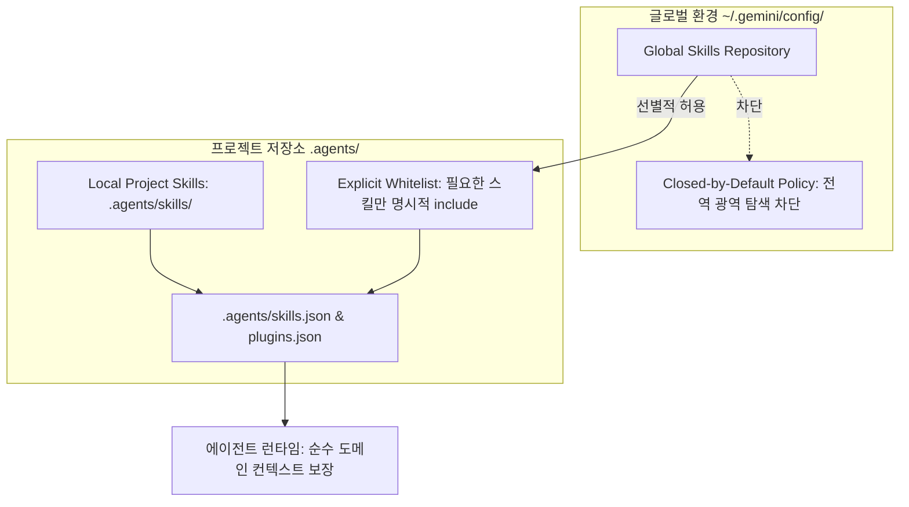

# 에이전트 커스터마이제이션 및 스킬 거버넌스 컨벤션 제안

상태: proposal  
작성일: 2026-09-06  
적용 대상: `oa-sdk` 및 관련 monorepo 프로젝트

---

## 1. 제안 배경 및 문제 정의

현재 Antigravity 에이전트 커스터마이제이션 플랫폼은 머신 전역(`~/.gemini/config/skills/`)에 위치한 스킬들을 모든 작업 공간에 자동으로 광역 탐색(Eager Discovery)하여 주입합니다. 

단일 프로젝트 환경에서는 편리하지만, 복수의 상이한 도메인(예: OpenAPI SDK, Photoshop 도구 체인, SVG 그래픽 엔진, OpenWiki 지식그래프 등)을 다루는 환경에서는 다음과 같은 중대한 아키텍처적 부작용이 발생합니다:

1. **컨텍스트 교차 오염 (Cross-Domain Context Pollution)**
   * `oa-sdk`(OpenAPI 3.1 SDK / AST 코드젠)를 다루는 세션에 Photoshop TCP 통신, SVG 삼각함수, OpenWiki 그래프 스킬 메타데이터가 무차별 주입됩니다.
   * 이는 시스템 프롬프트 토큰을 낭비할 뿐만 아니라, 모델의 주의(Attention) 분산과 무관한 도구의 오작동(False Positive Triggering) 위험을 높입니다.
2. **환경 비재현성 (Non-Hermeticity & Non-Determinism)**
   * 개발자 A의 로컬 머신 스킬 목록과 개발자 B의 스킬 목록이 다르면, **동일한 브랜치·동일한 프롬프트에서도 에이전트의 동작과 산출물이 달라집니다.**
   * 글로벌 설정에 의존하는 에이전트는 CI/CD 환경이나 신규 온보딩 환경에서 동일한 결과를 보장할 수 없습니다.
3. **최소 권한 및 보안 위배 (Violation of Least Privilege)**
   * 스킬 패키지는 내부 실행 스크립트(`scripts/`)나 훅을 가질 수 있습니다. 프로젝트와 무관한 외부 스킬이 열려 있는 것은 잠재적인 사이드이펙트의 통로가 됩니다.

---

## 2. 핵심 원칙: Closed-by-Default (글로벌 기본 닫힘 + 프로젝트별 명시적 활성화)

이 문제를 해결하기 위해 본 제안서는 **"글로벌 기본 닫힘(Closed-by-Default / Zero-Trust) + 프로젝트별 화이트리스트(Opt-in Whitelist)"** 체계를 표준 컨벤션으로 제안합니다.



### 3대 불변성 원칙

1. **밀폐성 (Hermeticity)**: 프로젝트 작업 시 에이전트가 사용하는 모든 스킬과 플러그인은 해당 저장소의 `.agents/` 설정에 의해 완전히 결정되어야 한다. 로컬 머신의 전역 상태에 의해 에이전트 동작이 왜곡되어서는 안 된다.
2. **화이트리스트 우선 (Whitelist-First)**: 외부/글로벌 스킬을 참조할 때는 블랙리스트(`exclude`) 방식보다 **명시적 화이트리스트(`include_only`)** 방식을 우선한다.
3. **VCS 형상 관리 (Git-Tracked Governance)**: `.agents/skills.json`과 `.agents/plugins.json`은 Git 형상 관리에 포함되어, 팀 전체와 CI 파이프라인이 100% 동일한 에이전트 사양을 공유한다.

---

## 3. 표준 디렉터리 및 설정 구조 규격

### 3.1 프로젝트 저장소 구조 (`.agents/`)

```text
<project-root>/
└── .agents/
    ├── skills.json        # [필수] 프로젝트 스킬 활성화 선언 및 화이트리스트
    ├── plugins.json       # [선택] 프로젝트 플러그인 활성화 선언
    └── skills/            # [선택] 프로젝트 전용 로컬 스킬 디렉터리
        └── <project-skill>/
            └── SKILL.md
```

### 3.2 프로젝트 스킬 설정 파일 규격 (`.agents/skills.json`)

```json
{
  "$schema": "https://antigravity.google/schemas/skills.json",
  "entries": [
    {
      "path": ".agents/skills"
    },
    {
      "path": "~/.gemini/config/skills",
      "include_only": [
        // 이 프로젝트에 필수적인 외부 스킬만 정규식으로 명시
      ],
      "exclude": [
        // 특수한 경우 제외 패턴
      ]
    }
  ]
}
```

* **`.agents/skills` 우선 등록**: 해당 프로젝트에만 귀속되는 로컬 스킬을 1순위로 마운트합니다.
* **`include_only` 필터 적용**: 글로벌 스킬 경로(`~/.gemini/config/skills`)를 참조하더라도, 프로젝트 도메인에 부합하는 스킬만 화이트리스트로 허용합니다.

### 3.3 프로젝트 플러그인 설정 파일 규격 (`.agents/plugins.json`)

```json
{
  "$schema": "https://antigravity.google/schemas/plugins.json",
  "entries": [
    {
      "path": ".agents/plugins"
    },
    {
      "path": "~/.gemini/config/plugins",
      "include_only": [
        "modern-web-guidance-plugin"
      ]
    }
  ]
}
```

---

## 4. `oa-sdk` 레퍼런스 구현 및 적용 사례

`oa-sdk` 저장소는 OpenAPI 3.1 코드 생성기 및 스펙 거버넌스 툴체인으로서 본 컨벤션의 레퍼런스 구현을 완료했습니다:

1. **포토샵 / 위키 / SVG 스킬 원천 차단**:
   * `.agents/skills.json`을 통해 `photoshop-toolchain-workflow`, `openwiki-*`, `svg-authoring` 스킬의 탐색과 주입을 배제.
2. **필수 웹 표준 플러그인만 선별 허용**:
   * `.agents/plugins.json`을 통해 `modern-web-guidance-plugin`(`chrome-extensions`, `modern-web-guidance`)만 인가하여 Manifest V3 CSP 감사(`oa-gen audit:csp`) 및 표준 Web API 검증 능력 보존.
3. **문서 정합성 게이트 통과**:
   * `pnpm check:docs`를 통한 228개 마크다운 문서 및 OAS 참조 문서 검사에서 100% 링크 정합성 유지.

---

## 5. 기대 효과 및 도입 로드맵

| 단계 | 목표 | 세부 실행 내용 |
| :--- | :--- | :--- |
| **Phase 1: 레퍼런스 안착** | `oa-sdk` 적용 | `.agents/skills.json` 및 `plugins.json` 커밋 및 정합성 검증 완료 |
| **Phase 2: 연계 저장소 확장** | `spec-management-platform` 적용 | 공통 스펙 플랫폼에도 동일 규격의 Closed-by-Default 스킬 파일 배포 |
| **Phase 3: 글로벌 기본값 정비** | `~/.gemini/config/` 정비 | 글로벌 `skills.json`에 전역 차단 기본값 도입 및 개별 프로젝트로 제어권 이양 |
| **Phase 4: CI 거버넌스 연계** | 정합성 게이트 자동화 | PR 검사 시 `.agents/skills.json`의 유효성을 정적 검증하는 CI 게이트 구축 |
