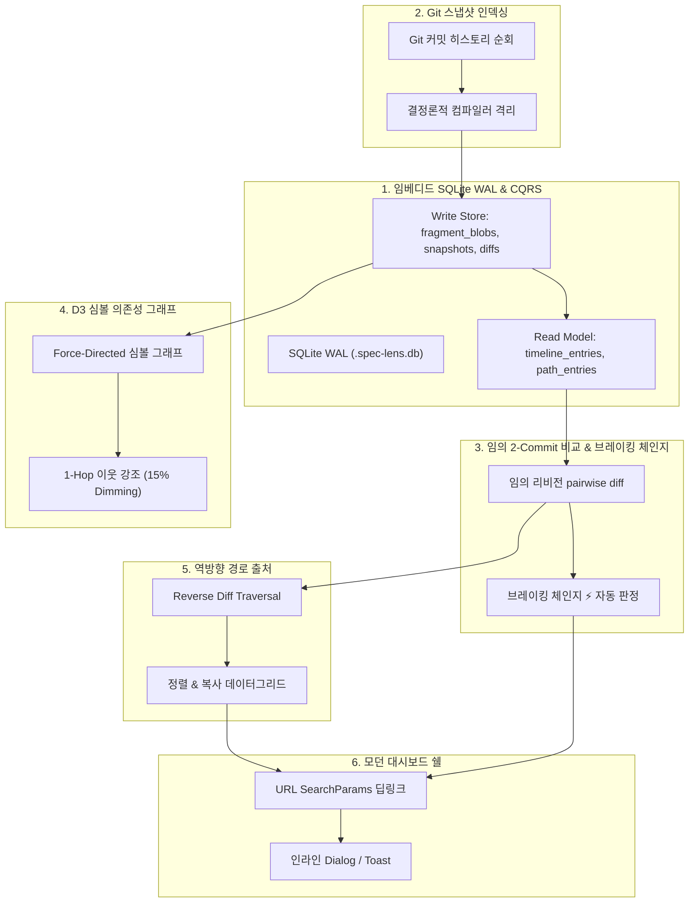

# spec-lens

OpenAPI 스펙 변경 이력 관리·관측 도구. TypeSpec production project와
Definition Builder rollback project의 source 변경을 수집하고, 브라우저 UI에서
diff·provenance·source 의존 그래프를 시각화한다.

**사용 범위:** `@oa-sdk/spec-lens`와 UI는 비공개 저장소 전용 workspace다. `.spec-lens.db`에
로컬 SQLite 캐시를 사용하며 일반 npm 사용자의 검증·타입/SDK 생성에 실행을 요구하지 않는다.
외부 DPM의 상시·공유 검색용 DB와는 별개다([기능 선택 지도](../guides/feature-map.md)).

> **추적 범위**: spec-lens는 `project.sourceRoot`와 TypeSpec project의 명시적
> `observation`으로 선언한 외부 경로를 건드린 커밋만 타임라인 후보로 표시한다. 앱 코드 변경 커밋은 잡히지 않는다.

---

## 빠른 시작 & 데모 실행 가이드

Spec-Lens는 **개발 모드(Vite HMR + Hono API)**와 **프로덕션 통합 모드(단일 Hono 프로세스 정적 호스팅)**의 두 가지 방법으로 즉시 실행할 수 있습니다.

### 1. 개발 모드 (권장: 빠른 UI/스펙 탐색)

```bash
# 터미널 1: 백엔드 엔진 서버 시작 (자동으로 로컬 git + 스키마 타겟 감지)
pnpm exec tsx packages/spec-lens/src/cli.ts

# 터미널 2: UI 개발 서버 시작 (HMR 지원)
pnpm --filter @oa-sdk/spec-lens-ui dev

# 브라우저 열기 (기본 포트: 5174, /api/* 요청은 4891 백엔드로 자동 프록시)
open http://localhost:5174
```

### 2. 프로덕션 임베디드 모드 (단일 프로세스 서빙)

UI를 프로덕션 번들로 빌드하면 `@oa-sdk/spec-lens` 백엔드 서버가 `dist/` 정적 에셋을 내장하여 단일 포트(`:4891`)에서 UI와 API를 동시에 서빙합니다.

```bash
# 1. UI 프로덕션 번들 빌드
pnpm --filter @oa-sdk/spec-lens-ui build

# 2. 백엔드 서버 실행
pnpm exec tsx packages/spec-lens/src/cli.ts

# 3. 브라우저에서 내장 대시보드 접속
open http://localhost:4891/ui/
```

### 3. 데모 워크스루 시나리오 (Sample Walkthrough)

레포지토리에 포함된 샘플 스키마 타겟(`book-notebook-api.yaml` 또는 `oa-sdk.typespec-bundle.json`)을 기반으로 다음 흐름을 체험할 수 있습니다:

1. **초기 스펙 인덱싱**:
   - 상단 **`↻ 새로고침` (Refresh)** 버튼 클릭 (또는 터미널에서 `curl -X POST http://localhost:4891/api/refresh`).
   - 로컬 Git 히스토리를 탐색하여 스키마 파일이 변경된 커밋들의 스냅샷을 자동 추출하고 `.spec-lens.db` SQLite 캐시에 인덱싱합니다.
2. **임의의 2개 커밋 비교 (Arbitrary 2-Commit Compare)**:
   - 타임라인 상단의 **`비교 선택`** 토글을 활성화합니다.
   - 비교할 두 커밋의 **Base(기준)** 및 **Head(비교 대상)** 라디오 버튼을 선택합니다.
   - 상단 Compare 바에서 **`⇄ 스왑`** 버튼으로 전/후 기준을 반전하거나 **`비교 실행`**을 클릭하여 두 리비전 간 pairwise diff 뷰로 즉시 진입합니다.
3. **브레이킹 체인지 ⚡ 필터 & 실시간 검색**:
   - 타임라인 상단의 **`⚡ 브레이킹만`** 필터 칩을 클릭하여 호환성을 깨뜨리는 변경이 포함된 커밋만 즉시 선별합니다.
   - 검색창에 커밋 SHA, 메시지, 작성자명을 입력하여 실시간으로 필터링합니다.
4. **D3 심볼 그래프 탐색 & 포커스 모드**:
   - 좌측 네비게이션에서 **`◎ 그래프`** 뷰로 전환합니다.
   - 우측 하단 **플로팅 캔버스 툴바**의 **`⛶ 화면에 맞추기 (Fit to Viewport)`** 버튼을 눌러 그래프 전체를 화면 중앙에 자동 정렬합니다.
   - 상단 검색창에 심볼 이름(예: `User`, `Book`)을 입력하면 해당 노드로 부드러운 줌 이동 및 펄스 하이라이트가 적용됩니다.
   - 특정 노드를 클릭하면 해당 노드와 직접 연결된 1-hop 엣지만 강조되고 나머지 노드는 **15% 디밍(Dimming)**되는 포커스 모드가 활성화됩니다.
5. **엔드포인트 출처 (Path Provenance) 데이터그리드**:
   - 좌측 네비게이션에서 **`⚡ 경로`** 뷰로 전환합니다.
   - 테이블 헤더(`경로`, `HTTP 메서드`, `마지막 변경`)를 클릭하여 오름차순/내림차순 정렬합니다.
   - 각 엔드포인트의 **`📋 복사`** 버튼을 눌러 Canonical ID 및 경로를 클립보드에 원클릭 복사합니다.
6. **URL 딥링크 공유 & 접이식 사이드바**:
   - 모든 뷰 전환과 diff 비교 상태는 URL 쿼리 스트링(`?view=diff&base=...&head=...`)과 실시간 연동되어 브라우저 뒤로가기/앞으로가기 및 동료 간 URL 공유가 완벽히 지원됩니다.
   - 좌측 사이드바 하단의 접기/펼치기 버튼을 눌러 Monaco Editor를 넓은 화면으로 볼 수 있는 60px 컴팩트 모드를 활성화할 수 있습니다.

**권장**: `.gitignore`에 로컬 캐시 및 리포지토리 클론 경로를 추가합니다:
```gitignore
.spec-lens.db*
.spec-lens-repos/
```

---

## 핵심 개념 온보딩 (Core Concepts Onboarding)

Spec-Lens는 대규모 API 스펙의 진화 과정을 관측하고 협업할 수 있도록 설계된 플랫폼입니다. 플랫폼을 구성하는 6가지 핵심 메커니즘은 다음과 같습니다:



### 1. 임베디드 SQLite WAL 캐시 & CQRS 아키텍처
- **CQRS (명령-조회 분리)**:
  - **쓰기 저장소(Write Store)**: `fragment_blobs`(본문 해시 기반 중복 제거), `snapshot_entries`, `snapshots`, `diffs`. 동일한 내용의 YAML 파일은 커밋이 달라도 단 1개의 해시 레코드만 저장됩니다.
  - **구체화된 읽기 모델(Materialized Read Models)**: `timeline_entries`, `path_entries`. 복잡한 파싱 없이 UI가 즉시 렌더링할 수 있도록 사전 집계된 형태로 저장됩니다.
- **WAL 모드 (`PRAGMA journal_mode = WAL`)**: 커밋 이력을 백그라운드에서 인덱싱(쓰기)하는 동안에도 UI 대시보드에서 쿼리(읽기) 락이 걸리지 않습니다.
- **Project Key 격리 v2**: 타겟 스펙 경로, 소스 브랜치, 빌더 버전별로 독립된 네임스페이스를 부여하여 캐시 오염을 원천 차단합니다.

### 2. Git 타임라인 & 결정론적 스냅샷 인덱싱
- **관측 대상 필터링**: 애플리케이션 소스 코드 변경은 무시하고, `project.sourceRoot` 및 선언된 `observation` 파일(예: `package.json`, `pnpm-lock.yaml`)을 건드린 유의미한 커밋만 선별하여 타임라인에 등록합니다.
- **컴파일러 격리 및 재현성**: 과거 커밋의 임의 스크립트를 실행하지 않고, 통제된 격리 환경에서 OpenAPI 3.1/3.2 스펙을 결정론적으로 빌드합니다. 특정 커밋에서 문법 오류 등으로 빌드가 실패할 경우 `build failed` 배지로 격리 표시됩니다.

### 3. 임의 2-리비전 비교 (Arbitrary 2-Commit Compare) & 브레이킹 체인지 감지
- **임의 리비전 다중 선택**: 직전 커밋(N-1) 단일 비교뿐만 아니라, 원하는 임의의 두 릴리즈(예: `v1.0.0` vs `v1.2.0`, 또는 브랜치 분기점 vs HEAD)를 Base와 Head로 지정하여 비교할 수 있습니다.
- **브레이킹 체인지(⚡) 자동 감지**:
  - `breaking`: 필수 파라미터 추가, 기존 프로퍼티 타입 변경, 엔드포인트 삭제 등 기존 클라이언트 호출을 즉시 파괴하는 변경.
  - `non-breaking`: 선택 파라미터 추가, 응답 필드 추가 등 하위 호환성을 유지하는 변경.
- **구조 카테고리별 분할**: `Root`, `Servers`, `API Paths`, `Components`, `Security` 카테고리별로 변경 내역을 집계하여 파급 효과를 한눈에 파악합니다.

### 4. D3.js 인터랙티브 심볼 의존성 그래프 ($ref Graph)
- **Canonical Definition ID 체계**: 모든 스키마, 오퍼레이션, 파라미터는 `${kind}:${scope}/${domain}/${localName}`(예: `schema:public/users/User`) 형식의 고유 식별자로 정규화됩니다.
- **강체(Force-Directed) 시각화**: 심볼 간의 `$ref` 의존성을 시각화하며, 엔티티 종류에 따라 노드 크기(`path` 10px, `operation` 8px, `schema` 6px 등)와 스코프 색상(`public` 파랑, `shared` 초록, `admin` 주황 등)을 차등화합니다.
- **뷰포트 제어 & 포커스 모드**:
  - **Fit to Viewport (⛶)**: 그래프의 전체 바운딩 박스를 계산하여 화면 중앙에 맞춰주는 자동 줌/팬 알고리즘 내장.
  - **심볼 검색 & 줌 포커스**: 심볼명을 검색하여 해당 노드로 부드러운 줌 이동 및 펄스 하이라이트 제공.
  - **1-Hop Neighborhood Focus**: 선택된 심볼과 직접 연결된 엣지만 강조하고, 무관한 전체 노드를 **15% 불투명도로 디밍**하여 대규모 의존성 속에서도 핵심 경로를 명확히 식별합니다.

### 5. 스펙 출처 (Path Provenance) & 역방향 Diff 탐색
- **Reverse Diff Traversal (First-Hit Rule)**: 최신 OpenAPI 스펙에 존재하는 모든 활성 엔드포인트에 대해, Git 히스토리를 역연대순(최신 커밋 → 과거 커밋)으로 거슬러 올라가며 해당 경로의 JSON Pointer가 처음 등장한 커밋을 찾아 **마지막 변경 시점**으로 매핑합니다.
- **정렬 & 복사 데이터그리드**: 엔드포인트 경로, HTTP 메서드, 변경 시각별 오름차순/내림차순 정렬 및 Canonical ID 원클릭 클립보드 복사를 제공합니다.

### 6. 모던 웹 대시보드 UI/UX 아키텍처
- **URL SearchParams 양방향 동기화**: `view`, `base`, `head`, `revision`, `search`, `scope`, `domain` 등의 모든 상태가 브라우저 쿼리 스트링과 실시간 동기화되어, 특정 diff나 심볼 그래프 상태를 URL로 즉시 팀원과 공유할 수 있습니다.
- **반응형 사이드바**: Monaco Side-by-Side YAML Diff를 넓게 확인할 수 있도록 60px 컴팩트 아이콘 모드 접기/펼치기 지원.
- **인라인 다이얼로그 & 토스트 시스템**: UI 흐름을 차단하는 브라우저 `window.alert`/`confirm`을 완전히 제거하고, 직렬화 큐잉이 적용된 비동기 Dialog 및 Toast 피드백을 제공합니다.
- **한/영 다국어 1:1 완비**: `ko`/`en` 언어 전환 및 상태 영속화(`localStorage`)를 지원합니다.

---

## 설정 파일

프로젝트 루트에 `spec-lens.config.yaml`을 만들면 자동 감지된다.

```yaml
# spec-lens.config.yaml

source: local-git           # local-git | github | gitlab (생략 시 local-git)
project:
  kind: definition-builder
  sourceRoot: packages/schemas/src/fragments
  targetPath: packages/schemas/src/targets/book-notebook-api.yaml
port: 4891
dbPath: .spec-lens.db
```

값을 비워 둔 키(`branch:`처럼 값이 없거나, 아래 줄을 모두 주석 처리한 `localGit:`)는
설정하지 않은 것으로 본다. `github` / `gitlab` / `localGit` 섹션은 `source`가 고른
섹션만 읽고 검증하므로, 다른 source의 섹션은 남겨 두어도 된다. `port`는 숫자 또는
숫자 문자열(`"4891"`)을 받는다.

기존 top-level `fragmentsDir` / `targetPath`도 호환된다. TypeSpec production
bundle 식별 설정은 아래와 같다.

```yaml
source: local-git
project:
  kind: typespec-bundle
  sourceRoot: packages/schemas/typespec
  manifestPath: packages/schemas/typespec/oa-sdk.typespec-bundle.json
  # sourceRoot 밖에서 compiler/runtime 재현성에 영향을 주는 경로만 추가한다.
  observation:
    evidence: [package.json, pnpm-lock.yaml]
    candidates: [packages/typespec-decorators]
```

TypeSpec project는 historical entries를 격리 workspace로 재구성하고 고정
`@typespec/openapi3` 설정으로 compile한 뒤 OA SDK extension/sidecar restore,
validation, expected diff를 통과한 OpenAPI를 snapshot으로 저장한다. revision에
포함된 emitter config는 실행하지 않는다.

`observation`은 기본 설정 표면이다. `candidates`는 파일 또는 디렉터리의 TypeSpec snapshot
재검증 후보를 추가하고, `evidence`는 파일의 revision별 hash 또는 missing/unreadable 상태를
provenance에 남긴다. 어느 경우도 historical compiler에 임의 설정을 실행시키지 않는다.
입력 목록은 project identity에 포함되므로 목록 변경은 별도 cache namespace를 만든다.

전체 입력은 최대 16개이고, evidence는 최대 4개(파일당 2 MiB, 합계 최대 8 MiB, 동시 읽기 2개)다.
이는 운영 안전장치이며 일반적으로 설정할 값이 아니다. 초과했다면 관측 대상을 묶거나 불필요한
경로를 제거한다. 고급 통합에서는 `observationInputs`로 동일한 값을 `{ path, class }` 형태로
직접 줄 수 있다. 기존 `watchPaths`는 `candidate-only` 호환 alias이며, `observation`,
`observationInputs`, `watchPaths` 중 하나만 사용한다.

**설정 파일이 없거나 비어 있으면**(주석만 있는 YAML 포함) 다음 경로를 자동 감지한다:
- `packages/schemas/typespec/oa-sdk.typespec-bundle.json` (production, 최우선)
- `packages/schemas/src/targets/book-notebook-api.yaml`
- `packages/schemas/src/targets/admin-api.yaml`

---

### source: local-git

현재 디렉터리의 git 저장소를 직접 분석한다.

```yaml
source: local-git
branch: main               # 분석할 브랜치 (생략 시 현재 HEAD)
localGit:
  repoPath: .               # 생략 시 현재 디렉터리
```

---

### source: github

레포지토리를 로컬에 bare clone하고 git CLI로 분석한다. GitHub API는 인증에만 사용하고 파일 읽기는 모두 로컬 git으로 처리하므로 rate limit 영향이 없다.

```yaml
source: github
github:
  owner: acme
  repo: my-api
  branch: main              # 생략 시 모든 브랜치 fetch
  repoCache: .spec-lens-repos   # clone 저장 경로 (생략 가능)
  # host: https://ghe.example.com  # GitHub Enterprise
```

**인증** (resolve 순서):
1. `GITHUB_TOKEN` / `GH_TOKEN` 환경변수
2. `gh auth token` CLI (GitHub CLI 설치된 경우)

첫 Refresh 시 `repoCache/<owner>/<repo>/`에 bare clone이 생성된다. 이후 Refresh는 `git fetch`로 업데이트한다.

> REST API만 사용하려면 `GithubApiAdapter`를 직접 인스턴스화한다 (git CLI 불필요).

---

### source: gitlab

> ⚠️ TODO: 테스트 환경 구축 필요. GitLab CE Docker 또는 GitLab.com 계정으로 검증 예정.

```yaml
source: gitlab
gitlab:
  projectId: 12345678       # 숫자 ID 또는 'namespace/project'
  # host: https://gitlab.company.com  # self-hosted
```

**인증** (resolve 순서):
1. `GITLAB_TOKEN` / `GL_TOKEN` / `CI_JOB_TOKEN` 환경변수
2. `glab auth token` CLI (GitLab CLI 설치된 경우)

---

## UI 뷰 설명

### 사이드바 — Target Info & 접이식 쉘

서버 시작 시 현재 관찰 중인 스펙 정보와 네비게이션을 제공합니다.

| 항목 | 내용 |
|------|------|
| **대상 (Target)** | `targetConfig.name` (hover 시 전체 경로) |
| **프래그먼트 / 소스** | `project.sourceRoot` 마지막 3 세그먼트 (hover 시 전체 경로) |
| **소스 종류** | `local-git` / `github` / `gitlab` + branch |
| **접이식 토글** | 사이드바 하단 버튼 클릭 시 **60px 컴팩트 아이콘 모드**로 축소되어 Monaco Editor 가로폭을 최대로 확보 |
| **언어 전환** | 하단 `EN` / `KO` 버튼으로 즉시 다국어 전환 (localStorage 영속화) |

---

### Timeline (타임라인)

커밋 목록을 최신순으로 표시합니다. **`project.sourceRoot` 또는 `observation` 입력을 건드린 커밋만 선별**되어 표시됩니다.

| 요소 | 설명 |
|------|------|
| **SHA (파란색)** | 커밋 해시 앞 7자리 |
| **`+N` 초록 배지** | 해당 커밋에서 추가된 API path 수 |
| **`−N` 빨간 배지** | 제거된 API path 수 |
| **`~N` 파란 배지** | 변경된 API path 수 |
| **`⚡N` 주황 배지** | 기존 클라이언트를 깨뜨리는 변경 수 |
| **`build failed` 주황 배지** | 해당 revision의 스냅샷 빌드 실패 |
| **파일명 태그** | 변경된 fragment 파일 목록 |

#### 주요 조작 인터랙션
1. **임의의 2-Commit 비교 모드 (Arbitrary 2-Commit Compare)**:
   - 상단 **`비교 선택`** 토글을 켜면 각 커밋 행에 **Base**와 **Head** 라디오 버튼이 노출됩니다.
   - 직전 커밋(N-1)뿐만 아니라 임의의 두 리비전을 선택할 수 있으며, 상단 Compare 바에서 **`⇄ 스왑`** 버튼으로 전/후 기준을 반전하거나 **`비교 실행`**으로 DiffView에 진입합니다.
   - Base와 Head가 같을 경우 경고 문구가 표시되며 실행 버튼이 안전하게 비활성화됩니다.
   - 빠른 직전 커밋 비교를 원할 경우 행 자체를 클릭하면 직전 커밋과의 diff로 즉시 진입합니다.
2. **브레이킹 체인지(⚡) 퀵 필터 칩**:
   - 상단 **`⚡ 브레이킹만`** 토글 칩을 누르면 호환성을 깨뜨리는 변경이 감지된 커밋만 즉시 선별됩니다.
3. **실시간 텍스트 검색**:
   - 검색창에 커밋 SHA, 커밋 메시지, 작성자 이름을 입력하여 실시간으로 일치하는 리비전을 필터링합니다.
4. **인라인 Dialog & Toast**:
   - **`캐시 초기화`** 클릭 시 브라우저 네이티브 alert 대신 세련된 **인라인 모달 Dialog**로 확인을 거치며, 완료 시 우측 하단 **Toast 알림**이 발생합니다.
   - **`↻ 새로고침`** 버튼: git 소스에서 커밋 이력을 수집하고 스냅샷을 빌드합니다 (30초 주기 자동 폴링 지원).

---

### Diff — Changes 탭 (기본)

두 리비전 간 변경된 항목을 **OpenAPI 구조 카테고리별**로 묶어 표시합니다.

각 항목을 클릭하면 **Before / After 인라인 diff**가 펼쳐집니다.
- **`+`** (초록): 해당 시점에 없었다가 추가된 것
- **`−`** (빨강): 있었다가 사라진 것
- **`~`** (주황): 두 시점 모두 존재하지만 내용이 바뀐 것

#### 카테고리 설명

| 카테고리 | 위치 | Breaking 위험 |
|---------|------|--------------|
| **Root** | `info`, `tags`, `openapi` 버전 | 낮음 — 런타임 무관 |
| **Servers** | `servers[].url` | 높음 — URL 변경 시 연결 끊김 |
| **API Paths** | `paths./users`, `paths./users/{id}` 등 | 가장 높음 — 클라이언트 직접 호출 |
| **Components** | `components.schemas`, `responses`, `parameters`, `requestBodies`, `securitySchemes` | 중간~높음 — `$ref` 전파 |
| **Security** | `security[]` 전역 인증 요구사항 | 높음 — 모든 엔드포인트 영향 |

---

### Diff — Breaking 탭

기존 클라이언트를 **업데이트 없이 깨뜨릴 수 있는 변경**만 추려서 보여줍니다.

| severity | 의미 | 예시 |
|----------|------|------|
| `breaking` | 기존 호출이 즉시 오류 또는 잘못된 동작 | 필수 파라미터 추가, 필드 타입 변경, path 제거 |
| `non-breaking` | 동작은 유지되나 컨트랙트 변화 | 응답 필드 제거, 선택 파라미터 추가 |

상단 필터 바에서 **전체 / Breaking / Non-breaking**을 선택해 원하는 항목만 표시할 수 있습니다. `breaking N개 · non-breaking N개` 요약이 함께 표시됩니다.

---

### Diff — Full YAML 탭

빌드된 전체 OpenAPI 문서를 side-by-side 또는 inline 모드로 비교합니다.
Monaco Editor 기반이므로 전체 파일을 스크롤하며 확인할 때 사용합니다.

---

### Diff — Fragments 탭

변경에 관여한 **definition fragment 파일 목록**. 파일명을 클릭하면 해당 `.yaml` 파일의 Before/After 인라인 diff가 펼쳐집니다.

---

### Path Provenance (경로 출처)

현재 최신 스펙의 모든 활성 API 엔드포인트를 정렬 가능한 데이터그리드로 표시합니다.

| 컬럼 | 정렬 지원 | 설명 |
|------|:---------:|------|
| **Path** | ✓ (A-Z / Z-A) | `/users`, `/notes/{id}` 등 |
| **Methods** | ✓ | HTTP 메서드 (GET/POST/PUT/DELETE 등) |
| **Canonical ID** | - | `path:public/users/Users` 형태의 내부 정규 식별자 |
| **Scope** | - | `public`, `admin`, `shared` 등 접근 범위 |
| **Domain** | - | `users`, `book`, `common` 등 비즈니스 도메인 |
| **Source File** | - | 이 path를 정의하는 fragment 파일 |
| **Last Changed** | ✓ (최신/과거순) | 마지막으로 변경된 커밋 SHA + 상대 시간 |

#### 주요 조작 인터랙션
- **컬럼 헤더 정렬**: `경로`, `메서드`, `마지막 변경` 헤더를 클릭하여 오름차순/내림차순 토글.
- **원클릭 클립보드 복사 (`📋`)**: Path 및 Canonical ID 옆 복사 버튼 클릭 시 클립보드에 복사되며 1.8초 동안 `Copied!` 툴팁 표시.
- **상세 아코디언**: 행을 클릭하면 전체 소스 파일 경로, Content Hash, 마지막 변경 revision 상세 정보가 확장됩니다.

---

### Fragment Graph (심볼 의존성 그래프)

선택한 revision의 definition fragment들 사이의 `$ref` 의존 관계를 D3 force-directed 그래프로 시각화합니다.

- **노드**: fragment 심볼 (schema, operation, path, response 등)
- **엣지**: `$ref` 참조 방향 화살표
- **색상**: scope별 구분 — 파랑 `public` · 초록 `shared` · 주황 `admin` · 보라 `internal` · 주황 `partner`
- **노드 크기**: Kind별 차등 (`path` 10px, `operation` 8px, `securityScheme` 7px, `schema` 6px, `parameter` 5px)

#### 고급 캔버스 제어 & 인터랙션
1. **플로팅 캔버스 툴바 (`.canvas-toolbar`)**:
   - **`+` / `−`**: 확대 / 축소.
   - **`⛶` 화면에 맞추기 (Fit to Viewport)**: 활성 노드들의 바운딩 박스를 즉시 계산하여 전체 그래프가 화면 중앙에 꽉 차도록 자동 줌/팬 정렬.
   - **`↻` 레이아웃 초기화 (Reset Layout)**: 드래그된 핀 고정을 해제하고 힘 시뮬레이션을 재가동하여 초기 중심으로 복귀.
2. **심볼 검색 자동완성 & 줌 포커스**:
   - 상단 검색창에 심볼 이름(예: `User`, `Book`)을 입력하면 일치하는 노드 목록이 드롭다운으로 표시됩니다.
   - 선택 시 해당 노드 좌표로 부드러운 카메라 줌 이동 및 펄스 하이라이트 효과가 적용됩니다.
3. **1-Hop Neighborhood Focus (이웃 집중 모드)**:
   - 노드를 클릭하면 해당 노드와 **직접 연결된 1-hop 엣지 및 이웃 노드만 100% 불투명도**로 유지되고, 나머지 무관한 노드는 **15% 디밍(Dimming)**되어 복잡한 참조망 속에서도 해당 심볼의 의존 관계를 즉시 격리 분석할 수 있습니다.
   - 배경 캔버스 빈 곳을 클릭하면 포커스 모드가 해제됩니다.
4. **노드 상세 패널**:
   - 노드 클릭 시 우측 패널에 Canonical ID, Content Hash, 소스 파일 경로, 참조 중인 목록(References), 참조되고 있는 목록(Referenced by)이 표시됩니다.

---

## 언어 설정

사이드바 하단의 **`EN` / `한국어`** 버튼으로 UI 언어를 전환한다. 선택한 언어는 `localStorage`에 저장되어 다음 방문 시에도 유지된다. 기본값은 한국어.

---

## 아키텍처

```
┌─ Presentation ──────────────────────────────────────────┐
│  GET  /api/config                                       │  서버 설정 조회
│  POST /api/refresh        RefreshTimelineHandler        │  Command (쓰기)
│  DELETE /api/cache        CachePort.clearCache()        │  Command (캐시 초기화)
│  GET  /api/timeline       GetTimelineHandler            │  Query  (Read Model)
│  GET  /api/snapshot/:id   GetSnapshotHandler            │  Query
│  GET  /api/diff/:b/:h     GetDiffHandler                │  Query
│  GET  /api/paths          GetPathsHandler               │  Query  (Read Model)
│  GET  /api/graph[?revision=:id] GetGraphHandler         │  Query
└────────────────────┬────────────────────────────────────┘
                     │ Ports (interface)
┌─ Infrastructure ───────────────────────────────────────┐
│  SpecSourcePort    GithubAdapter / LocalGitAdapter /   │
│                    GitlabAdapter / GithubApiAdapter     │
│  SnapshotBuilderPort   SnapshotBuilder /               │
│                        TypeSpecBundleSnapshotBuilder   │
│  CachePort         SqliteCache                         │
│    Write Side : snapshots, diffs, fragment_blobs       │
│    Read Model : timeline_entries, path_entries         │
└────────────────────────────────────────────────────────┘
```

CQRS 패턴 적용. `POST /refresh`, `DELETE /api/cache`만 쓰기이고, 나머지는 전부 Read Model 또는 캐시에서 읽는다.

**캐시 키 격리 v2**: `SpecProjectKey`는 project kind, source root,
manifest/target digest, builder version, snapshot schema version과 adapter별
repository/project coordinate + branch/ref observation identity를 포함한다.
TypeSpec project는 codegen-owned compiler/http/openapi/openapi3 version,
restore contract, source/artifact/compiler resource policy도 fingerprint에 포함한다.
snapshot, diff, timeline, path read model이 모두 같은 project key로 격리되므로
동일 revision이라도 target/manifest 또는 builder가 바뀌면 이전 diff를 재사용하지 않는다.
project identity가 없던 v1 SQLite cache는 안전하게 폐기한 뒤 Git history에서 재구축한다.

**TypeSpec source admission**: revision content를 읽기 전에 모든 adapter는
codegen-owned `oa-sdk.spec-lens.source-read-budget.v1`을 요구한다. Canonical 상한은
256 files, 2 MiB/file, 16 MiB total, concurrency 4이며 더 엄격한 budget만 허용한다.
Local Git/GitHub는 size metadata를 preflight하고, GitLab은 raw response의
`Content-Length`를 per-file 선제 거부에 사용하면서 stream/running aggregate를 실제
bytes로 제한하며, file-diff는 stat과 realpath containment 뒤 bounded read한다. 한
파일이라도 실패하면 partial snapshot을 만들지 않고 revision 전체가 실패하며,
codegen은 AST/compile admission에서 같은 budget을 두 번째로 검증한다. GitLab은
모든 body에 per-file ceiling을 예약하고 full reservation이 불가능한 마지막 body만
남은 aggregate를 독점한다. 전역 EOF/overflow probe는 cap 밖에서 최대 1 byte만
소비하며 저장하지 않는다. 실패 시 header-pending fetch와 active/queued read를 모두
중단하고 worker 정리를 기다린다.

---

## 데이터 흐름 (Refresh)

```
POST /refresh
  → adapter.listRevisions()
      local-git:  git log -- project.sourceRoot
      github:     git fetch → git log (bare clone 로컬 실행)
      gitlab:     GitLab Commits API
  → adapter.getFileEntries()          (revision별)
      local-git:  git ls-tree + git show
      github:     git ls-tree + git show (로컬 clone)
      gitlab:     GitLab Tree API + Files API
  → no-limit refresh: unreachable cache/read-model rows transaction reconcile
  → SnapshotBuilder.build()
      definition-builder: oa-gen 파이프라인 인메모리 실행
      typespec-bundle: isolated compile → OA SDK restore/validation/diff gates
  → SqliteCache.saveSnapshot()        Write Side 저장 (fragment_blobs dedup)
  → SnapshotBuilder.diff()            인접 revision 간 diff 계산
  → SqliteCache.saveDiff()            Write Side 저장
  → SqliteCache.upsertTimelineEntry() Read Model 갱신 (timeline_entries)
  → SqliteCache.replacePathEntries()  Read Model 교체 (path_entries)
```

---

## 관련 문서

- [Concepts](../concepts.md) — oa-sdk 공통 용어
- [OpenAPI Governance Workflow](../guides/use-cases/openapi-governance-workflow.md)
- [packages/spec-lens README](../../packages/spec-lens/README.md)
- [apps/spec-lens README](../../apps/spec-lens/README.md)
