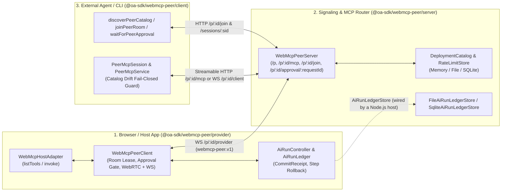

# `@oa-sdk/webmcp-peer`

Unified 3-tier **Peer-Based Server Routing MCP** library for connecting browser/host web applications and external AI agents over Streamable HTTP MCP (`/p/:id/mcp`), WebSocket signaling/relay (`/p/:id/provider`, `/p/:id/client`), and WebRTC DataChannels.

- **Zero External Runtime Dependencies**: Built strictly on standard Web APIs (`fetch`, `WebSocket`, `RTCPeerConnection`, `AbortController`) and Node.js built-ins (`node:http`, `node:crypto`, `node:fs`, `node:sqlite`).
- **Functional Intent Modularization**: Every module under `src/` owns a single, well-bounded functional responsibility, exposed through 5 public entrypoints (`.`, `./config`, `./client`, `./provider`, `./server`).
- **One protocol specification**: the wire protocol `webmcp-peer/1` (WebSocket subprotocol `webmcp-peer.v1`) is specified, requirement by requirement, in the [WebMCP relay protocol spec](../../docs/internal/webmcp-relay-protocol.md). This README only summarizes it; where the two differ, the spec is right and the README is a bug. `test/protocol-spec.test.ts` checks the spec against the code and the tests.

---

## 1. Architecture & 3-Tier Topology



---

## 2. Subpath Entrypoints & Functional Intent Modules

### 2.1 `@oa-sdk/webmcp-peer/config` — Configuration, Invitation & Health Probing

| Functional Intent Module | Key Exports | Responsibility |
| :--- | :--- | :--- |
| `src/config/types.ts` | `WEBMCP_PROTOCOL`, `WEBMCP_SUBPROTOCOL`, `WEBMCP_ROOM_ID_PATTERN`, `WEBMCP_PEER_CONFIG_TYPE`, `DEFAULT_EXTERNAL_CONSENT_PREFIX`, `WebMcpPeerConfigProfile`, `WebMcpParsedInvitationUrl`, `PeerServerPublicConfig`, `PeerHealthResult`, `PeerHealthProbeOptions` | The protocol identifiers (`webmcp-peer/1` in frames, `/config` and profiles; `webmcp-peer.v1` as the WebSocket subprotocol and in descriptors), the room id grammar `^[A-Za-z0-9_-]{1,128}$` every tier checks, profile contracts, the `/config` document (`defaults.roomTtlMs`, `defaults.maxRoomTtlMs`), and health check types (`activeRooms`, `retainedRooms`) |
| `src/config/invitation.ts` | `normalizePeerUrl`, `normalizePeerConfigUrl`, `isLocalPeerUrl`, `isSecurePeerTransport`, `redactInvitationUrl`, `externalConsentKey`, `parseInvitationUrl`, `buildInvitationUrl` | Origin normalization, local/external host detection, secure-transport check (https or loopback), invite-token redaction for logs (never throws, even on malformed percent-encoding), and `#invite=...` URL parsing/building |
| `src/config/profile.ts` | `createPeerConfigProfile`, `stringifyPeerConfigProfile`, `parsePeerConfig` | Portable JSON peer configuration profile creation and flexible URL/JSON parsing |
| `src/config/limits.ts` | `PEER_RELAY_MAX_MESSAGE_BYTES`, `PEER_RELAY_MAX_REQUEST_BYTES`, `PEER_RELAY_MAX_CATALOG_BYTES`, `PEER_RELAY_MAX_ANNOUNCEMENT_BYTES`, `PEER_RELAY_MAX_PENDING_REQUESTS` | The relay protocol's limits, shared by the server, provider, and client tiers: a message of at most 256 KiB of UTF-8 JSON in either direction, an agent request of 255 KiB, a provider `register` frame of 252 KiB, a catalog announcement of 254 KiB, and 64 requests waiting on one agent WebSocket. Every limit, who enforces it and what happens past it is in the spec's limits table (chapter 3) |
| `src/config/catalog.ts` | `PEER_CATALOG_MAX_TOOLS`, `PEER_CATALOG_MAX_TOOL_NAME_LENGTH` | The tool-catalog contract the relay and the agent client share: at most 128 tools with unique names of at most 256 UTF-16 code units, never trimmed (spec R-CAT-001) |
| `src/config/close-codes.ts` | `WEBMCP_CLOSE_CODES` | The close codes the relay sends and what a peer does after each: 1000 after the frame that ended the session, 1001 relay going away or idle timeout, 1013 stalled queue, 4001 superseded, 4002 room expired (spec 2.4, R-WS-030) |
| `src/config/probe.ts` | `probePeerHealth`, `fetchPeerServerConfig` | Pre-connection `/health` liveness probing and `/config` discovery with timeout & abort support (an already-aborted `signal` is refused before any request; a `/config` document whose declared members have the wrong type rejects) |

### 2.2 `@oa-sdk/webmcp-peer/client` — External AI Agent & CLI Client

| Functional Intent Module | Key Exports | Responsibility |
| :--- | :--- | :--- |
| `src/client/types.ts` | `DEFAULT_SERVER_URL`, `PROTOCOL_VERSION`, `PeerMcpTool`, `PeerMcpCatalogSnapshot`, `PeerMcpSessionInfo`, `PeerMcpSessionOptions`, `PeerMcpServiceSessionOptions`, `PeerMcpCallOptions`, `PeerMcpRpcResponse`, `PeerMcpCallToolResult`, `PeerClientTicket`, `PeerMcpCatalogCache`, `PeerMcpTransportCallbacks`, `PeerMcpTransportClose` | Client session state, tool catalog snapshot, validated response shapes, and transport interface contracts (a transport reports the close code and reason it learned, which a session passes on in `TRANSPORT_CLOSED`'s `details`) |
| `src/client/errors.ts` | `PeerMcpError`, `PeerMcpRpcError`, `PeerMcpCatalogChangedError`, `canonicalRpcErrorCode`, `isCatalogChangedRpcError` | Structured RPC error hierarchy, canonical error names for numeric JSON-RPC errors (the name identifies an error, the code is only its class), and fail-closed catalog drift detection: -32010 `CATALOG_CHANGED`, and the reserved -32027 that this relay never sends but other relays may (spec R-ERR-001, R-ERR-006) |
| `src/client/catalog-hash.ts` | `hashTools`, `normalizeTools` | Order- and locale-independent SHA-256 tool catalog hashing (tools in UTF-16 code-unit name order, identical to the relay's `hashDeploymentCatalog`) and descriptor validation |
| `src/client/transport.ts` | `normalizeServerUrl`, `websocketUrl`, `parseRoomId` | Streamable HTTP (`/p/:id/mcp`) and WebSocket (`/p/:id/client`) transport adapters. Both refuse a request over `PEER_RELAY_MAX_REQUEST_BYTES` before sending it (`PeerMcpError` code `REQUEST_TOO_LARGE`, `details` `{ bytes, limitBytes }`); only that call fails. The HTTP transport accepts JSON and event-stream responses, names the negotiated `MCP-Protocol-Version` after `initialize`, and passes `Retry-After` on as `retryAfterMs`. Each is made for one connection and, once closed, sends nothing (`TRANSPORT_CLOSED`) and reports nothing more of a POST (spec R-PEER-031, R-PEER-033, R-PEER-037) |
| `src/client/session.ts` | `PeerMcpSession`, `createPeerMcpSession` | Single-room MCP JSON-RPC session (`initialize` followed by `notifications/initialized`, `tools/list`, `tools/call`, catalog drift guard, ticket revocation). It re-hashes every catalog the relay sends and refuses one whose `catalogHash` does not describe its tools (`CATALOG_INTEGRITY_UNVERIFIED`). A request the relay refuses as retryable (`data.retryable: true`, e.g. `PROVIDER_BUSY`) is sent again with backoff, waiting at least as long as `Retry-After` asks, within the request's own timeout. Over a relay socket at most `PEER_RELAY_MAX_PENDING_REQUESTS` (64) requests are in flight and the rest wait in order, so fanning out calls never meets the relay's `TOO_MANY_PENDING_REQUESTS`. A session never reconnects by itself; the next request connects again on a new socket only after a close it may retry, and `TRANSPORT_CLOSED` carries the close code. One transport object has one live connection at most, across sessions (`TRANSPORT_SUPERSEDED`), and request ids and relay slots end with their connection (spec 9.2) |
| `src/client/service.ts` | `PeerMcpService`, `createPeerMcpService`, `JsonPeerMcpStore`, `createJsonPeerMcpStore` | Multi-session registry under keys the caller chooses (`key`, never sent to the relay and never written over a session's `sessionId`), active-session routing (`activeKey`), and atomic JSON file catalog cache |
| `src/client/room-lifecycle.ts` | `discoverPeerCatalog`, `joinPeerRoom`, `getPeerSessionStatus`, `waitForPeerApproval`, `rotatePeerRoom` | Room catalog discovery (`/mcp/catalog`, or `initialize` + `tools/list` on a room's `/p/:id/mcp` with the client ticket as bearer token), invitation token exchange, approval polling, and room rotation |

### 2.3 `@oa-sdk/webmcp-peer/provider` — Browser / Host Provider & AI Run Lifecycle

| Functional Intent Module | Key Exports | Responsibility |
| :--- | :--- | :--- |
| `src/provider/commit-receipt.ts` | `MCP_PROTOCOL_VERSION`, `MCP_PROTOCOL_VERSIONS`, `MCP_INITIALIZE_PROTOCOL_VERSIONS`, `CommitReceipt`, `isCommitReceipt`, `isUtcTimestamp` | Authority commit receipt union (`rejected`, `committed`, `durable`, `replicating`, `replicated`, `outcome-unknown`) and runtime type guards. A `durable` receipt is either metadata-only (the five base keys) or a document commit with both `operationId` and `replicaId`; the type and the guard accept exactly those two shapes |
| `src/provider/ai-run-controller.ts` | `AiRunController`, `AiRunLimitExceededError`, `AiRunPhase`, `AiRunStep`, `AiRunPoint`, `AiRunSnapshot`, `AiRunRollbackSummary` | Multi-step AI execution lifecycle (`queued` $\rightarrow$ `running` $\rightarrow$ `completed`/`rolled-back`), cursor trajectory tracking, and reverse-order rollback coordinator. At most 128 runs are tracked: a new run evicts the oldest terminal run, else the oldest idle one; runs with work in flight are never evicted, and `begin` throws `AiRunLimitExceededError` when all 128 are busy (the provider answers such a call with `AI_RUN_LIMIT_EXCEEDED`). `hasAction(runId, requestId)` tells whether a run still holds an action registered with `registerAction`. A listener (`subscribe`) that throws is skipped: the change stands and the other listeners are still told |
| `src/provider/ai-run-ledger.ts` | `AiRunLedger`, `InMemoryAiRunLedgerStore`, `AiRunLedgerError`, `aiRunLedgerDisposition`, `AiRunOperationRecord`, `AiRunLedgerStore` | Idempotent AI operation ledger preventing duplicate mutations or status regressions |
| `src/provider/types.ts` | `WebMcpHostAdapter`, `WebMcpCrdtTransport`, `WebMcpPeerSessionInfo`, `WebMcpPeerConnectOptions`, `WebMcpPeerClientOptions`, `resolveDefaultSignalingUrl`, `toWireToolDescriptor` | Host application tool adapter contract, CRDT carrier envelope guard, session metadata types, and the single tool-descriptor serialization used on every channel |
| `src/provider/peer-client.ts` | `WebMcpPeerClient` | Browser/Host provider runtime: room creation (`POST /p`), F5 session lease reclaim (`reclaimLease`) with auto-reconnect backoff, interactive approval gate kept in step with the relay's approval frames, WebSocket MCP relay (every frame it sends is checked against the relay's message limit: an oversized reply becomes `RESULT_TOO_LARGE`, a `register` catalog over `PEER_RELAY_MAX_CATALOG_BYTES` is withheld with `CATALOG_TOO_LARGE`), and chunked WebRTC DataChannel framing for the experimental DataChannel handoff (spec 9.1) |

### 2.4 `@oa-sdk/webmcp-peer/server` — Room-Based HTTP MCP Router & Signaling Server

| Functional Intent Module | Key Exports | Responsibility |
| :--- | :--- | :--- |
| `src/server/ws-upgrade.ts` | `upgradeWebSocket`, `PeerSocket`, `PeerSendResult`, `UpgradeWebSocketOptions`, `MAX_WEBSOCKET_FRAME_BYTES`, `MAX_WEBSOCKET_MESSAGE_BYTES`, `MAX_WEBSOCKET_MESSAGE_FRAGMENTS`, `MAX_WEBSOCKET_OUTBOUND_BUFFER_BYTES`, `MIN_WEBSOCKET_OUTBOUND_BUFFER_BYTES`, `WEBSOCKET_CLOSE_TIMEOUT_MS`, `WEBSOCKET_STALLED_OUTBOUND_TIMEOUT_MS`, `WEBSOCKET_CLOSE_TRY_AGAIN_LATER`, `WEBSOCKET_PING_INTERVAL_MS`, `WEBSOCKET_IDLE_TIMEOUT_MS` | Zero-dependency RFC 6455 WebSocket codec: the opening handshake (a request that is not one is answered 400 `BAD_UPGRADE` or 426 `UNSUPPORTED_WEBSOCKET_VERSION`, never thrown), a streaming frame parser that refuses a message over 256 KiB from its frame header (1009), a bounded outbound queue (`PeerSocket.send` returns `'sent' \| 'too-large' \| 'busy' \| 'closed'` and never closes for a full queue; a peer that reads nothing for 30 s after a refused frame is closed with 1013), a ping every 30 s and a close after 75 s of silence (1001), and a close timeout of 5 s. The rules are the spec's chapter 2 |
| `src/server/durable-file.ts` | `withFileLockSync`, `appendDurableLineSync`, `readDurableJsonLinesSync`, `truncateUnterminatedTailSync`, `DurableJsonRowSchema`, `ReadDurableJsonLinesOptions` | Cross-process advisory lockfile (`O_CREAT \| O_EXCL`) and `fsync` append-only JSONL helpers: every row is validated by a caller-supplied row schema, and a torn final row (an append interrupted before its newline) can be skipped on read and truncated on byte offsets before the next append |
| `src/server/rate-limit.ts` | `InMemoryPublishRateLimitStore`, `FilePublishRateLimitStore`, `SqlitePublishRateLimitStore`, `createPublishRateLimitStoreFromEnv`, `validatePublishRateLimitDecision` | Fixed-window room publish rate limiter (each window is anchored at the first request per key, so up to about 2x `publishRateLimitMax` can pass across a window boundary) across Memory, File, and `node:sqlite`; expired windows are pruned and the in-memory store is bounded (spec R-ROOM-010) |
| `src/server/deployment-catalog.ts` | `loadDeploymentCatalog`, `hashDeploymentCatalog`, `normalizeToolCatalog`, `DeploymentCatalogSnapshot`, `DeploymentCatalogInput` | Cold-start static tool catalog bootstrap before a live browser provider connects, and the shared tool-catalog validator |
| `src/server/server-config.ts` | `resolvePeerServerConfig`, `parseCliArgs`, `findConfigFile`, `loadConfigFile`, `loadEnvFile`, `autoLoadEnvFiles`, `isOriginAllowed`, `isHostAllowed`, `DEFAULT_ALLOWED_ORIGINS`, `DEFAULT_ALLOWED_HOSTS`, `DEFAULT_PUBLISH_RATE_LIMIT_WINDOW_MS`, `DEFAULT_PUBLISH_RATE_LIMIT_MAX` | CLI flag, `.env`, and JSON config resolution: the Origin allow list and the Host allow list (a configured list replaces the default one), whether the relay enforces the host (`enforceAllowedHosts`), the proxies it trusts (`trustProxy`), the publish key and the publish rate limit (spec R-HTTP-012, R-HTTP-020, R-HTTP-021). `WebMcpPeerServer` resolves CLI flags and loads `.env` files only when asked (`argv`, `loadEnvFiles` options); direct `resolvePeerServerConfig` callers keep `process.argv` and `.env` loading by default |
| `src/server/ledger-stores.ts` | `FileAiRunLedgerStore`, `SqliteAiRunLedgerStore` | Crash-safe JSONL and SQLite WAL persistence backends for `AiRunLedger`, wired by the host (the server exposes no ledger endpoint). The JSONL store never reads a torn final row and repairs it before the next append |
| `src/server/types.ts` | `RoomEntry`, `ClientSessionTicket`, `ClientSessionStatus`, `PendingApprovalRequest`, `PendingMcpRequest`, `WebMcpPeerServerOptions`, `PeerCapability` | Server room state machine contracts, the relay options (`approvalTimeoutMs`, `mcpRequestTimeoutMs`, `maxRoomTtlMs`, `maxRooms`, `trustProxy`, `webSocketPingIntervalMs`, `webSocketIdleTimeoutMs`, ...), and custom HTTP/WebSocket extension hooks |
| `src/server/wire-schemas.ts` | (internal) `JsonObjectBodySchema`, `PeerFrameSchema` | Named runtime validators for HTTP JSON bodies and WebSocket frames before the relay relies on their shape |
| `src/server/peer-server.ts` | `WebMcpPeerServer`, `createWebMcpPeerServer` | Room lifecycle control plane, Streamable HTTP MCP router (`/p/:id/mcp`), WebSocket signaling relay, and custom HTTP/WS extension hooks |

---

## 3. Quick Start Recipes

### 3.1 Launch the Peer Routing Server (`@oa-sdk/webmcp-peer/server`)

```ts
import { createWebMcpPeerServer } from '@oa-sdk/webmcp-peer/server'

const server = createWebMcpPeerServer({
  port: 8787,
  host: '127.0.0.1',
  serverName: 'my-service-peer-server',
  customHttpHandler: async (req, res, url) => {
    if (req.method === 'GET' && url.pathname === '/custom-status') {
      res.writeHead(200, { 'Content-Type': 'application/json' })
      res.end(JSON.stringify({ ok: true }))
      return true
    }
    return false
  },
})

const port = await server.listen()
console.log(`Peer MCP Server listening on http://127.0.0.1:${port}`)
```

Server behaviour worth knowing when embedding or operating the relay. Each point summarizes rules of the [relay protocol spec](../../docs/internal/webmcp-relay-protocol.md); the requirement IDs name them.

- **Configuration is explicit.** The constructor never parses `process.argv` and never loads `.env` files into `process.env`. A standalone CLI entry point opts in with `createWebMcpPeerServer({ argv: process.argv.slice(2), loadEnvFiles: true })`; CLI flags then take precedence over the options (`cwd` sets where config and `.env` files are looked up). Environment variables that are already set (`PORT`, `HOST`, `FRAMEBOOK_PUBLISH_KEY`, ...) are still read, after explicit options and the JSON config file.
- **Endpoints.** `POST /p` (create a room), `POST /p/:id/reclaim`, `POST /p/:id/join`, `POST /p/:id/approval/:requestId` (provider decision), `GET /p/:id/sessions/:sessionId`, `POST /p/:id/session/revoke` and `POST /p/:id/sessions/:sessionId/revoke`, `POST /p/:id/rotate`, `GET|POST /p/:id/mcp`, `GET /p/:id/mcp/tools`, `GET /mcp/catalog[/:hash]`, `GET /config`, `GET /health`, and the `/p/:id/provider` / `/p/:id/client` WebSockets. A route asked with a method it does not take answers 405 `METHOD_NOT_ALLOWED` with its `Allow`; only a path that is no route is 404 (spec 2.6, chapter 4, R-HTTP-022).
- **Who is served.** A relay bound to the loopback interface (the default `127.0.0.1`), or one with a configured `allowedHosts`, refuses a request or upgrade for any other host with 403 `HOST_NOT_ALLOWED`, so a page that a DNS rebinding pointed at a local relay reaches nothing. It checks the request's own `Host` even when a trusted proxy names the host in `X-Forwarded-Host`, which a page can send too; a proxy that rewrites `Host` to a name other than a loopback or the public one needs that name in `allowedHosts`. A configured `allowedOrigins` replaces the default origins, and a disallowed Origin gets 403 `ORIGIN_NOT_ALLOWED` everywhere. `X-Forwarded-*` count only from a proxy `trustProxy` names; a relay behind a proxy must set it (R-HTTP-011, R-HTTP-012, R-HTTP-020, R-HTTP-021).
- **Room creation is bounded.** With a publish key, `POST /p` needs it (`Authorization: Bearer`, or `X-Publish-Key` without a Bearer credential). With or without one, room creation is rate limited per client address (30 a minute by default, `publishRateLimitMax: 0` turns it off; every failed attempt from one address shares one bucket), a rotation spends from the same quota, since it adds the replacement room, and the relay holds at most `maxRooms` rooms (10000), the expired and rotated ones it still retains included, answering 503 `ROOM_CAPACITY_EXCEEDED` past it (R-ROOM-008, R-ROOM-009, R-ROOM-010, R-ROOM-073, R-LIM-047).
- **Room lifetime.** `ttlMs` is clamped to `[60 s, maxRoomTtlMs]` (option, default 24 h; advertised in `GET /config` as `defaults.maxRoomTtlMs`). An expired or rotated room is retained for a day after its original expiry and answers 410 `ROOM_EXPIRED` or `ROOM_ROTATED` (with the replacement room) until then, 404 `ROOM_NOT_FOUND` after. An approval request lives `approvalTimeoutMs` (5 min by default, never past the room). The reconnect lease does not expire while the provider socket is attached and lasts 15 minutes after it goes away (R-ROOM-002, R-ROOM-018, R-ROOM-024, R-ROOM-051, R-ROOM-070).
- **Errors.** Every error has one canonical name (the JSON-RPC `message`, or a lifecycle body's `error`) and one code, which is only its class; whether to send a request again is told by `data.retryable`. A missing credential is `<X>_REQUIRED`, a wrong one `<X>_INVALID`, and every 401 carries `WWW-Authenticate: Bearer` (R-ERR-001, R-ERR-005, R-HTTP-019).
- **Bearer tickets, no OAuth.** The relay's credentials are tokens it issues (a room's provider token, a join's client token) or the operator's publish key, not OAuth access tokens. Its Bearer challenge names no `resource_metadata`, and it serves no OAuth protected resource metadata (RFC 9728), authorization server metadata or OpenID discovery: those `/.well-known/...` paths are 404. An MCP client sends the client token as a static `Authorization: Bearer` header (the official SDK: `requestInit.headers`, no auth provider) and starts no OAuth flow on a 401; a new ticket comes from joining with an invite (R-HTTP-019, R-PEER-053).
- **Request bodies.** JSON-body endpoints answer a body over 64 KiB with 413 `BODY_TOO_LARGE` and one that is not a UTF-8 JSON object with 400 `INVALID_JSON_BODY`, without acting; an empty body means `{}`, and one leading byte order mark is ignored. If a `customHttpHandler` reads a body and then returns `false`, the endpoint answers 500 `BODY_CONSUMED`. State-changing endpoints check the room again once the body has arrived, so a rotation or reclaim that happens meanwhile wins (R-HTTP-006 to R-HTTP-009).
- **MCP over HTTP.** `POST /p/:id/mcp` answers `initialize`, `ping`, `tools/list` and `server/discover` itself (discovery is public) and forwards other requests of an approved ticket to the provider. It checks every `tools/call` against the room's catalog before forwarding it, one without an id included, on both transports; one without an id it refuses over WebSocket is dropped unanswered (R-MCP-020). A request the relay refuses before forwarding gets a 4xx or 5xx status; a forwarded one is always answered 200 with a JSON-RPC message, an error that ended it in flight (`ROOM_ROTATED`, `ROOM_EXPIRED`, `SESSION_INVALID`, `PROVIDER_DISCONNECTED`, `MCP_REQUEST_TIMEOUT`) included, so judge an answer by its JSON-RPC `error`, not its status. A notification it takes is answered 202 with an empty body. An agent that disconnects releases its pending slot immediately (spec 7.2, R-MCP-023, R-PEER-053).
- **WebSockets.** A socket offers the subprotocol `webmcp-peer.v1` with its credential as `ticket.<token>`; a refused upgrade gets an HTTP response with the same status and name an HTTP route gives. The relay pings every socket every 30 s and closes one it hears nothing from for 75 s (1001); its close codes tell a peer whether to reconnect (`WEBMCP_CLOSE_CODES`). An agent socket gets the frames it asked for in order, a slow one included, and the frame that ends its session after them (spec chapter 2, R-WS-030, R-WS-037, R-WS-039).
- **Signaling.** A client socket can relay only `mcp` requests and, once approved, `offer` frames, which need a `requestId`; the relay stamps what it forwards to the provider with `from: "client"` and the ticket's `sessionId`. From the provider it passes on only JSON-RPC notifications and requests (to the approved agents) and the `answer`/`release` of an offer (to the socket that offered); relay control frames sent by either side are dropped, and so is the provider's own `notifications/tools/list_changed`: the one agents get is the relay's, naming the catalog version and hash their calls are checked against (R-SIG-003, R-SIG-004, R-SIG-017, R-MCP-041).
- **Provider reattach.** When a provider socket attaches to a room it already served (`POST /p/:id/reclaim` after a page reload, or auto-reconnect), the relay follows `ready` with an `approval.restored` frame for every approved, unexpired client and the pending `approval.request` for every client still waiting, so an approved agent keeps working without a new approval. It also sends again the frame that ended a ticket while the room stays live (`approval.rejected`, `approval.expired`, `session.revoked`), and names that frame's type in the provider's `ready` itself (`ticketEnded`), so a provider learns from `ready` that the room serves no agent any more. Rooms created with `approvalRequired: false` replay only such an end (R-ROOM-053, R-SIG-006).
- **Revocation.** Revoke responses report `alreadyRevoked: false` for the first revocation and `true` (with the original `revokedAt`) for a repeat, and the provider socket is told of every revocation with `session.revoked` (R-ROOM-039, R-SIG-024). A room's expiry ends only the sessions still live: a session rejected or revoked before keeps reporting that state and time in its session status (R-ROOM-035, R-ROOM-048).
- **Catalog hash.** `catalogHash` is SHA-256 over the tools sorted by name in UTF-16 code-unit order with object keys sorted recursively (`hashDeploymentCatalog`), so it does not depend on the runtime locale (R-CAT-002).

### 3.2 Connect a Browser / Host App Provider (`@oa-sdk/webmcp-peer/provider`)

```ts
import { WebMcpPeerClient } from '@oa-sdk/webmcp-peer/provider'

const provider = new WebMcpPeerClient({
  hostAdapter: {
    getServerInfo: () => ({ name: 'my-web-app', version: '1.0.0' }),
    getStatus: () => ({ writeEnabled: true }),
    listTools: () => [
      {
        name: 'doc_summary_get',
        description: 'Read current document summary',
        inputSchema: { type: 'object', properties: {} },
      },
    ],
    invoke: async (name, args) => {
      return {
        content: [{ type: 'text', text: JSON.stringify({ tool: name, args }) }],
        structuredContent: { tool: name, args },
      }
    },
  },
})

// connect() resolves to the invitation URL (`<descriptorUrl>#invite=<token>`).
const invitationUrl = await provider.connect({
  serverUrl: 'http://127.0.0.1:8787',
  alias: 'my-workspace',
  autoReconnect: true,
})
console.log('Share invitation URL with AI agent:', invitationUrl)

// Full session state (room, approval state, errors such as CATALOG_INVALID) via getSession()/subscribe().
// Admitting an agent is the user's decision: ask once per approval request (`askUser` is your own UI).
const asked = new Set<string>()
provider.subscribe(async (session) => {
  const requestId = session.approvalRequestId
  if (session.approvalState !== 'pending' || !requestId || asked.has(requestId)) return
  asked.add(requestId)
  const allowed = await askUser(`Allow ${session.clientLabel ?? 'an AI agent'} to use this workspace?`)
  if (allowed) provider.approveClient(requestId)
  else provider.rejectClient(requestId)
})
```

`hostAdapter.invoke` may return either shape; the agent always receives an MCP `CallToolResult`, a host that throws included. A `tools/call` is answered a JSON-RPC error only for params without a tool `name` (−32602) and for an unexpected exception outside the host call, such as a ledger lookup that fails, which is −32603 `Internal error` (spec R-PEER-013). The refusals every request meets come first, and the host is not called for them: an id that is not a string or a number (`null` included) is answered −32600 `Invalid Request`, and a request on the relay socket from a session other than the approved one, or before approval, −32053 `CLIENT_APPROVAL_REQUIRED` (R-PEER-012):

- an MCP `CallToolResult` (`{ content: [...], structuredContent?, isError? }`) keeps its members, but `isError` is worked out again (`isError: true`, or an `ok` member, of the result or of its `structuredContent`, that is false), and a result without valid `content` gets a `text` block of its payload;
- any other value is the payload: it becomes `structuredContent` (wrapped as `{ value }` when it is not a JSON object), a legacy `data` mirror, and a JSON `text` block, and `{ ok: false }` marks the call failed. The `text` block repeats the payload only when its JSON is at most 16 KiB; a larger payload gets a short `text` block that points at `structuredContent`.

Every relay message must fit `PEER_RELAY_MAX_MESSAGE_BYTES` (256 KiB of UTF-8 JSON), whether it is sent as one WebSocket frame, as browsers and Node do, or fragmented. The relay closes a socket that sends more (close code 1009); for the provider socket that ends every agent request pending in the room with `PROVIDER_DISCONNECTED` (the agents stay connected), so every frame the provider sends on the relay socket is measured first (a frame over the limit is not sent and is logged with `console.warn`). The relay, in turn, never closes or detaches the provider because of agent traffic. The limits and what happens past each are the spec's chapter 3; in short:

- A `tools/call` result that does not fit is answered with `isError: true` and error code `RESULT_TOO_LARGE` (the tool did run; only its result is lost), and any other oversized reply with the JSON-RPC error `RESULT_TOO_LARGE`. Return large data by reference (a resource link or an id the agent can page through) rather than inline.
- A host catalog whose `register` frame is over `PEER_RELAY_MAX_CATALOG_BYTES` (256 KiB - 4 KiB) is withheld: `syncTools()` returns `false`, `getSession().error` becomes `CATALOG_TOO_LARGE: ...`, and the socket stays open. The relay keeps serving the last catalog it accepted from this provider (if any); a room that never had one answers `CATALOG_UNAVAILABLE`. The relay refuses a catalog whose announcement would be over `PEER_RELAY_MAX_ANNOUNCEMENT_BYTES` (256 KiB - 2 KiB) with `CATALOG_TOO_LARGE`, and every rejection echoes the frame's `registerSeq`, so the provider ignores the rejection of a catalog it has since replaced (R-PEER-009, R-PEER-010, R-CAT-009).
- The relay evaluates `register` frames within a budget per room, whatever their result: 8 at once, then one a second. A frame that arrives while none is allowed waits and the provider's next `register` replaces it, so the latest catalog is always evaluated, only later, and none is refused for the rate (R-CAT-011, R-CAT-012).
- While the room holds a catalog, the relay answers a WebSocket agent's `tools/list` and `server/discover` from it as it answers an HTTP agent's, so both see the same catalog; the provider answers the listings the relay forwards from the last `register` frame it sent (R-MCP-038, R-PEER-011).
- Agents get `REQUEST_TOO_LARGE` for a request over `PEER_RELAY_MAX_REQUEST_BYTES` (256 KiB - 1 KiB, measured on what the agent sends and on that request as `JSON.stringify` writes it): the client refuses it before sending, an HTTP body over it is answered 413, and a WebSocket request over it with a JSON-RPC error. Every request within the limit is forwarded, whatever stamp or wire-id rewrite the relay adds (R-LIM-010).
- When the provider is not reading fast enough (its 1 MiB outbound queue is full, for example while a browser tab runs a long synchronous tool), the relay does not queue the request and answers the retryable `PROVIDER_BUSY` (HTTP 503 with `Retry-After: 1`); `PeerMcpSession` sends it again. The provider stays attached: the relay closes a socket only when no write to it completes for 30 s after a frame was refused (1013, R-WS-026).
- An agent WebSocket that falls behind on frames it asked for (replies to its requests, `approval.pending`, `approval.approved` and `ready`, the `answer`, `release` or `offer.refused` of its offer, and the frame that ends its session) is never closed for it and loses none of them: they wait in order, and meanwhile the relay reads and handles nothing more from that agent, not even the rest of a read it already took, so an agent that does not read holds at most the replies to its requests in flight and a few frames of its own; the waiting replies count toward its 64 pending requests. A catalog listing shares the relay's one frozen catalog instead of holding a copy (R-WS-040, R-MCP-042). Frames it did not ask for (catalog announcements, `notifications/tools/list_changed`, provider notifications) are skipped for an agent that is behind (R-WS-031, R-WS-032, R-MCP-032).
- The relay also bounds what one agent can hold: JSON-RPC request ids and `offer` `requestId`s are at most 1 KiB of JSON (`REQUEST_ID_TOO_LARGE`), an agent WebSocket has at most 64 requests waiting (`TOO_MANY_PENDING_REQUESTS`, which `PeerMcpSession` never meets) and one offer waiting for its answer, a client ticket holds at most 4 WebSockets (a fifth closes the oldest with 4001), and a `/join` `clientLabel` or room `alias` is trimmed and cut to its first 256 code points (R-LIM-012 to R-LIM-014, R-LIM-022, R-LIM-042, R-LIM-044).

A payload `receipt` that passes `isCommitReceipt` is recorded in the AI run ledger the host set with `setAiRunLedger` (there is none by default); an invalid one is logged and never made rollback-eligible. With a ledger, a call whose `arguments.context.requestId` the ledger holds as durable is answered with the recorded receipt without calling the host, and one it holds as `outcome-unknown` gets `RECONCILIATION_REQUIRED`. Tool calls without `_meta.framebook.aiTrace.runId` share one implicit AI run, which a failed call does not end (only a run the agent named is failed or completed by a call's outcome). A call still running when its connection ends (a revocation, an expiry, a replaced socket, `disconnect()`) is answered with nothing, since the channel it came on is closed, and so is one whose connection ended while the ledger looked it up. A call whose connection host code ended before the host was called (the host adapter's `getServerInfo`, or a `subscribeAiRuns` listener told of the call's run, calling `disconnect()`) is not run either. Its agent gets the error the relay ended its request with (the call may have run): `SESSION_INVALID` for a revocation over HTTP, `ROOM_EXPIRED` or `ROOM_ROTATED` when the relay expired or rotated the room, `PROVIDER_DISCONNECTED` when the provider socket closed first (the provider's own `disconnect()` or `revokeClient()`, a 4001 replacement, a dropped socket); with a ledger, it learns the outcome by calling again under the same `context.requestId`. The host's run still accounts for a call the host ran, unless `disconnect()` cleared the runs: the call's step is recorded and its action settled, so the run can be stopped, rolled back and evicted. No request of an ended connection is answered, whatever its method and channel, even when host code the provider calls while handling it (`getServerInfo`, `listTools`, the ledger, a run listener) ends the connection or throws afterwards. The provider sends an answer in the turn it sees the request's connection still live, so a request is not answered once another request of the same read (a `tools/call` whose run listener calls `disconnect()`, say) ended the connection. A `subscribeAiRuns` listener that throws changes nothing of a call or its run: `AiRunController` drops a listener's exception and still tells the other listeners. Nor does a CRDT transport (`attachCrdtTransport`) that throws as the provider publishes an AI run to it: the provider logs the exception, as it does wherever it tells the transport of its agent (as the transport is attached, as a DataChannel session starts, as a `tools/call` comes), so the call is answered with its result and recorded in its run, and `stopAiRun()` and `rollbackAiRun()` do not throw (R-PEER-012, R-PEER-016).

When the provider WebSocket drops (close code 1001, 1006 or 1013), auto-reconnect reclaims the room of the saved lease, trying again with exponential backoff (1 s, 1.5 s, 2.25 s, ... capped at 15 s) while the relay cannot be reached or fails otherwise, until it reattaches or `disconnect()` is called. It never opens a new room: without a saved lease it does not run, and a lease the relay refuses stops it at `ROOM_LEASE_LOST`, leaving a new invitation to the host's `connect()`. A final close (1000 after the frame that ended the session, 4001 when another provider socket took the room, 4002 when the room expired) ends the session without a reconnect. After the relay revokes the session (the agent's own revoke included), rejects or expires its approval request (the host's own `rejectClient()` included, once the relay confirms it) or rotates or expires its room, the provider ends the session and forgets that room's lease, so a reloaded page does not reclaim a room nobody can join; a revoke leaves the host's auto-reconnect preference as it was, and only the host's own `revokeClient()` turns it off (R-PEER-021). Writes are enabled again only if the user last left them on (`webmcp:write-enabled`). On reattach the relay re-sends pending approval requests and restores every approved client with an `approval.restored` frame, so an approved agent keeps working without a new approval. It also sends again the frame that ended a ticket (a rejection, an approval request that expired, a revoke), and its `ready` already names it, so a provider whose socket was away when that happened, or that lost the frame, ends the session and forgets the lease as it reattaches: that reconnect fails instead of succeeding into a session that is over, so `autoReconnectIfSaved()` resolves `false` and `connect({ reclaimLease: true })` rejects with the session error, and the host's next `connect()` opens a new room (R-PEER-004, R-PEER-024, R-PEER-025, R-PEER-028, R-ROOM-053).

### 3.3 Join and Call Tools from an External Agent / CLI (`@oa-sdk/webmcp-peer/client`)

```ts
import {
  joinPeerRoom,
  waitForPeerApproval,
  PeerMcpSession,
} from '@oa-sdk/webmcp-peer/client'

// 1. Exchange invitation URL for a client session ticket
const joined = await joinPeerRoom({
  invitationUrl: process.env.WEBMCP_INVITE_URL,
  clientLabel: 'external-coding-agent',
})

// 2. Wait for host approval if the room requires interactive consent
if (joined.approvalRequired && joined.state !== 'approved') {
  await waitForPeerApproval({
    serverUrl: joined.serverUrl,
    roomId: joined.roomId,
    sessionId: joined.sessionId,
    clientToken: joined.clientToken,
  })
}

// 3. Connect over Streamable HTTP MCP (or WebSocket) and invoke tools
const session = new PeerMcpSession({
  mcpEndpoint: joined.mcpEndpoint,
  clientToken: joined.clientToken,
  sessionId: joined.sessionId,
})

await session.connect()
await session.initialize()
const tools = await session.listTools()
// A validated MCP CallToolResult: { content?, structuredContent?, isError?, ... }
const result = await session.callTool(tools[0].name, {})
if (result.isError) console.error(result.content)

// 4. Leave the room with one POST: revoke() names the room/epoch/session it learned while
//    connected, and leaves out what it does not know (or disconnect() to keep the ticket for later).
await session.revoke()
```

`discoverPeerCatalog({ invitationUrl, clientToken })` (or `{ serverUrl, roomId, clientToken }`, or `{ mcpEndpoint, clientToken }`) reads a room's catalog without keeping a session open; `{ serverUrl }` alone reads the deployment catalog (`/mcp/catalog`). Every helper and `PeerMcpSession` accept `fetchImpl` for tests and custom runtimes, and refuse a room id outside the protocol's grammar with `ROOM_ID_INVALID` before sending anything. `PeerMcpService` keeps several sessions under keys of its own (`createSession({ ...options, key })`, `callTool(name, args, { key })`), never sent to the relay. A session never reconnects by itself. After a close it may retry (1001, 1006, 1013) the next request connects again, on a new socket; after a final one (1000, 4001, 4002, a code refusing a frame it sent) or a frame that ended the session, requests (`PeerMcpService` calls included) fail with that error until the caller calls `connect()`, and a `TRANSPORT_CLOSED` error's `details.code` tells which it was (R-PEER-045). `disconnect()` ends the requests waiting and a connect in flight with `SESSION_DISCONNECTED` at once (a connect still getting its transport ends once your `transportFactory` or your transport's `connect` returns, which it cannot cut short, but a request waiting for that connect ends at once and frees its id), and nothing a transport reports through the callbacks of a connect it ended, while it closes or later, changes the session it left `idle` or ends the next connect. That holds for your own `transport` too: each connect hands its `connect(callbacks)` new callbacks and only the latest connect's speak for the session, so a close event that arrives after `close()` returned no longer cuts off the connect after it. One transport object is held by one live connection at most, across every session: a connect that starts on your transport (or on one your `transportFactory` hands out again) ends the connection that held it, of another session too (each session of one `PeerMcpService({ transport })`, say), whose requests then fail with `TRANSPORT_SUPERSEDED`, without connecting again, until you call its `connect()`. The `onMessage` the session sets on your transport when it has none belongs to the transport and delivers to the live connection that holds it (to nothing after `disconnect()`), so a transport that has `connect(callbacks)` should report through those callbacks. A connection closes its transport when it ends (its connect fails, the transport closes, a frame ends the session, `disconnect()`), and only while it still holds it. A `connect()` or request made before `disconnect()` finished connects once that has closed the socket, so a session never holds more than one, and a transport that a connect gets after its connection ended is closed unless a live connection holds it by then. A frame that ends the session, or a close, while a connect still gets its transport fails that connect with that error. Once a connect's connection has ended (another connect took its transport, a frame or a close ended it), `connect()` starts a new connect instead of handing out that one, which can only fail and then changes nothing of the new one, so a session whose transport another connect took takes it back with `connect()`. A connect whose connection ended before it got its transport (a listener took the transport back, or called `disconnect()`) calls neither your transport's `connect(callbacks)` nor your `transportFactory`, and one that cannot give your transport an `onMessage` (a frozen object, say) fails, ending its connection and closing the transport (R-PEER-031, R-PEER-045). A session matches a reply to its request as the relay does (a string or number id with a `result` or `error`), so a provider's request under the id of a call in flight neither ends that call nor frees the relay slot it holds, and it refuses a request under an id already in flight (as a string: `1` and `"1"` are one id) with `DUPLICATE_REQUEST_ID`, unsent. A request is in flight, on every transport, from its call until its answer arrives or its connection ends: its wait before a retry included, and even after its timeout (over Streamable HTTP, whose POST brings the answer, until that POST ends). When its connection ends (`disconnect()`, a transport close, a frame that ends the session, a failed connect, another connect taking its transport) every request gives back its id and its relay slot at once, even one whose send still runs, and that send touches nothing of a request sent under the id since. A transport you reuse across connects (your own `transport`, or one your `transportFactory` hands out again) must not deliver such a send on a later connection: it drops or fails it (the `PeerMcpTransport` contract; the built-in transports send nothing once closed). A transport error (`onError`) or a `{type:'error'}` frame leaves the connection open: it rejects the requests waiting, but those sent keep their ids and slots until their answers arrive. A transport you reuse should not report an earlier connect's late answers through the next connect's callbacks (R-PEER-031, R-PEER-032). An MCP client other than `PeerMcpSession` talks to `POST /p/:id/mcp` as the spec's R-PEER-053 lists: a Bearer client token on relayed methods, string or number ids, no batches, and success judged by the JSON-RPC `error`, not the HTTP status.

### 3.4 Tool Catalog Contract (Provider ↔ Relay ↔ Client)

세 계층은 하나의 도구 카탈로그 계약(`src/config/catalog.ts`)을 공유하며, 어긋나면 `catalogVersion`/`catalogHash`가 계층마다 달라집니다. 규칙 전체는 [relay protocol spec](../../docs/internal/webmcp-relay-protocol.md)의 6장과 R-PEER-006~R-PEER-011, R-PEER-040~R-PEER-044입니다.

- **Provider**는 `register` 프레임, `tools/list`, `server/discover`에 모두 `toWireToolDescriptor()`로 만든 동일한 기술자(`name`, `title`, `description`, `inputSchema`, `outputSchema`, `annotations`)를 보내고, 호스트가 `inputSchema`를 생략하면 `{ type: "object", properties: {} }`로 채웁니다. Relay의 `CATALOG_INVALID`·`CATALOG_TOO_LARGE` 거부와 보내지 않은 큰 카탈로그는 `getSession().error`에 남고(구독자에게 통지), 맞는 카탈로그를 보내면 지워집니다. 모든 `register` 프레임은 증가하는 `registerSeq`를 담고, Provider는 이미 다른 카탈로그로 바꾼 뒤 도착한 거부를 무시합니다. Relay가 전달한 `tools/list`·`server/discover`에는 그 room에 마지막으로 보낸 `register` 프레임의 카탈로그로 답합니다.
- **Relay**는 `normalizeToolCatalog()`로 카탈로그를 검증합니다: 도구 128개 이하, 앞뒤 공백이 없는(trim하지 않고 거절) 256 UTF-16 code unit 이하의 고유 이름, 모든 도구에 `type: "object"`인 `inputSchema`. 위반한 `register`는 카탈로그 전체를 `CATALOG_INVALID`로 거부하고 클라이언트에는 알리지 않습니다. 바뀐 카탈로그만 Relay의 `catalogVersion`/`catalogHash`를 붙여 `notifications/tools/list_changed` 다음에 알리고, 해시가 같은 `register`는 조용히 받아들입니다. `register` 평가는 결과와 무관하게 room마다 한 번에 8개, 그 뒤로 초당 1개까지이며, 기다리는 frame은 Provider의 다음 `register`로 바뀌므로 마지막 frame은 늦게라도 항상 평가됩니다. room에 카탈로그가 없을 때만 Provider의 `tools/list` 결과가 같은 기준을 통과해 Relay 카탈로그가 될 수 있습니다. 정적 배포 카탈로그(`deploymentCatalog`)도 같은 규칙을 따르므로 `inputSchema`가 없는 도구가 있으면 비어 있는 카탈로그가 됩니다.
- **Client**(`PeerMcpSession`)는 같은 계약으로 카탈로그를 검증하고, Relay가 준 `catalogHash`를 tools에서 다시 계산해 다르면 `CATALOG_INTEGRITY_UNVERIFIED`로 거절하며, 검증할 수 없는 카탈로그 프레임은 버리고 마지막으로 검증된 카탈로그를 유지합니다. `CATALOG_CHANGED`(-32010)를 카탈로그 드리프트로 취급하고, 이 relay가 내지 않는 예약값 -32027(`SOURCE_CHANGED`·`RUNTIME_EPOCH_MISMATCH`)도 그것을 내는 다른 relay와의 호환을 위해 드리프트로 분류합니다(`isCatalogChangedRpcError`). HTTP 전송은 서버의 JSON-RPC 오류를 그대로 전달합니다(`error.code`는 `SESSION_INVALID` 같은 정규 이름, `rpcError.httpStatus`에 HTTP 상태).

---

## 4. 로컬 기능 스모크 테스트 & 플레이그라운드 (Quick Local Smoke Test)

별도의 외부 인프라 설정 없이 로컬 루프백(`127.0.0.1`)에서 **Tier 2 서버 + Tier 1 프로바이더 + Tier 3 에이전트 클라이언트** 전체 7단계 흐름(헬스 프로브 $\rightarrow$ 룸 생성 $\rightarrow$ 초대 승인 $\rightarrow$ `tools/list` $\rightarrow$ 쓰기 도구 호출 및 `AiRunLedger` 영수증 기록 $\rightarrow$ 읽기 도구 호출 $\rightarrow$ 룸 회전)을 즉시 검증할 수 있습니다.

```bash
# 1) 원샷 E2E 기능 스모크 테스트 (< 1초 실행 후 자동 종료)
pnpm --filter @oa-sdk/webmcp-peer smoke

# 2) 인터랙티브 로컬 서버 + 프로바이더 상시 구동 (기본 127.0.0.1:8787, curl 명령 안내 출력)
pnpm --filter @oa-sdk/webmcp-peer smoke:serve

# 3) 단위 및 통합 테스트 스위트 실행
pnpm --filter @oa-sdk/webmcp-peer test

# 4) 3-Tier 인터랙티브 라이브 데모 (기본 http://127.0.0.1:8788/demo, PORT 환경변수로 변경)
pnpm --filter @oa-sdk/webmcp-peer demo
```

라이브 데모(`examples/live-demo.ts` + `examples/live-demo/`)는 한 페이지에서 Tier 1 호스트와 Tier 3 에이전트를 실제 서버에 붙여 실행합니다. 동적 도구팩 `register` → `notifications/tools/list_changed` 푸시, `params._meta.catalogHash` 기반 `CATALOG_CHANGED` Fail-Closed 차단, Write Consent 잠금, `CommitReceipt` 롤백, 룸 회전(`ROOM_ROTATED`)·세션 파기·1회용 초대 소비를 확인할 수 있으며, Config & Security 카드는 `@oa-sdk/webmcp-peer/config`의 `isSecurePeerTransport` / `redactInvitationUrl` / `createPeerConfigProfile` 판정 결과를 그대로 보여줍니다.

데모 Provider의 `register`도 SDK처럼 증가하는 `registerSeq`를 담고, Relay의 `CATALOG_INVALID`·`CATALOG_TOO_LARGE` 거부를 그 번호로 frame에 맞춥니다. 마지막 frame에 대한 거부만 Provider 상태 배지에 표시하고, 이미 대체된 frame에 대한 거부는 wire log에 무시했다고 남깁니다. Relay는 반복된 frame에 마지막 답을 다시 보내고 기다리는 동안 대체된 frame에는 답하지 않으므로, 답이 온 순서로는 frame을 맞출 수 없습니다.

데모의 프로토콜 로직은 DOM에 의존하지 않는 모듈(`host-tools.js` · `host-provider.js` · `agent-client.js` · `scenario.js` · `peer-protocol.js`)로 분리되어 있고, 페이지(`app.js`)는 렌더링만 담당합니다. 데모 에이전트는 공개 `PeerMcpSession`처럼 모든 `tools/list` 응답을 SHA-256으로 재계산해 릴레이의 `catalogHash`와 대조하며, 검증되지 않은 카탈로그로는 호출하지 않습니다. `test/live-demo.e2e.test.ts`는 같은 모듈과 공개 `PeerMcpSession`을 실제 서버에 붙여 위 동작 전부를 실행 가능한 증명으로 검증합니다(`pnpm --filter @oa-sdk/webmcp-peer test`).

