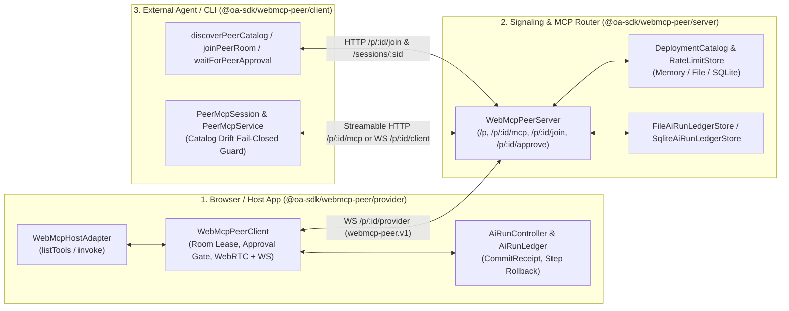

# `@oa-sdk/webmcp-peer`

Unified 3-tier **Peer-Based Server Routing MCP** library for connecting browser/host web applications and external AI agents over Streamable HTTP MCP (`/p/:id/mcp`), WebSocket signaling/relay (`/p/:id/provider`, `/p/:id/client`), and WebRTC DataChannels.

- **Zero External Runtime Dependencies**: Built strictly on standard Web APIs (`fetch`, `WebSocket`, `RTCPeerConnection`, `AbortController`) and Node.js built-ins (`node:http`, `node:crypto`, `node:fs`, `node:sqlite`).
- **Functional Intent Modularization**: Every module under `src/` owns a single, well-bounded functional responsibility, exposed through 5 public entrypoints (`.`, `./config`, `./client`, `./provider`, `./server`).

---

## 1. Architecture & 3-Tier Topology



---

## 2. Subpath Entrypoints & Functional Intent Modules

### 2.1 `@oa-sdk/webmcp-peer/config` — Configuration, Invitation & Health Probing

| Functional Intent Module | Key Exports | Responsibility |
| :--- | :--- | :--- |
| `src/config/types.ts` | `WEBMCP_SUBPROTOCOL`, `WEBMCP_PEER_CONFIG_TYPE`, `DEFAULT_EXTERNAL_CONSENT_PREFIX`, `WebMcpPeerConfigProfile`, `WebMcpParsedInvitationUrl`, `PeerHealthResult`, `PeerHealthProbeOptions` | Wire protocol constants, profile contracts, and health check types |
| `src/config/invitation.ts` | `normalizePeerUrl`, `normalizePeerConfigUrl`, `isLocalPeerUrl`, `externalConsentKey`, `parseInvitationUrl`, `buildInvitationUrl` | Origin normalization, local/external host detection, and `#invite=...` URL parsing/building |
| `src/config/profile.ts` | `createPeerConfigProfile`, `stringifyPeerConfigProfile`, `parsePeerConfig` | Portable JSON peer configuration profile creation and flexible URL/JSON parsing |
| `src/config/probe.ts` | `probePeerHealth`, `fetchPeerServerConfig` | Pre-connection `/health` liveness probing and `/config` discovery with timeout & abort support |

### 2.2 `@oa-sdk/webmcp-peer/client` — External AI Agent & CLI Client

| Functional Intent Module | Key Exports | Responsibility |
| :--- | :--- | :--- |
| `src/client/types.ts` | `DEFAULT_SERVER_URL`, `PROTOCOL_VERSION`, `PeerMcpTool`, `PeerMcpCatalogSnapshot`, `PeerMcpSessionInfo`, `PeerMcpSessionOptions`, `PeerMcpCallOptions` | Client session state, tool catalog snapshot, and transport interface contracts |
| `src/client/errors.ts` | `PeerMcpError`, `PeerMcpRpcError`, `PeerMcpCatalogChangedError`, `canonicalRpcErrorCode`, `isCatalogChangedRpcError` | Structured RPC error hierarchy, canonical error names for numeric JSON-RPC errors, and fail-closed catalog drift detection (-32010 / -32027 only) |
| `src/client/catalog-hash.ts` | `hashTools`, `normalizeTools` | Order-independent SHA-256 tool catalog hashing and descriptor validation |
| `src/client/transport.ts` | `normalizeServerUrl`, `websocketUrl`, `parseRoomId` | Streamable HTTP (`/p/:id/mcp`) and WebSocket (`/p/:id/client`) transport adapters |
| `src/client/session.ts` | `PeerMcpSession`, `createPeerMcpSession` | Single-room MCP JSON-RPC session (`initialize`, `tools/list`, `tools/call`, catalog drift guard, ticket revocation) |
| `src/client/service.ts` | `PeerMcpService`, `createPeerMcpService`, `JsonPeerMcpStore`, `createJsonPeerMcpStore` | Multi-session registry, active-session routing, and atomic JSON file catalog cache |
| `src/client/room-lifecycle.ts` | `discoverPeerCatalog`, `joinPeerRoom`, `getPeerSessionStatus`, `waitForPeerApproval`, `rotatePeerRoom` | Room catalog discovery, invitation token exchange, approval polling, and room rotation |

### 2.3 `@oa-sdk/webmcp-peer/provider` — Browser / Host Provider & AI Run Lifecycle

| Functional Intent Module | Key Exports | Responsibility |
| :--- | :--- | :--- |
| `src/provider/commit-receipt.ts` | `MCP_PROTOCOL_VERSION`, `MCP_PROTOCOL_VERSIONS`, `CommitReceipt`, `isCommitReceipt`, `isUtcTimestamp` | Authority commit receipt union (`rejected`, `committed`, `durable`, `replicating`, `replicated`, `outcome-unknown`) and runtime type guards |
| `src/provider/ai-run-controller.ts` | `AiRunController`, `AiRunPhase`, `AiRunStep`, `AiRunPoint`, `AiRunSnapshot`, `AiRunRollbackSummary` | Multi-step AI execution lifecycle (`queued` $\rightarrow$ `running` $\rightarrow$ `completed`/`rolled-back`), cursor trajectory tracking, and reverse-order rollback coordinator |
| `src/provider/ai-run-ledger.ts` | `AiRunLedger`, `InMemoryAiRunLedgerStore`, `AiRunLedgerError`, `aiRunLedgerDisposition`, `AiRunOperationRecord`, `AiRunLedgerStore` | Idempotent AI operation ledger preventing duplicate mutations or status regressions |
| `src/provider/types.ts` | `WebMcpHostAdapter`, `WebMcpCrdtTransport`, `WebMcpPeerSessionInfo`, `WebMcpPeerConnectOptions`, `WebMcpPeerClientOptions`, `resolveDefaultSignalingUrl`, `toWireToolDescriptor` | Host application tool adapter contract, CRDT carrier envelope guard, session metadata types, and the single tool-descriptor serialization used on every channel |
| `src/provider/peer-client.ts` | `WebMcpPeerClient` | Browser/Host provider runtime: room creation (`POST /p`), F5 session lease reclaim (`reclaimLease`), interactive approval gate, WebSocket MCP relay, and chunked WebRTC DataChannel framing |

### 2.4 `@oa-sdk/webmcp-peer/server` — Room-Based HTTP MCP Router & Signaling Server

| Functional Intent Module | Key Exports | Responsibility |
| :--- | :--- | :--- |
| `src/server/ws-upgrade.ts` | `upgradeWebSocket`, `PeerSocket`, `MAX_WEBSOCKET_FRAME_BYTES`, `MAX_WEBSOCKET_MESSAGE_BYTES` | Zero-dependency RFC 6455 WebSocket handshake, masking, ping/pong, and message fragmentation |
| `src/server/durable-file.ts` | `withFileLockSync`, `appendDurableLineSync`, `readDurableJsonLinesSync` | Cross-process advisory lockfile (`O_CREAT \| O_EXCL`) and `fsync` append-only JSONL helpers |
| `src/server/rate-limit.ts` | `InMemoryPublishRateLimitStore`, `FilePublishRateLimitStore`, `SqlitePublishRateLimitStore`, `createPublishRateLimitStoreFromEnv`, `validatePublishRateLimitDecision` | Sliding-window room publish rate limiter across Memory, File, and `node:sqlite` |
| `src/server/deployment-catalog.ts` | `loadDeploymentCatalog`, `hashDeploymentCatalog`, `normalizeToolCatalog`, `DeploymentCatalogSnapshot`, `DeploymentCatalogInput` | Cold-start static tool catalog bootstrap before a live browser provider connects, and the shared tool-catalog validator |
| `src/server/server-config.ts` | `resolvePeerServerConfig`, `parseCliArgs`, `loadConfigFile`, `loadEnvFile`, `autoLoadEnvFiles`, `isOriginAllowed`, `isHostAllowed` | CLI flag, `.env`, and JSON config resolution with wildcard Origin and Host header guards |
| `src/server/ledger-stores.ts` | `FileAiRunLedgerStore`, `SqliteAiRunLedgerStore` | Crash-safe JSONL and SQLite WAL persistence backends for `AiRunLedger` |
| `src/server/types.ts` | `RoomEntry`, `ClientSessionTicket`, `PendingApprovalRequest`, `WebMcpPeerServerOptions`, `PeerCapability` | Server room state machine contracts and custom HTTP/WebSocket extension hooks |
| `src/server/peer-server.ts` | `WebMcpPeerServer`, `createWebMcpPeerServer` | Room lifecycle control plane, Streamable HTTP MCP router (`/p/:id/mcp`), WebSocket signaling relay, and `/ai-runs/ledger` endpoint |

---

## 3. Quick Start Recipes

### 3.1 Launch the Peer Routing Server (`@oa-sdk/webmcp-peer/server`)

```ts
import { createWebMcpPeerServer } from '@oa-sdk/webmcp-peer/server'

const server = createWebMcpPeerServer({
  port: 8787,
  host: '127.0.0.1',
  serverName: 'my-service-peer-server',
  customHttpHandler: async (req, res, url) => {
    if (req.method === 'GET' && url.pathname === '/custom-status') {
      res.writeHead(200, { 'Content-Type': 'application/json' })
      res.end(JSON.stringify({ ok: true }))
      return true
    }
    return false
  },
})

const port = await server.listen()
console.log(`Peer MCP Server listening on http://127.0.0.1:${port}`)
```

### 3.2 Connect a Browser / Host App Provider (`@oa-sdk/webmcp-peer/provider`)

```ts
import { WebMcpPeerClient } from '@oa-sdk/webmcp-peer/provider'

const provider = new WebMcpPeerClient({
  hostAdapter: {
    getServerInfo: () => ({ name: 'my-web-app', version: '1.0.0' }),
    getStatus: () => ({ writeEnabled: true }),
    listTools: () => [
      {
        name: 'doc_summary_get',
        description: 'Read current document summary',
        inputSchema: { type: 'object', properties: {} },
      },
    ],
    invoke: async (name, args) => {
      return {
        content: [{ type: 'text', text: JSON.stringify({ tool: name, args }) }],
        structuredContent: { tool: name, args },
      }
    },
  },
})

const session = await provider.connect({
  serverUrl: 'http://127.0.0.1:8787',
  alias: 'my-workspace',
  autoReconnect: true,
})
console.log('Share invitation URL with AI agent:', session.invitationUrl)
```

### 3.3 Join and Call Tools from an External Agent / CLI (`@oa-sdk/webmcp-peer/client`)

```ts
import {
  joinPeerRoom,
  waitForPeerApproval,
  PeerMcpSession,
} from '@oa-sdk/webmcp-peer/client'

// 1. Exchange invitation URL for a client session ticket
const joined = await joinPeerRoom({
  invitationUrl: process.env.WEBMCP_INVITE_URL,
  clientLabel: 'external-coding-agent',
})

// 2. Wait for host approval if the room requires interactive consent
if (joined.approvalRequired && joined.state !== 'approved') {
  await waitForPeerApproval({
    serverUrl: joined.serverUrl,
    roomId: joined.roomId,
    sessionId: joined.sessionId,
    clientToken: joined.clientToken,
  })
}

// 3. Connect over Streamable HTTP MCP (or WebSocket) and invoke tools
const session = new PeerMcpSession({
  mcpEndpoint: joined.mcpEndpoint,
  clientToken: joined.clientToken,
  sessionId: joined.sessionId,
})

await session.connect()
await session.initialize()
const tools = await session.listTools()
const result = await session.callTool(tools[0].name, {})
await session.disconnect()
```

### 3.4 Tool Catalog Contract (Provider ↔ Relay ↔ Client)

세 계층은 하나의 도구 카탈로그 계약을 공유하며, 어긋나면 `catalogVersion`/`catalogHash`가 계층마다 달라집니다.

- **Provider**는 `register` 프레임, `tools/list`, `server/discover`에 모두 `toWireToolDescriptor()`로 만든 동일한 기술자(`name`, `title`, `description`, `inputSchema`, `outputSchema`, `annotations`)를 보냅니다. 호스트가 `inputSchema`를 생략하면 `{ type: "object", properties: {} }`로 채웁니다.
- **Relay**는 `normalizeToolCatalog()`로 카탈로그를 검증합니다: 도구 128개 이하, 공백 없는 고유 이름(256자 이하), 모든 도구에 `type: "object"`인 `inputSchema`. 위반한 `register`는 카탈로그 전체를 거부하고 Provider에 `{ type: "error", code: -32602, message: "CATALOG_INVALID" }`를 돌려주며, 클라이언트에는 전달하지 않습니다. 받아들인 카탈로그는 Relay의 `catalogVersion`/`catalogHash`를 붙여 알립니다. 정적 배포 카탈로그(`deploymentCatalog`)도 같은 규칙을 따르므로 `inputSchema`가 없는 도구가 있으면 비어 있는 카탈로그가 됩니다.
- **Client**(`PeerMcpSession`)는 검증할 수 없는 카탈로그 프레임을 버리고 마지막으로 검증된 카탈로그를 유지합니다. `CATALOG_CHANGED`(-32010)와 `SOURCE_CHANGED`(-32027)만 카탈로그 드리프트로 취급하며(`isCatalogChangedRpcError`), HTTP 전송은 서버의 JSON-RPC 오류 코드를 그대로 전달합니다(`error.code`는 `SESSION_INVALID` 같은 정규 이름, `rpcError.httpStatus`에 HTTP 상태).

---

## 4. 로컬 기능 스모크 테스트 & 플레이그라운드 (Quick Local Smoke Test)

별도의 외부 인프라 설정 없이 로컬 루프백(`127.0.0.1`)에서 **Tier 2 서버 + Tier 1 프로바이더 + Tier 3 에이전트 클라이언트** 전체 7단계 흐름(헬스 프로브 $\rightarrow$ 룸 생성 $\rightarrow$ 초대 승인 $\rightarrow$ `tools/list` $\rightarrow$ 쓰기 도구 호출 및 `AiRunLedger` 영수증 기록 $\rightarrow$ 읽기 도구 호출 $\rightarrow$ 룸 회전)을 즉시 검증할 수 있습니다.

```bash
# 1) 원샷 E2E 기능 스모크 테스트 (< 1초 실행 후 자동 종료)
pnpm --filter @oa-sdk/webmcp-peer smoke

# 2) 인터랙티브 로컬 서버 + 프로바이더 상시 구동 (기본 127.0.0.1:8787, curl 명령 안내 출력)
pnpm --filter @oa-sdk/webmcp-peer smoke:serve

# 3) 단위 및 통합 테스트 스위트 실행
pnpm --filter @oa-sdk/webmcp-peer test

# 4) 3-Tier 인터랙티브 라이브 데모 (기본 http://127.0.0.1:8788/demo, PORT 환경변수로 변경)
pnpm --filter @oa-sdk/webmcp-peer demo
```

라이브 데모(`examples/live-demo.ts` + `examples/live-demo/`)는 한 페이지에서 Tier 1 호스트와 Tier 3 에이전트를 실제 서버에 붙여 실행합니다. 동적 도구팩 `register` → `notifications/tools/list_changed` 푸시, `params._meta.catalogHash` 기반 `CATALOG_CHANGED` Fail-Closed 차단, Write Consent 잠금, `CommitReceipt` 롤백, 룸 회전(`ROOM_ROTATED`)·세션 파기·1회용 초대 소비를 확인할 수 있으며, Config & Security 카드는 `@oa-sdk/webmcp-peer/config`의 `isSecurePeerTransport` / `redactInvitationUrl` / `createPeerConfigProfile` 판정 결과를 그대로 보여줍니다.

데모의 프로토콜 로직은 DOM에 의존하지 않는 모듈(`host-tools.js` · `host-provider.js` · `agent-client.js` · `scenario.js` · `peer-protocol.js`)로 분리되어 있고, 페이지(`app.js`)는 렌더링만 담당합니다. 에이전트는 모든 `tools/list` 응답을 SHA-256으로 재계산해 릴레이의 `catalogHash`와 대조하며, 검증되지 않은 카탈로그로는 호출하지 않습니다. `test/live-demo.e2e.test.ts`는 같은 모듈과 공개 `PeerMcpSession`을 실제 서버에 붙여 위 동작 전부를 실행 가능한 증명으로 검증합니다(`pnpm --filter @oa-sdk/webmcp-peer test`).

