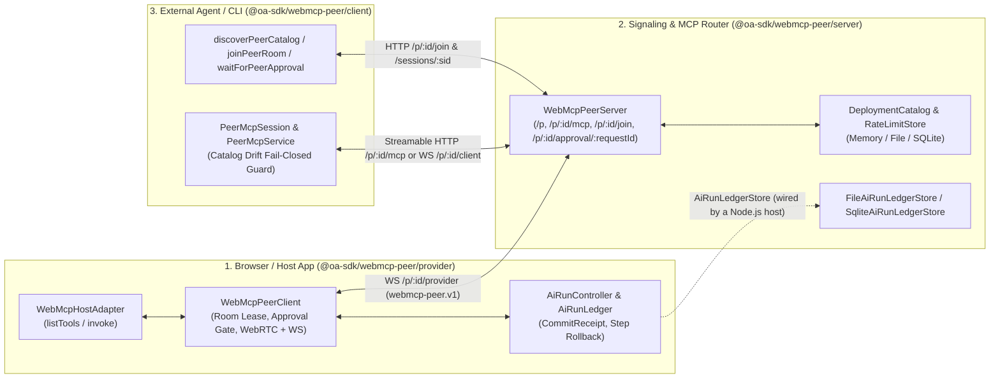

# `@oa-sdk/webmcp-peer`

Unified 3-tier **Peer-Based Server Routing MCP** library for connecting browser/host web applications and external AI agents over Streamable HTTP MCP (`/p/:id/mcp`), WebSocket signaling/relay (`/p/:id/provider`, `/p/:id/client`), and WebRTC DataChannels.

- **Zero External Runtime Dependencies**: Built strictly on standard Web APIs (`fetch`, `WebSocket`, `RTCPeerConnection`, `AbortController`) and Node.js built-ins (`node:http`, `node:crypto`, `node:fs`, `node:sqlite`).
- **Functional Intent Modularization**: Every module under `src/` owns a single, well-bounded functional responsibility, exposed through 5 public entrypoints (`.`, `./config`, `./client`, `./provider`, `./server`).

---

## 1. Architecture & 3-Tier Topology



---

## 2. Subpath Entrypoints & Functional Intent Modules

### 2.1 `@oa-sdk/webmcp-peer/config` — Configuration, Invitation & Health Probing

| Functional Intent Module | Key Exports | Responsibility |
| :--- | :--- | :--- |
| `src/config/types.ts` | `WEBMCP_SUBPROTOCOL`, `WEBMCP_PEER_CONFIG_TYPE`, `DEFAULT_EXTERNAL_CONSENT_PREFIX`, `WebMcpPeerConfigProfile`, `WebMcpParsedInvitationUrl`, `PeerHealthResult`, `PeerHealthProbeOptions` | Wire protocol constants, profile contracts, and health check types |
| `src/config/invitation.ts` | `normalizePeerUrl`, `normalizePeerConfigUrl`, `isLocalPeerUrl`, `isSecurePeerTransport`, `redactInvitationUrl`, `externalConsentKey`, `parseInvitationUrl`, `buildInvitationUrl` | Origin normalization, local/external host detection, secure-transport check (https or loopback), invite-token redaction for logs (never throws, even on malformed percent-encoding), and `#invite=...` URL parsing/building |
| `src/config/profile.ts` | `createPeerConfigProfile`, `stringifyPeerConfigProfile`, `parsePeerConfig` | Portable JSON peer configuration profile creation and flexible URL/JSON parsing |
| `src/config/limits.ts` | `PEER_RELAY_MAX_MESSAGE_BYTES`, `PEER_RELAY_MAX_REQUEST_BYTES`, `PEER_RELAY_MAX_CATALOG_BYTES`, `PEER_RELAY_MAX_ANNOUNCEMENT_BYTES`, `PEER_RELAY_MAX_PENDING_REQUESTS` | The relay protocol's limits, shared by the server, provider, and client tiers: one message is at most 256 KiB of UTF-8 JSON in either direction (one frame or fragmented); an agent request at most 255 KiB as sent (the relay's `from`/`sessionId` stamp and wire-id rewrite always fit in the rest); a provider `register` frame at most 252 KiB; a catalog announcement the relay accepts (stamped with `catalogVersion`/`catalogHash`) at most 254 KiB, so its `tools/list` reply always fits; and at most 64 requests in flight on one agent WebSocket, which `PeerMcpSession` keeps to by queueing |
| `src/config/probe.ts` | `probePeerHealth`, `fetchPeerServerConfig` | Pre-connection `/health` liveness probing and `/config` discovery with timeout & abort support (an already-aborted `signal` is refused before any request; a malformed `/config` document rejects) |

### 2.2 `@oa-sdk/webmcp-peer/client` — External AI Agent & CLI Client

| Functional Intent Module | Key Exports | Responsibility |
| :--- | :--- | :--- |
| `src/client/types.ts` | `DEFAULT_SERVER_URL`, `PROTOCOL_VERSION`, `PeerMcpTool`, `PeerMcpCatalogSnapshot`, `PeerMcpSessionInfo`, `PeerMcpSessionOptions`, `PeerMcpCallOptions`, `PeerMcpRpcResponse`, `PeerMcpCallToolResult`, `PeerClientTicket`, `PeerMcpCatalogCache` | Client session state, tool catalog snapshot, validated response shapes, and transport interface contracts |
| `src/client/errors.ts` | `PeerMcpError`, `PeerMcpRpcError`, `PeerMcpCatalogChangedError`, `canonicalRpcErrorCode`, `isCatalogChangedRpcError` | Structured RPC error hierarchy, canonical error names for numeric JSON-RPC errors, and fail-closed catalog drift detection (-32010 / -32027 only) |
| `src/client/catalog-hash.ts` | `hashTools`, `normalizeTools` | Order- and locale-independent SHA-256 tool catalog hashing (tools in UTF-16 code-unit name order, identical to the relay's `hashDeploymentCatalog`) and descriptor validation |
| `src/client/transport.ts` | `normalizeServerUrl`, `websocketUrl`, `parseRoomId` | Streamable HTTP (`/p/:id/mcp`) and WebSocket (`/p/:id/client`) transport adapters. Both refuse a request over `PEER_RELAY_MAX_REQUEST_BYTES` before sending it (`PeerMcpError` code `REQUEST_TOO_LARGE`, `details` `{ bytes, limitBytes }`); only that call fails |
| `src/client/session.ts` | `PeerMcpSession`, `createPeerMcpSession` | Single-room MCP JSON-RPC session (`initialize`, `tools/list`, `tools/call`, catalog drift guard, ticket revocation). Requests made while a connect is in flight wait for that connect. A request the relay refuses as retryable (`data.retryable: true`, e.g. `PROVIDER_BUSY`) reached nobody and is retried with backoff (100 ms doubling to 2 s) within the request's own timeout. Over a relay socket (any transport that is not `raw`; the Streamable HTTP one is) at most `PEER_RELAY_MAX_PENDING_REQUESTS` (64) requests are in flight: a request past them waits, in order, and is sent once an earlier one has been answered, so fanning out more calls never meets the relay's `TOO_MANY_PENDING_REQUESTS`. A request holds its place until the relay answers it, even after its caller stopped waiting, since the relay counts it until then; the wait counts toward the request's timeout (`REQUEST_TIMEOUT`, never sent), and `disconnect()` or a closed transport ends it like a pending request. There, an id over 1 KiB of JSON is refused before sending (`REQUEST_ID_TOO_LARGE`, `details` `{ bytes, limitBytes }`), since the relay would answer it without the id |
| `src/client/service.ts` | `PeerMcpService`, `createPeerMcpService`, `JsonPeerMcpStore`, `createJsonPeerMcpStore` | Multi-session registry, active-session routing, and atomic JSON file catalog cache |
| `src/client/room-lifecycle.ts` | `discoverPeerCatalog`, `joinPeerRoom`, `getPeerSessionStatus`, `waitForPeerApproval`, `rotatePeerRoom` | Room catalog discovery (`/mcp/catalog`, or `initialize` + `tools/list` on a room's `/p/:id/mcp` with the client ticket as bearer token), invitation token exchange, approval polling, and room rotation |

### 2.3 `@oa-sdk/webmcp-peer/provider` — Browser / Host Provider & AI Run Lifecycle

| Functional Intent Module | Key Exports | Responsibility |
| :--- | :--- | :--- |
| `src/provider/commit-receipt.ts` | `MCP_PROTOCOL_VERSION`, `MCP_PROTOCOL_VERSIONS`, `CommitReceipt`, `isCommitReceipt`, `isUtcTimestamp` | Authority commit receipt union (`rejected`, `committed`, `durable`, `replicating`, `replicated`, `outcome-unknown`) and runtime type guards. A `durable` receipt is either metadata-only (the five base keys) or a document commit with both `operationId` and `replicaId`; the type and the guard accept exactly those two shapes |
| `src/provider/ai-run-controller.ts` | `AiRunController`, `AiRunLimitExceededError`, `AiRunPhase`, `AiRunStep`, `AiRunPoint`, `AiRunSnapshot`, `AiRunRollbackSummary` | Multi-step AI execution lifecycle (`queued` $\rightarrow$ `running` $\rightarrow$ `completed`/`rolled-back`), cursor trajectory tracking, and reverse-order rollback coordinator. At most 128 runs are tracked: a new run evicts the oldest terminal run, else the oldest idle one; runs with work in flight are never evicted, and `begin` throws `AiRunLimitExceededError` when all 128 are busy (the provider answers such a call with `AI_RUN_LIMIT_EXCEEDED`) |
| `src/provider/ai-run-ledger.ts` | `AiRunLedger`, `InMemoryAiRunLedgerStore`, `AiRunLedgerError`, `aiRunLedgerDisposition`, `AiRunOperationRecord`, `AiRunLedgerStore` | Idempotent AI operation ledger preventing duplicate mutations or status regressions |
| `src/provider/types.ts` | `WebMcpHostAdapter`, `WebMcpCrdtTransport`, `WebMcpPeerSessionInfo`, `WebMcpPeerConnectOptions`, `WebMcpPeerClientOptions`, `resolveDefaultSignalingUrl`, `toWireToolDescriptor` | Host application tool adapter contract, CRDT carrier envelope guard, session metadata types, and the single tool-descriptor serialization used on every channel |
| `src/provider/peer-client.ts` | `WebMcpPeerClient` | Browser/Host provider runtime: room creation (`POST /p`), F5 session lease reclaim (`reclaimLease`) with auto-reconnect backoff, interactive approval gate, WebSocket MCP relay (every frame it sends is checked against the relay's message limit: an oversized reply becomes `RESULT_TOO_LARGE`, a `register` catalog over `PEER_RELAY_MAX_CATALOG_BYTES` is withheld with `CATALOG_TOO_LARGE`), and chunked WebRTC DataChannel framing |

### 2.4 `@oa-sdk/webmcp-peer/server` — Room-Based HTTP MCP Router & Signaling Server

| Functional Intent Module | Key Exports | Responsibility |
| :--- | :--- | :--- |
| `src/server/ws-upgrade.ts` | `upgradeWebSocket`, `PeerSocket`, `PeerSendResult`, `UpgradeWebSocketOptions`, `MAX_WEBSOCKET_FRAME_BYTES`, `MAX_WEBSOCKET_MESSAGE_BYTES`, `MAX_WEBSOCKET_MESSAGE_FRAGMENTS`, `MAX_WEBSOCKET_OUTBOUND_BUFFER_BYTES`, `MIN_WEBSOCKET_OUTBOUND_BUFFER_BYTES`, `WEBSOCKET_CLOSE_TIMEOUT_MS`, `WEBSOCKET_STALLED_OUTBOUND_TIMEOUT_MS`, `WEBSOCKET_CLOSE_TRY_AGAIN_LATER` | Zero-dependency RFC 6455 WebSocket handshake and streaming frame parser. A message may be up to `MAX_WEBSOCKET_MESSAGE_BYTES` (256 KiB) in one frame (`MAX_WEBSOCKET_FRAME_BYTES` equals it) or in at most 1024 frames (`MAX_WEBSOCKET_MESSAGE_FRAGMENTS`); a larger inbound message is refused from its frame header, before its payload is buffered, with close code 1009. Protocol violations close with 1002, binary data with 1003, invalid UTF-8 with 1007, and an exception in the owner's `onText` with 1011. `PeerSocket.send` returns `'sent'`, `'too-large'` (over the message limit), `'busy'` (the peer's outbound queue would pass `MAX_WEBSOCKET_OUTBOUND_BUFFER_BYTES`, 1 MiB) or `'closed'`; for `'too-large'` and `'busy'` nothing is queued and the socket stays open. A pong that would not fit is dropped. A peer whose queue stays full for `WEBSOCKET_STALLED_OUTBOUND_TIMEOUT_MS` (30 s) after a refused send is closed with 1013 (`WEBSOCKET_CLOSE_TRY_AGAIN_LATER`); that is the only close a full queue causes. `PeerSocket.close(code?)` sends the given close code (default 1000). `onClose` runs once, as soon as the socket stops; a peer that does not answer the relay's close is destroyed after `WEBSOCKET_CLOSE_TIMEOUT_MS` (5 s). A socket that is already gone when `upgradeWebSocket` is called (destroyed, ended by its peer, i.e. `readableEnded`, or no longer writable, as after an upgrade hook that awaited) gets no 101, is destroyed, and stops at once: `send` returns `'closed'` and `onClose` runs after the call returns, so no caller holds a half-open socket it never sees close. The optional sixth argument (`UpgradeWebSocketOptions`) sets `closeTimeoutMs`, `stalledOutboundTimeoutMs` and `maxOutboundBufferBytes` |
| `src/server/durable-file.ts` | `withFileLockSync`, `appendDurableLineSync`, `readDurableJsonLinesSync`, `truncateUnterminatedTailSync`, `DurableJsonRowSchema`, `ReadDurableJsonLinesOptions` | Cross-process advisory lockfile (`O_CREAT \| O_EXCL`) and `fsync` append-only JSONL helpers: every row is validated by a caller-supplied row schema, and a torn final row (an append interrupted before its newline) can be skipped on read and truncated on byte offsets before the next append |
| `src/server/rate-limit.ts` | `InMemoryPublishRateLimitStore`, `FilePublishRateLimitStore`, `SqlitePublishRateLimitStore`, `createPublishRateLimitStoreFromEnv`, `validatePublishRateLimitDecision` | Fixed-window room publish rate limiter (each window is anchored at the first request per key, so up to about 2x `publishRateLimitMax` can pass across a window boundary) across Memory, File, and `node:sqlite`; expired windows are pruned and the in-memory store is bounded |
| `src/server/deployment-catalog.ts` | `loadDeploymentCatalog`, `hashDeploymentCatalog`, `normalizeToolCatalog`, `DeploymentCatalogSnapshot`, `DeploymentCatalogInput` | Cold-start static tool catalog bootstrap before a live browser provider connects, and the shared tool-catalog validator |
| `src/server/server-config.ts` | `resolvePeerServerConfig`, `parseCliArgs`, `loadConfigFile`, `loadEnvFile`, `autoLoadEnvFiles`, `isOriginAllowed`, `isHostAllowed` | CLI flag, `.env`, and JSON config resolution with wildcard Origin and Host header guards. `WebMcpPeerServer` resolves CLI flags and loads `.env` files only when asked (`argv`, `loadEnvFiles` options); direct `resolvePeerServerConfig` callers keep `process.argv` and `.env` loading by default |
| `src/server/ledger-stores.ts` | `FileAiRunLedgerStore`, `SqliteAiRunLedgerStore` | Crash-safe JSONL and SQLite WAL persistence backends for `AiRunLedger`, wired by the host (the server exposes no ledger endpoint). The JSONL store never reads a torn final row and repairs it before the next append |
| `src/server/types.ts` | `RoomEntry`, `ClientSessionTicket`, `PendingApprovalRequest`, `WebMcpPeerServerOptions`, `PeerCapability` | Server room state machine contracts and custom HTTP/WebSocket extension hooks |
| `src/server/wire-schemas.ts` | (internal) `JsonObjectBodySchema`, `PeerFrameSchema` | Named runtime validators for HTTP JSON bodies and WebSocket frames before the relay relies on their shape |
| `src/server/peer-server.ts` | `WebMcpPeerServer`, `createWebMcpPeerServer` | Room lifecycle control plane, Streamable HTTP MCP router (`/p/:id/mcp`), WebSocket signaling relay, and custom HTTP/WS extension hooks |

---

## 3. Quick Start Recipes

### 3.1 Launch the Peer Routing Server (`@oa-sdk/webmcp-peer/server`)

```ts
import { createWebMcpPeerServer } from '@oa-sdk/webmcp-peer/server'

const server = createWebMcpPeerServer({
  port: 8787,
  host: '127.0.0.1',
  serverName: 'my-service-peer-server',
  customHttpHandler: async (req, res, url) => {
    if (req.method === 'GET' && url.pathname === '/custom-status') {
      res.writeHead(200, { 'Content-Type': 'application/json' })
      res.end(JSON.stringify({ ok: true }))
      return true
    }
    return false
  },
})

const port = await server.listen()
console.log(`Peer MCP Server listening on http://127.0.0.1:${port}`)
```

Server behaviour worth knowing when embedding or operating the relay:

- **Configuration is explicit.** The constructor never parses `process.argv` and never loads `.env` files into `process.env`. A standalone CLI entry point opts in with `createWebMcpPeerServer({ argv: process.argv.slice(2), loadEnvFiles: true })`; CLI flags then take precedence over the options (`cwd` sets where config and `.env` files are looked up). Environment variables that are already set (`PORT`, `HOST`, `FRAMEBOOK_PUBLISH_KEY`, ...) are still read, after explicit options and the JSON config file.
- **Endpoints.** `POST /p` (create a room), `POST /p/:id/join`, `POST /p/:id/approval/:requestId` (provider decision), `GET /p/:id/sessions/:sessionId`, `POST /p/:id/session/revoke` and `POST /p/:id/sessions/:sessionId/revoke`, `POST /p/:id/rotate`, `POST /p/:id/reclaim`, `GET|POST /p/:id/mcp`, `GET /p/:id/mcp/tools`, `GET /mcp/catalog[/:hash]`, `GET /config`, `GET /health`, and the `/p/:id/provider` / `/p/:id/client` WebSockets.
- **Request bodies.** JSON-body endpoints (`POST /p`, `/join`, `/approval/:requestId`, `/session/revoke`, `/sessions/:sessionId/revoke`, `/rotate`, `/reclaim`) answer a body over 64 KiB with HTTP 413 `{ error: "BODY_TOO_LARGE" }` and one that is not valid UTF-8 or not a JSON object with 400 `INVALID_JSON_BODY` (`POST /p/:id/mcp` answers ill-formed UTF-8 with 400 `PARSE_ERROR`), without acting; an empty body means `{}`, and a request aborted mid-body is not acted on. Oversized bodies are read to their end and discarded (up to 16 times the limit) so the error response reaches the client. If a `customHttpHandler` reads a request body and then returns `false`, the endpoint answers 500 `BODY_CONSUMED` instead of acting on a partial body. State-changing endpoints check the room again once the body has arrived, so a rotation or reclaim that happens meanwhile makes the slower request fail.
- **Upgrade hooks.** An awaiting `customUpgradeHandler` may outlive its client: the relay guards the raw socket before awaiting the hook, so a client that resets meanwhile cannot crash the process, and a socket that is gone when the hook returns is destroyed rather than attached.
- **Room TTL.** `ttlMs` on `POST /p` and `POST /p/:id/rotate` is clamped to `[60 s, maxRoomTtlMs]` (option, default 24 h; advertised in `GET /config` as `defaults.maxRoomTtlMs`), so every room expires and is swept.
- **Publish rate limit.** With a publish key, every failed `POST /p` attempt (missing or wrong key) from one address shares one bucket, so key guessing is throttled at `publishRateLimitMax` attempts per window regardless of the keys tried, while the valid key keeps its own quota.
- **In-flight MCP calls.** An HTTP `tools/call` waiting on the provider is always answered: `ROOM_ROTATED` (-32057, with `data.replacementRoomId`), `SESSION_INVALID` (-32001) after a provider revoke-all, `ROOM_EXPIRED` (-32056) when the sweeper expires the room, `PROVIDER_DISCONNECTED`, or `MCP_REQUEST_TIMEOUT`. An agent that disconnects releases its pending slot immediately.
- **Client signaling.** A client socket can relay only `mcp` requests and, once approved, `offer` frames. The relay stamps every frame it forwards to the provider (`mcp` envelopes from WebSocket and HTTP agents, and offers) with `from: "client"` and the authoritative `sessionId`, overwriting whatever the agent put there. An offer the relay cannot forward is answered with `{ type: "offer.refused", requestId, error }` (`PROVIDER_BUSY`, `REQUEST_TOO_LARGE` or `PROVIDER_UNAVAILABLE`). The provider answers an offer under its `requestId`, so an offer whose `requestId` is over 1 KiB of JSON is not forwarded: it is refused with `{ type: "offer.refused", error: REQUEST_ID_TOO_LARGE }`, without the id. Relay control frames (`session.*`, `room.*`, `approval.*`, `register`, ...) sent by a client are dropped, and frames that are not JSON objects with a string `type` are ignored on both sockets.
- **Provider reattach.** When a provider socket attaches to a room it already served (`POST /p/:id/reclaim` after a page reload, or auto-reconnect), the relay follows `ready` with the room's approval state, oldest event first: an `approval.restored` frame (`payload: { sessionId, roomId, roomEpoch, clientLabel, capabilities, approvedAt, expiresAt }`) for every approved, unexpired client and the pending `approval.request` for every client still waiting. An approved agent therefore keeps working without a new approval, and the room reports `active` again. Rooms created with `approvalRequired: false` replay nothing.
- **Revocation.** Revoke responses report `alreadyRevoked: false` for the first revocation and `true` (with the original `revokedAt`) for a repeat.
- **Catalog hash.** `catalogHash` is SHA-256 over the tools sorted by name in UTF-16 code-unit order with object keys sorted recursively (`hashDeploymentCatalog`), so it does not depend on the runtime locale.

### 3.2 Connect a Browser / Host App Provider (`@oa-sdk/webmcp-peer/provider`)

```ts
import { WebMcpPeerClient } from '@oa-sdk/webmcp-peer/provider'

const provider = new WebMcpPeerClient({
  hostAdapter: {
    getServerInfo: () => ({ name: 'my-web-app', version: '1.0.0' }),
    getStatus: () => ({ writeEnabled: true }),
    listTools: () => [
      {
        name: 'doc_summary_get',
        description: 'Read current document summary',
        inputSchema: { type: 'object', properties: {} },
      },
    ],
    invoke: async (name, args) => {
      return {
        content: [{ type: 'text', text: JSON.stringify({ tool: name, args }) }],
        structuredContent: { tool: name, args },
      }
    },
  },
})

// connect() resolves to the invitation URL (`<descriptorUrl>#invite=<token>`).
const invitationUrl = await provider.connect({
  serverUrl: 'http://127.0.0.1:8787',
  alias: 'my-workspace',
  autoReconnect: true,
})
console.log('Share invitation URL with AI agent:', invitationUrl)

// Full session state (room, approval state, errors such as CATALOG_INVALID) via getSession()/subscribe().
// Admitting an agent is the user's decision: ask once per approval request (`askUser` is your own UI).
const asked = new Set<string>()
provider.subscribe(async (session) => {
  const requestId = session.approvalRequestId
  if (session.approvalState !== 'pending' || !requestId || asked.has(requestId)) return
  asked.add(requestId)
  const allowed = await askUser(`Allow ${session.clientLabel ?? 'an AI agent'} to use this workspace?`)
  if (allowed) provider.approveClient(requestId)
  else provider.rejectClient(requestId)
})
```

`hostAdapter.invoke` may return either shape; the agent always receives an MCP `CallToolResult`:

- an MCP `CallToolResult` (`{ content: [...], structuredContent?, isError? }`) is forwarded as is, and `isError: true` marks the call failed;
- any other value is the payload: it becomes `structuredContent` (wrapped as `{ value }` when it is not a JSON object), a legacy `data` mirror, and a JSON `text` block, and `{ ok: false }` marks the call failed. The `text` block repeats the payload only when its JSON is at most 16 KiB; a larger payload gets a short `text` block that points at `structuredContent`.

Every relay message must fit `PEER_RELAY_MAX_MESSAGE_BYTES` (256 KiB of UTF-8 JSON), whether it is sent as one WebSocket frame, as browsers and Node do, or fragmented. The relay closes a socket that sends more (close code 1009), and a closed provider socket drops every agent of the room, so every frame the provider sends on the relay socket is measured first (a frame over the limit is not sent and is logged with `console.warn`). The relay, in turn, never closes or detaches the provider because of agent traffic:

- A `tools/call` result that does not fit is answered with `isError: true` and error code `RESULT_TOO_LARGE` (the tool did run; only its result is lost), and any other oversized reply with the JSON-RPC error `RESULT_TOO_LARGE`. Return large data by reference (a resource link or an id the agent can page through) rather than inline.
- A host catalog whose `register` frame is over `PEER_RELAY_MAX_CATALOG_BYTES` (256 KiB - 4 KiB) is withheld: `syncTools()` returns `false`, `getSession().error` becomes `CATALOG_TOO_LARGE: the register frame for N tools is B bytes, ...`, and the socket stays open. The relay is not told: it keeps announcing and serving the last catalog it accepted from this provider (if any), to HTTP and WebSocket agents alike, so calls to those tools keep working and a tool the host added since gets `TOOL_NOT_FOUND`. A room that never had a catalog answers `CATALOG_UNAVAILABLE`. The error clears, and subscribers are notified, when a catalog that fits is synced.
- The relay accepts a catalog only if its announcement fits `PEER_RELAY_MAX_ANNOUNCEMENT_BYTES` (256 KiB - 2 KiB) and refuses a larger one with `{ type: "error", code: -32602, message: "CATALOG_TOO_LARGE", limitBytes, reason, registerSeq }`, keeping its previous catalog. Every `register` frame carries an increasing `registerSeq`, which the relay echoes in `CATALOG_INVALID`/`CATALOG_TOO_LARGE` rejections; the provider ignores a rejection of a catalog it has since replaced.
- Evaluating a `register` frame (normalizing, hashing and measuring its catalog) is bounded per room, so a provider cannot make the relay spend CPU at the rate it sends frames. A frame identical to the last one the relay evaluated for the room, apart from `registerSeq`, is not evaluated again while the room catalog is still the one that frame left: it gets the same answer (the same rejection under its own `registerSeq`, or none). Frames that change nothing (rejected, or carrying the catalog the room already holds) are evaluated at most 8 at once per room and then one per second; a frame that arrives while none is allowed waits, and the provider's next `register` replaces it. The latest frame is therefore always evaluated, only later, and is never refused for the rate: a provider that matches rejections by `registerSeq`, as `WebMcpPeerClient` does, needs no change. The budget belongs to the room, so a new provider socket does not reset it.
- A WebSocket agent's `tools/list` and `server/discover` are answered with the catalog the relay holds: the provider answers them from the last `register` frame it sent to the room (never from a withheld catalog), and the relay never passes on a catalog it refused. HTTP and WebSocket agents therefore see the same catalog.
- Agents get `REQUEST_TOO_LARGE` for a request over `PEER_RELAY_MAX_REQUEST_BYTES` (256 KiB - 1 KiB, measured on what the agent sends and on that request as `JSON.stringify` writes it, which is what the relay forwards; the two are equal for clients that serialize with `JSON.stringify`): the client refuses it before sending (`PeerMcpError`, `details` `{ bytes, limitBytes }`), an HTTP `POST /p/:id/mcp` body over it is answered with HTTP 413, and a WebSocket request over it with a JSON-RPC error. Every request within the limit is forwarded, whatever stamp or wire-id rewrite the relay adds. A reply the relay can no longer fit for a WebSocket agent becomes `RESULT_TOO_LARGE`. If the provider socket is already closing, the agent gets `PROVIDER_UNAVAILABLE`.
- When the provider is not reading fast enough (its 1 MiB outbound queue is full, for example while a browser tab runs a long synchronous tool), the relay does not queue the request and answers `{ code: -32001, message: "PROVIDER_BUSY", data: { retryable: true } }` (HTTP 503 with `Retry-After: 1`). Nothing was forwarded, so `PeerMcpSession` retries it with backoff within the request's timeout. The provider stays attached; only a queue that stays full for 30 s closes it.
- An agent WebSocket that falls behind on frames it asked for (replies to its requests, `approval.pending`, `approval.approved` and `ready`, `offer.refused`) is never closed for it and loses none of them: they wait in order and go out as the agent reads, and meanwhile the relay reads nothing more from that agent. Waiting frames count toward its 64 pending requests. Frames it did not ask for (catalog announcements, `notifications/tools/list_changed`, provider signaling) are skipped for an agent that is behind; it learns of a catalog change through `CATALOG_CHANGED` on its next call.
- The relay also bounds what one agent can hold: JSON-RPC request ids and `offer` `requestId`s are at most 1 KiB of JSON (`REQUEST_ID_TOO_LARGE`, -32600, without echoing the id), an agent WebSocket has at most 64 requests waiting for the provider (`PEER_RELAY_MAX_PENDING_REQUESTS`; one more is refused with `TOO_MANY_PENDING_REQUESTS`, -32087, which `PeerMcpSession` never sends), a client ticket holds at most 4 WebSockets (opening a fifth closes the oldest), and a `/join` `clientLabel` is trimmed to 256 characters. A pending ticket's `approval.request` goes to each provider socket once (on creation and on attach), not again on every request. A provider WebSocket that attaches with the room's provider token replaces and closes the previous one.

A payload `receipt` that passes `isCommitReceipt` is recorded in the AI run ledger; an invalid one is logged and never made rollback-eligible. Tool calls without `_meta.framebook.aiTrace.runId` share one implicit AI run, which a failed call does not end (only a run the agent named is failed or completed by a call's outcome).

When the provider WebSocket drops, auto-reconnect reclaims the saved room lease with exponential backoff (1 s, 1.5 s, 2.25 s, ... capped at 15 s) until it succeeds or `disconnect()` is called. On reattach the relay re-sends pending approval requests, and the provider adopts every client ticket the relay reports as still approved in an `approval.restored` frame (`{ type: "approval.restored", roomId, roomEpoch, sessionId, payload: { sessionId, roomId, roomEpoch, clientLabel, capabilities, approvedAt, expiresAt } }`), so an approved agent keeps working without a new approval.

### 3.3 Join and Call Tools from an External Agent / CLI (`@oa-sdk/webmcp-peer/client`)

```ts
import {
  joinPeerRoom,
  waitForPeerApproval,
  PeerMcpSession,
} from '@oa-sdk/webmcp-peer/client'

// 1. Exchange invitation URL for a client session ticket
const joined = await joinPeerRoom({
  invitationUrl: process.env.WEBMCP_INVITE_URL,
  clientLabel: 'external-coding-agent',
})

// 2. Wait for host approval if the room requires interactive consent
if (joined.approvalRequired && joined.state !== 'approved') {
  await waitForPeerApproval({
    serverUrl: joined.serverUrl,
    roomId: joined.roomId,
    sessionId: joined.sessionId,
    clientToken: joined.clientToken,
  })
}

// 3. Connect over Streamable HTTP MCP (or WebSocket) and invoke tools
const session = new PeerMcpSession({
  mcpEndpoint: joined.mcpEndpoint,
  clientToken: joined.clientToken,
  sessionId: joined.sessionId,
})

await session.connect()
await session.initialize()
const tools = await session.listTools()
// A validated MCP CallToolResult: { content?, structuredContent?, isError?, ... }
const result = await session.callTool(tools[0].name, {})
if (result.isError) console.error(result.content)

// 4. Leave the room: revoke() binds to the room/epoch/session learned while connected, and asks
//    the relay for the room epoch first when it is not known yet
//    (or disconnect() to keep the ticket for later).
await session.revoke()
```

`discoverPeerCatalog({ invitationUrl, clientToken })` (or `{ serverUrl, roomId, clientToken }`, or `{ mcpEndpoint, clientToken }`) reads a room's catalog without keeping a session open; `{ serverUrl }` alone reads the deployment catalog (`/mcp/catalog`). Every helper and `PeerMcpSession` accept `fetchImpl` for tests and custom runtimes.

### 3.4 Tool Catalog Contract (Provider ↔ Relay ↔ Client)

세 계층은 하나의 도구 카탈로그 계약을 공유하며, 어긋나면 `catalogVersion`/`catalogHash`가 계층마다 달라집니다.

- **Provider**는 `register` 프레임, `tools/list`, `server/discover`에 모두 `toWireToolDescriptor()`로 만든 동일한 기술자(`name`, `title`, `description`, `inputSchema`, `outputSchema`, `annotations`)를 보냅니다. 호스트가 `inputSchema`를 생략하면 `{ type: "object", properties: {} }`로 채웁니다. Relay가 `CATALOG_INVALID`로 거부하면 `getSession().error`가 `CATALOG_INVALID: <reason>`이 되고(구독자에게 통지), 다음 `syncTools()`가 새 카탈로그를 보낼 때 지워집니다. 직렬화한 `register` 프레임이 `PEER_RELAY_MAX_CATALOG_BYTES`(256 KiB - 4 KiB)를 넘으면 보내지 않고 `CATALOG_TOO_LARGE: <크기>`를 남기며, 같은 방식으로 지워집니다. 모든 `register` 프레임은 증가하는 `registerSeq`를 담고, Provider는 이미 다른 카탈로그로 바꾼 뒤 도착한 거부를 무시합니다. 세션 오류가 바뀔 때마다(연결·자동 재연결 중 포함) 구독자에게 통지합니다. Relay가 전달한 `tools/list`·`server/discover`에는 마지막으로 보낸 `register` 프레임의 카탈로그로 답합니다.
- **Relay**는 `normalizeToolCatalog()`로 카탈로그를 검증합니다: 도구 128개 이하, 공백 없는 고유 이름(256자 이하), 모든 도구에 `type: "object"`인 `inputSchema`. 위반한 `register`는 카탈로그 전체를 거부하고 Provider에 `{ type: "error", code: -32602, message: "CATALOG_INVALID" }`를 돌려주며, 클라이언트에는 전달하지 않습니다. 바뀐 카탈로그만 Relay의 `catalogVersion`/`catalogHash`를 붙여 알리며, 해시가 같은 `register`는 조용히 받아들입니다. 그렇게 붙인 알림이 `PEER_RELAY_MAX_ANNOUNCEMENT_BYTES`(256 KiB - 2 KiB)를 넘을 카탈로그는 `{ type: "error", code: -32602, message: "CATALOG_TOO_LARGE", limitBytes, reason, registerSeq }`로 거부하고 기존 카탈로그를 유지합니다. 거부 frame은 `register`의 `registerSeq`를 그대로 돌려줍니다. 직전에 평가한 frame과 `registerSeq`만 다른 `register`는 room 카탈로그가 그대로인 동안 다시 정규화·hash하지 않고 같은 답을 돌려주며, 아무것도 바꾸지 않는 frame(거부되거나 이미 가진 카탈로그)은 room마다 한 번에 8개, 그 뒤로 초당 1개까지만 평가합니다. 그 사이에 온 frame은 기다리다가 Provider의 다음 `register`로 바뀌므로 마지막 frame은 늦게라도 항상 평가됩니다. Provider의 `tools/list` 결과에 담긴 카탈로그도 같은 기준을 통과할 때만 Relay 카탈로그를 바꿉니다. 정적 배포 카탈로그(`deploymentCatalog`)도 같은 규칙을 따르므로 `inputSchema`가 없는 도구가 있으면 비어 있는 카탈로그가 됩니다.
- **Client**(`PeerMcpSession`)는 검증할 수 없는 카탈로그 프레임을 버리고 마지막으로 검증된 카탈로그를 유지합니다. `CATALOG_CHANGED`(-32010)와 `SOURCE_CHANGED`(-32027)만 카탈로그 드리프트로 취급하며(`isCatalogChangedRpcError`), HTTP 전송은 서버의 JSON-RPC 오류 코드를 그대로 전달합니다(`error.code`는 `SESSION_INVALID` 같은 정규 이름, `rpcError.httpStatus`에 HTTP 상태).

---

## 4. 로컬 기능 스모크 테스트 & 플레이그라운드 (Quick Local Smoke Test)

별도의 외부 인프라 설정 없이 로컬 루프백(`127.0.0.1`)에서 **Tier 2 서버 + Tier 1 프로바이더 + Tier 3 에이전트 클라이언트** 전체 7단계 흐름(헬스 프로브 $\rightarrow$ 룸 생성 $\rightarrow$ 초대 승인 $\rightarrow$ `tools/list` $\rightarrow$ 쓰기 도구 호출 및 `AiRunLedger` 영수증 기록 $\rightarrow$ 읽기 도구 호출 $\rightarrow$ 룸 회전)을 즉시 검증할 수 있습니다.

```bash
# 1) 원샷 E2E 기능 스모크 테스트 (< 1초 실행 후 자동 종료)
pnpm --filter @oa-sdk/webmcp-peer smoke

# 2) 인터랙티브 로컬 서버 + 프로바이더 상시 구동 (기본 127.0.0.1:8787, curl 명령 안내 출력)
pnpm --filter @oa-sdk/webmcp-peer smoke:serve

# 3) 단위 및 통합 테스트 스위트 실행
pnpm --filter @oa-sdk/webmcp-peer test

# 4) 3-Tier 인터랙티브 라이브 데모 (기본 http://127.0.0.1:8788/demo, PORT 환경변수로 변경)
pnpm --filter @oa-sdk/webmcp-peer demo
```

라이브 데모(`examples/live-demo.ts` + `examples/live-demo/`)는 한 페이지에서 Tier 1 호스트와 Tier 3 에이전트를 실제 서버에 붙여 실행합니다. 동적 도구팩 `register` → `notifications/tools/list_changed` 푸시, `params._meta.catalogHash` 기반 `CATALOG_CHANGED` Fail-Closed 차단, Write Consent 잠금, `CommitReceipt` 롤백, 룸 회전(`ROOM_ROTATED`)·세션 파기·1회용 초대 소비를 확인할 수 있으며, Config & Security 카드는 `@oa-sdk/webmcp-peer/config`의 `isSecurePeerTransport` / `redactInvitationUrl` / `createPeerConfigProfile` 판정 결과를 그대로 보여줍니다.

데모 Provider의 `register`도 SDK처럼 증가하는 `registerSeq`를 담고, Relay의 `CATALOG_INVALID`·`CATALOG_TOO_LARGE` 거부를 그 번호로 frame에 맞춥니다. 마지막 frame에 대한 거부만 Provider 상태 배지에 표시하고, 이미 대체된 frame에 대한 거부는 wire log에 무시했다고 남깁니다. Relay는 반복된 frame에 마지막 답을 다시 보내고 기다리는 동안 대체된 frame에는 답하지 않으므로, 답이 온 순서로는 frame을 맞출 수 없습니다.

데모의 프로토콜 로직은 DOM에 의존하지 않는 모듈(`host-tools.js` · `host-provider.js` · `agent-client.js` · `scenario.js` · `peer-protocol.js`)로 분리되어 있고, 페이지(`app.js`)는 렌더링만 담당합니다. 에이전트는 모든 `tools/list` 응답을 SHA-256으로 재계산해 릴레이의 `catalogHash`와 대조하며, 검증되지 않은 카탈로그로는 호출하지 않습니다. `test/live-demo.e2e.test.ts`는 같은 모듈과 공개 `PeerMcpSession`을 실제 서버에 붙여 위 동작 전부를 실행 가능한 증명으로 검증합니다(`pnpm --filter @oa-sdk/webmcp-peer test`).

